<p align="center">
    <br>
    <strong>Universidad Peruana de Ciencias Aplicadas</strong><br><br>
    <strong>Ingeniería de Software</strong><br><br>
    <strong>1ASI0657 Fundamentos de Arquitectura de Software</strong><br>
    <strong>202610</strong><br><br>
    <strong>NRC: 16363</strong><br><br>
    <strong>Profesor: Marino Humberto Jara Palacios</strong><br><br>
    <strong>TRABAJO FINAL</strong><br><br>
    <strong>Nombre del Producto:</strong> VSafe
</p>

<div align="center">

| Alumno | Código |
|:---:|:---:|
| Gianfranco Jared Durand Vega | U202312614 |
| Stephano Mayrzon Landauri Preciado | U202311828 |
| Oscar Leonardo Espinoza Quijandría | U202311842 |
| Renzo Sebastián Uribe Livia | U202311745 |

</div>

## Registro de Versiones del Informe

| Versión | Fecha | Autor(es) | Descripción |
|---|---|---|---|
| TB1 | 16/09/2026 | Oscar Espinoza.<br>Renzo Sebastián Uribe Livia.<br>Stephano Mayrzon Landauri Preciado.<br>Gianfranco Jared Durand Vega. | Elaboración y consolidación de los capítulos I al IV de VSafe. Se documentaron el perfil de la startup, la problemática, los segmentos objetivo y el proceso Lean UX; el análisis de competidores y las entrevistas; la especificación de requisitos y el Product Backlog; y el diseño estratégico de la solución basado en DDD, ADD y una arquitectura de microservicios. |
| TP1 | 06/10/2026 | Oscar Espinoza.<br>Renzo Sebastián Uribe Livia.<br>Stephano Mayrzon Landauri Preciado.<br>Gianfranco Jared Durand Vega. | Elaboración y consolidación de los capítulos V y VI de VSafe. Se desarrolló el diseño táctico de los bounded contexts, incluyendo las capas, componentes, modelos de dominio y bases de datos de los microservicios. Asimismo, se documentaron las guías de estilo, la arquitectura de información, los wireframes y mock-ups de la landing page, y los wireframes y wireflows de la aplicación, manteniendo coherencia con DDD, ADD y los requisitos definidos. |
## Student Outcome

El curso contribuye al cumplimiento del Student Outcome ABET:

**ABET – EAC - Student Outcome 3**

**Criterio:** Capacidad de comunicarse efectivamente con un rango de audiencias.

En el siguiente cuadro se describe las acciones realizadas y enunciados de conclusiones por parte del grupo, que permiten sustentar el haber alcanzado el logro del **ABET – EAC - Student Outcome 3**.

| Criterio específico | Acciones realizadas | Conclusiones |
|---|---|---|
| **3.c1.** Comunica oralmente sus ideas y/o resultados con objetividad a público de diferentes especialidades y niveles jerárquicos, en el marco del desarrollo de un proyecto en ingeniería de software. | **TB1:**<br>- **Oscar Espinoza:** Desarrollé el capítulo IV completo y preparé la explicación oral de las decisiones arquitectónicas de VSafe. Organicé las ideas sobre ADD, DDD, Clean Architecture y microservicios, apoyándome en los diagramas para explicar las responsabilidades de cada contexto y sus relaciones con un lenguaje comprensible para públicos con distintos conocimientos técnicos.<br>- **Renzo Sebastián Uribe Livia:** Desarrollé todo el capítulo III y preparé la explicación oral de la especificación de requisitos de VSafe. Organicé los To-Be Scenario Maps, las Epics y User Stories con sus criterios de aceptación, el Impact Mapping y el Product Backlog, relacionando las necesidades de los usuarios con los objetivos del negocio mediante un lenguaje comprensible para públicos técnicos y no técnicos.<br>- **Stephano Mayrzon Landauri Preciado:** Desarrollé el capítulo II de VSafe y preparé la explicación oral del proceso de Requirements Elicitation & Analysis. Organicé el análisis competitivo, las entrevistas a los segmentos objetivo y las técnicas de Needfinding, incluyendo User Personas, User Task Matrix, Empathy Mapping y As-Is Scenario Mapping. Asimismo, expliqué el Ubiquitous Language definido para el proyecto, relacionando los hallazgos sobre estudiantes universitarios y trabajadores urbanos con las necesidades que busca abordar VSafe mediante un lenguaje comprensible para públicos técnicos y no técnicos.<br>- **Gianfranco Jared Durand Vega:** Desarrollé y documenté el capítulo I de VSafe, estructurando el Startup Profile y Solution Profile del proyecto. Definí la descripción de la startup, misión, visión, valores, objetivo general y objetivos específicos, además de los antecedentes y la problemática, junto con el análisis 5W + 2H. Asimismo, desarrollé el proceso Lean UX mediante los Problem Statements, Business Assumptions, User Assumptions, Hypothesis Statements y Lean UX Canvas, sustentando la problemática con fuentes y referencias y manteniendo coherencia entre las necesidades identificadas, los usuarios objetivo y la solución propuesta.<br><br>**TP1:**<br>- **Oscar Espinoza:** Participé junto con el equipo en la preparación de la exposición de los capítulos V y VI de VSafe. Organicé la explicación del diseño táctico de los bounded contexts y las propuestas UX/UI, utilizando diagramas y pantallas para comunicar las decisiones basadas en DDD, ADD y microservicios.<br>- **Renzo Sebastián Uribe Livia:** Participé junto con el equipo en la preparación de la exposición de los capítulos V y VI de VSafe. Organicé la explicación del diseño táctico de los bounded contexts y las propuestas UX/UI, utilizando diagramas y pantallas para comunicar las decisiones basadas en DDD, ADD y microservicios.<br>- **Stephano Mayrzon Landauri Preciado:** Participé junto con el equipo en la preparación de la exposición de los capítulos V y VI de VSafe. Organicé la explicación del diseño táctico de los bounded contexts y las propuestas UX/UI, utilizando diagramas y pantallas para comunicar las decisiones basadas en DDD, ADD y microservicios.<br>- **Gianfranco Jared Durand Vega:** Participé junto con el equipo en la preparación de la exposición de los capítulos V y VI de VSafe. Organicé la explicación del diseño táctico de los bounded contexts y las propuestas UX/UI, utilizando diagramas y pantallas para comunicar las decisiones basadas en DDD, ADD y microservicios.<br><br>**TB2:**<br>- **Stephano Mayrzon Landauri Preciado:** Preparé la demostración de la landing page de VSafe para el Sprint Review. Organicé la explicación en torno a la pantalla de inicio, el cambio de idioma y la navegación a la sección «Cómo funciona». Preparé capturas de la ejecución local y un video breve como apoyo visual para comunicar los resultados a públicos técnicos y no técnicos.<br>- **Renzo Sebastián Uribe Livia:** Preparé la explicación oral de las secciones 7.1 a 7.2.1.2 del capítulo VII de VSafe. Organicé las decisiones sobre el entorno de desarrollo, el control de versiones, las convenciones de código y la configuración del despliegue, y la relación entre el objetivo, las historias y las tareas del Sprint 1. Utilicé las tablas de planificación y el diagrama de despliegue como apoyo para presentar el alcance propuesto a públicos técnicos y no técnicos.<br>- **Oscar Leonardo Espinoza Quijandría:** Preparé la explicación oral y la demostración del MVP y la landing page de VSafe. Organicé los wireframes, wireflows, mock-ups y prototipos de las secciones 6.4.2, 6.4.3 y 6.5 como apoyo para explicar los flujos de interacción, las decisiones de interfaz y las correcciones realizadas. Relacioné el alcance implementado con las necesidades de los usuarios mediante un lenguaje comprensible para públicos técnicos y no técnicos. | **TB1:** La preparación de VSafe permitió integrar los aportes del equipo en una explicación del problema, las necesidades de los usuarios, los requerimientos y la solución propuesta. El uso de ejemplos y diagramas facilita comunicar las decisiones del proyecto a públicos con diferentes especialidades y niveles de responsabilidad, distinguiendo los resultados obtenidos de los aspectos pendientes de validación.<br><br>**TP1:** La preparación conjunta de los capítulos V y VI permitió organizar una explicación clara de la relación entre el diseño táctico y la experiencia de usuario. Los diagramas y las pantallas propuestas facilitan comunicar las responsabilidades de los microservicios y los flujos de interacción a públicos con diferentes conocimientos técnicos, distinguiendo las propuestas de diseño de los resultados pendientes de validación.<br><br>**TB2:** La demostración permitió preparar una explicación del incremento a partir de interacciones verificables. El cambio de idioma y la navegación entre secciones sirvieron para mostrar el avance de la landing page en términos comprensibles para públicos con distintos conocimientos técnicos. La planificación documentada y el diagrama de despliegue complementan la demostración al permitir explicar cómo se organiza el trabajo y qué alcance se propone para cada producto. Relacionar objetivos, historias y tareas facilita comunicar las decisiones a audiencias con distintos conocimientos técnicos. El MVP y los diseños de interfaz aportan un soporte visual para explicar el funcionamiento de la solución y los cambios realizados. La relación entre pantallas, flujos y necesidades de los usuarios facilita presentar las decisiones de diseño de manera objetiva a audiencias con distinta formación técnica. |
| **3.c2.** Comunica en forma escrita ideas y/o resultados con objetividad a público de diferentes especialidades y niveles jerárquicos, en el marco del desarrollo de un proyecto de ingeniería de software. | **TB1:**<br>- **Oscar Espinoza:** Elaboré y documenté todo el capítulo IV de VSafe, incluyendo el diseño guiado por atributos de calidad, los drivers y las decisiones arquitectónicas, el EventStorming, el descubrimiento de contextos, los flujos del dominio, los Bounded Context Canvases, el Context Mapping y los diagramas de arquitectura. Expliqué la propuesta de microservicios y la aplicación de Clean Architecture, manteniendo coherencia con los capítulos anteriores y diferenciando las decisiones propuestas de los resultados pendientes de validación.<br>- **Renzo Sebastián Uribe Livia:** Elaboré y documenté todo el capítulo III de VSafe, incluyendo los To-Be Scenario Maps, la definición de Epics, User Stories y Technical Stories con criterios de aceptación, el Impact Mapping y la priorización del Product Backlog. Organicé los requisitos y su trazabilidad con los objetivos del negocio, manteniendo coherencia con la problemática, los segmentos objetivo y las hipótesis definidas en el capítulo I.<br>- **Stephano Mayrzon Landauri Preciado:** Elaboré y documenté el capítulo II de VSafe, correspondiente a Requirements Elicitation & Analysis, incluyendo el análisis de competidores y las estrategias frente a ellos, el diseño y análisis de entrevistas para los segmentos de estudiantes universitarios y trabajadores urbanos, y las técnicas de Needfinding mediante User Personas, User Task Matrix, Empathy Mapping y As-Is Scenario Mapping. Además, definí el Ubiquitous Language del proyecto para mantener una terminología consistente sobre conceptos como rutas, incidentes, reportes y riesgo estimado, manteniendo coherencia con la problemática, los segmentos objetivo y la propuesta de valor definida en el capítulo I.<br>- **Gianfranco Jared Durand Vega:** Elaboré y documenté el capítulo I de VSafe, estructurando el Startup Profile y Solution Profile del proyecto. Definí la descripción de la startup, misión, visión, valores, objetivos generales y específicos, antecedentes y problemática, así como el análisis 5W + 2H. Asimismo, desarrollé y documenté el proceso Lean UX mediante los Problem Statements, Business Assumptions, User Assumptions, Hypothesis Statements y Lean UX Canvas, sustentando la problemática mediante fuentes y referencias y manteniendo coherencia entre las necesidades identificadas, los usuarios objetivo y la solución propuesta.<br><br>**TP1:**<br>- **Oscar Espinoza:** Colaboré con el equipo en la elaboración y revisión de los capítulos V y VI de VSafe. Participé en la documentación del diseño táctico, los modelos de dominio y los diagramas de componentes, clases y bases de datos, así como en los estilos, la arquitectura de información, la landing page, los wireframes y los wireflows, manteniendo coherencia con DDD, ADD y microservicios.<br>- **Renzo Sebastián Uribe Livia:** Colaboré con el equipo en la elaboración y revisión de los capítulos V y VI de VSafe. Participé en la documentación del diseño táctico, los modelos de dominio y los diagramas de componentes, clases y bases de datos, así como en los estilos, la arquitectura de información, la landing page, los wireframes y los wireflows, manteniendo coherencia con DDD, ADD y microservicios.<br>- **Stephano Mayrzon Landauri Preciado:** Colaboré con el equipo en la elaboración y revisión de los capítulos V y VI de VSafe. Participé en la documentación del diseño táctico, los modelos de dominio y los diagramas de componentes, clases y bases de datos, así como en los estilos, la arquitectura de información, la landing page, los wireframes y los wireflows, manteniendo coherencia con DDD, ADD y microservicios.<br>- **Gianfranco Jared Durand Vega:** Colaboré con el equipo en la elaboración y revisión de los capítulos V y VI de VSafe. Participé en la documentación del diseño táctico, los modelos de dominio y los diagramas de componentes, clases y bases de datos, así como en los estilos, la arquitectura de información, la landing page, los wireframes y los wireflows, manteniendo coherencia con DDD, ADD y microservicios.<br><br>**TB2:**<br>- **Stephano Mayrzon Landauri Preciado:** Elaboré los apartados 7.2.1.4 y 7.2.1.5 del capítulo VII sobre las evidencias de pruebas y de ejecución del Sprint 1. Relacioné los casos de prueba con los componentes, las historias de usuario y los commits correspondientes. Registré los resultados obtenidos y las verificaciones pendientes. También preparé las capturas, sus pies de figura y el enlace al video de la landing page para facilitar la revisión del incremento.<br>- **Renzo Sebastián Uribe Livia:** Elaboré y documenté las secciones 7.1 a 7.2.1.2 del capítulo VII de VSafe, incluyendo Software Configuration Management, la configuración del entorno de desarrollo, Source Code Management, las convenciones de código, la configuración del despliegue y el Sprint Planning y Sprint Backlog 1. Organicé las historias y tareas con sus estimaciones, responsables, dependencias y criterios de aceptación, manteniendo trazabilidad con el Product Backlog y la arquitectura. Registré el aporte en [733db92](https://github.com/VSAFE-Arquitecturas-Software-Emergentes/Informe/commit/733db92d45a196ba16ca9c8b67efede6e8ba332d) y lo integré en `Master` mediante [068ef7c](https://github.com/VSAFE-Arquitecturas-Software-Emergentes/Informe/commit/068ef7c4815fb6b6e11c86b02a0478ae3b70f0f1).<br>- **Oscar Leonardo Espinoza Quijandría:** Desarrollé el MVP y la landing page de VSafe y elaboré los diseños de las secciones 6.4.2, 6.4.3 y 6.5 del capítulo VI, incluyendo wireframes, wireflows, mock-ups y prototipado de la aplicación. Documenté los flujos de navegación, las decisiones visuales y las correcciones realizadas, manteniendo coherencia entre la propuesta de diseño, los requisitos y el funcionamiento del producto. Organicé los recursos y las explicaciones para facilitar la revisión de los avances por parte del equipo y de lectores técnicos y no técnicos. | **TB1:** La documentación de VSafe consolidó los aportes del equipo y estableció una relación entre el análisis del problema, los objetivos, las necesidades de los usuarios, los requerimientos y el diseño de la solución. La organización del informe mediante textos, tablas y diagramas facilita su comprensión y revisión por lectores técnicos y no técnicos, y proporciona una base común para continuar el desarrollo y validar las decisiones propuestas.<br><br>**TP1:** El trabajo colaborativo permitió integrar el diseño táctico y las propuestas UX/UI en una documentación coherente con los requisitos y la arquitectura de VSafe. Los modelos, diagramas y diseños de interfaz facilitan comprender las responsabilidades de los contextos y las tareas de los usuarios, y proporcionan una base compartida para la implementación y posterior validación de la solución.<br><br>**TB2:** La documentación del Sprint 1 permite consultar qué pruebas se identificaron en los repositorios, cuáles se ejecutaron y qué verificaciones quedaron pendientes. Las capturas y el video complementan ese registro al mostrar la navegación observada en la landing page durante la ejecución local. La gestión de configuración y el backlog documentados complementan las evidencias del Sprint 1 y permiten revisar la trazabilidad desde los requisitos hasta las tareas, sus dependencias y su aceptación. El versionado del informe facilita identificar los aportes e integrar el trabajo del equipo para TB2. La documentación del MVP, la landing page y los diseños de interacción permite contrastar las propuestas con el producto desarrollado y seguir las correcciones realizadas. Su organización mediante recursos visuales y explicaciones escritas facilita la revisión del equipo y la continuidad del trabajo para TB2. |
## Contenido

### Tabla de contenidos

- [Student Outcome](#student-outcome)
- [Capítulo I: Introducción](#capítulo-i-introducción)
  - [1.1 Startup Profile](#11-startup-profile)
    - [1.1.1 Descripción de la Startup](#111-descripción-de-la-startup)
    - [1.1.2 Perfiles de integrantes del equipo](#112-perfiles-de-integrantes-del-equipo)
  - [1.2 Solution Profile](#12-solution-profile)
    - [1.2.1 Nombre del producto](#121-nombre-del-producto)
    - [1.2.2 Antecedentes y problemática](#122-antecedentes-y-problemática)
    - [1.2.3 Lean UX Process](#123-lean-ux-process)
      - [1.2.3.1 Lean UX Problem Statements](#1231-lean-ux-problem-statements)
      - [1.2.3.2 Lean UX Assumptions](#1232-lean-ux-assumptions)
      - [1.2.3.3 Lean UX Hypothesis Statements](#1233-lean-ux-hypothesis-statements)
      - [1.2.3.4 Lean UX Canvas](#1234-lean-ux-canvas)
  - [1.3 Segmentos objetivo](#13-segmentos-objetivo)
- [Capítulo II: Requirements Elicitation & Analysis](#capítulo-ii--requirements-elicitation--analysis)
  - [2.1 Competidores](#21-competidores)
    - [2.1.1 Análisis competitivo](#211-análisis-competitivo)
    - [2.1.2 Estrategias y tácticas frente a competidores](#212-estrategias-y-tácticas-frente-a-competidores)
  - [2.2 Entrevistas](#22-entrevistas)
    - [2.2.1 Diseño de entrevistas](#221-diseño-de-entrevistas)
    - [2.2.2 Registro de entrevistas](#222-registro-de-entrevistas)
    - [2.2.3 Análisis de entrevistas](#223-análisis-de-entrevistas)
  - [2.3 Needfinding](#23-needfinding)
    - [2.3.1 User Personas](#231-user-personas)
    - [2.3.2 User Task Matrix](#232-user-task-matrix)
    - [2.3.3 Empathy Mapping](#233-empathy-mapping)
    - [2.3.4 As-is Scenario Mapping](#234-as-is-scenario-mapping)
  - [2.4 Ubiquitous Language](#24-ubiquitous-language)
- [Capítulo III: Requirements Specification](#capítulo-iii-requirements-specification)
  - [3.1 To-Be Scenario Mapping](#31-to-be-scenario-mapping)
  - [3.2 User Stories](#32-user-stories)
  - [3.3 Impact Map](#33-impact-map)
  - [3.4 Product Backlog](#34-product-backlog)
- [Capítulo IV: Strategic-Level Software Design](#capítulo-iv-strategic-level-software-design)
  - [4.1. Strategic-Level Attribute-Driven Design](#41-strategic-level-attribute-driven-design)
    - [4.1.1. Design Purpose](#411-design-purpose)
    - [4.1.2. Attribute-Driven Design Inputs](#412-attribute-driven-design-inputs)
      - [4.1.2.1. Primary Functionality (Primary User Stories)](#4121-primary-functionality-primary-user-stories)
      - [4.1.2.2. Quality Attribute Scenarios](#4122-quality-attribute-scenarios)
      - [4.1.2.3. Constraints](#4123-constraints)
    - [4.1.3. Architectural Drivers Backlog](#413-architectural-drivers-backlog)
    - [4.1.4. Architectural Design Decisions](#414-architectural-design-decisions)
    - [4.1.5. Quality Attribute Scenario Refinements](#415-quality-attribute-scenario-refinements)
  - [4.2. Strategic-Level Domain-Driven Design](#42-strategic-level-domain-driven-design)
    - [4.2.1. EventStorming](#421-eventstorming)
    - [4.2.2. Candidate Context Discovery](#422-candidate-context-discovery)
    - [4.2.3. Domain Message Flows Modeling](#423-domain-message-flows-modeling)
    - [4.2.4. Bounded Context Canvases](#424-bounded-context-canvases)
    - [4.2.5. Context Mapping](#425-context-mapping)
  - [4.3. Software Architecture](#43-software-architecture)
    - [4.3.1. Software Architecture System Landscape Diagram](#431-software-architecture-system-landscape-diagram)
    - [4.3.2. Software Architecture Context Level Diagrams](#432-software-architecture-context-level-diagrams)
    - [4.3.3. Software Architecture Container Level Diagrams](#433-software-architecture-container-level-diagrams)
    - [4.3.4. Software Architecture Deployment Diagrams](#434-software-architecture-deployment-diagrams)
- [Capítulo V: Tactical-Level Software Design](#capítulo-v-tactical-level-software-design)
  - [5.1. Bounded Context: Route Planning](#51-bounded-context-route-planning)
    - [5.1.1. Domain Layer](#511-domain-layer)
    - [5.1.2. Interface Layer](#512-interface-layer)
    - [5.1.3. Application Layer](#513-application-layer)
    - [5.1.4. Infrastructure Layer](#514-infrastructure-layer)
    - [5.1.5. Bounded Context Software Architecture Component Level Diagrams](#515-bounded-context-software-architecture-component-level-diagrams)
    - [5.1.6. Bounded Context Software Architecture Code Level Diagrams](#516-bounded-context-software-architecture-code-level-diagrams)
      - [5.1.6.1. Bounded Context Domain Layer Class Diagrams](#5161-bounded-context-domain-layer-class-diagrams)
      - [5.1.6.2. Bounded Context Database Design Diagram](#5162-bounded-context-database-design-diagram)
  - [5.2. Bounded Context: Risk Assessment](#52-bounded-context-risk-assessment)
    - [5.2.1. Domain Layer](#521-domain-layer)
    - [5.2.2. Interface Layer](#522-interface-layer)
    - [5.2.3. Application Layer](#523-application-layer)
    - [5.2.4. Infrastructure Layer](#524-infrastructure-layer)
    - [5.2.5. Bounded Context Software Architecture Component Level Diagrams](#525-bounded-context-software-architecture-component-level-diagrams)
    - [5.2.6. Bounded Context Software Architecture Code Level Diagrams](#526-bounded-context-software-architecture-code-level-diagrams)
      - [5.2.6.1. Bounded Context Domain Layer Class Diagrams](#5261-bounded-context-domain-layer-class-diagrams)
      - [5.2.6.2. Bounded Context Database Design Diagram](#5262-bounded-context-database-design-diagram)
  - [5.3. Bounded Context: Incident Reporting](#53-bounded-context-incident-reporting)
    - [5.3.1. Domain Layer](#531-domain-layer)
    - [5.3.2. Interface Layer](#532-interface-layer)
    - [5.3.3. Application Layer](#533-application-layer)
    - [5.3.4. Infrastructure Layer](#534-infrastructure-layer)
    - [5.3.5. Bounded Context Software Architecture Component Level Diagrams](#535-bounded-context-software-architecture-component-level-diagrams)
    - [5.3.6. Bounded Context Software Architecture Code Level Diagrams](#536-bounded-context-software-architecture-code-level-diagrams)
      - [5.3.6.1. Bounded Context Domain Layer Class Diagrams](#5361-bounded-context-domain-layer-class-diagrams)
      - [5.3.6.2. Bounded Context Database Design Diagram](#5362-bounded-context-database-design-diagram)
  - [5.4. Bounded Context: Journey Alerts](#54-bounded-context-journey-alerts)
    - [5.4.1. Domain Layer](#541-domain-layer)
    - [5.4.2. Interface Layer](#542-interface-layer)
    - [5.4.3. Application Layer](#543-application-layer)
    - [5.4.4. Infrastructure Layer](#544-infrastructure-layer)
    - [5.4.5. Bounded Context Software Architecture Component Level Diagrams](#545-bounded-context-software-architecture-component-level-diagrams)
    - [5.4.6. Bounded Context Software Architecture Code Level Diagrams](#546-bounded-context-software-architecture-code-level-diagrams)
      - [5.4.6.1. Bounded Context Domain Layer Class Diagrams](#5461-bounded-context-domain-layer-class-diagrams)
      - [5.4.6.2. Bounded Context Database Design Diagram](#5462-bounded-context-database-design-diagram)
  - [5.5. Contratos, consistencia y trazabilidad entre microservicios](#55-contratos-consistencia-y-trazabilidad-entre-microservicios)
- [Capítulo VI: Solution UX Design](#capítulo-vi-solution-ux-design)
  - [6.1. Style Guidelines](#61-style-guidelines)
    - [6.1.1. General Style Guidelines](#611-general-style-guidelines)
    - [6.1.2. Web, Mobile & Devices Style Guidelines](#612-web-mobile--devices-style-guidelines)
  - [6.2. Information Architecture](#62-information-architecture)
    - [6.2.1. Organization Systems](#621-organization-systems)
    - [6.2.2. Labeling Systems](#622-labeling-systems)
    - [6.2.3. Searching Systems](#623-searching-systems)
    - [6.2.4. SEO Tags and Meta Tags](#624-seo-tags-and-meta-tags)
    - [6.2.5. Navigation Systems](#625-navigation-systems)
  - [6.3. Landing Page UI Design](#63-landing-page-ui-design)
    - [6.3.1. Landing Page Wireframe](#631-landing-page-wireframe)
    - [6.3.2. Landing Page Mock-up](#632-landing-page-mock-up)
  - [6.4. Applications UX/UI Design](#64-applications-uxui-design)
    - [6.4.1. Applications Wireframes](#641-applications-wireframes)
    - [6.4.2. Applications Wireflow Diagrams](#642-applications-wireflow-diagrams)
      - [6.4.2.1. UG01 · Comparar e iniciar un recorrido](#6421-ug01--comparar-e-iniciar-un-recorrido)
      - [6.4.2.2. UG02 · Evaluar una alerta y cambiar la ruta](#6422-ug02--evaluar-una-alerta-y-cambiar-la-ruta)
      - [6.4.2.3. UG03 · Reportar un incidente observado](#6423-ug03--reportar-un-incidente-observado)
      - [6.4.2.4. UG04 · Conocer el resultado de un reporte](#6424-ug04--conocer-el-resultado-de-un-reporte)
      - [6.4.2.5. UG05 · Reutilizar o borrar una consulta anterior](#6425-ug05--reutilizar-o-borrar-una-consulta-anterior)
      - [6.4.2.6. UG06 · Cambiar autorización y preferencias](#6426-ug06--cambiar-autorización-y-preferencias)
  - [Relación del diseño UX con ADD y DDD](#relación-del-diseño-ux-con-add-y-ddd)
- [Capítulo VII: Product Implementation, Validation & Deployment](#capítulo-vii-product-implementation-validation--deployment)
  - [7.1. Software Configuration Management](#71-software-configuration-management)
    - [7.1.1. Software Development Environment Configuration](#711-software-development-environment-configuration)
    - [7.1.2. Source Code Management](#712-source-code-management)
    - [7.1.3. Source Code Style Guide & Conventions](#713-source-code-style-guide--conventions)
    - [7.1.4. Software Deployment Configuration](#714-software-deployment-configuration)
  - [7.2. Solution Implementation](#72-solution-implementation)
    - [7.2.1. Sprint 1](#721-sprint-1)
      - [7.2.1.1. Sprint Planning 1](#7211-sprint-planning-1)
      - [7.2.1.2. Sprint Backlog 1](#7212-sprint-backlog-1)
      - [7.2.1.3. Development Evidence for Sprint Review](#7213-development-evidence-for-sprint-review)
      - [7.2.1.4. Testing Suite Evidence for Sprint Review](#7214-testing-suite-evidence-for-sprint-review)
      - [7.2.1.5. Execution Evidence for Sprint Review](#7215-execution-evidence-for-sprint-review)
      - [7.2.1.6. Services Documentation Evidence for Sprint Review](#7216-services-documentation-evidence-for-sprint-review)
      - [7.2.1.7. Software Deployment Evidence for Sprint Review](#7217-software-deployment-evidence-for-sprint-review)
      - [7.2.1.8. Team Collaboration Insights during Sprint](#7218-team-collaboration-insights-during-sprint)
- [Conclusiones](#conclusiones)
- [Referencias Bibliográficas](#referencias-bibliográficas)
- [Anexos](#anexos)
  - [Anexo 1. Registro de entrevistas](#anexo-1-registro-de-entrevistas)
  - [Anexo 2. Diagramas del diseño táctico](#anexo-2-diagramas-del-diseño-táctico)
  - [Anexo 3. Diseños UX/UI](#anexo-3-diseños-uxui)
  - [Anexo 4. Fuentes editables del diseño](#anexo-4-fuentes-editables-del-diseño)

# Capítulo I: Introducción

## 1.1 Startup Profile

### 1.1.1 Descripción de la Startup

VSafe es una startup tecnológica enfocada en mejorar la experiencia de desplazamiento de las personas dentro de la ciudad mediante una plataforma de navegación urbana inteligente. Nuestra solución utiliza inteligencia artificial, geolocalización y reportes de incidentes para permitir la evaluación de rutas considerando no solo aspectos como el tiempo y la distancia, sino también el nivel de riesgo estimado de las zonas por las que transita el usuario.

A través de la plataforma, los usuarios podrán ingresar un punto de origen y destino para visualizar diferentes alternativas de recorrido, conocer incidentes reportados cerca de su ubicación y recibir alertas sobre situaciones que puedan afectar su desplazamiento. Asimismo, podrán contribuir con la comunidad registrando incidentes relacionados con robos, asaltos u otras situaciones que puedan representar un riesgo para las personas que transitan por determinadas zonas.

Nuestra startup busca complementar los sistemas tradicionales de navegación incorporando el riesgo estimado como un criterio adicional para la elección de una ruta. De esta manera, los usuarios podrán contar con mayor información antes y durante sus desplazamientos y elegir el recorrido que mejor se adapte a sus necesidades.

### Misión

Facilitar el desplazamiento urbano de las personas mediante una solución tecnológica que combine inteligencia artificial, geolocalización y reportes de incidentes para ofrecer alternativas de recorrido considerando tiempo, distancia y nivel de riesgo estimado.

### Visión

Convertirse en una plataforma de navegación urbana reconocida por incorporar información sobre el riesgo estimado como un factor relevante dentro de la planificación de rutas, contribuyendo a que las personas puedan movilizarse de manera más informada por la ciudad.

### Valores

Nuestros valores se basan en la innovación, utilizando nuevas tecnologías para mejorar la experiencia de navegación urbana; la seguridad, proporcionando información que permita a los usuarios tomar decisiones más informadas durante sus recorridos; la colaboración, fomentando la participación de la comunidad mediante el reporte de incidentes; la accesibilidad, desarrollando una plataforma sencilla y fácil de utilizar; y la responsabilidad, gestionando adecuadamente la información y ubicación de los usuarios.

### Objetivo General

Desarrollar una plataforma de navegación urbana inteligente que permita a los usuarios evaluar diferentes alternativas de recorrido considerando tiempo, distancia y nivel de riesgo estimado mediante el uso de inteligencia artificial, geolocalización y reportes de incidentes.

### 1.1.2 Perfiles de integrantes del equipo

| Foto | Nombre completo | Código | Carrera | Habilidades técnicas y rol |
|---|---|---|---|---|
|  | Gianfranco Jared Durand Vega | U202312614 | Ingeniería de Software | Desarrollo Frontend (Vue/React), UI/UX, Integración de servicios externos. |
|  | Oscar Leonardo Espinoza Quijandria | U202311842 | Ingeniería de Software | Desarrollo de software, análisis de requerimientos, diseño de arquitectura y documentación técnica. Colaboración en equipo para proponer soluciones y organizar el desarrollo del proyecto. |
|  | Renzo Sebastián Uribe Livia | U202311745 | Ingeniería de Software | Análisis y especificación de requisitos, elaboración de User Stories y criterios de aceptación, Impact Mapping, Product Backlog y documentación técnica. |
|  | Stephano Mayrzon Landauri Preciado | U202311828 | Ingeniería de Software | Análisis de requerimientos, investigación de usuarios y documentación técnica para soluciones de software. Experiencia en Needfinding, User Personas, User Stories, Ubiquitous Language y análisis competitivo, colaborando en equipo para definir funcionalidades y organizar el desarrollo de proyectos. |

## 1.2 Solution Profile

### 1.2.1 Nombre del producto

**VSafe** es una plataforma tecnológica de navegación urbana inteligente orientada a mejorar la información disponible durante los desplazamientos dentro de la ciudad. La solución utiliza inteligencia artificial, geolocalización y reportes de incidentes para permitir que los usuarios comparen alternativas de recorrido considerando factores como el tiempo, la distancia y el nivel de riesgo estimado de las zonas por las que transitarán.

A través de la plataforma, los usuarios podrán ingresar un punto de origen y destino, visualizar diferentes alternativas de recorrido, conocer incidentes reportados cerca de su ubicación y recibir alertas sobre situaciones relevantes para su desplazamiento. Asimismo, podrán contribuir con la comunidad registrando incidentes relacionados con robos, asaltos u otras situaciones de riesgo.

VSafe busca complementar los sistemas tradicionales de navegación incorporando información sobre el riesgo estimado como un criterio adicional para evaluar las alternativas de recorrido.

### 1.2.2 Antecedentes y problemática

La inseguridad ciudadana representa una preocupación importante para las personas que se desplazan diariamente dentro de los espacios urbanos. Según el Instituto Nacional de Estadística e Informática (INEI, 2026), durante el año 2025 el **84.4 % de la población urbana de 15 años a más consideraba que podía ser víctima de algún hecho delictivo durante los siguientes doce meses**, mientras que en Lima Metropolitana esta percepción alcanzó el **85.5 %**; además, el **62.9 % de la población de Lima Metropolitana manifestó sentirse insegura al caminar sola durante la noche por su zona o barrio**, evidenciando que la seguridad puede influir en las decisiones relacionadas con los desplazamientos cotidianos.

En este contexto, las herramientas de navegación suelen centrarse principalmente en factores como la distancia, el tiempo y el tráfico, a pesar de que diferentes investigaciones han demostrado que es posible incorporar datos relacionados con criminalidad e incidentes para calcular rutas considerando también niveles de riesgo (Galbrun et al., 2016; Mata et al., 2016). Asimismo, Sohrabi et al. (2022) señalan que la búsqueda de rutas con criterios de seguridad requiere considerar diferentes fuentes de información, métodos para estimar riesgos y el equilibrio entre la rapidez y la seguridad del recorrido.

Frente a esta problemática, se propone **VSafe**, una plataforma que utiliza inteligencia artificial, geolocalización y reportes de incidentes para estimar el nivel de riesgo de diferentes recorridos y ofrecer a los usuarios información que les permita comparar alternativas y tomar decisiones más informadas.

#### Análisis 5W + 2H

| Elemento | Descripción |
|---|---|
| **What? (¿Qué?)** | Dificultad de las personas para conocer y considerar el nivel de riesgo de determinadas zonas al momento de seleccionar una ruta para desplazarse por la ciudad. |
| **Why? (¿Por qué?)** | Porque los sistemas de navegación suelen priorizar factores como el tiempo y la distancia, mientras que la información relacionada con incidentes o niveles de riesgo no siempre se encuentra integrada dentro del proceso de selección de una ruta (Galbrun et al., 2016). |
| **Who? (¿Quién?)** | Personas que se desplazan diariamente por la ciudad, especialmente estudiantes y trabajadores que deben transitar por zonas que desconocen o en determinados horarios. |
| **Where? (¿Dónde?)** | En entornos urbanos, principalmente en ciudades que presentan altos niveles de percepción de inseguridad, como Lima Metropolitana (INEI, 2026). |
| **When? (¿Cuándo?)** | Durante los desplazamientos cotidianos, especialmente cuando una persona se moviliza por lugares desconocidos, durante la noche o cuando debe elegir entre diferentes recorridos para llegar a un destino. |
| **How? (¿Cómo?)** | Los usuarios seleccionan sus recorridos principalmente a partir de información relacionada con distancia, tiempo o tráfico, sin disponer necesariamente de información integrada sobre incidentes ocurridos en las zonas por las que transitarán. |
| **How much? (¿Cuánto?)** | En 2025, el 84.4 % de la población urbana del Perú consideraba que podía ser víctima de un hecho delictivo durante los siguientes doce meses, mientras que en Lima Metropolitana esta cifra alcanzó el 85.5 % (INEI, 2026). |

### 1.2.3 Lean UX Process

#### 1.2.3.1 Lean UX Problem Statements

Las personas que se desplazan diariamente por la ciudad pueden presentar dificultades para identificar qué recorridos poseen un menor nivel de riesgo estimado, debido a que las herramientas tradicionales de navegación se enfocan principalmente en factores como el tiempo, la distancia y el tráfico, mientras que la información relacionada con incidentes de seguridad no siempre se encuentra integrada durante la planificación del recorrido.

Investigaciones relacionadas con navegación urbana han demostrado que los datos sobre criminalidad pueden incorporarse a modelos de rutas para comparar recorridos según distancia y riesgo, mientras que la combinación de información oficial y datos proporcionados por ciudadanos puede contribuir a mejorar este tipo de sistemas.

Por ello, VSafe busca integrar geolocalización, reportes de incidentes e inteligencia artificial para ofrecer diferentes alternativas de navegación y permitir que el usuario tome una decisión considerando tanto la rapidez como el nivel de riesgo estimado del recorrido.

> **¿Cómo podríamos ayudar a las personas que se desplazan por la ciudad a tomar decisiones más informadas sobre sus recorridos, considerando tanto la rapidez como el nivel de riesgo de las zonas por las que transitan?**

#### 1.2.3.2 Lean UX Assumptions

##### Business Assumptions

- Creemos que los usuarios necesitan una herramienta de navegación que considere el nivel de riesgo además del tiempo y la distancia al momento de evaluar una ruta.
- Creemos que integrar inteligencia artificial, geolocalización y reportes de incidentes permitirá ofrecer alternativas de recorrido más útiles para los usuarios.
- Creemos que los usuarios valorarán poder visualizar información sobre incidentes antes de iniciar un desplazamiento.
- Creemos que la participación de los usuarios mediante reportes puede contribuir a mantener actualizada la información disponible en la plataforma.
- Creemos que una plataforma disponible desde dispositivos móviles facilitará el acceso a la información durante los desplazamientos cotidianos.

##### User Assumptions

- Creemos que los usuarios sienten preocupación al desplazarse por zonas que desconocen o consideran poco seguras.
- Creemos que los usuarios desean conocer el nivel de riesgo estimado de una ruta antes de iniciar su recorrido.
- Creemos que los usuarios estarían dispuestos a elegir una ruta ligeramente más larga si esta presenta un menor nivel de riesgo estimado.
- Creemos que los usuarios consideran importante recibir alertas sobre incidentes cercanos que puedan afectar su recorrido.
- Creemos que algunos usuarios estarían dispuestos a reportar incidentes para contribuir con información útil para otros miembros de la comunidad.
- Creemos que los usuarios utilizarían una plataforma de navegación enfocada en proporcionar información sobre riesgo si esta resulta sencilla, rápida y confiable.

#### 1.2.3.3 Lean UX Hypothesis Statements

1. Creemos que mostrar diferentes alternativas de ruta acompañadas de un nivel de riesgo estimado permitirá que los usuarios tomen decisiones más informadas antes de iniciar un desplazamiento.
2. Creemos que integrar reportes de incidentes dentro del mapa ayudará a los usuarios a identificar zonas que podrían representar un mayor riesgo durante su recorrido.
3. Creemos que utilizar inteligencia artificial para analizar datos de ubicación e incidentes permitirá mejorar la estimación del riesgo asociado a las diferentes alternativas de recorrido.
4. Creemos que enviar alertas cuando se detecten incidentes relevantes cerca de la ruta seleccionada ayudará a los usuarios a conocer posibles riesgos y evaluar recorridos alternativos.
5. Creemos que permitir que los usuarios reporten incidentes de manera sencilla contribuirá a incrementar la información disponible y mantener actualizados los niveles de riesgo estimados de las diferentes zonas.
6. Creemos que ofrecer una plataforma sencilla, accesible y organizada aumentará la disposición de las personas a utilizar VSafe como complemento de sus herramientas habituales de navegación.

#### 1.2.3.4 Lean UX Canvas

| Sección | Contenido |
|---|---|
| **1. Business Problem** | • Los usuarios no cuentan con información integrada sobre el nivel de riesgo de las rutas que utilizan.<br>• Las aplicaciones de navegación suelen priorizar tiempo, distancia y tráfico, sin integrar necesariamente información relacionada con el riesgo del recorrido.<br>• Existe dificultad para conocer incidentes recientes ocurridos en determinadas zonas de la ciudad.<br>• Los usuarios pueden desplazarse por zonas desconocidas sin información suficiente sobre posibles riesgos.<br>• La información relacionada con incidentes urbanos se encuentra distribuida en diferentes fuentes y no siempre está disponible durante el recorrido. |
| **2. Business Outcomes** | • Incrementar la adopción de VSafe como herramienta complementaria para la planificación de desplazamientos.<br>• Incrementar el porcentaje de usuarios que consideran el riesgo estimado al seleccionar una ruta.<br>• Incrementar las consultas recurrentes de rutas dentro de la plataforma.<br>• Fomentar la generación de reportes comunitarios.<br>• Incrementar la cantidad de información validada disponible para mejorar progresivamente las estimaciones de riesgo. |
| **3. Users and Customers** | • Estudiantes universitarios que realizan desplazamientos frecuentes hacia y desde la universidad.<br>• Trabajadores urbanos que realizan recorridos frecuentes por motivos laborales, incluyendo zonas desconocidas o desplazamientos nocturnos. |
| **4. User Benefits** | • Conocer el nivel de riesgo estimado de una ruta antes de iniciar el recorrido.<br>• Identificar incidentes reportados cerca de su ubicación o destino.<br>• Comparar rutas considerando tiempo, distancia y nivel de riesgo estimado.<br>• Recibir alertas sobre incidentes relevantes durante el desplazamiento.<br>• Tomar decisiones más informadas al desplazarse por zonas desconocidas.<br>• Tener mayor control sobre la planificación de sus recorridos.<br>• Contribuir con otros usuarios mediante el reporte de incidentes. |
| **5. Solution Ideas** | • Mapa interactivo con visualización de rutas e incidentes.<br>• Estimación del riesgo de las alternativas mediante análisis de información geográfica y de incidentes.<br>• Clasificación del nivel de riesgo mediante indicadores visuales.<br>• Sistema de reportes de incidentes urbanos.<br>• Geolocalización del usuario.<br>• Alertas sobre incidentes cercanos al recorrido seleccionado.<br>• Comparación entre diferentes alternativas considerando tiempo, distancia y riesgo estimado.<br>• Historial de recorridos.<br>• Sistema de validación de reportes realizados por la comunidad. |
| **6. Hypotheses** | • Creemos que mostrar el nivel de riesgo estimado de diferentes rutas permitirá a los usuarios tomar decisiones más informadas sobre sus recorridos.<br>• Creemos que integrar reportes de incidentes dentro del mapa ayudará a los usuarios a identificar zonas que podrían representar un mayor riesgo.<br>• Creemos que algunos usuarios estarán dispuestos a elegir una ruta ligeramente más larga si presenta un menor nivel de riesgo estimado.<br>• Creemos que enviar alertas sobre incidentes cercanos permitirá a los usuarios evaluar rutas alternativas durante su desplazamiento.<br>• Creemos que permitir reportar incidentes de manera sencilla aumentará la información disponible dentro de la plataforma.<br>• Creemos que utilizar inteligencia artificial para analizar información de ubicación e incidentes permitirá mejorar las estimaciones de riesgo.<br>• Creemos que una plataforma sencilla y rápida aumentará la intención de los usuarios de utilizar VSafe de manera recurrente. |
| **7. What's the most important thing we need to learn first?** | • Validar si los usuarios consideran importante conocer el nivel de riesgo antes de seleccionar una ruta.<br>• Identificar qué factores utilizan actualmente los usuarios para decidir por dónde desplazarse.<br>• Determinar si los usuarios estarían dispuestos a utilizar una ruta más larga a cambio de un menor nivel de riesgo estimado.<br>• Conocer qué tipos de incidentes consideran más relevantes para evaluar una ruta.<br>• Identificar si los usuarios estarían dispuestos a reportar incidentes dentro de la plataforma.<br>• Determinar qué información necesitan visualizar para confiar en una estimación de VSafe.<br>• Validar qué tipo de alertas consideran útiles durante sus desplazamientos. |
| **8. What's the least amount of work we need to do to learn the next most important thing?** | • Realizar entrevistas a potenciales usuarios de VSafe.<br>• Aplicar encuestas para conocer hábitos de navegación y percepción de riesgo.<br>• Crear un prototipo de baja fidelidad de la plataforma.<br>• Realizar pruebas de usabilidad con usuarios potenciales.<br>• Diseñar un mapa simulado que muestre rutas con diferentes niveles de riesgo estimado.<br>• Probar diferentes formas de representar visualmente el nivel de riesgo.<br>• Crear una Landing Page para evaluar el interés de los usuarios en la propuesta.<br>• Desarrollar un MVP con las funcionalidades principales de búsqueda de rutas, visualización de incidentes y reporte de eventos. |

## 1.3 Segmentos objetivo

### Estudiantes universitarios

Estudiantes universitarios que realizan desplazamientos frecuentes entre su hogar, universidad y otros destinos relacionados con sus actividades académicas. Este segmento puede requerir información adicional al movilizarse por zonas desconocidas o en horarios nocturnos, por lo que VSafe busca permitirles comparar alternativas considerando tiempo, distancia, incidentes y nivel de riesgo estimado.

### Trabajadores urbanos

Trabajadores que realizan desplazamientos frecuentes por motivos laborales y que pueden necesitar movilizarse hacia diferentes zonas de la ciudad, incluyendo lugares desconocidos o recorridos realizados durante horarios nocturnos. VSafe busca proporcionarles información que les permita evaluar diferentes alternativas de recorrido considerando tiempo, distancia, incidentes y nivel de riesgo estimado.

# Capítulo II : Requirements Elicitation & Analysis

## 2.1. Competidores

El análisis competitivo permite identificar plataformas relacionadas con la navegación, movilidad y seguridad urbana que poseen características similares o complementarias a VSafe. Para este análisis se consideran Google Maps, Waze, My Safetipin y Citizen, debido a que presentan funcionalidades relacionadas con la planificación de rutas, información de tráfico, reportes colaborativos, alertas de incidentes o evaluación de condiciones de seguridad urbana.

El análisis de estas plataformas permite reconocer sus principales fortalezas y debilidades, así como identificar oportunidades de diferenciación para VSafe. La propuesta de VSafe se enfoca en integrar la planificación de recorridos con información relacionada con el nivel de riesgo estimado, permitiendo que los usuarios comparen alternativas considerando principalmente tiempo, distancia e información sobre incidentes relevantes.

### 2.1.1. Análisis competitivo

| Sección | Subcategoría | VSafe | Google Maps | Waze | My Safetipin | Citizen App |
|---|---|---|---|---|---|---|
| **Perfil** | **Overview** | Plataforma de navegación urbana inteligente que compara rutas según tiempo, distancia y nivel de riesgo estimado mediante geolocalización, información de incidentes e inteligencia artificial. | Plataforma de mapas y navegación que permite buscar lugares, obtener indicaciones, visualizar rutas alternativas y consultar tráfico en tiempo real. | Aplicación de navegación colaborativa orientada principalmente a conductores, utilizando información de tráfico y reportes de su comunidad. | Plataforma enfocada en seguridad urbana que analiza información de espacios públicos para apoyar decisiones sobre desplazamientos. | Aplicación de seguridad pública que proporciona alertas e información sobre incidentes cercanos a la ubicación del usuario. |
| **Ventaja competitiva** | **¿Qué valor ofrece a los clientes?** | Integra la comparación de tiempo, distancia y riesgo estimado, acompañada de información sobre incidentes relevantes asociados al recorrido. | Amplia infraestructura cartográfica, navegación multimodal e información de tráfico en tiempo real. | Información colaborativa sobre tráfico, accidentes y condiciones de las vías que permite adaptar los recorridos. | Utiliza un Safety Score para evaluar aspectos relacionados con seguridad urbana y dispone de funcionalidades orientadas a recorridos. | Permite conocer incidentes cercanos mediante alertas basadas en ubicación e información contextual. |
| **Perfil de Marketing** | **Mercado objetivo** | Estudiantes universitarios y trabajadores urbanos que realizan desplazamientos frecuentes, especialmente por zonas desconocidas o en determinados horarios. | Público general que necesita mapas, navegación, búsqueda de lugares y planificación de desplazamientos. | Principalmente conductores que desean optimizar sus desplazamientos considerando las condiciones del tráfico. | Personas interesadas en conocer información relacionada con la seguridad de espacios urbanos durante sus desplazamientos. | Personas interesadas en conocer incidentes relacionados con seguridad que ocurren cerca de su ubicación. |
| | **Estrategias de marketing** | Posicionamiento como plataforma de movilidad urbana inteligente enfocada en decisiones informadas sobre rapidez y riesgo, inicialmente dirigida a estudiantes y trabajadores de Lima. | Integración con el ecosistema de Google y disponibilidad en múltiples plataformas y dispositivos. | Posicionamiento basado en navegación colaborativa y participación de una comunidad de conductores. | Posicionamiento basado en seguridad urbana, análisis de espacios públicos y utilización de datos. | Posicionamiento como plataforma de información y alertas en tiempo real relacionadas con seguridad pública. |
| **Perfil de Producto** | **Productos & Servicios** | Búsqueda de rutas, comparación de tiempo, distancia y riesgo estimado, visualización de incidentes, reportes comunitarios, alertas y recálculo de recorridos. | Mapas, navegación, rutas alternativas, tráfico en tiempo real, transporte público, búsqueda de lugares e información sobre incidentes viales. | Navegación, planificación de viajes, tráfico, alertas viales, reportes comunitarios y redireccionamiento. | Safety Score, mapas de seguridad, análisis de espacios urbanos y funcionalidades relacionadas con recorridos. | Alertas de incidentes cercanos, búsqueda de incidentes, actualizaciones e información contextual. |
| | **Precios & Costos** | El MVP tendrá inicialmente acceso gratuito para facilitar la validación de la propuesta. El modelo de monetización será evaluado posteriormente. | Uso general gratuito para el usuario final. | Uso gratuito para el usuario final. | Aplicación disponible gratuitamente para usuarios y servicios especializados para organizaciones y ciudades. | Funcionalidades principales gratuitas y servicios adicionales mediante Citizen Premium. |
| | **Canales de distribución (Web/Móvil)** | Landing Page, aplicación web y aplicación móvil según el alcance de VSafe. | Web, Android e iOS, además de integraciones con diferentes dispositivos y vehículos. | Android, iOS y servicios web relacionados con mapas y planificación de viajes. | Aplicaciones móviles y plataformas web pertenecientes al ecosistema Safetipin. | Principalmente aplicaciones móviles para Android e iOS y plataforma web informativa. |
| **Análisis SWOT** | **Fortalezas** | Integración de navegación, riesgo estimado, incidentes y participación comunitaria, con adaptación inicial al contexto urbano de Lima. | Amplia cobertura cartográfica, navegación multimodal, tráfico en tiempo real y ecosistema tecnológico consolidado. | Comunidad colaborativa, información vial en tiempo real y capacidad de adaptar los recorridos. | Especialización en seguridad urbana, Safety Score y experiencia analizando espacios urbanos. | Especialización en información sobre incidentes y alertas basadas en ubicación. |
| | **Debilidades** | Producto nuevo sin una comunidad inicial amplia. La calidad de las estimaciones dependerá de la disponibilidad, actualidad y confiabilidad de los datos. | No está específicamente enfocado en comparar rutas mediante un indicador explícito de riesgo de seguridad ciudadana. | Su enfoque principal está en tráfico y condiciones viales y no específicamente en estimar el riesgo de seguridad ciudadana de una ruta. | Sus funcionalidades dependen de la disponibilidad y cobertura de información existente en cada ciudad. | Su función principal es informar sobre incidentes y no proporcionar una experiencia completa de navegación entre origen y destino. |
| | **Oportunidades** | Aprovechar datos abiertos, IA, geolocalización y participación comunitaria para desarrollar estimaciones adaptadas a Lima y establecer alianzas con universidades y organizaciones. | Incorporar nuevas fuentes de información contextual y ampliar funcionalidades relacionadas con movilidad urbana. | Incorporar nuevos tipos de información colaborativa relevante durante los desplazamientos. | Expandir su metodología y cobertura hacia nuevas ciudades y proyectos de seguridad urbana. | Ampliar su cobertura geográfica e incorporar nuevas fuentes de información sobre incidentes. |
| | **Amenazas** | Competencia de plataformas consolidadas, disponibilidad limitada de datos, reportes falsos, privacidad de ubicación y responsabilidad asociada a las estimaciones de riesgo. | Competencia de otras plataformas y preocupaciones relacionadas con privacidad y datos de ubicación. | Dependencia de la participación de su comunidad y competencia de otras plataformas de navegación. | Competencia de plataformas de navegación que incorporen características similares y necesidad de mantener información actualizada. | Problemas relacionados con moderación, confiabilidad de información, privacidad, cobertura y competencia de plataformas de navegación. |

### 2.1.2. Estrategias y tácticas frente a competidores

<p>
A partir del análisis competitivo realizado, se desarrolla una matriz FODA y C.A.M.E. para establecer las estrategias que VSafe puede aplicar frente a sus competidores. La matriz relaciona las fortalezas y debilidades internas de VSafe con las oportunidades y amenazas del entorno.
</p>

<table>
  <thead>
    <tr>
      <th>MATRIZ FODA y C.A.M.E.</th>
      <th>Oportunidades: Crecimiento de soluciones de movilidad inteligente, disponibilidad de datos abiertos y mayor interés por información de seguridad urbana.</th>
      <th>Amenazas: Competidores consolidados, calidad de los datos, privacidad de ubicación y aparición de funcionalidades similares.</th>
    </tr>
  </thead>
  <tbody>
    <tr>
      <td>
        <strong>Fortalezas:</strong><br>
        Integración de navegación, riesgo estimado, información de incidentes, inteligencia artificial y participación comunitaria, con un enfoque inicial adaptado al contexto urbano de Lima.
      </td>
      <td>
        <strong>Estrategia Ofensiva (F + O):</strong><br>
        Aprovechar la integración de navegación, IA e información de incidentes para desarrollar una solución especializada en movilidad urbana. El enfoque inicial en Lima permitirá adaptar progresivamente el análisis de riesgo a las características del mercado local y diferenciar la propuesta frente a plataformas de navegación generalistas.
      </td>
      <td>
        <strong>Estrategia Defensiva (F + A):</strong><br>
        Diferenciar VSafe frente a Google Maps, Waze y otras plataformas consolidadas mediante la comparación de tiempo, distancia y riesgo estimado. La presentación de información contextual sobre los incidentes permitirá fortalecer la transparencia de las estimaciones.
      </td>
    </tr>
    <tr>
      <td>
        <strong>Debilidades:</strong><br>
        Bajo reconocimiento de marca, ausencia de una comunidad inicial, cantidad limitada de reportes propios y dependencia de la disponibilidad, actualidad y confiabilidad de los datos.
      </td>
      <td>
        <strong>Estrategia de Reorientación (D + O):</strong><br>
        Aprovechar la disponibilidad de datos abiertos para reducir la dependencia inicial de reportes propios. Además, establecer alianzas con universidades, municipalidades y otras organizaciones para facilitar la obtención de información, incrementar la adopción inicial y desarrollar la comunidad de VSafe.
      </td>
      <td>
        <strong>Estrategia de Supervivencia (D + A):</strong><br>
        Concentrar inicialmente VSafe en estudiantes y trabajadores urbanos de Lima. Implementar mecanismos de validación de reportes, protección de datos de ubicación y transparencia en las estimaciones para fortalecer progresivamente la confianza de los usuarios.
      </td>
    </tr>
  </tbody>
</table>

## 2.2. Entrevistas

### 2.2.1. Diseño de entrevistas

Para cada segmento se elaboró un conjunto de diez preguntas. Las entrevistas buscan explorar experiencias reales relacionadas con la planificación de recorridos, uso de aplicaciones de navegación, percepción de riesgo, desplazamientos por zonas desconocidas, horarios de viaje y acceso a información sobre incidentes.

#### Segmento 1: Estudiantes universitarios

**Objetivo de la entrevista:** Comprender cómo los estudiantes universitarios planifican sus desplazamientos hacia y desde la universidad, qué factores consideran al seleccionar una ruta y qué dificultades experimentan cuando transitan por zonas que desconocen o consideran de mayor riesgo.

1. ¿Cómo sueles desplazarte desde tu casa hacia la universidad y de regreso?
2. ¿Qué aplicaciones o herramientas utilizas normalmente para planificar tus recorridos y por qué las utilizas?
3. ¿Qué factores consideras más importantes al momento de elegir una ruta hacia la universidad?
4. ¿Alguna vez has cambiado o evitado una ruta porque considerabas que una zona podía ser peligrosa? ¿Qué ocurrió?
5. Cuando tienes que desplazarte por una zona que no conoces, ¿qué haces para decidir por dónde ir?
6. ¿Tu manera de elegir una ruta cambia cuando te desplazas de noche? ¿De qué manera?
7. ¿Cómo obtienes actualmente información sobre zonas que consideras peligrosas o sobre incidentes ocurridos durante tus recorridos?
8. Si tuvieras dos rutas hacia el mismo destino, una más rápida y otra un poco más larga pero con información que indique un menor nivel de riesgo, ¿qué aspectos considerarías para elegir entre ellas?
9. ¿Qué tipo de información sobre un recorrido te ayudaría a sentirte mejor informado antes de iniciar el viaje?
10. ¿Qué necesitarías conocer sobre una aplicación que estima el nivel de riesgo de diferentes rutas para confiar en la información que presenta?

#### Segmento 2: Trabajadores urbanos

**Objetivo de la entrevista:** Comprender cómo los trabajadores urbanos planifican sus desplazamientos laborales, especialmente cuando deben movilizarse hacia lugares desconocidos o durante horarios nocturnos, e identificar los principales factores que influyen en la elección y modificación de sus recorridos.

1. ¿Cómo sueles desplazarte durante un día normal de trabajo?
2. ¿Con qué frecuencia necesitas trasladarte hacia lugares o zonas que no conoces bien por motivos laborales?
3. ¿Qué aplicaciones o herramientas utilizas para planificar tus desplazamientos y qué información consultas en ellas?
4. ¿Qué factores consideras más importantes cuando tienes que elegir una ruta para llegar a un destino de trabajo?
5. ¿Puedes contarme alguna situación en la que hayas decidido cambiar de ruta debido a que una zona te generaba preocupación o inseguridad?
6. Cuando debes dirigirte hacia un lugar que no conoces, ¿cómo investigas previamente la zona o el recorrido que vas a realizar?
7. ¿Tu forma de seleccionar una ruta cambia cuando debes desplazarte en horarios nocturnos? ¿Por qué?
8. ¿Qué haces actualmente si durante tu recorrido te enteras de que ocurrió un incidente cerca de la ruta que estás utilizando?
9. ¿En qué circunstancias estarías dispuesto a utilizar una ruta que tome más tiempo si cuentas con información que indique un menor nivel de riesgo?
10. ¿Qué información necesitarías para confiar en una aplicación que compara rutas utilizando tiempo, distancia e información sobre el nivel de riesgo estimado?

### 2.2.2. Registro de entrevistas

#### Segmento 1: Estudiantes universitarios

##### Entrevista 1

| Campo | Información |
| --- | --- |
| **Nombre** | Fernanda Valderrama |
| **Edad** | 20 años |
| **Ocupación** | Estudiante universitaria |
| **Duración** | 00:00 - 04:23 |
| **Resumen** | Fernanda Valderrama, de 20 años, se desplaza hacia la universidad en auto propio y utiliza principalmente Google Maps porque le permite visualizar diferentes rutas y considera acertadas sus estimaciones de tiempo. Al elegir un recorrido, sus prioridades cambian según el horario: durante el día prioriza el tiempo de llegada, mientras que durante la noche presta mayor atención a las zonas por las que transitará. Indicó que ha optado por recorridos más largos para evitar lugares que considera peligrosos y que, cuando se encuentra en zonas desconocidas, prefiere utilizar avenidas o carreteras en lugar de calles pequeñas. Durante la noche busca transitar por lugares conocidos, concurridos e iluminados. Actualmente, la información que utiliza sobre determinadas zonas proviene principalmente de su conocimiento previo, por lo que reconoce que no dispone de información actualizada ni en tiempo real. Ante dos alternativas, afirmó que elegiría una ruta más larga si conoce que la opción más rápida presenta mayor presencia de delincuencia o robos. Considera importante conocer la seguridad de las zonas, el tiempo estimado de llegada y el estado actual del tráfico antes de iniciar un recorrido. Para confiar en una estimación de riesgo, considera relevante que esta se encuentre respaldada por información como casos registrados de robos, noticias e incidentes ocurridos en la zona. |

<p align="center">
  
</p>

## Entrevista 1: [Link a la entrevista](https://youtu.be/35xNbh2UCRI)

##### Entrevista 2

| Campo | Información |
| --- | --- |
| **Nombre** | Adrián Navarro |
| **Edad** | 21 años |
| **Ocupación** | Estudiante de Contabilidad y Administración / Practicante preprofesional |
| **Duración** | 00:00 - 04:29 |
| **Resumen** | Adrián Navarro, de 21 años, suele desplazarse hacia la universidad en transporte público y utiliza taxi cuando necesita reducir el tiempo de viaje, especialmente antes de una evaluación. Para estos viajes utiliza principalmente Cabify y Yango, mientras que emplea Google Maps cuando se desplaza caminando y Moovit para consultar los recorridos del transporte público. Al seleccionar una ruta prioriza principalmente el tiempo y señaló que, incluso ante una alternativa más larga con menor nivel de riesgo, su decisión dependería del destino, aunque mantendría el tiempo como principal criterio. Debido a que conoce las zonas por las que suele movilizarse, generalmente no modifica sus recorridos durante la noche. Sin embargo, cuando debe pasar por lugares que considera peligrosos utiliza Google Maps para observar previamente la zona y Moovit para identificar por dónde circulará el transporte público. Considera útil disponer de información sobre accidentes y sobre el nivel de riesgo de las zonas. Además, señaló que para confiar en información relacionada con la seguridad considera importante conocer los mecanismos de validación utilizados por la plataforma. En el contexto de servicios de taxi, también manifestó preocupación por la confiabilidad de los conductores y mencionó medidas como evaluaciones adicionales y grabación de audio durante el trayecto, destacando que el riesgo percibido durante un desplazamiento no depende únicamente de la ruta. |

<p align="center">
  
</p>

## Entrevista 2: [Link a la entrevista](https://youtu.be/OmTxK0tkRHo)

##### Entrevista 3

| Campo | Información |
| --- | --- |
| **Nombre** | Aixa Valle |
| **Edad** | 21 años |
| **Ocupación** | Estudiante universitaria de Ingeniería de Sistemas de Información |
| **Duración** | 00:00 - 04:10 |
| **Resumen** | Aixa Valle, de 21 años, se desplaza normalmente en auto hacia la universidad y utiliza principalmente Waze para consultar el tráfico, accidentes, calles cerradas y cambios de ruta. Al seleccionar un recorrido considera principalmente el tiempo, el tráfico y qué tan conocida es la ruta, aunque la importancia del riesgo aumenta cuando debe transitar de noche o por lugares desconocidos. Ha evitado rutas sugeridas por Waze que atraviesan calles pequeñas o zonas que no conoce, prefiriendo continuar por avenidas principales aunque esto incremente el tiempo de viaje. Antes de desplazarse por una zona desconocida revisa previamente el recorrido e identifica las principales avenidas utilizando Waze o Google Maps. Durante la noche prioriza avenidas grandes, iluminadas y transitadas. Actualmente obtiene información sobre las zonas mediante familiares, amigos, noticias, redes sociales y alertas de aplicaciones de navegación. Ante dos rutas, estaría dispuesta a utilizar una alternativa con menor nivel de riesgo estimado si la diferencia de tiempo es razonable, especialmente durante la noche. Considera importante conocer robos y accidentes recientes, las partes del recorrido con mayor riesgo, el horario de los incidentes y su frecuencia. Para confiar en una aplicación que estime el riesgo, considera fundamental conocer el origen y la actualidad de los datos, así como entender por qué una zona recibe determinado nivel de riesgo, por ejemplo, mediante denuncias, reportes oficiales o incidentes recientes. |

<p align="center">
  
</p>

## Entrevista 3: [Link a la entrevista](https://youtu.be/nTg6DkAB5Uo)

#### Segmento 2: Trabajadores urbanos

##### Entrevista 1

| Campo | Información |
| --- | --- |
| **Nombre** | Zayda Preciado |
| **Edad** | 42 años |
| **Ocupación** | Jefa de Finanzas |
| **Segmento** | Trabajador urbano |
| **Duración** | 00:00 - 06:29 |
| **Resumen** | Zayda Preciado, de 42 años, se desplaza diariamente en auto propio y utiliza principalmente Waze para sus recorridos habituales y Google Maps para viajes de mayor distancia. Al seleccionar una ruta prioriza la rapidez, incluso si implica recorrer más kilómetros; sin embargo, relató una experiencia negativa en la que una aplicación la dirigió por una zona desconocida y que percibió como peligrosa en Chorrillos. Indicó que actualmente no investiga previamente las zonas por las que transitará, sino que revisa principalmente el tiempo y la distancia del recorrido. Considera importante contar con alertas sobre cierres, accidentes y condiciones de las vías, así como conocer si una ruta presenta zonas de mayor riesgo estimado o características como vías no asfaltadas. Señaló que durante la noche estaría dispuesta a utilizar una ruta más larga si cuenta con información que indique un menor nivel de riesgo. También valoró disponer de rutas alternativas, alertas sobre recorridos no habituales, configuración de indicaciones por voz, participación de otros usuarios mediante comentarios y una posible integración con el calendario para recibir recomendaciones sobre cuándo iniciar un desplazamiento según las condiciones del tráfico. |

<p align="center">
  
</p>

## Entrevista 1: [Link a la entrevista](https://youtu.be/6niMgI2TcJQ)

##### Entrevista 2

| Campo | Información |
| --- | --- |
| **Nombre** | Pedro Romano Preciado Carvajal |
| **Edad** | 73 años |
| **Ocupación** | Conductor de taxi |
| **Duración** | 00:00 - 06:03 |
| **Resumen** | Pedro Romano Preciado Carvajal, de 73 años, trabaja como conductor de taxi mediante Uber y se desplaza constantemente hacia diferentes zonas de la ciudad según los destinos solicitados por sus pasajeros. Para planificar sus recorridos utiliza principalmente Waze, donde consulta las rutas y los tiempos estimados de llegada. Su principal criterio al seleccionar una ruta es el tiempo, debido a que este influye directamente en su actividad laboral y sus ganancias. Sin embargo, también relaciona determinadas condiciones del recorrido con el riesgo, señalando que una congestión vehicular puede incrementar su exposición a posibles asaltos al mantener el vehículo detenido. Antes de dirigirse hacia una zona desconocida revisa previamente el recorrido propuesto y, si no está conforme, busca una alternativa. Durante la noche modifica sus prioridades y está dispuesto a utilizar una ruta que tome más tiempo cuando considera que permite evitar zonas de mayor riesgo. Ante accidentes durante el recorrido, reduce la velocidad y conduce con mayor precaución. Asimismo, estaría dispuesto a modificar una ruta previamente establecida cuando exista información que indique un riesgo elevado en la zona. Para confiar en una aplicación que compare tiempo, distancia y riesgo estimado, considera fundamental conocer la procedencia de la información, que esta sea verificable y confiable, y que la estimación del riesgo sea revisada y actualizada constantemente. |

<p align="center">
  
</p>

## Entrevista 2: [Link a la entrevista](https://youtu.be/B6ImZAACEMI)

### 2.2.3. Análisis de entrevistas

A partir de las entrevistas realizadas a los segmentos objetivo de VSafe, se identificaron patrones relacionados con la elección de rutas, el uso de aplicaciones de navegación, la importancia del tiempo de viaje, la percepción del riesgo y la confiabilidad de la información. Los resultados se analizaron de manera independiente para los segmentos de estudiantes universitarios y trabajadores urbanos.

#### Estudiantes universitarios

Las entrevistas realizadas a Fernanda Valderrama, Adrián Navarro y Aixa Valle muestran que el tiempo de llegada es uno de los principales factores considerados al seleccionar una ruta, aunque la importancia del riesgo varía según el contexto y las preferencias de cada estudiante. Fernanda y Aixa indicaron que durante la noche prestan mayor atención a las zonas por las que transitan y están dispuestas a utilizar recorridos más largos cuando estos presentan un menor nivel de riesgo estimado, mientras que Adrián mantiene el tiempo como su principal criterio de decisión. Los entrevistados utilizan herramientas como Google Maps, Waze, Moovit, Cabify y Yango dependiendo de su medio de transporte y necesidades, pero también recurren a conocimientos previos, familiares, amigos, noticias y redes sociales para obtener información sobre determinadas zonas. Los tres manifestaron interés por conocer incidentes y riesgos asociados al recorrido, así como por disponer de información actualizada y verificable que permita comprender por qué una zona presenta determinado nivel de riesgo. En conjunto, los resultados evidencian que VSafe debe permitir comparar tiempo, distancia y riesgo estimado sin asumir que todos los usuarios priorizarán el mismo factor, proporcionando información transparente para facilitar decisiones más informadas sobre sus recorridos.

<p align="center">
  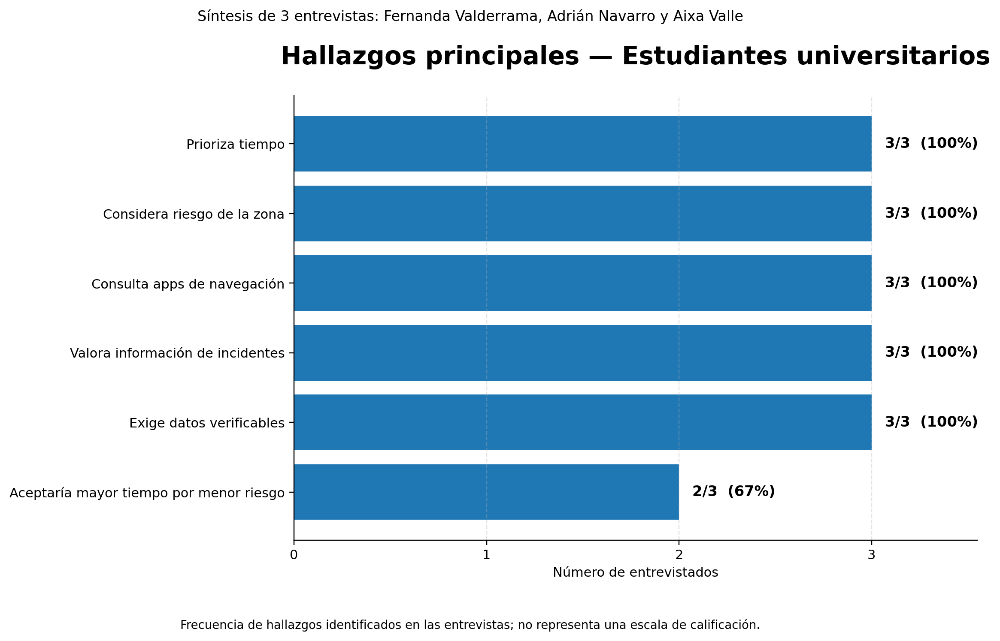
</p>

Los resultados muestran que los tres estudiantes consideran el tiempo al seleccionar sus recorridos, toman en cuenta el riesgo de las zonas, utilizan aplicaciones de navegación, valoran disponer de información sobre incidentes y consideran relevante la confiabilidad de los datos. Sin embargo, solo dos de los tres entrevistados manifestaron una disposición clara a aceptar un mayor tiempo de recorrido a cambio de una ruta con menor nivel de riesgo estimado. Esto demuestra que VSafe debe permitir al usuario comparar diferentes factores y tomar su propia decisión, en lugar de asumir que el menor riesgo será siempre su principal criterio.

#### Trabajadores urbanos

Las entrevistas realizadas a Zayda Preciado y Pedro Romano Preciado Carvajal muestran que el tiempo constituye un factor fundamental en sus desplazamientos laborales, ya que Zayda prioriza los recorridos que le permiten llegar más rápido y Pedro relaciona directamente el tiempo de viaje con su actividad como conductor de taxi y sus ganancias. Ambos utilizan Waze para apoyar sus desplazamientos, mientras que Zayda también emplea Google Maps para recorridos de mayor distancia. A pesar de priorizar el tiempo, los entrevistados modifican sus decisiones cuando identifican zonas o situaciones que consideran de mayor riesgo, especialmente durante la noche o al transitar por lugares desconocidos, y ambos manifestaron disposición a utilizar rutas alternativas de mayor duración para evitar zonas con mayor riesgo estimado. También se identificaron preocupaciones relacionadas con accidentes, congestión vehicular, rutas desconocidas y falta de información previa sobre las condiciones del recorrido. Asimismo, ambos consideran fundamental conocer la procedencia de los datos y que la información utilizada para estimar el riesgo sea verificable, confiable y se mantenga actualizada. Estos hallazgos respaldan que VSafe presente alternativas de recorrido considerando tiempo, distancia, incidentes y riesgo estimado, permitiendo que el usuario evalúe estos factores antes de seleccionar una ruta.

El siguiente gráfico presenta la frecuencia de los principales hallazgos identificados en las entrevistas realizadas hasta el momento a trabajadores urbanos.

<p align="center">
  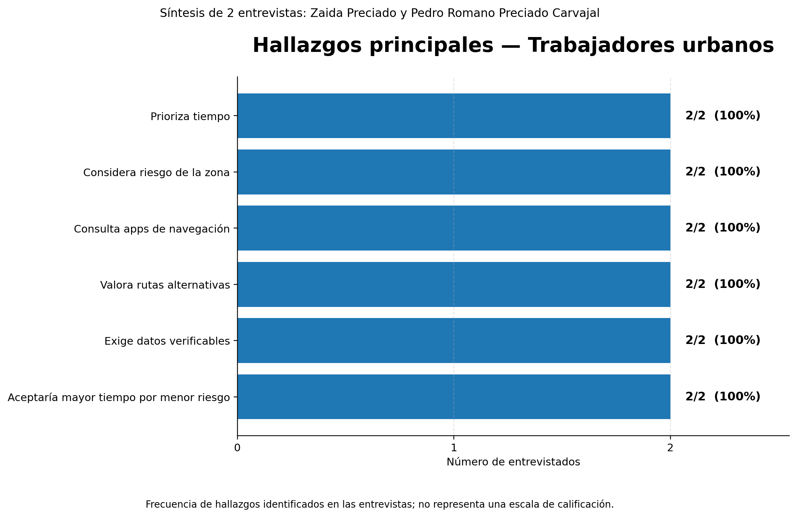
</p>

Los resultados actuales muestran coincidencias entre los trabajadores entrevistados respecto a la importancia del tiempo, la consideración del riesgo de las zonas, el uso de aplicaciones de navegación, la necesidad de rutas alternativas y la confiabilidad de la información. Ambos también manifestaron disposición a aceptar un recorrido de mayor duración cuando este permita evitar una zona que presente un mayor nivel de riesgo estimado.

En conjunto, los resultados de ambos segmentos evidencian que el tiempo continúa siendo un criterio fundamental en la planificación de los desplazamientos, pero no constituye el único factor considerado. El contexto del recorrido, el horario, el conocimiento previo de la zona, los incidentes registrados y el nivel de riesgo estimado pueden modificar la decisión del usuario. Estos hallazgos respaldan el enfoque de VSafe de presentar alternativas que permitan comparar tiempo, distancia y riesgo estimado, proporcionando información transparente para que cada usuario pueda tomar una decisión más informada sobre su recorrido.

## 2.3. Needfinding

### 2.3.1. User Personas

A partir de los segmentos objetivo definidos para VSafe, se plantean dos User Personas que representan a los principales tipos de usuarios de la solución. Estas personas permiten sintetizar sus objetivos, necesidades, motivaciones, frustraciones y comportamiento tecnológico relacionado con sus desplazamientos urbanos.

#### User Persona - Estudiante universitario

Este User Persona representa a estudiantes universitarios que realizan desplazamientos frecuentes entre su hogar, universidad y otros destinos de la ciudad. Su principal necesidad se relaciona con poder evaluar sus recorridos considerando no solo el tiempo y la distancia, sino también información sobre las zonas transitadas, especialmente cuando se movilizan por lugares desconocidos o en horarios nocturnos.

<p align="center">
  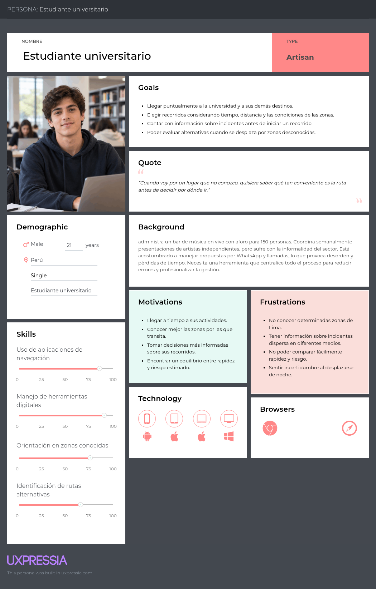
</p>

#### User Persona - Trabajador urbano

Este User Persona representa a trabajadores que se desplazan frecuentemente por diferentes zonas de la ciudad debido a sus actividades laborales. Sus recorridos pueden involucrar lugares desconocidos y diferentes horarios, por lo que requieren información que les permita comparar alternativas y tomar decisiones más informadas ante posibles incidentes o cambios durante el desplazamiento.

<p align="center">
  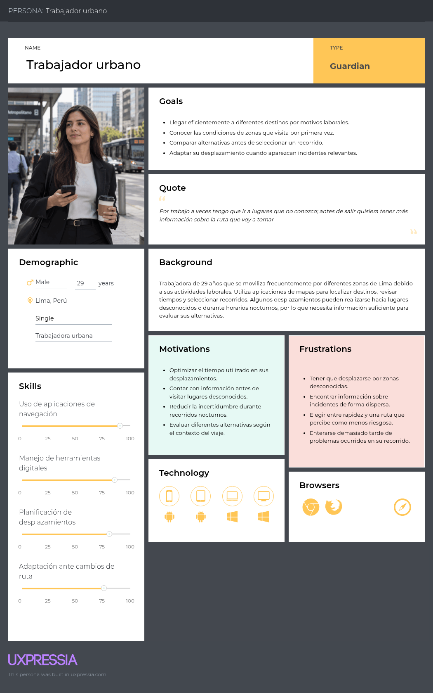
</p>

### 2.3.2. User Task Matrix

La User Task Matrix permite identificar y comparar las principales actividades que realizan los segmentos objetivo de VSafe durante sus desplazamientos urbanos. Para cada tarea se considera la frecuencia con la que se realiza y su nivel de importancia para cada tipo de usuario. Este análisis permite identificar las actividades que deben recibir mayor prioridad dentro de la solución.

| Tarea del usuario | Estudiante - Frecuencia | Estudiante - Importancia | Trabajador - Frecuencia | Trabajador - Importancia |
| --- | --- | --- | --- | --- |
| Definir origen y destino | Alta | Alta | Alta | Alta |
| Utilizar la ubicación actual como origen | Alta | Alta | Alta | Alta |
| Consultar rutas alternativas | Alta | Alta | Alta | Alta |
| Comparar tiempo y distancia entre rutas | Alta | Alta | Alta | Alta |
| Consultar el riesgo estimado de una ruta | Alta | Alta | Alta | Alta |
| Visualizar incidentes asociados al recorrido | Alta | Alta | Alta | Alta |
| Seleccionar una ruta considerando tiempo, distancia y riesgo estimado | Alta | Alta | Alta | Alta |
| Recibir alertas sobre incidentes durante el recorrido | Media | Alta | Alta | Alta |
| Solicitar una ruta alternativa ante un incidente | Media | Alta | Alta | Alta |
| Reportar un incidente observado | Media | Media | Media | Media |
| Consultar el estado de un reporte | Baja | Media | Baja | Media |
| Consultar recorridos anteriores | Media | Media | Alta | Media |

A partir de la matriz se observa que ambos segmentos comparten como tareas prioritarias la definición del recorrido, la consulta de rutas alternativas y la comparación de tiempo, distancia y riesgo estimado. Estas actividades constituyen el núcleo de la experiencia de VSafe y permiten que los usuarios dispongan de mayor información antes de seleccionar un recorrido.

En el caso del trabajador urbano, las alertas, la solicitud de rutas alternativas y la consulta de recorridos anteriores presentan una mayor frecuencia debido a que sus actividades laborales pueden requerir desplazamientos hacia diferentes zonas de la ciudad. Por otro lado, el estudiante universitario suele realizar recorridos más recurrentes entre su hogar, universidad y otros destinos habituales.

A partir de este análisis, las funcionalidades relacionadas con la planificación de rutas, estimación de riesgo, visualización de incidentes y comparación de alternativas representan actividades de alta prioridad para ambos segmentos y deberán considerarse dentro de las principales funcionalidades de VSafe.

### 2.3.3. Empathy Mapping

El Empathy Mapping permite comprender con mayor profundidad las necesidades, pensamientos, emociones, comportamientos y dificultades de los segmentos objetivo de VSafe. A partir de este análisis se identifican los principales factores que influyen en la manera en que estudiantes universitarios y trabajadores urbanos toman decisiones durante sus desplazamientos.

#### Empathy Mapping - Estudiante universitario

El mapa de empatía del estudiante universitario representa a usuarios que se desplazan frecuentemente entre su hogar, universidad y otros destinos de la ciudad. Este segmento busca llegar puntualmente a sus actividades y contar con información que le permita tomar decisiones más informadas, especialmente cuando debe transitar por zonas desconocidas o en determinados horarios.

Entre sus principales preocupaciones se encuentran la falta de información confiable sobre determinadas zonas, la dificultad para evaluar diferentes recorridos y la incertidumbre que puede generar desplazarse por lugares poco conocidos. Asimismo, suele recurrir a aplicaciones de navegación, recomendaciones de amigos o familiares, noticias y redes sociales para obtener información antes de desplazarse.

<p align="center">
  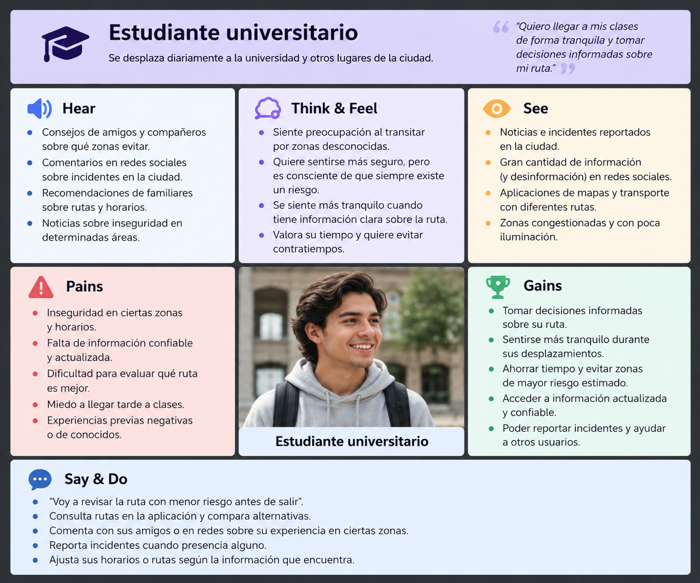
</p>

#### Empathy Mapping - Trabajador urbano

El mapa de empatía del trabajador urbano representa a personas que realizan desplazamientos frecuentes por motivos laborales y que pueden necesitar movilizarse hacia diferentes zonas de la ciudad. Para este segmento resulta importante optimizar el tiempo de traslado y disponer de información suficiente para evaluar las alternativas disponibles.

Sus principales dificultades se relacionan con el tráfico, los cambios inesperados durante el recorrido, la falta de información consolidada sobre incidentes y la incertidumbre al desplazarse hacia lugares poco conocidos. Debido a ello, consulta aplicaciones de navegación, alertas, noticias, recomendaciones y otras fuentes antes o durante sus recorridos.

<p align="center">
  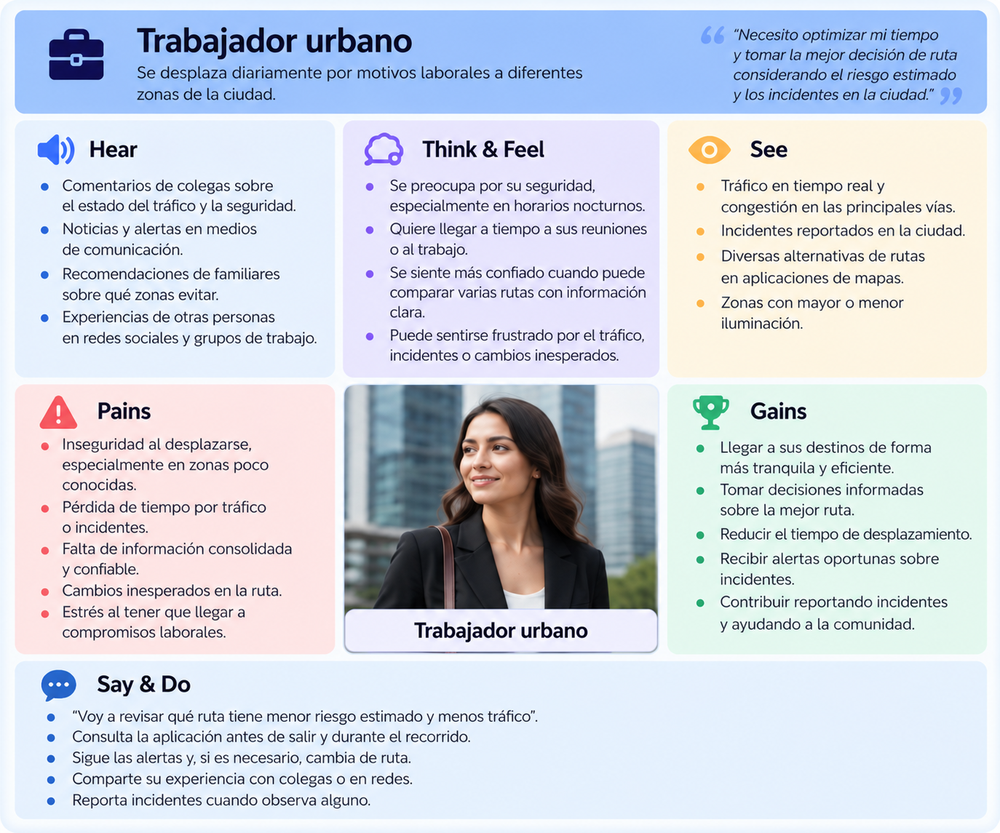
</p>

A partir de ambos mapas de empatía se identifica que los dos segmentos comparten la necesidad de acceder a información clara y actualizada antes de seleccionar un recorrido. Sin embargo, mientras el estudiante universitario presenta una mayor preocupación por sus desplazamientos habituales hacia la universidad y el cumplimiento de sus horarios académicos, el trabajador urbano requiere una mayor capacidad de adaptación debido a la variedad de destinos y situaciones que pueden presentarse durante sus actividades laborales.

### 2.3.4. As-is Scenario Mapping

#### As-Is Scenario Mapping - Estudiante universitario

El As-Is Scenario Mapping del estudiante universitario representa la experiencia actual de un estudiante que necesita desplazarse desde su hogar hacia la universidad u otros destinos relacionados con sus actividades académicas. El escenario permite identificar las acciones, pensamientos, emociones y dificultades que experimenta actualmente antes de contar con una solución como VSafe.

| Aspecto | Planificar | Buscar información | Evaluar | Desplazarse | Reaccionar |
| --- | --- | --- | --- | --- | --- |
| **Doing** | Define su destino y calcula a qué hora debe salir. | Consulta aplicaciones de mapas, redes sociales o recomendaciones de conocidos. | Compara rutas principalmente por tiempo y distancia. | Sigue la ruta seleccionada hacia la universidad. | Busca otra alternativa si encuentra un problema durante el recorrido. |
| **Thinking** | “Quiero llegar a tiempo a clases.” | “¿Por qué zona me conviene ir?” | “¿Cuál de estas rutas debería elegir?” | “Espero no encontrar problemas en el camino.” | “¿Por dónde puedo continuar?” |
| **Feeling** | Preocupación | Incertidumbre | Duda | Atención | Estrés |
| **Pain Points** | Debe equilibrar el tiempo disponible con sus preocupaciones sobre determinadas zonas. | La información sobre incidentes se encuentra dispersa entre diferentes fuentes. | No dispone de una comparación integrada entre tiempo, distancia e información sobre incidentes. | Puede encontrarse con situaciones que desconocía antes de iniciar el recorrido. | Debe buscar una alternativa mientras ya se encuentra desplazándose. |
| **Opportunities** | Facilitar la planificación previa del recorrido. | Centralizar información relevante sobre las zonas transitadas. | Facilitar la comparación de diferentes factores antes de seleccionar una ruta. | Proporcionar información contextual durante el recorrido. | Facilitar la evaluación de alternativas ante cambios o incidentes. |

#### As-Is Scenario Mapping - Trabajador urbano

El As-Is Scenario Mapping del trabajador urbano representa la experiencia actual de una persona que necesita desplazarse hacia diferentes destinos por motivos laborales, incluyendo lugares que conoce poco o recorridos realizados en determinados horarios. El escenario permite identificar las dificultades que enfrenta al planificar, seleccionar y modificar sus recorridos.

| Aspecto | Buscar destino | Investigar | Seleccionar | Desplazarse | Adaptarse |
| --- | --- | --- | --- | --- | --- |
| **Doing** | Busca la ubicación de su destino laboral. | Consulta mapas, tráfico, noticias y referencias disponibles sobre la zona. | Selecciona una ruta considerando principalmente tiempo y distancia. | Sigue las indicaciones proporcionadas por su aplicación de navegación. | Busca otra ruta cuando encuentra tráfico, incidentes u otros inconvenientes. |
| **Thinking** | “Necesito llegar puntual.” | “No conozco bien esta zona.” | “¿Cuál de estas rutas me conviene más?” | “¿Habrá algún problema más adelante?” | “Necesito encontrar otra ruta rápidamente.” |
| **Feeling** | Presión | Incertidumbre | Duda | Precaución | Estrés |
| **Pain Points** | Puede disponer de poco tiempo para planificar el desplazamiento. | Debe consultar distintas fuentes para conocer las condiciones de una zona. | No cuenta con información consolidada para evaluar el recorrido desde diferentes criterios. | Los cambios inesperados pueden afectar su tiempo de llegada. | Debe tomar una nueva decisión mientras se encuentra en movimiento. |
| **Opportunities** | Simplificar la planificación de desplazamientos laborales. | Consolidar información relevante sobre las zonas y recorridos. | Facilitar la comparación de alternativas utilizando información contextual. | Proporcionar información oportuna durante el desplazamiento. | Facilitar la búsqueda de alternativas ante situaciones inesperadas. |

## 2.4. Ubiquitous Language

El Ubiquitous Language de VSafe establece un vocabulario común para describir los principales conceptos del dominio de la solución. Su propósito es mantener una terminología consistente entre el equipo de desarrollo, los stakeholders, la documentación, los modelos de dominio y la implementación del software, reduciendo ambigüedades durante el desarrollo del proyecto.

| Término | Definición |
| --- | --- |
| **Usuario (User)** | Persona registrada o que utiliza VSafe para consultar información y planificar sus desplazamientos. |
| **Origen (Origin)** | Punto desde el cual el usuario desea iniciar un recorrido. Puede ser ingresado manualmente o determinado mediante su ubicación actual. |
| **Destino (Destination)** | Punto al cual el usuario desea llegar mediante un recorrido. |
| **Ubicación actual (Current Location)** | Posición geográfica actual del usuario obtenida mediante los servicios de geolocalización autorizados. |
| **Ruta (Route)** | Recorrido posible entre un origen y un destino que contiene información como distancia, duración e información contextual asociada. |
| **Ruta alternativa (Route Alternative)** | Opción adicional de recorrido entre el mismo origen y destino que puede diferir en tiempo, distancia y riesgo estimado. |
| **Ruta activa (Active Route)** | Ruta seleccionada por el usuario y utilizada durante un desplazamiento en curso. |
| **Comparación de rutas (Route Comparison)** | Proceso mediante el cual el usuario evalúa diferentes alternativas considerando tiempo, distancia, riesgo estimado e incidentes asociados. |
| **Incidente (Incident)** | Evento ocurrido en una ubicación determinada que puede ser relevante para evaluar las condiciones de una zona o recorrido. |
| **Reporte de incidente (Incident Report)** | Registro realizado por un usuario para comunicar la ocurrencia de un incidente observado. |
| **Categoría de incidente (Incident Category)** | Clasificación utilizada para identificar el tipo de incidente reportado. |
| **Ubicación del incidente (Incident Location)** | Posición geográfica asociada a un incidente registrado en la plataforma. |
| **Estado del reporte (Report Status)** | Situación actual de un reporte dentro de su proceso de registro y validación. |
| **Validez del reporte (Report Validity)** | Resultado del proceso mediante el cual se determina si un reporte puede considerarse válido para ser utilizado por la plataforma. |
| **Confiabilidad del reporte (Report Reliability)** | Nivel de confianza asignado a un reporte considerando la información disponible y los mecanismos de validación definidos por VSafe. |
| **Reporte duplicado (Duplicate Report)** | Reporte que representa un incidente previamente registrado en una ubicación y periodo similares. |
| **Riesgo (Risk)** | Concepto utilizado para representar la posibilidad de exposición a incidentes o condiciones desfavorables durante un recorrido. |
| **Estimación de riesgo (Risk Estimation)** | Proceso mediante el cual VSafe analiza la información disponible para estimar el nivel de riesgo asociado a una ruta o zona. |
| **Puntuación de riesgo (Risk Score)** | Valor generado por el proceso de estimación para representar cuantitativamente el riesgo asociado a una ruta o zona. |
| **Nivel de riesgo (Risk Level)** | Representación comprensible de la estimación de riesgo que permite al usuario interpretar y comparar diferentes alternativas. |
| **Incidente relevante (Relevant Incident)** | Incidente cuya ubicación, momento u otras características hacen que pueda afectar la evaluación de una ruta activa o alternativa. |
| **Alerta (Alert)** | Notificación presentada al usuario cuando se identifica información relevante relacionada con su recorrido. |
| **Recálculo de ruta (Route Recalculation)** | Proceso de obtención y evaluación de nuevas alternativas cuando cambian las condiciones del recorrido o el usuario solicita otra opción. |
| **Historial de recorridos (Route History)** | Registro de recorridos anteriores asociados a un usuario para su posterior consulta. |

# Capítulo III: Requirements Specification

## 3.1 To-Be Scenario Mapping

Los To-Be Scenario Maps representan la experiencia esperada después de incorporar VSafe al desplazamiento cotidiano. Para mantener correspondencia con los segmentos identificados, se consideran dos perfiles representativos: una persona que realiza recorridos frecuentes por estudio y una persona que se moviliza por trabajo, en ocasiones de noche o por zonas que no conoce. En ambos casos, el cambio principal consiste en pasar de elegir una ruta únicamente por tiempo o distancia a tomar una decisión informada mediante un nivel de riesgo estimado, incidentes cercanos y alertas contextualizadas.

### 3.1.1 Estudiante que se desplaza diariamente

**Objetivo del escenario:** llegar a la universidad mediante una ruta que mantenga un equilibrio aceptable entre duración y nivel de riesgo estimado.

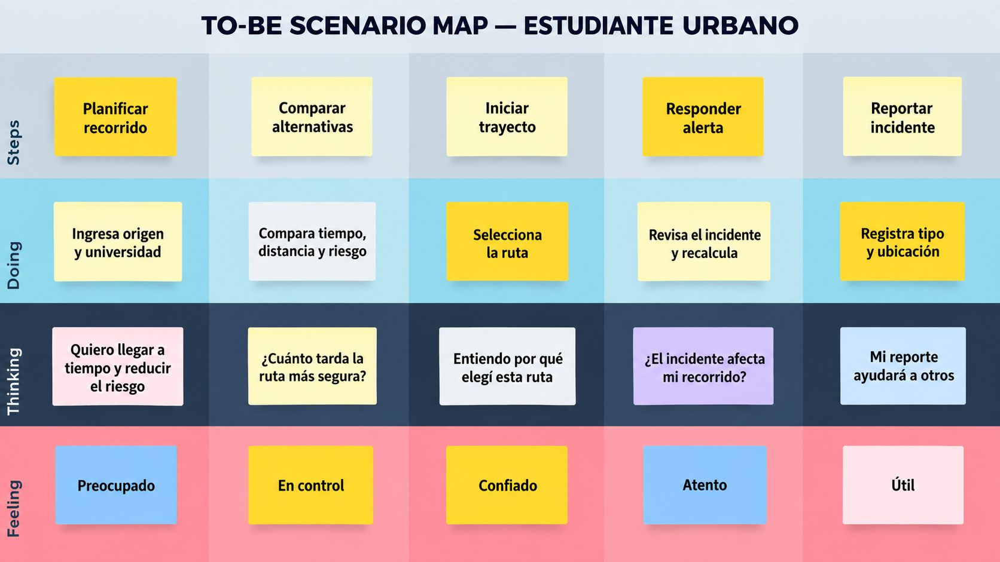

**Cambio frente a la situación actual:** la persona deja de depender únicamente de recomendaciones genéricas o de su conocimiento previo de la zona. VSafe centraliza la información necesaria para comparar alternativas y reaccionar ante incidentes que puedan afectar el recorrido.

### 3.1.2 Trabajador que transita por zonas desconocidas o en horario nocturno

**Objetivo del escenario:** completar un desplazamiento laboral con información actualizada sobre los posibles riesgos de las zonas atravesadas.

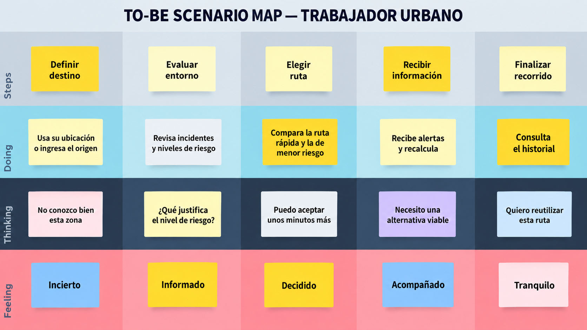

**Cambio frente a la situación actual:** la planificación deja de ser una decisión estática tomada antes de salir. VSafe acompaña el recorrido con información contextual, permite reconsiderar la ruta y conserva un historial útil para futuros desplazamientos.

## 3.2 User Stories

Las historias de usuario convierten las necesidades identificadas en capacidades verificables para el Landing Page y la aplicación de VSafe. También se incluyen historias técnicas para los servicios que calculan el riesgo, consultan incidentes y protegen los datos de ubicación. Los criterios de aceptación están redactados en formato Gherkin y evitan depender de una implementación visual específica.

### 3.2.1 Epics

| Epic ID | Título | Descripción |
|---|---|---|
| **EP01** | Descubrimiento de VSafe | Comunicar la propuesta de valor y conducir a los visitantes desde el Landing Page hacia la experiencia principal. |
| **EP02** | Planificación de rutas informadas | Permitir que las personas definan un recorrido, comparen alternativas y elijan considerando tiempo, distancia y riesgo estimado. |
| **EP03** | Acompañamiento durante el recorrido | Informar sobre incidentes relevantes y ofrecer alternativas cuando cambien las condiciones del trayecto. |
| **EP04** | Colaboración comunitaria | Facilitar el registro de incidentes y aprovechar los aportes de la comunidad para mantener actualizada la información. |
| **EP05** | Inteligencia y confianza de la plataforma | Proveer capacidades técnicas para calcular el riesgo, procesar información geoespacial, validar reportes y tratar responsablemente los datos de ubicación. |

### 3.2.2 Historias de usuario y técnicas

| Epic / User Story ID | Título | Descripción | Criterios de aceptación | Relacionado con |
|---|---|---|---|---|
| **EP01** | Descubrimiento de VSafe | Como visitante, deseo conocer la propuesta de VSafe para decidir si puede ayudarme en mis desplazamientos. | No aplica a nivel de Epic. | — |
| **US01** | Comprender la propuesta de valor | Como visitante, deseo conocer qué problema resuelve VSafe para evaluar su utilidad. | **Escenario 1:** Dado que el visitante accede al Landing Page, cuando consulta la presentación del producto, entonces comprende que VSafe compara rutas mediante tiempo, distancia y riesgo estimado.<br><br>**Escenario 2:** Dado que el visitante revisa la propuesta, cuando consulta los beneficios, entonces identifica la visualización de incidentes, las alertas y los reportes comunitarios. | EP01 |
| **US02** | Conocer las capacidades principales | Como visitante, deseo revisar las principales capacidades de VSafe para entender cómo puede acompañar mi recorrido. | **Escenario 1:** Dado que el visitante explora el contenido informativo, cuando revisa las capacidades, entonces encuentra la búsqueda de rutas, la comparación de alternativas, los incidentes y las alertas.<br><br>**Escenario 2:** Dado que el visitante necesita más contexto, cuando consulta una capacidad, entonces recibe una explicación coherente con el propósito de seguridad urbana de VSafe. | EP01 |
| **US03** | Acceder a la aplicación | Como visitante, deseo ingresar a la aplicación desde el Landing Page para comenzar a planificar un recorrido. | **Escenario 1:** Dado que el visitante decide utilizar VSafe, cuando solicita comenzar, entonces accede al punto de entrada de la aplicación.<br><br>**Escenario 2:** Dado que el acceso no está disponible, cuando el visitante intenta continuar, entonces recibe información clara sobre la indisponibilidad. | EP01 |
| **EP02** | Planificación de rutas informadas | Como usuario, deseo comparar rutas con información de riesgo para elegir una alternativa adecuada a mis necesidades. | No aplica a nivel de Epic. | — |
| **US04** | Definir origen y destino | Como usuario, deseo indicar mi origen y destino para solicitar alternativas de recorrido. | **Escenario 1:** Dado que el usuario proporciona un origen y un destino válidos, cuando solicita rutas, entonces el sistema procesa ambos puntos.<br><br>**Escenario 2:** Dado que falta uno de los puntos o no puede identificarse, cuando el usuario solicita rutas, entonces el sistema informa qué dato debe corregirse. | EP02 |
| **US05** | Utilizar la ubicación actual | Como usuario, deseo utilizar mi ubicación actual como origen para iniciar una búsqueda con menor esfuerzo. | **Escenario 1:** Dado que el usuario autoriza el acceso a su ubicación, cuando selecciona usarla como origen, entonces el sistema registra la posición disponible.<br><br>**Escenario 2:** Dado que el usuario no autoriza o no dispone de ubicación, cuando intenta utilizarla, entonces el sistema permite ingresar el origen manualmente. | EP02 |
| **US06** | Visualizar rutas alternativas | Como usuario, deseo recibir diferentes alternativas de ruta para no depender de una única opción. | **Escenario 1:** Dado que existen recorridos disponibles, cuando finaliza el cálculo, entonces el sistema presenta más de una alternativa cuando las condiciones lo permiten.<br><br>**Escenario 2:** Dado que solo existe una alternativa válida, cuando finaliza el cálculo, entonces el sistema presenta esa ruta e informa la limitación. | EP02 |
| **US07** | Comparar tiempo distancia y riesgo | Como usuario, deseo comparar las rutas por duración, distancia y nivel de riesgo estimado para tomar una decisión informada. | **Escenario 1:** Dado que se obtuvieron rutas alternativas, cuando el usuario las compara, entonces cada alternativa presenta duración, distancia y riesgo estimado bajo criterios consistentes.<br><br>**Escenario 2:** Dado que falta información suficiente para estimar el riesgo, cuando se muestra la ruta afectada, entonces el sistema comunica la incertidumbre sin presentar el valor como concluyente. | EP02 |
| **US08** | Seleccionar una ruta | Como usuario, deseo elegir una de las alternativas para iniciar el recorrido que mejor se adapte a mis prioridades. | **Escenario 1:** Dado que el usuario revisó las alternativas, cuando selecciona una ruta, entonces el sistema la establece como recorrido activo.<br><br>**Escenario 2:** Dado que cambian los datos antes del inicio, cuando la ruta seleccionada deja de estar disponible, entonces el sistema solicita elegir una alternativa vigente. | EP02 |
| **US09** | Consultar incidentes del recorrido | Como usuario, deseo conocer los incidentes cercanos a las rutas para comprender el contexto del riesgo estimado. | **Escenario 1:** Dado que existen incidentes relevantes, cuando el usuario consulta una ruta, entonces el sistema presenta su tipo, ubicación aproximada y vigencia.<br><br>**Escenario 2:** Dado que no existen incidentes relevantes registrados, cuando el usuario consulta la ruta, entonces el sistema comunica que no se encontraron reportes aplicables sin afirmar que la zona carece de riesgo. | EP02 |
| **EP03** | Acompañamiento durante el recorrido | Como usuario en desplazamiento, deseo recibir información relevante para reaccionar ante cambios que afecten la ruta seleccionada. | No aplica a nivel de Epic. | — |
| **US10** | Recibir alertas de incidentes | Como usuario, deseo recibir alertas sobre incidentes relevantes cercanos a mi ruta para evaluar oportunamente si debo modificarla. | **Escenario 1:** Dado que existe un recorrido activo, cuando aparece un incidente relevante dentro del área evaluada, entonces el sistema informa al usuario sobre la situación.<br><br>**Escenario 2:** Dado que un incidente no afecta el recorrido activo, cuando es procesado, entonces el sistema evita generar una alerta innecesaria. | EP03 |
| **US11** | Solicitar una ruta alternativa | Como usuario, deseo recalcular mi recorrido después de una alerta para continuar por una alternativa disponible. | **Escenario 1:** Dado que el usuario recibe una alerta, cuando solicita recalcular, entonces el sistema evalúa rutas vigentes desde su posición disponible.<br><br>**Escenario 2:** Dado que no existe una alternativa, cuando finaliza el recálculo, entonces el sistema informa la situación sin ocultar el incidente detectado. | EP03 |
| **US12** | Consultar recorridos anteriores | Como usuario, deseo revisar mis rutas consultadas anteriormente para reutilizar información en desplazamientos similares. | **Escenario 1:** Dado que existen consultas anteriores, cuando el usuario accede a su historial, entonces el sistema presenta los datos esenciales de cada recorrido.<br><br>**Escenario 2:** Dado que no existen consultas anteriores, cuando el usuario accede al historial, entonces el sistema informa que todavía no hay recorridos registrados. | EP03 |
| **EP04** | Colaboración comunitaria | Como miembro de la comunidad, deseo registrar incidentes para aportar información útil a otros usuarios. | No aplica a nivel de Epic. | — |
| **US13** | Registrar un incidente | Como usuario, deseo reportar un incidente observado para contribuir con información sobre el entorno urbano. | **Escenario 1:** Dado que el usuario dispone de los datos requeridos, cuando envía el reporte, entonces el sistema lo registra para su procesamiento.<br><br>**Escenario 2:** Dado que falta información requerida, cuando el usuario intenta enviar el reporte, entonces el sistema identifica los datos pendientes. | EP04 |
| **US14** | Clasificar el incidente | Como usuario, deseo indicar el tipo de incidente para que otras personas comprendan la situación reportada. | **Escenario 1:** Dado que el usuario crea un reporte, cuando selecciona una categoría válida, entonces el sistema asocia esa categoría al incidente.<br><br>**Escenario 2:** Dado que ninguna categoría representa lo ocurrido, cuando el usuario elige la opción correspondiente, entonces puede proporcionar una descripción complementaria. | EP04 |
| **US15** | Confirmar la ubicación del reporte | Como usuario, deseo confirmar la ubicación aproximada del incidente para evitar que el reporte afecte zonas incorrectas. | **Escenario 1:** Dado que existe una ubicación disponible, cuando el usuario la confirma, entonces el sistema la asocia al reporte.<br><br>**Escenario 2:** Dado que la ubicación detectada no corresponde al incidente, cuando el usuario la corrige, entonces el sistema conserva la ubicación confirmada. | EP04 |
| **US16** | Conocer el estado del reporte | Como usuario, deseo conocer el estado de mis reportes para saber si fueron incorporados a la información de la plataforma. | **Escenario 1:** Dado que el usuario registró un incidente, cuando consulta sus reportes, entonces el sistema muestra el estado vigente de cada uno.<br><br>**Escenario 2:** Dado que el estado de un reporte cambia, cuando el usuario vuelve a consultarlo, entonces el sistema presenta el estado actualizado. | EP04 |
| **EP05** | Inteligencia y confianza de la plataforma | Como equipo de desarrollo, deseamos procesar rutas e incidentes de forma consistente para ofrecer información útil y responsable. | No aplica a nivel de Epic. | — |
| **TS01** | Consultar información geoespacial | Como desarrollador, deseo disponer de un servicio que obtenga rutas e incidentes aplicables para construir las alternativas de recorrido. | **Escenario 1:** Dado un origen y un destino válidos, cuando el servicio recibe la solicitud, entonces devuelve las alternativas disponibles con sus datos geoespaciales.<br><br>**Escenario 2:** Dado que una fuente no responde, cuando se procesa la solicitud, entonces el servicio devuelve un estado controlado y registra la incidencia técnica. | EP05 |
| **TS02** | Estimar el riesgo de una ruta | Como desarrollador, deseo disponer de un servicio de estimación de riesgo para comparar rutas bajo un criterio consistente. | **Escenario 1:** Dada una ruta y la información disponible de incidentes, cuando se solicita una estimación, entonces el servicio devuelve un nivel de riesgo y la vigencia de los datos utilizados.<br><br>**Escenario 2:** Dado que la información es insuficiente, cuando se solicita una estimación, entonces el servicio devuelve un resultado identificado como incierto. | EP05 |
| **TS03** | Procesar la confiabilidad de reportes | Como desarrollador, deseo validar los reportes comunitarios para reducir información duplicada, inconsistente o desactualizada. | **Escenario 1:** Dado que ingresa un reporte, cuando coincide con otro incidente próximo en tipo, espacio y tiempo, entonces el servicio lo identifica como posible duplicado.<br><br>**Escenario 2:** Dado que un reporte supera su periodo de vigencia, cuando se actualiza la información, entonces deja de influir como incidente activo. | EP05 |
| **TS04** | Proteger datos de ubicación | Como desarrollador, deseo limitar el tratamiento de la ubicación a lo necesario para que VSafe gestione la información de manera responsable. | **Escenario 1:** Dado que una función necesita la ubicación, cuando solicita acceso, entonces utiliza únicamente los datos autorizados para esa finalidad.<br><br>**Escenario 2:** Dado que el usuario no autoriza la ubicación, cuando utiliza una función compatible, entonces puede continuar mediante el ingreso manual de datos. | EP05 |

## 3.3 Impact Mapping

El Impact Mapping conecta los resultados de negocio de VSafe con los comportamientos esperados de sus usuarios y con las capacidades que debe entregar el producto. Las metas se formulan para una etapa piloto del MVP y deberán revisarse con evidencia real una vez que se establezcan la fecha de lanzamiento y una línea base de uso.

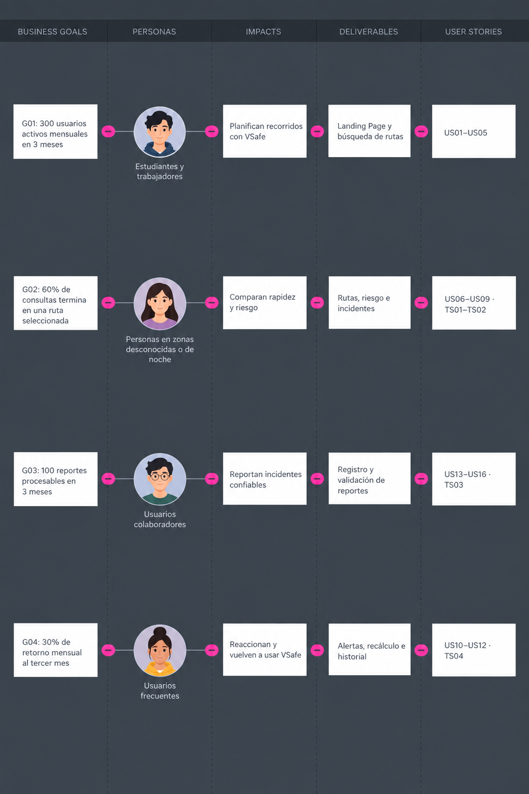

La siguiente tabla conserva el detalle textual y la trazabilidad del mapa:

| Goal | Actor | Impacto esperado | Deliverable | User Stories relacionadas |
|---|---|---|---|---|
| **G01. Alcanzar 300 usuarios activos mensuales al finalizar los primeros tres meses del piloto del MVP.** | Estudiantes y trabajadores que realizan desplazamientos frecuentes. | Incorporan VSafe a la planificación de recorridos cotidianos. | Landing Page con propuesta de valor clara y acceso a la aplicación. | US01, US02, US03 |
| G01 | Estudiantes y trabajadores que realizan desplazamientos frecuentes. | Consultan VSafe antes de iniciar un recorrido. | Búsqueda mediante origen, destino y ubicación actual. | US04, US05 |
| **G02. Lograr que al menos el 60 % de las consultas válidas del piloto termine en la selección de una ruta durante sus primeras ocho semanas.** | Personas que transitan por zonas desconocidas o en horario nocturno. | Comparan explícitamente rapidez y riesgo antes de elegir. | Alternativas de ruta con duración, distancia y riesgo estimado. | US06, US07, TS01, TS02 |
| G02 | Personas que transitan por zonas desconocidas o en horario nocturno. | Revisan el contexto del riesgo antes de comenzar. | Consulta de incidentes relevantes asociados al recorrido. | US08, US09 |
| **G03. Conseguir 100 reportes comunitarios procesables durante los primeros tres meses del piloto.** | Usuarios dispuestos a contribuir con la comunidad. | Registran incidentes con información suficiente y una ubicación confirmada. | Flujo de reporte con categoría, descripción y ubicación aproximada. | US13, US14, US15 |
| G03 | Usuarios que ya enviaron reportes. | Consultan el resultado de su contribución y vuelven a reportar cuando corresponde. | Seguimiento del estado de reportes. | US16, TS03 |
| **G04. Alcanzar una tasa de retorno mensual del 30 % al cierre del tercer mes del piloto.** | Usuarios con recorridos frecuentes. | Mantienen VSafe disponible durante el desplazamiento y reaccionan a información nueva. | Alertas relevantes y recálculo de alternativas. | US10, US11 |
| G04 | Usuarios con recorridos frecuentes. | Reutilizan información de recorridos anteriores. | Historial de rutas consultadas. | US12 |
| G04 | Todos los usuarios de VSafe. | Mantienen confianza en el tratamiento de su información de ubicación. | Controles de autorización y uso limitado de datos de ubicación. | TS04 |

La cadena de impacto prioriza primero la comprensión de la propuesta de valor y la planificación de rutas, ya que ambas capacidades permiten validar el beneficio central de VSafe. Después se incorporan las alertas y la participación comunitaria, que aumentan el valor recurrente de la plataforma y mejoran progresivamente la información disponible.

## 3.4 Product Backlog

| Orden | User Story ID | Título | Descripción resumida | Story Points |
|---:|---|---|---|---:|
| 1 | US01 | Comprender la propuesta de valor | Explicar el problema, el enfoque y los beneficios de VSafe. | 3 |
| 2 | US02 | Conocer las capacidades principales | Presentar rutas, incidentes, alertas y colaboración comunitaria. | 3 |
| 3 | US03 | Acceder a la aplicación | Conectar el Landing Page con la experiencia principal. | 2 |
| 4 | US04 | Definir origen y destino | Registrar los puntos necesarios para calcular un recorrido. | 5 |
| 5 | US05 | Utilizar la ubicación actual | Permitir el uso autorizado de la posición como origen. | 3 |
| 6 | TS01 | Consultar información geoespacial | Obtener alternativas de ruta e incidentes aplicables. | 8 |
| 7 | US06 | Visualizar rutas alternativas | Presentar diferentes recorridos cuando estén disponibles. | 5 |
| 8 | TS02 | Estimar el riesgo de una ruta | Calcular un nivel de riesgo e informar la vigencia o incertidumbre. | 13 |
| 9 | US07 | Comparar tiempo distancia y riesgo | Facilitar una comparación consistente entre rutas. | 5 |
| 10 | US09 | Consultar incidentes del recorrido | Explicar el contexto asociado al riesgo estimado. | 5 |
| 11 | US08 | Seleccionar una ruta | Establecer una alternativa como recorrido activo. | 3 |
| 12 | US10 | Recibir alertas de incidentes | Informar cambios relevantes durante el trayecto. | 8 |
| 13 | US11 | Solicitar una ruta alternativa | Recalcular el recorrido después de una alerta. | 8 |
| 14 | US13 | Registrar un incidente | Recibir aportes de información de la comunidad. | 5 |
| 15 | US14 | Clasificar el incidente | Asociar el reporte con un tipo comprensible. | 3 |
| 16 | US15 | Confirmar la ubicación del reporte | Evitar que el incidente se asocie a una zona incorrecta. | 3 |
| 17 | TS03 | Procesar la confiabilidad de reportes | Identificar duplicados y controlar la vigencia de los incidentes. | 8 |
| 18 | US16 | Conocer el estado del reporte | Comunicar si el aporte fue procesado por la plataforma. | 5 |
| 19 | US12 | Consultar recorridos anteriores | Permitir la reutilización de información de rutas consultadas. | 3 |
| 20 | TS04 | Proteger datos de ubicación | Limitar el uso de la ubicación a finalidades autorizadas. | 5 |

<div style="break-before: page; page-break-before: always;"></div>

# Capítulo IV: Strategic-Level Software Design

VSafe es una plataforma de navegación urbana orientada a estudiantes universitarios y trabajadores que necesitan planificar sus desplazamientos considerando tiempo, distancia y nivel de riesgo estimado. Su propuesta integra información geoespacial, reportes comunitarios y estimación de riesgo para facilitar decisiones informadas antes y durante un recorrido.

El presente capítulo establece el diseño estratégico de la solución mediante Attribute-Driven Design, Strategic Domain-Driven Design y el modelo C4. Se identifican las funcionalidades con mayor impacto arquitectónico, se especifican escenarios de calidad, se evalúan alternativas de diseño y se delimitan las responsabilidades de los principales contextos del dominio.

La arquitectura de VSafe se basa en microservicios, de acuerdo con el requisito del proyecto. Route Planning, Risk Assessment, Incident Reporting y Journey Alerts se implementan como servicios ejecutables y desplegables de forma independiente, cada uno con datos propios y contratos explícitos. Un API Gateway expone el acceso de la aplicación y RabbitMQ transporta los eventos de integración. Esta estructura mantiene la trazabilidad entre requisitos, reglas del negocio y elementos de la solución.

## 4.1. Strategic-Level Attribute-Driven Design

Attribute-Driven Design permite orientar la arquitectura a partir de requisitos funcionales, atributos de calidad y restricciones. En VSafe, este enfoque se utiliza para determinar cómo obtener alternativas de recorrido, estimar su riesgo, procesar reportes y comunicar cambios relevantes sin comprometer la privacidad de los usuarios.

El Quality Attribute Workshop sirve como referencia para identificar, priorizar y refinar escenarios. Posteriormente, las iteraciones de diseño permiten evaluar tácticas y patrones capaces de responder a esos escenarios. [Wojcik et al., 2006](https://www.sei.cmu.edu/library/attribute-driven-design-add-version-20/); [Barbacci et al., 2003](https://www.sei.cmu.edu/library/quality-attribute-workshops-qaws-third-edition/).

### 4.1.1. Design Purpose

El propósito del diseño arquitectónico de VSafe es establecer una estructura que permita ofrecer alternativas de desplazamiento con información comprensible, oportuna y consistente sobre duración, distancia y riesgo estimado.

La problemática identificada en los capítulos anteriores requiere integrar información que suele encontrarse distribuida entre herramientas cartográficas, datos de incidentes y experiencias de los propios usuarios. Por ello, la arquitectura debe facilitar la integración de estas fuentes y permitir que sus limitaciones sean visibles durante la comparación de rutas.

El diseño se orienta a los siguientes objetivos:

1. Permitir la consulta y comparación de alternativas de recorrido.
2. Separar el cálculo cartográfico de la estimación de riesgo.
3. Procesar reportes comunitarios mediante reglas de consistencia, duplicidad y vigencia.
4. Informar incidentes pertinentes durante un recorrido activo.
5. Mantener una respuesta controlada ante fallos de servicios externos.
6. Proteger los datos de ubicación y limitar su almacenamiento.
7. Facilitar cambios de proveedores, reglas y modelos sin afectar innecesariamente toda la solución.

Estos objetivos se relacionan con las metas del capítulo III:

| Objetivo de negocio | Relación con el diseño arquitectónico |
|---|---|
| **G01:** alcanzar 300 usuarios activos mensuales al finalizar los primeros tres meses del piloto. | Requiere una experiencia accesible y una plataforma operativa para consultar recorridos. |
| **G02:** conseguir que al menos el 60 % de las consultas válidas termine en la selección de una ruta durante las primeras ocho semanas. | Requiere alternativas comparables, respuestas oportunas y una presentación clara del riesgo y su incertidumbre. |
| **G03:** obtener 100 reportes comunitarios procesables durante los primeros tres meses. | Requiere recepción confiable, validación y seguimiento de los reportes. |
| **G04:** alcanzar una tasa de retorno mensual del 30 % al cierre del tercer mes. | Requiere alertas pertinentes, reutilización de recorridos y confianza en el tratamiento de la información. |

Para concretar el diseño se propone el siguiente alcance inicial:

| Aspecto | Alcance propuesto |
|---|---|
| Productos digitales | Landing Page, aplicación web adaptable a dispositivos móviles, API Gateway y cuatro microservicios de negocio. |
| Estilo arquitectónico | Microservicios con despliegue independiente, base de datos por servicio y comunicación mediante HTTP y eventos. |
| Segmentos principales | Estudiantes universitarios y trabajadores urbanos. |
| Cobertura inicial | Zonas de Lima Metropolitana habilitadas mediante configuración. La cobertura cartográfica y la cobertura de datos de riesgo se evaluarán por separado. |
| Modalidad de desplazamiento | Recorridos peatonales. La incorporación de transporte público o navegación vehicular requerirá ampliar los requisitos. |
| Alertas | Disponibles durante un recorrido activo, mientras la aplicación esté visible y conectada. |
| Acceso | Sesión anónima asociada al navegador, sin registro obligatorio en el MVP. |
| Historial | Almacenamiento local y optativo en el navegador. |
| Estimación de riesgo | Modelo de aprendizaje automático versionado, sujeto a disponibilidad de datos y validación. |
| Capacidad de referencia | Pruebas con 50 sesiones simultáneas, 5 consultas de rutas por segundo y 100 000 incidentes de prueba. |

Los valores de capacidad son hipótesis técnicas para evaluar la solución. No representan demanda observada ni se deducen directamente de la cantidad de usuarios activos mensuales.

### 4.1.2. Attribute-Driven Design Inputs

Las entradas del proceso de diseño se clasifican en tres grupos:

- Funcionalidades principales que afectan la organización de la solución.
- Escenarios de atributos de calidad que establecen condiciones verificables.
- Restricciones impuestas por la guía y el requisito del proyecto de utilizar microservicios.

Se conservan los identificadores de las historias del capítulo III para mantener trazabilidad entre requisitos y arquitectura.

#### 4.1.2.1. Primary Functionality (Primary User Stories)

Se seleccionan las historias que requieren integración geoespacial, estimación de riesgo, procesamiento de reportes, comunicación de alertas y protección de datos.

Las historias del Landing Page mantienen su importancia comercial, pero no determinan la descomposición principal del dominio.

| Epic / User Story ID | Título | Descripción | Criterios de aceptación | Epic ID |
|---|---|---|---|---|
| **US06** | Visualizar rutas alternativas | Como usuario, deseo recibir diferentes alternativas de ruta para no depender de una única opción. | **Escenario 1:** Dado que existen recorridos disponibles, cuando finaliza el cálculo, entonces el sistema presenta más de una alternativa cuando las condiciones lo permiten.<br><br>**Escenario 2:** Dado que solo existe una alternativa válida, cuando finaliza el cálculo, entonces presenta esa ruta e informa la limitación. | EP02 |
| **US07** | Comparar tiempo, distancia y riesgo | Como usuario, deseo comparar las rutas por duración, distancia y nivel de riesgo estimado para tomar una decisión informada. | **Escenario 1:** Dado que se obtuvieron alternativas, cuando el usuario las compara, entonces cada una presenta duración, distancia y riesgo estimado bajo criterios consistentes.<br><br>**Escenario 2:** Dado que falta información suficiente, cuando se muestra una ruta, entonces el sistema comunica la incertidumbre. | EP02 |
| **US09** | Consultar incidentes del recorrido | Como usuario, deseo conocer los incidentes cercanos a las rutas para comprender el contexto del riesgo estimado. | **Escenario 1:** Dado que existen incidentes relevantes, cuando se consulta una ruta, entonces el sistema presenta tipo, ubicación aproximada y vigencia.<br><br>**Escenario 2:** Dado que no existen reportes aplicables, cuando se consulta la ruta, entonces informa esta condición sin afirmar que la zona carece de riesgo. | EP02 |
| **US10** | Recibir alertas de incidentes | Como usuario, deseo recibir alertas sobre incidentes relevantes cercanos a mi ruta para evaluar si debo modificarla. | **Escenario 1:** Dado un recorrido activo, cuando aparece un incidente pertinente, entonces el sistema informa al usuario.<br><br>**Escenario 2:** Dado que el incidente no afecta el recorrido, cuando se procesa, entonces evita generar una alerta innecesaria. | EP03 |
| **US11** | Solicitar una ruta alternativa | Como usuario, deseo recalcular mi recorrido después de una alerta para continuar por una alternativa disponible. | **Escenario 1:** Dado que el usuario recibe una alerta, cuando solicita recalcular, entonces el sistema evalúa rutas vigentes desde su posición disponible.<br><br>**Escenario 2:** Dado que no existe una alternativa, cuando termina el cálculo, entonces informa la situación sin ocultar el incidente. | EP03 |
| **US12** | Consultar recorridos anteriores | Como usuario, deseo revisar mis rutas consultadas anteriormente para reutilizar información en desplazamientos similares. | **Escenario 1:** Dado que existen consultas anteriores, cuando se accede al historial, entonces se presentan sus datos esenciales.<br><br>**Escenario 2:** Dado que no existen consultas, cuando se accede al historial, entonces se informa que no hay recorridos registrados. | EP03 |
| **US13** | Registrar un incidente | Como usuario, deseo reportar un incidente observado para contribuir con información sobre el entorno urbano. | **Escenario 1:** Dados los datos requeridos, cuando el usuario envía el reporte, entonces se registra para procesamiento.<br><br>**Escenario 2:** Dado que falta información, cuando intenta enviarlo, entonces el sistema identifica los datos pendientes. | EP04 |
| **US15** | Confirmar la ubicación del reporte | Como usuario, deseo confirmar la ubicación aproximada del incidente para evitar que afecte zonas incorrectas. | **Escenario 1:** Dada una ubicación disponible, cuando el usuario la confirma, entonces se asocia al reporte.<br><br>**Escenario 2:** Dado que la posición detectada es incorrecta, cuando el usuario la corrige, entonces se conserva la ubicación confirmada. | EP04 |
| **TS01** | Consultar información geoespacial | Como desarrollador, deseo disponer de un servicio que obtenga rutas e incidentes aplicables para construir alternativas de recorrido. | **Escenario 1:** Dados origen y destino válidos, cuando se recibe la solicitud, entonces se devuelven alternativas con sus datos geoespaciales.<br><br>**Escenario 2:** Dado que una fuente no responde, cuando se procesa la solicitud, entonces se devuelve un estado controlado y se registra la incidencia técnica. | EP05 |
| **TS02** | Estimar el riesgo de una ruta | Como desarrollador, deseo disponer de un servicio de estimación de riesgo para comparar rutas bajo un criterio consistente. | **Escenario 1:** Dada una ruta e información de incidentes, cuando se solicita una estimación, entonces se devuelve un nivel de riesgo y la vigencia de los datos.<br><br>**Escenario 2:** Dada información insuficiente, cuando se solicita una estimación, entonces se devuelve un resultado identificado como incierto. | EP05 |
| **TS03** | Procesar la confiabilidad de reportes | Como desarrollador, deseo validar reportes comunitarios para reducir información duplicada, inconsistente o desactualizada. | **Escenario 1:** Dado un reporte coincidente en tipo, espacio y tiempo con otro incidente, cuando se procesa, entonces se identifica como posible duplicado.<br><br>**Escenario 2:** Dado que un reporte supera su vigencia, cuando se actualiza la información, entonces deja de influir como incidente activo. | EP05 |
| **TS04** | Proteger datos de ubicación | Como desarrollador, deseo limitar el tratamiento de la ubicación a lo necesario para gestionar la información responsablemente. | **Escenario 1:** Dada una función que necesita ubicación, cuando solicita acceso, entonces utiliza únicamente los datos autorizados para esa finalidad.<br><br>**Escenario 2:** Dada la ausencia de autorización, cuando se utiliza una función compatible, entonces permite continuar mediante ingreso manual. | EP05 |

US04, US05 y US08 completan el flujo de definición, ubicación y selección de ruta. US14 y US16 completan la clasificación y consulta del estado de los reportes. Estas historias se incorporan a la distribución de responsabilidades presentada en la sección 4.2.

#### 4.1.2.2. Quality Attribute Scenarios

Los escenarios iniciales concretan las condiciones que debe satisfacer la solución. Sus métricas constituyen objetivos propuestos que deberán verificarse durante la implementación.

| Atributo | Fuente | Estímulo | Artefacto | Entorno | Respuesta | Medida |
|---|---|---|---|---|---|---|
| **QA01. Eficiencia de desempeño** | Estudiante o trabajador. | Solicita alternativas entre dos puntos válidos. | Consulta de rutas y estimador. | Carga de referencia; proveedor operativo. | Devuelve alternativas con sus datos y estimación o incertidumbre. | p95 ≤ 4 s; p99 ≤ 6 s; éxito técnico ≥ 99 %. |
| **QA02. Oportunidad de alertas** | Gestión de incidentes. | Publica un incidente pertinente. | Procesamiento de eventos y alertas. | 50 recorridos activos; aplicación visible y conectada. | Muestra una alerta por incidente y versión de recorrido. | p95 ≤ 15 s desde publicación hasta visualización; cero duplicados en pruebas. |
| **QA03. Tolerancia a fallos externos** | Proveedor cartográfico. | No responde o devuelve un error. | Adaptador cartográfico. | Dependencia degradada. | Limita la espera e informa indisponibilidad. | 100 % de fallos controlados en ≤ 4 s; recepción de reportes disponible. |
| **QA04. Calidad de información** | Datos de incidentes o modelo. | Información insuficiente, vencida o fuera de cobertura. | Estimación de riesgo. | Consulta con evidencia insuficiente. | Devuelve incertidumbre y explica su causa. | 100 % de casos insuficientes identificados; ninguna etiqueta LOW causada solo por ausencia de reportes. |
| **QA05. Seguridad y privacidad** | Usuario o cliente sin autorización. | Revoca ubicación o intenta acceder a otra sesión. | Sesiones, recorridos e historial. | Uso normal y solicitudes manipuladas. | Respeta permisos y limita acceso por propietario. | Cero accesos cruzados en pruebas; cero coordenadas precisas en logs; limpieza del recorrido en ≤ 5 min tras cierre o revocación. |
| **QA06. Integridad y consistencia** | Cliente, productor o consumidor de eventos. | Reenvía una operación o reinicia durante su procesamiento. | Base del propietario, outbox, RabbitMQ e inbox. | Reintentos y fallos temporales. | Recupera el procesamiento sin duplicar efectos. | Un reporte por clave idempotente; cero eventos confirmados perdidos por reinicio del consumidor; recuperación ≤ 60 s tras su retorno. |
| **QA07. Modificabilidad** | Equipo de desarrollo. | Sustituye proveedor o modelo. | Adaptadores y contratos. | Evolución de la solución. | Incorpora el cambio sin modificar las reglas de los consumidores. | 100 % de pruebas de contrato aprobadas; objetivo ≤ 2 jornadas para cambios compatibles. |
| **QA08. Disponibilidad y recuperación** | Fallo de proceso o infraestructura. | Detiene un microservicio, gateway, broker o host. | Despliegue y respaldos. | Operación del piloto. | Detecta, reinicia o restaura el servicio. | Objetivo 99,5 % mensual para funciones propias; reinicio ≤ 60 s; RTO ≤ 4 h; RPO ≤ 24 h. |
| **QA09. Despliegue independiente** | Equipo de desarrollo. | Publica una versión compatible de Incident Reporting Service. | Pipeline e imagen del servicio. | Piloto operativo con los demás servicios estables. | Actualiza únicamente el servicio y mantiene consultas de rutas mediante proyecciones vigentes o incertidumbre explícita. | Cero recompilaciones o despliegues de otros servicios; 100 % de contratos aprobados; éxito técnico de rutas ≥ 99 % durante la prueba. |

Una respuesta con riesgo desconocido puede ser técnicamente correcta, pero no constituye una estimación informativa. Por ello, se medirá también la proporción de consultas con estimaciones utilizables, diferenciándola de la disponibilidad del API.

#### 4.1.2.3. Constraints

CON01–CON07 proceden de la guía del trabajo. CON08 incorpora el requisito explícito del proyecto de utilizar microservicios; no se atribuye esta condición al docente. Las tecnologías concretas siguen siendo decisiones propuestas para implementar esa arquitectura.

| Technical Story ID | Título | Descripción | Criterios de aceptación | Epic ID |
|---|---|---|---|---|
| **CON01** | Servicios e integración | Como desarrollador, deseo implementar servicios internos REST e integrar un servicio externo para conectar los productos digitales. | Dada una solicitud válida, cuando se procesa, entonces el backend utiliza contratos definidos e integra la fuente externa correspondiente. | EP05 |
| **CON02** | Backend permitido | Como desarrollador, deseo utilizar Spring Boot con Java, ASP.NET Core con C# o Nest con TypeScript para respetar las opciones del curso. | Dado el backend, cuando se revisa su configuración, entonces utiliza una de las alternativas autorizadas. | EP05 |
| **CON03** | Tecnologías web | Como desarrollador, deseo construir el Landing Page con HTML5, CSS3 y JavaScript, y la aplicación con Angular o Vue. | Dado el código de interfaz, cuando se inspecciona, entonces utiliza las tecnologías permitidas y una biblioteca de componentes compatible con la guía. | EP01 |
| **CON04** | Internacionalización y accesibilidad | Como desarrollador, deseo soportar en_US y es_419, con inglés predeterminado y accesibilidad web. | Dado un idioma seleccionado, cuando se recorren las funciones principales, entonces los mensajes utilizan ese idioma y los controles tienen nombres accesibles y navegación por teclado. | EP01 / EP02 |
| **CON05** | Documentación de arquitectura | Como desarrollador, deseo mantener C4 en Structurizr y documentar el dominio mediante las herramientas indicadas. | Dado el modelo arquitectónico, cuando se revisa, entonces incluye las vistas Landscape, Context, Container y Deployment, junto con los artefactos DDD. | EP05 |
| **CON06** | Contratos OpenAPI | Como desarrollador, deseo documentar los servicios mediante OpenAPI y Swagger. | Dado un endpoint, cuando se consulta su documentación, entonces se identifican entradas, respuestas, errores y requisitos de sesión. | EP05 |
| **CON07** | Control de versiones | Como desarrollador, deseo versionar el informe y sus diagramas en GitHub mediante GitFlow y conventional commits. | Dado un cambio integrado, cuando se revisa el repositorio, entonces las fuentes, imágenes y referencias corresponden a la misma versión. | EP05 |
| **CON08** | Arquitectura de microservicios | Como desarrollador, deseo implementar servicios con ejecución, datos y despliegue independientes para cumplir el requisito arquitectónico del proyecto. | Dado un cambio compatible en un servicio, cuando se construye y despliega su versión, entonces no se requiere recompilar ni desplegar los demás; cada servicio accede únicamente a su propia base de datos. | EP05 |

### 4.1.3. Architectural Drivers Backlog

El backlog arquitectónico reúne cuatro drivers funcionales, nueve drivers de calidad y ocho restricciones: veintiún drivers en total.

La importancia para stakeholders expresa el efecto sobre la utilidad del producto, la confianza y las condiciones de entrega. El impacto en complejidad técnica considera integración, coordinación de procesos y dificultad de verificación.

Los drivers High–High se ubican primero. La ordenación presentada constituye una priorización técnica propuesta para su revisión con el equipo.

| Driver ID | Título del driver | Descripción | Importancia para stakeholders | Impacto en complejidad técnica |
|---|---|---|---|---|
| **QA04** | Transparencia del riesgo | Distinguir datos suficientes, insuficientes y vencidos. | High | High |
| **QA05** | Protección de ubicación | Controlar permisos, propiedad y retención de información. | High | High |
| **QA02** | Alertas oportunas | Informar incidentes pertinentes durante un recorrido activo. | High | High |
| **FD01** | Comparación de recorridos | Integrar US04–US09, TS01 y TS02. | High | High |
| **QA01** | Respuesta de planificación | Mantener tiempos aceptables bajo la carga propuesta. | High | High |
| **QA03** | Aislamiento de fallos externos | Evitar esperas indefinidas y respuestas engañosas. | High | High |
| **FD02** | Gestión de reportes | Integrar US13–US16 y TS03. | High | High |
| **QA06** | Procesamiento íntegro | Evitar efectos duplicados y recuperar eventos confirmados. | High | High |
| **FD03** | Acompañamiento del recorrido | Integrar selección, alertas y recálculo de US08, US10 y US11. | High | High |
| **CON01** | Integración de productos | Utilizar servicios REST internos y una dependencia externa. | High | High |
| **CON08** | Microservicios independientes | Descomponer el backend en servicios con despliegue y persistencia propios. | High | High |
| **QA09** | Despliegue independiente | Actualizar un servicio manteniendo compatibles los contratos de sus consumidores. | High | High |
| **QA08** | Recuperación del piloto | Recuperar procesos y datos dentro de los objetivos establecidos. | High | Medium |
| **FD04** | Historial y acceso responsable | Relacionar US12 con TS04. | High | Medium |
| **CON02** | Backend autorizado | Respetar las familias tecnológicas de la guía. | High | Medium |
| **CON03** | Experiencia web | Utilizar las tecnologías de interfaz permitidas. | High | Medium |
| **CON04** | Idiomas y accesibilidad | Incorporar internacionalización y accesibilidad desde el diseño. | High | Medium |
| **CON05** | Modelado arquitectónico | Mantener representaciones C4 y DDD revisables. | High | Low |
| **CON06** | Documentación de servicios | Definir contratos mediante OpenAPI. | High | Low |
| **CON07** | Versionado del informe | Conservar trazabilidad del documento y los diagramas. | High | Low |
| **QA07** | Cambios acotados | Sustituir adaptadores y modelos sin propagar cambios innecesarios. | Medium | Medium |

El orden arquitectónico no sustituye al Product Backlog. Por ejemplo, aunque TS04 figure al final del backlog comercial, la protección de ubicación debe implementarse desde la primera funcionalidad que utilice esos datos.

### 4.1.4. Architectural Design Decisions

El análisis se estructura utilizando las etapas del QAW. La siguiente tabla describe cómo se aplicarán al proyecto y qué artefactos permiten revisar cada etapa; no representa un acta de una sesión realizada.

| Etapa | Aplicación en VSafe | Resultado esperado |
|---|---|---|
| Presentación e introducciones | Delimitar el piloto y los roles participantes. | Alcance y responsabilidades de revisión. |
| Presentación del negocio | Relacionar necesidades y funcionalidades con G01–G04. | Criterios de valor. |
| Presentación del plan arquitectónico | Examinar interfaz, backend, datos y proveedores. | Visión inicial de integración. |
| Identificación de drivers | Clasificar funcionalidades, atributos y restricciones. | Backlog arquitectónico. |
| Generación de escenarios | Considerar lentitud, incertidumbre, fallos, duplicados y permisos. | Escenarios iniciales. |
| Consolidación | Unificar escenarios equivalentes y separar problemas distintos. | Conjunto consistente de escenarios. |
| Priorización | Evaluar importancia y complejidad. | Orden de atención. |
| Refinamiento | Precisar condiciones, métricas y preguntas pendientes. | Escenarios verificables. |

Estas etapas siguen la organización propuesta por el SEI para el QAW. [Barbacci et al., 2003](https://www.sei.cmu.edu/documents/716/2003_005_001_14249.pdf).

#### Iteraciones de diseño

| Iteración | Drivers considerados | Resultado | Criterio de decisión |
|---|---|---|---|
| **I1. Estructura** | FD01–FD04, QA07, QA09, CON02 y CON08. | Cuatro microservicios, API Gateway y bases de datos privadas. | Respetar el requisito de independencia de despliegue y propiedad de datos. |
| **I2. Rutas y riesgo** | QA01, QA03 y QA04. | Adaptadores, límites de espera y estimación con incertidumbre explícita. | Responder oportunamente sin ocultar limitaciones. |
| **I3. Reportes y alertas** | FD02, FD03, QA02 y QA06. | RabbitMQ, outbox por productor e inbox por consumidor. | Recuperar mensajes entre servicios y evitar efectos duplicados. |
| **I4. Privacidad y operación** | FD04, QA05, QA08 y restricciones documentales. | Sesión anónima, historial local y despliegue recuperable. | Limitar datos persistentes y facilitar soporte del piloto. |

#### Candidate Pattern Evaluation Matrix

| Driver ID | Título | Patrón 1: Pro / Con | Patrón 2: Pro / Con | Patrón 3: Pro / Con |
|---|---|---|---|---|
| CON08, QA09 | Descomposición en servicios | **Un servicio por bounded context.** Pro: responsabilidades y despliegues coherentes. Con: requiere contratos y coordinación de eventos. | **Un servicio por operación.** Pro: unidades pequeñas. Con: fragmentación y llamadas excesivas. | **Un servicio por capa técnica.** Pro: separación técnica visible. Con: los cambios de negocio atraviesan varios servicios. |
| CON01, QA03 | Integración cartográfica | **Adaptador con ACL.** Pro: contratos propios. Con: requiere traducción y pruebas. | **SDK dentro del dominio.** Pro: menos código inicial. Con: dependencia directa del proveedor. | **Motor cartográfico propio.** Pro: control de los datos. Con: mantenimiento y procesamiento adicionales. |
| QA01, QA03 | Fallos externos | **Timeout y Circuit Breaker.** Pro: tiempos acotados. Con: rechazo temporal de solicitudes. | **Reintentos ilimitados.** Pro: algunas operaciones terminan recuperándose. Con: consumo y espera sin límites. | **Proveedor secundario.** Pro: alternativa ante fallos. Con: doble integración y diferencias de cobertura. |
| QA04 | Estimación de riesgo | **Modelo versionado con abstención.** Pro: aprendizaje y límites explícitos. Con: exige datos y validación. | **Reglas fijas.** Pro: explicación sencilla. Con: umbrales rígidos y sin aprendizaje. | **Modelo generativo que califica zonas.** Pro: explicación textual. Con: difícil calibración y riesgo de afirmaciones no sustentadas. |
| QA06 | Publicación de eventos | **Transactional Outbox.** Pro: estado y evento se guardan juntos. Con: necesita procesamiento e inbox. | **Guardar y luego publicar.** Pro: implementación corta. Con: posible pérdida entre ambas operaciones. | **Event Sourcing completo.** Pro: reconstrucción histórica. Con: mayor complejidad de modelos y retención. |
| QA02 | Comunicación de alertas | **SSE.** Pro: canal servidor-cliente y reconexión. Con: restricciones en segundo plano. | **Polling frecuente.** Pro: implementación sencilla. Con: solicitudes repetidas y retraso por intervalo. | **WebSocket.** Pro: comunicación bidireccional. Con: administración adicional de conexiones y protocolo. |
| QA05, FD04 | Identidad e historial | **Sesión anónima e historial local.** Pro: menor almacenamiento central. Con: no sincroniza dispositivos. | **Cuenta persistente.** Pro: recuperación y sincronización. Con: amplía requisitos y gestión de credenciales. | **Consulta pública por identificador.** Pro: acceso simple. Con: riesgo de exposición de datos. |
| QA08 | Despliegue | **Host recuperable con respaldos externos.** Pro: operación controlable. Con: punto único de fallo. | **Clúster con réplica de base.** Pro: tolerancia a determinados fallos. Con: mayor costo y administración. | **Multirregión.** Pro: aislamiento geográfico. Con: replicación y consistencia más complejas. |
| QA06, CON08 | Mensajería entre servicios | **RabbitMQ con outbox.** Pro: colas por consumidor y desacoplamiento temporal. Con: operación del broker e idempotencia. | **HTTP encadenado para propagar eventos.** Pro: menos infraestructura. Con: dependencia de disponibilidad simultánea. | **Log distribuido de eventos.** Pro: retención y reproducción extensas. Con: mayor administración para el piloto. |

#### ADR01. Microservicios por bounded context y datos privados

Se implementarán cuatro microservicios de negocio, propuestos en **NestJS y TypeScript**: Route Planning Service, Risk Assessment Service, Incident Reporting Service y Journey Alerts Service. Cada uno tendrá proceso ejecutable, imagen de despliegue, configuración, health checks, pruebas y migraciones propios. Los contextos se asignan inicialmente uno a uno por la coherencia de sus reglas; esta correspondencia se revisará si aparecen interacciones excesivas.

Un API Gateway implementado como aplicación independiente centraliza el enrutamiento de las solicitudes públicas y las verificaciones comunes de acceso. Las decisiones de rutas, riesgo, incidentes y pertinencia de alertas permanecen en sus respectivos servicios. Route Planning consulta Risk Assessment por HTTP; la propagación de cambios se realiza mediante RabbitMQ.

Se adopta **Database per Service**: `route_planning_db`, `risk_assessment_db`, `incident_reporting_db` y `journey_alerts_db`. Cada servicio dispone de credenciales exclusivas y solo ejecuta sus propias migraciones. Se prohíben consultas SQL, claves foráneas y transacciones que atraviesen estas bases. Los consumidores mantienen proyecciones locales construidas mediante eventos o contratos autorizados. Esta autonomía de datos permite acotar cambios y despliegues. [Microsoft, Data considerations for microservices](https://learn.microsoft.com/en-us/azure/architecture/microservices/design/data-considerations).

El piloto puede alojar las cuatro bases lógicas en un mismo servidor PostgreSQL, manteniendo aislamiento de permisos. Compartir infraestructura física supone una dependencia operativa común; no autoriza compartir tablas ni modelos de dominio.

El repositorio puede ser único o dividirse por servicio, pero cada microservicio tendrá un pipeline de construcción y despliegue seleccionable. Los contratos se versionan por separado; las bibliotecas compartidas no incluirán entidades, repositorios ni reglas que obliguen a actualizar todos los servicios a la vez. La consecuencia de esta decisión es asumir latencia de red, consistencia eventual y mayor observabilidad operativa.

#### ADR02. Proveedor cartográfico mediante adaptador

Route Planning utiliza un puerto denominado `RouteProvider`. Su implementación inicial propuesta integra **Mapbox Directions** con perfil peatonal.

El adaptador transforma la respuesta externa en un contrato propio con geometría, duración, distancia y puntos del recorrido. También traduce errores y resultados incompletos.

Mapbox permite solicitar alternativas, aunque no garantiza que existan para todas las consultas. VSafe comparará los recorridos obtenidos y comunicará cuando solo exista una opción. [Mapbox, Directions API](https://docs.mapbox.com/api/navigation/directions/).

El riesgo ciudadano será calculado por VSafe. La comparación se limita a las alternativas disponibles; no se afirmará que la opción elegida es la ruta globalmente más segura de toda la ciudad.

En el alcance inicial, origen y destino pueden definirse sobre el mapa. Una búsqueda textual de direcciones requerirá añadir el servicio de geocodificación correspondiente.

#### ADR03. Respuestas acotadas ante fallos

Se propone un límite de dos segundos para cada consulta al proveedor cartográfico y un presupuesto global de respuesta coherente con QA01.

Tras cinco fallos consecutivos, el Circuit Breaker suspenderá las llamadas durante treinta segundos. Posteriormente permitirá una solicitud de prueba para comprobar la recuperación.

No se realizarán reintentos ilimitados dentro de una misma consulta. Ante indisponibilidad se devolverá un error controlado, manteniendo operativas las funciones que no dependan de cartografía.

Una ruta ya mostrada podrá conservarse como referencia fechada, pero no se presentará como una recomendación actualizada.

La llamada de Route Planning a Risk Assessment tendrá un límite inicial de 1 s, dentro del presupuesto extremo a extremo de QA01. Si falla únicamente Risk Assessment, Route Planning podrá devolver la cartografía obtenida con riesgo UNKNOWN y causa `RISK_SERVICE_UNAVAILABLE`. Las llamadas internas tendrán límites de concurrencia y cancelación. La caída de Incident Reporting no bloqueará las consultas de rutas: Risk Assessment utiliza su proyección local y aplica controles de frescura.

Si RabbitMQ no está disponible, los productores conservan eventos en sus outboxes y muestran los reportes como pendientes. En ese intervalo no se promete cumplir QA02. Los consumidores verifican un checkpoint periódico de sincronización: el productor emite un heartbeat con la última secuencia confirmada cada 30 s y el consumidor solo marca vigente su proyección si ha procesado hasta esa secuencia. Tras 60 s sin sincronización comprobada, Risk Assessment se abstiene de clasificar y devuelve UNKNOWN. Estos intervalos son parámetros iniciales de prueba.

#### ADR04. Estimación versionada y manejo de incertidumbre

Risk Assessment será responsable de combinar geometría, información temporal e incidentes disponibles.

Se propone un modelo supervisado compacto, exportable a **ONNX**, para estimar intensidad relativa de incidentes reportados por segmento y franja horaria. ONNX Runtime dispone de integración con Node.js, compatible con el entorno tecnológico propuesto. [ONNX Runtime, Node.js binding](https://onnxruntime.ai/docs/get-started/with-javascript/node.html).

El modelo podrá considerar:

- Densidad de incidentes por categoría.
- Recencia de los reportes.
- Franja horaria.
- Cobertura de información.
- Distribución de incidentes a lo largo de los segmentos.

Sus resultados no se interpretarán como una probabilidad individual de sufrir un delito.

Las categorías propuestas son:

| Categoría | Interpretación |
|---|---|
| **LOW** | Menor intensidad estimada dentro de los criterios y cobertura del modelo. |
| **MEDIUM** | Intensidad intermedia según los umbrales validados. |
| **HIGH** | Mayor intensidad estimada según los umbrales validados. |
| **UNKNOWN** | Información, cobertura o validación insuficiente para emitir una clasificación. |

Los umbrales se establecerán después de evaluar datos históricos y una línea base. Se utilizarán separaciones temporales de entrenamiento y prueba, evitando que reportes duplicados del mismo incidente aparezcan en ambos conjuntos.

Hasta disponer de un modelo y cobertura aceptables, VSafe podrá mostrar rutas e incidentes, pero devolverá `UNKNOWN` en la estimación.

Cada resultado contendrá fecha de evaluación, vigencia, versión del método, cobertura y causa de incertidumbre cuando corresponda.

#### ADR05. Mensajería distribuida con RabbitMQ y outbox por servicio

Incident Reporting guarda un reporte y su evento en una transacción de su base privada. Route Planning aplica el mismo principio a los cambios del recorrido. Cada productor ejecuta un relay de outbox propio que publica en RabbitMQ y conserva el pendiente hasta recibir confirmación. No existe un worker global con acceso a todas las bases. El outbox resuelve la separación entre guardar el estado y publicar su evento. [AWS, Transactional outbox pattern](https://docs.aws.amazon.com/prescriptive-guidance/latest/cloud-design-patterns/transactional-outbox.html).

Se propone un exchange de eventos de VSafe con claves de enrutamiento y colas durables por suscripción: Risk Assessment recibe incidentes y Journey Alerts recibe incidentes y recorridos. Los mensajes se publican como persistentes; cada consumidor confirma recepción después de guardar su inbox y el efecto de negocio en una transacción local. Las confirmaciones del publicador y del consumidor cumplen funciones diferentes. [RabbitMQ, Consumer Acknowledgements and Publisher Confirms](https://www.rabbitmq.com/docs/confirms).

La entrega es **al menos una vez**. `eventId` identifica reentregas y `aggregateVersion` permite detectar cambios antiguos o faltantes. Los mensajes no procesables utilizan reintentos limitados con espera creciente y una cola de errores para inspección y reejecución. La retención se coordina con los checkpoints y la capacidad de reconstruir proyecciones; un mensaje no se descarta silenciosamente.

Si un consumidor pierde una versión, solicita la información vigente al servicio propietario antes de continuar. La recuperación de un host completo requiere reconstruir las proyecciones desde los datos autorizados del productor y reanudar eventos; una copia de una base aislada no equivale a una instantánea consistente de todo el sistema.

El análisis de reportes distingue formato, consistencia espacial y temporal, duplicidad, vigencia y condición de publicación. Un reporte procesable no equivale a un hecho confirmado. La publicación de información comunitaria no verificada debe indicar esa condición.

Los eventos de recorridos transportan identificadores, versión y expiración; no llevan geometrías precisas. Journey Alerts obtiene el mínimo estado vigente mediante un endpoint interno autorizado de Route Planning y lo conserva temporalmente. Las transacciones fuertes son locales a cada servicio; la coordinación de proyecciones es eventualmente consistente.

#### ADR06. Alertas mediante Server-Sent Events

Se utilizará **SSE** desde Journey Alerts Service, a través del API Gateway y el reverse proxy, hacia la aplicación web. El gateway retransmite el flujo sin concentrar la lógica de alertas. NestJS proporciona soporte para este mecanismo de comunicación. [NestJS, Server-Sent Events](https://docs.nestjs.com/techniques/server-sent-events).

Journey Alerts mantendrá en su base privada una proyección de los recorridos activos y de los incidentes recibidos por RabbitMQ. Sus consumidores evaluarán los incidentes cercanos al tramo restante. El gateway y el reverse proxy deshabilitarán el buffering del flujo SSE y permitirán heartbeats y reconexión por identificador de alerta.

Como regla inicial, se propone un radio de 200 metros. Las consultas deben utilizar distancias métricas; PostGIS proporciona operaciones como `ST_DWithin` para evaluar proximidad. [PostGIS, ST_DWithin](https://postgis.net/docs/ST_DWithin.html).

La combinación de incidente, recorrido y versión de ruta permitirá evitar alertas duplicadas. Al reconectarse, el cliente recuperará únicamente las alertas que sigan siendo pertinentes.

El usuario decidirá si solicita un recálculo. La alerta no modificará automáticamente la ruta seleccionada.

#### ADR07. Sesión anónima e historial local

El MVP utilizará una sesión anónima asociada al navegador mediante una cookie protegida con Secure, HttpOnly y SameSite. El API Gateway verifica la credencial y genera un contexto interno firmado, de corta duración y con audiencia del servicio receptor. Los servicios verifican ese contexto y autorizan cada recurso según su propietario; no confían en encabezados de identidad enviados libremente por el cliente. Las llamadas entre servicios utilizan identidad técnica y canal protegido. El gateway concentra funciones de acceso y transporte, sin almacenar reglas ni bases de negocio.

El historial de US12 será local, optativo y limitado inicialmente a veinte consultas durante siete días. Su reutilización generará una nueva evaluación, evitando presentar estimaciones antiguas como actuales.

Se evitará almacenar una trayectoria continua del usuario. El servidor conservará solo la información temporal necesaria para el recorrido activo.

El cierre del recorrido o la revocación de autorización provocará la eliminación de sus proyecciones en un máximo de cinco minutos. Route Planning registra el cierre y publica el evento correspondiente. Para que una caída del broker no mantenga datos personales indefinidamente, la proyección de Journey Alerts tiene una vigencia máxima de cinco minutos y solo se renueva consultando un recorrido activo al propietario. Si esa consulta falla, se suspende la alerta y se deja expirar la proyección. Al regresar, el servicio ejecuta la limpieza de expirados antes de atender solicitudes. Los eventos durables no incluyen coordenadas precisas.

Los logs técnicos no incluirán coordenadas precisas. Las operaciones de cambio de estado incorporarán validación, protección contra solicitudes cruzadas y límites de frecuencia.

#### ADR08. Despliegue independiente y recuperación de infraestructura

Se propone un piloto en una máquina virtual Linux de AWS con contenedores separados para API Gateway, Route Planning, Risk Assessment, Incident Reporting, Journey Alerts y RabbitMQ. Un reverse proxy sirve archivos estáticos y termina HTTPS. PostgreSQL aloja cuatro bases privadas, con credenciales y migraciones independientes. Los costos y recursos definitivos deberán evaluarse antes del despliegue.

Cada servicio se construye y publica como una imagen versionada. Un despliegue compatible actualiza únicamente la imagen del servicio afectado. Las migraciones seguirán cambios aditivos y eliminación posterior de campos, manteniendo compatibilidad entre la versión nueva y la anterior. Las comprobaciones de readiness y las pruebas de contratos forman parte del pipeline. El rollback aplica al servicio y no revierte automáticamente migraciones destructivas.

La operación local puede utilizar Docker Compose y DNS de la red de contenedores para resolver servicios. En el piloto se permite actualizar o replicar selectivamente un proceso; su escalado se valida con métricas de CPU, memoria, conexiones y cola. Una sola réplica por servicio puede interrumpir su propia función durante un reemplazo; QA09 comprueba que no obliga a desplegar las demás funciones.

Se realizarán respaldos diarios por base y se conservarán siete copias fuera del host. El broker utilizará almacenamiento persistente, configuración versionada, colas durables y mensajes persistentes. Las pruebas de recuperación deberán incluir productores, broker, consumidores y reconciliación de proyecciones. La fiabilidad depende de la colaboración de estas partes. [RabbitMQ, Reliability Guide](https://www.rabbitmq.com/docs/reliability).

Los respaldos excluirán el estado transitorio de recorridos y la información personal que ya deba eliminarse. Tras una restauración completa, se iniciarán nuevos recorridos y se reconstruirán las proyecciones de incidentes. Las copias independientes se reconciliarán mediante IDs, versiones y snapshots del propietario; no se asumirá atomicidad entre bases.

La independencia de despliegue no elimina los puntos únicos de fallo: el host, el gateway, el servidor de bases y el broker del piloto aún pueden interrumpir varias funciones. El RTO de 4 h, RPO de 24 h y disponibilidad objetivo se mantendrán sujetos a pruebas y medición; una evolución posterior puede distribuir instancias e infraestructura.

### 4.1.5. Quality Attribute Scenario Refinements

Los escenarios refinados se presentan por prioridad. Cada ficha conserva el identificador inicial e incorpora condiciones de verificación, objetivos de negocio y preguntas pendientes.

#### Scenario Refinement for Scenario QA04

| Campo | Especificación |
|---|---|
| **Scenario(s)** | Consulta de una ruta con información insuficiente, vencida o fuera de cobertura. |
| **Business Goals** | G02 y G04. |
| **Relevant Quality Attributes** | Calidad de información y transparencia. |
| **Stimulus** | Se solicita una estimación sin evidencia suficiente. |
| **Stimulus Source** | Servicio de incidentes, cobertura o modelo de inferencia. |
| **Environment** | Operación normal con datos incompletos. |
| **Artifact** | Risk Assessment y comparación de rutas. |
| **Response** | Devuelve `UNKNOWN`, conserva los datos cartográficos disponibles y explica la causa. |
| **Response Measure** | El 100 % de los casos insuficientes del conjunto de prueba se identifica; ninguno recibe LOW por ausencia de reportes. |
| **Verificación** | Probar falta de datos, cobertura parcial, modelo ausente, inferencia inválida y resultados caducados. Verificar metadatos de vigencia y método. |
| **Questions** | ¿Qué información permite considerar suficiente la cobertura de una zona? |
| **Issues** | Los criterios de suficiencia y aceptación del modelo necesitan datos reales y revisión del dominio. |
| **Decisión relacionada** | ADR04. |

#### Scenario Refinement for Scenario QA05

| Campo | Especificación |
|---|---|
| **Scenario(s)** | Revocación de ubicación o intento de acceso a información de otra sesión. |
| **Business Goals** | G04. |
| **Relevant Quality Attributes** | Seguridad y privacidad. |
| **Stimulus** | Se revoca un permiso o se manipula un identificador. |
| **Stimulus Source** | Usuario o cliente sin autorización. |
| **Environment** | Navegador personal o compartido; solicitudes normales y manipuladas. |
| **Artifact** | Sesiones, recorridos activos e historial. |
| **Response** | Limita el acceso al propietario, detiene el uso no autorizado y permite ingreso manual cuando corresponda. |
| **Response Measure** | Cero accesos cruzados en pruebas; cero coordenadas precisas en logs; eliminación del estado activo en ≤ 5 minutos tras cierre o revocación. |
| **Verificación** | Intercambiar identificadores entre sesiones; probar permisos permitidos, denegados y revocados; inspeccionar respuestas, logs y persistencia. |
| **Questions** | ¿Se incorporarán cuentas y sincronización en una versión posterior? |
| **Issues** | El permiso del navegador debe acompañarse de información clara sobre el uso de datos y su envío al proveedor cartográfico. |
| **Decisión relacionada** | ADR07. |

#### Scenario Refinement for Scenario QA02

| Campo | Especificación |
|---|---|
| **Scenario(s)** | Aparición de un incidente pertinente durante un recorrido. |
| **Business Goals** | G04. |
| **Relevant Quality Attributes** | Oportunidad y consistencia de alertas. |
| **Stimulus** | Se publica un incidente activo próximo al tramo restante. |
| **Stimulus Source** | Incident Reporting. |
| **Environment** | Cincuenta recorridos activos; aplicación visible y conectada. |
| **Artifact** | Relay de Incident Reporting, RabbitMQ, Journey Alerts, API Gateway y SSE. |
| **Response** | Evalúa la pertinencia y entrega una alerta identificable. |
| **Response Measure** | p95 ≤ 15 segundos desde el commit de publicación hasta la visualización; cero duplicados lógicos. |
| **Verificación** | Publicar incidentes pertinentes y no pertinentes; registrar tiempos sincronizados y acuses del cliente; reenviar eventos. |
| **Questions** | ¿El radio inicial de 200 metros produce demasiadas alertas? |
| **Issues** | La meta no aplica a pestañas suspendidas, pérdida de conectividad o dispositivos bloqueados. |
| **Decisiones relacionadas** | ADR05 y ADR06. |

#### Scenario Refinement for Scenario QA01

| Campo | Especificación |
|---|---|
| **Scenario(s)** | Consulta de alternativas bajo carga de referencia. |
| **Business Goals** | G01 y G02. |
| **Relevant Quality Attributes** | Eficiencia de desempeño. |
| **Stimulus** | Se envían solicitudes válidas de rutas. |
| **Stimulus Source** | Estudiantes y trabajadores. |
| **Environment** | Cincuenta sesiones, cinco consultas por segundo y 100 000 incidentes de prueba. |
| **Artifact** | API Gateway, Route Planning Service, Risk Assessment Service y sus bases privadas. |
| **Response** | Devuelve alternativas completas o incertidumbre explícita. |
| **Response Measure** | p95 ≤ 4 segundos; p99 ≤ 6 segundos; éxito técnico ≥ 99 %. |
| **Verificación** | Ejecutar quince minutos de carga estable después del calentamiento. Utilizar un proveedor simulado con respuesta ≤ 2 segundos. Medir desde el envío hasta la recepción completa. |
| **Questions** | ¿Cuál será la carga real por horario y zona? |
| **Issues** | Los percentiles de respuestas exitosas y la tasa de errores deben reportarse por separado; las fallas no se excluirán del análisis global. |
| **Decisiones relacionadas** | ADR01, ADR02, ADR03 y ADR04. |

#### Scenario Refinement for Scenario QA03

| Campo | Especificación |
|---|---|
| **Scenario(s)** | Indisponibilidad del proveedor cartográfico. |
| **Business Goals** | G02 y G04. |
| **Relevant Quality Attributes** | Tolerancia a fallos. |
| **Stimulus** | Timeout, rechazo por cuota, error de servidor o geometría inválida. |
| **Stimulus Source** | Proveedor externo. |
| **Environment** | Dependencia degradada durante dos minutos. |
| **Artifact** | Adaptador cartográfico y búsqueda. |
| **Response** | Limita la espera, aísla la dependencia e informa el problema. |
| **Response Measure** | El 100 % de los casos fallidos termina de forma controlada en ≤ 4 segundos. Las operaciones de reportes continúan funcionando. |
| **Verificación** | Inyectar fallos y verificar timeout, apertura del circuito, recuperación y ausencia de respuestas inventadas. |
| **Questions** | ¿Qué cuotas tendrá la cuenta del proveedor? |
| **Issues** | El Circuit Breaker protege la aplicación, pero no hace disponible el cálculo de nuevas rutas durante la caída externa. |
| **Decisiones relacionadas** | ADR02 y ADR03. |

#### Scenario Refinement for Scenario QA06

| Campo | Especificación |
|---|---|
| **Scenario(s)** | Reenvío de reportes o interrupción del procesamiento. |
| **Business Goals** | G03 y G04. |
| **Relevant Quality Attributes** | Integridad y consistencia eventual. |
| **Stimulus** | Se repite una solicitud o reinicia un productor, consumidor o broker después del commit. |
| **Stimulus Source** | Cliente o infraestructura. |
| **Environment** | Reentrega de operaciones y fallos temporales. |
| **Artifact** | Bases privadas, relays, RabbitMQ, inbox por consumidor y alertas. |
| **Response** | Recupera los pendientes y conserva un único efecto lógico. |
| **Response Measure** | Un reporte por clave idempotente; cero eventos confirmados perdidos por reinicio; recuperación ≤ 60 segundos tras el retorno del consumidor y del broker. |
| **Verificación** | Repetir solicitudes con la misma clave, modificar su contenido para comprobar conflicto y reiniciar por separado productor, broker y consumidor entre almacenamiento y confirmación; comprobar reentrega sin duplicados. |
| **Questions** | ¿Qué retención de claves y eventos necesita el piloto? |
| **Issues** | Se propone retener claves idempotentes durante 24 horas. La garantía de reinicio no equivale a ausencia de pérdida ante destrucción completa del almacenamiento. |
| **Decisiones relacionadas** | ADR05 y ADR06. |

#### Scenario Refinement for Scenario QA09

| Campo | Especificación |
|---|---|
| **Scenario(s)** | Actualización independiente de Incident Reporting Service. |
| **Business Goals** | G01 y G04. |
| **Relevant Quality Attributes** | Desplegabilidad, modificabilidad y aislamiento de fallos. |
| **Stimulus** | Se publica una versión con un cambio compatible de contrato y migración aditiva. |
| **Stimulus Source** | Equipo de desarrollo y pipeline del servicio. |
| **Environment** | Piloto con Route Planning, Risk Assessment, Journey Alerts, gateway y broker operativos. |
| **Artifact** | Imagen, pipeline, base privada y contratos de Incident Reporting. |
| **Response** | Actualiza únicamente Incident Reporting. Los demás procesos conservan su versión; sus proyecciones se reconcilian al recibir nuevos eventos. |
| **Response Measure** | Cero recompilaciones o despliegues de otros servicios; 100 % de pruebas de contrato aprobadas; éxito técnico de consultas de rutas ≥ 99 % durante quince minutos de prueba. |
| **Verificación** | Registrar hashes de imágenes antes y después; desplegar Incident Reporting durante la carga de QA01 y ejecutar su rollback compatible. Verificar versiones sin cambios en los otros servicios, ausencia de consultas cruzadas a bases y recuperación de eventos. |
| **Questions** | ¿Qué periodo de convivencia necesitan las versiones anterior y nueva de cada contrato? |
| **Issues** | Una sola réplica puede interrumpir temporalmente la función del servicio reemplazado. UNKNOWN por proyección vencida no cuenta como estimación informativa; el objetivo técnico de rutas se reporta junto con ese indicador. |
| **Decisiones relacionadas** | ADR01, ADR05 y ADR08; restricción CON08. |

#### Scenario Refinement for Scenario QA08

| Campo | Especificación |
|---|---|
| **Scenario(s)** | Fallo del proceso o pérdida del host. |
| **Business Goals** | G01 y G04. |
| **Relevant Quality Attributes** | Disponibilidad y recuperabilidad. |
| **Stimulus** | Se interrumpe un microservicio, gateway, broker o servidor. |
| **Stimulus Source** | Infraestructura. |
| **Environment** | Piloto con un host de aplicación. |
| **Artifact** | Despliegue, monitoreo y respaldos. |
| **Response** | Detecta el fallo, reinicia procesos o restaura la solución. |
| **Response Measure** | Objetivo 99,5 % mensual para funciones propias; reinicio ≤ 60 segundos; RTO ≤ 4 horas; RPO ≤ 24 horas. |
| **Verificación** | Ejecutar sondeos por minuto, pruebas de reinicio y restauración aislada. Medir tiempo de recuperación y antigüedad del último dato recuperado. |
| **Questions** | ¿El presupuesto permite incorporar redundancia? |
| **Issues** | El objetivo no es un SLA demostrado. La disponibilidad de las rutas dependientes del proveedor se medirá por separado. |
| **Decisión relacionada** | ADR08. |

#### Scenario Refinement for Scenario QA07

| Campo | Especificación |
|---|---|
| **Scenario(s)** | Sustitución de un proveedor o modelo compatible. |
| **Business Goals** | G02. |
| **Relevant Quality Attributes** | Modificabilidad e interoperabilidad. |
| **Stimulus** | Se introduce otra implementación de un adaptador. |
| **Stimulus Source** | Equipo de desarrollo. |
| **Environment** | Pruebas de integración entre versiones compatibles de servicios desplegados por separado. |
| **Artifact** | Puertos, adaptadores y contratos. |
| **Response** | Integra el cambio conservando los contratos públicos. |
| **Response Measure** | El 100 % de las pruebas de contrato se aprueba; objetivo de hasta dos jornadas para cambios compatibles. |
| **Verificación** | Sustituir el proveedor o modelo y ejecutar contratos HTTP y de eventos de los servicios consumidores; comprobar que no requieren cambios de código. |
| **Questions** | ¿La alternativa ofrece capacidades equivalentes? |
| **Issues** | La estimación de esfuerzo no aplica a proveedores que exijan nuevas capacidades del producto. |
| **Decisiones relacionadas** | ADR01, ADR02 y ADR04. |

<!-- 4.1.4. Clean Architecture -->
<p align="center">
  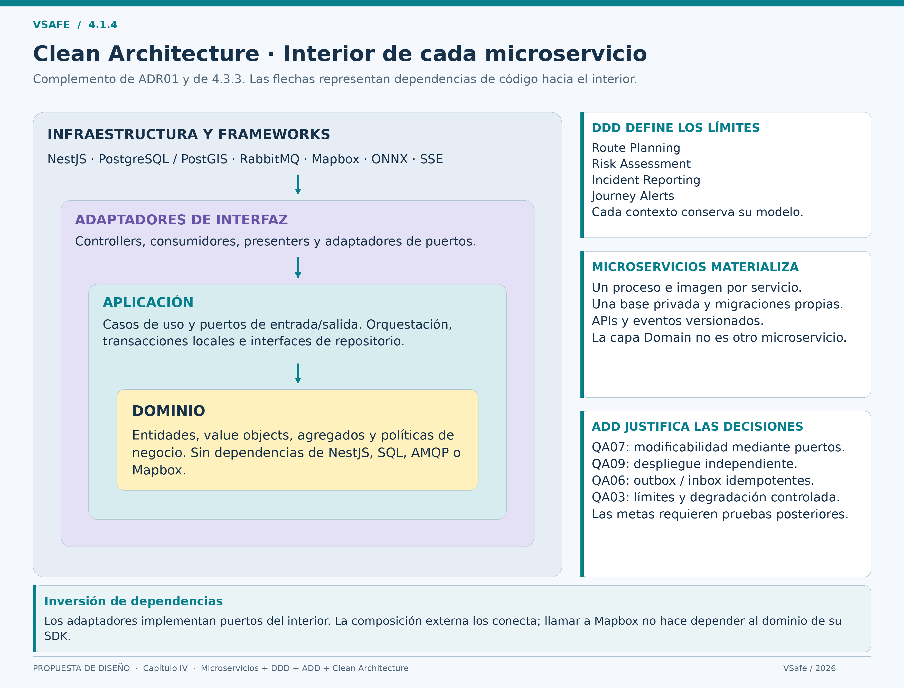
</p>

## 4.2. Strategic-Level Domain-Driven Design

El diseño estratégico del dominio organiza VSafe alrededor de capacidades del negocio. La separación se fundamenta en diferencias de lenguaje, reglas, datos y ciclos de vida. Los cuatro contextos identificados se materializan en microservicios independientes, con contratos HTTP y eventos de integración.

Una ruta describe un recorrido posible; una estimación expresa una evaluación contextual; un reporte representa una contribución comunitaria; y una alerta comunica información pertinente para un recorrido activo. Estos conceptos se relacionan, pero no comparten las mismas reglas.

### 4.2.1. EventStorming

EventStorming permite explorar el dominio mediante eventos que representan hechos relevantes del negocio. Para VSafe, el análisis se estructura alrededor de planificación de recorridos, contribución de incidentes y acompañamiento durante el desplazamiento. [Brandolini, EventStorming](https://www.eventstorming.com/).

Se propone una sesión de entre una y dos horas con representantes del equipo y de los segmentos objetivo. El modelo presentado constituye una base para esa sesión y deberá ajustarse con sus observaciones.

#### Organización del análisis

| Etapa | Actividad | Resultado esperado |
|---|---|---|
| Identificación de hechos | Enumerar acontecimientos relevantes expresados en pasado. | Catálogo inicial de eventos. |
| Ordenamiento | Ubicar los eventos según su relación temporal. | Flujos de planificación y reportes. |
| Identificación de causas | Asociar actores y comandos que desencadenan los eventos. | Relación entre intención y resultado. |
| Identificación de reglas | Incorporar políticas de publicación, vigencia y alertas. | Reglas del dominio. |
| Detección de dudas | Señalar criterios todavía no definidos. | Hotspots para discusión. |
| Revisión de límites | Agrupar eventos con lenguaje y responsabilidades comunes. | Contextos candidatos. |

#### Catálogo inicial de eventos

| Actor o fuente | Comando o acción | Evento del dominio | Regla o consecuencia |
|---|---|---|---|
| Usuario | Solicitar alternativas. | `RouteAlternativesObtained` | Solo se presentan recorridos cartográficamente válidos. |
| Route Planning | Solicitar evaluación. | `RiskAssessmentCompleted` | La evaluación puede terminar con una clasificación o con UNKNOWN. |
| Usuario | Seleccionar una ruta. | `JourneyStarted` | Se establece una ruta activa con una versión. |
| Usuario | Enviar un reporte. | `IncidentReportSubmitted` | El reporte se almacena como pendiente. |
| Procesamiento de reportes | Evaluar formato y consistencia. | `IncidentReportAssessed` | Se determina si puede publicarse, rechazarse o revisarse como duplicado. |
| Procesamiento de reportes | Vincular un duplicado. | `ReportLinkedToIncident` | El aporte no crea un segundo incidente equivalente. |
| Política de publicación | Publicar información procesable. | `IncidentPublished` | Se comunica procedencia y condición de verificación. |
| Reloj del sistema | Evaluar vigencia. | `IncidentExpired` | El incidente deja de influir como activo. |
| Journey Alerts | Evaluar pertinencia. | `JourneyAlertCreated` | Solo se alerta sobre un recorrido activo afectado. |
| Usuario | Solicitar otro recorrido. | `JourneyRouteChanged` | Se incrementa la versión de la ruta activa. |
| Usuario o expiración | Finalizar el recorrido. | `JourneyClosed` | Se detienen las alertas y se elimina el estado temporal. |

#### Hotspots identificados

| Hotspot | Tratamiento propuesto |
|---|---|
| Diferencia entre reporte y hecho confirmado. | Mantener procedencia y estado de verificación; no atribuir confirmación a una validación automática de formato. |
| Falta de información para calcular riesgo. | Utilizar UNKNOWN y explicar la causa. |
| Reportes similares. | Detectarlos como posibles duplicados antes de sumar su influencia. |
| Tiempo de vigencia. | Configurarlo por categoría; utilizar 24 horas como hipótesis inicial del piloto. |
| Pertinencia de una alerta. | Evaluar incidente activo y proximidad al tramo restante de la ruta. |
| Cambio de recorrido mientras se procesa una alerta. | Comprobar la versión vigente antes de entregar y mostrar la notificación. |

<!-- 4.2.1. EventStorming -->
<p align="center">
  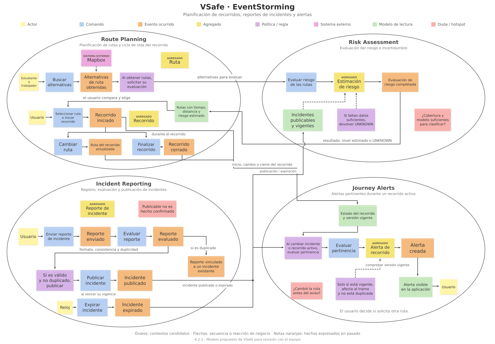
</p>


### 4.2.2. Candidate Context Discovery

La identificación de contextos combina las técnicas **start-with-value** y **look-for-pivotal-events**.

Primero se identifican las capacidades que generan el principal valor: comparación informada y estimación de riesgo. Después se analizan los eventos que representan cambios relevantes, como publicar un incidente, iniciar un recorrido o completar una evaluación.

#### Primera agrupación

Inicialmente se reconocen tres grupos:

| Grupo inicial | Capacidades incluidas | Observación |
|---|---|---|
| Navegación | Obtener rutas, estimar riesgo, seleccionar recorridos y recalcular. | Agrupa reglas cartográficas y analíticas que cambian por razones diferentes. |
| Comunidad | Registrar, clasificar y procesar reportes. | Presenta un ciclo de vida propio. |
| Acompañamiento | Mantener recorridos activos y comunicar alertas. | Depende de rutas e incidentes, pero tiene reglas temporales particulares. |

#### Refinamiento de los límites

El grupo Navegación se divide porque la obtención de rutas y la estimación de riesgo requieren modelos distintos:

- Route Planning administra alternativas y recorridos.
- Risk Assessment administra evaluaciones, cobertura, vigencia y versiones del modelo.

La evolución propuesta queda representada así:

<!-- 4.2.2. Candidate Context Discovery -->
<p align="center">
  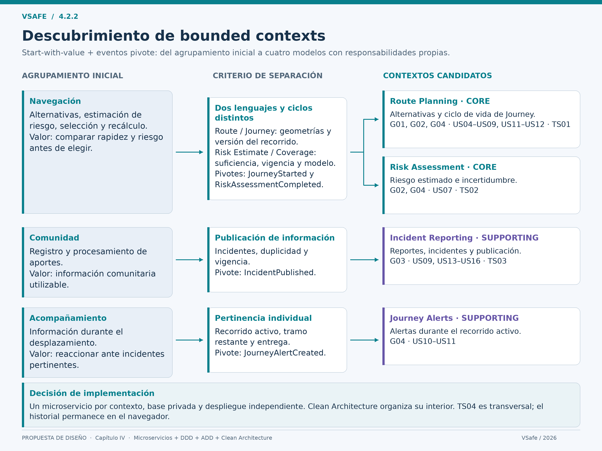
</p>

#### Contextos candidatos

| Bounded Context | Clasificación | Responsabilidad principal | Historias relacionadas |
|---|---|---|---|
| **Route Planning** | Core. | Obtener alternativas, compararlas y administrar la ruta seleccionada. | US04–US09, US11, US12 y TS01. |
| **Risk Assessment** | Core. | Evaluar el riesgo estimado y representar su incertidumbre. | US07 y TS02. |
| **Incident Reporting** | Supporting. | Gestionar aportes comunitarios e información publicable. | US09, US13–US16 y TS03. |
| **Journey Alerts** | Supporting. | Determinar y comunicar incidentes pertinentes durante un recorrido. | US10 y US11. |

La clasificación distingue capacidades centrales para la diferenciación de VSafe y capacidades que las sostienen. El Bounded Context Canvas propone este tipo de clasificación estratégica como parte del análisis de cada contexto. [DDD Crew, Bounded Context Canvas](https://github.com/ddd-crew/bounded-context-canvas).

Cada bounded context corresponde inicialmente a un microservicio de negocio con despliegue y base propios. La sesión anónima y las verificaciones comunes de acceso se incorporan al API Gateway; la autorización de recursos permanece en cada servicio. Configuración y observabilidad son capacidades de infraestructura. No se añaden contextos de negocio por cada herramienta técnica.

#### Lenguaje del dominio propuesto

| Término | Definición |
|---|---|
| **Route** | Alternativa cartográfica entre origen y destino, con geometría, distancia y duración. |
| **Journey** | Recorrido que el usuario ha activado para recibir acompañamiento. |
| **Route Version** | Número que identifica la alternativa vigente dentro de un recorrido activo. |
| **Incident Report** | Contribución enviada por un usuario sobre una situación observada. |
| **Published Incident** | Información procesada y habilitada para consulta según la política de publicación. |
| **Risk Estimate** | Evaluación contextual de una ruta mediante un método y datos identificables. |
| **Coverage** | Disponibilidad y suficiencia de información para una zona y periodo. |
| **Validity Period** | Intervalo durante el cual un dato o evaluación puede considerarse vigente. |
| **Journey Alert** | Comunicación sobre un incidente pertinente para un recorrido activo. |
| **Unknown Risk** | Estado utilizado cuando no existe evidencia suficiente para clasificar una ruta. |

### 4.2.3. Domain Message Flows Modeling

La colaboración se modela mediante **Domain Storytelling**, utilizando actores, objetos de trabajo y actividades numeradas. Esta representación permite explicar quién realiza una actividad, sobre qué información y con qué participante colabora. [Hofer y Schwentner, Domain Storytelling Quick-Start Guide](https://domainstorytelling.org/quick-start-guide).

Los siguientes diagramas muestran escenarios concretos. Las variaciones y errores se describen después de cada historia.

#### Historia 1. Comparación informada de rutas

Un estudiante define origen y destino. Route Planning obtiene alternativas del proveedor cartográfico y solicita su evaluación a Risk Assessment. Finalmente, presenta información comparable para que el estudiante seleccione un recorrido.

<!-- 4.2.3. Domain Message Flows Modeling: comparar rutas -->
<p align="center">
  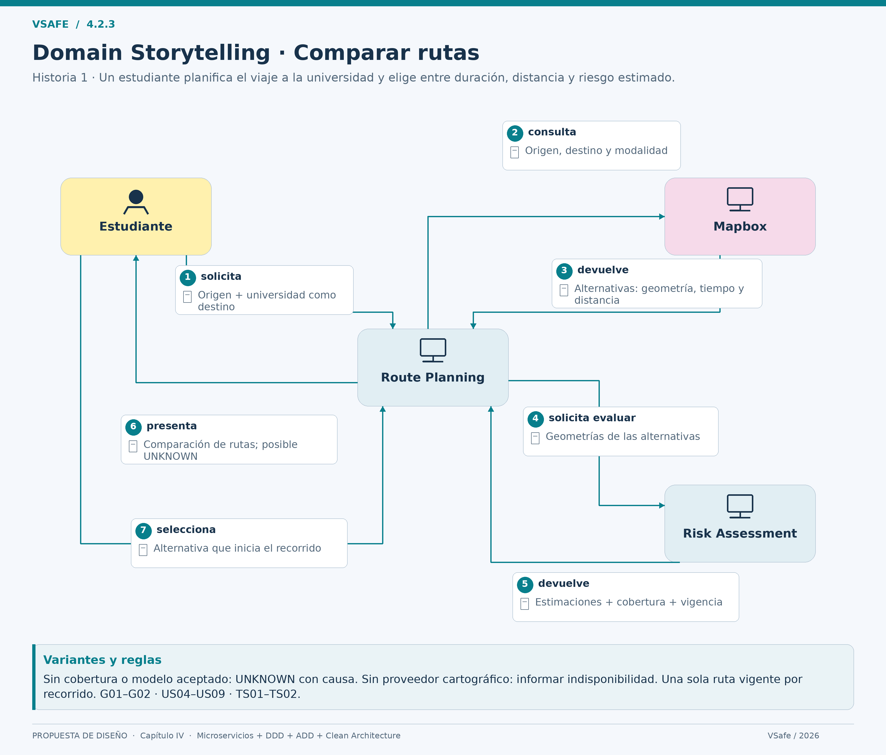
</p>

Si Risk Assessment no dispone de información suficiente, devuelve UNKNOWN con su causa. Route Planning conserva las alternativas cartográficas disponibles y permite comparar sus demás características.

Si el proveedor no responde, el sistema informa indisponibilidad; no fabrica geometrías ni tiempos.

#### Historia 2. Registro y publicación de un incidente

Un trabajador reporta un incidente y confirma su ubicación aproximada. Incident Reporting comprueba el aporte y determina su condición de publicación.

Cuando el reporte se incorpora como incidente publicable, Risk Assessment y Journey Alerts reciben la información necesaria para actualizar sus proyecciones.

<!-- 4.2.3. Domain Message Flows Modeling: reportar incidente -->
<p align="center">
  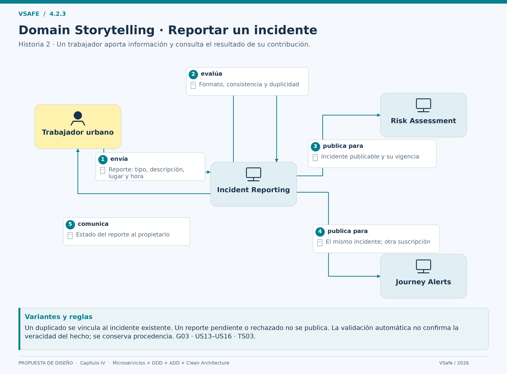
</p>

La detección de un posible duplicado evita crear un segundo incidente equivalente. Un reporte rechazado o todavía pendiente no se incorpora a la evaluación de rutas.

#### Historia 3. Alerta y cambio de recorrido

Journey Alerts recibe información de un incidente publicado, evalúa su relación con un recorrido activo y entrega una alerta. El usuario decide solicitar una nueva alternativa a Route Planning.

<!-- 4.2.3. Domain Message Flows Modeling: alerta y recálculo -->
<p align="center">
  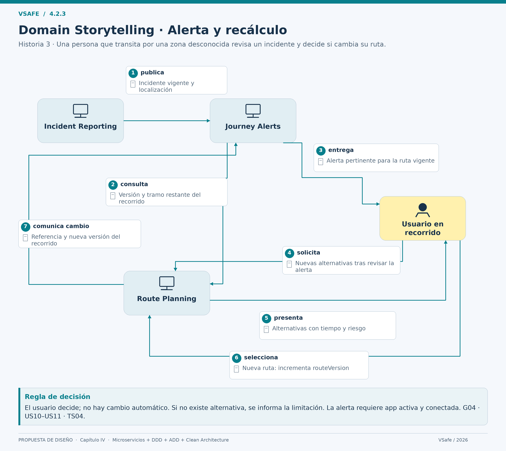
</p>

Si no existe una alternativa, se mantiene visible la información del incidente y se comunica la limitación. Si el usuario selecciona otra ruta, se incrementa su versión y se actualizan las condiciones utilizadas por Journey Alerts.

#### Contratos de colaboración

| Mensaje | Emisor | Receptor | Tipo | Información principal |
|---|---|---|---|---|
| `FindRouteAlternatives` | Aplicación web. | Route Planning. | Solicitud. | Origen, destino y modalidad. |
| `AssessRoutes` | Route Planning Service. | Risk Assessment Service. | HTTP interno síncrono. | Geometrías, instante de consulta e identificadores de ruta; timeout y autenticación entre servicios. |
| `SubmitIncidentReport` | Aplicación web. | Incident Reporting. | Comando. | Categoría, descripción, ubicación aproximada y momento observado. |
| `IncidentPublished` | Incident Reporting. | Risk Assessment y Journey Alerts. | Evento. | Incidente, categoría, ubicación, vigencia, procedencia y versión. |
| `IncidentExpired` | Incident Reporting. | Risk Assessment y Journey Alerts. | Evento. | Identificador, fecha de expiración y versión. |
| `JourneyStarted` | Route Planning Service. | Journey Alerts Service. | Evento por RabbitMQ. | Identificador del recorrido, versión, expiración y referencia de propietario; el consumidor consulta la geometría vigente mediante un contrato interno. |
| `JourneyRouteChanged` | Route Planning. | Journey Alerts. | Evento. | Recorrido y nueva versión de ruta. |
| `JourneyClosed` | Route Planning. | Journey Alerts. | Evento. | Recorrido y motivo de cierre. |
| `JourneyAlertCreated` | Journey Alerts. | Canal de entrega al cliente. | Evento interno. | Alerta, recorrido, incidente y versión de ruta. |

Los eventos incorporarán `eventId`, `occurredAt`, `schemaVersion`, `aggregateVersion` y un identificador de correlación. Los consumidores comprobarán duplicados y versiones antes de aplicar cambios. La comunicación de consultas se realiza mediante HTTP interno y la distribución de eventos mediante RabbitMQ. Cada consumidor actualiza únicamente su base privada. Los eventos con una versión faltante activan reconciliación con el productor; los eventos de recorridos no contienen coordenadas precisas.

### 4.2.4. Bounded Context Canvases

Los canvases detallan propósito, clasificación, lenguaje, capacidades, reglas y dependencias de cada contexto.

Su elaboración sigue una secuencia de definición general, identificación de reglas, captura del lenguaje, análisis de capacidades, revisión de dependencias y crítica del diseño.

#### Bounded Context Canvas: Route Planning

| Elemento | Definición |
|---|---|
| **Nombre** | Route Planning. |
| **Propósito** | Permitir que el usuario obtenga, compare y seleccione alternativas de recorrido. |
| **Clasificación estratégica** | Core domain. |
| **Valor para el negocio** | Hace posible la principal experiencia de comparación de VSafe y contribuye a G01 y G02. |
| **Usuarios** | Estudiantes y trabajadores. |
| **Lenguaje ubicuo** | Route, Origin, Destination, Route Alternative, Journey y Route Version. |
| **Capacidades** | Definir puntos, consultar alternativas, asociar evaluaciones, seleccionar una ruta, recalcular y cerrar recorridos. |
| **Datos propios** | Solicitudes de alternativas, rutas seleccionadas y estado temporal de recorridos activos. |
| **Reglas de negocio** | Origen y destino deben ser válidos; una alternativa debe corresponder a la modalidad; solo una versión de ruta está vigente por recorrido. |
| **Reglas de vigencia** | Una estimación vencida se vuelve a solicitar antes de presentarse como actual. |
| **Entradas** | Solicitudes del usuario, alternativas del proveedor y evaluaciones de Risk Assessment. |
| **Salidas** | Comparaciones, rutas activas y eventos de inicio, cambio y cierre. |
| **Dependencias** | Proveedor cartográfico y Risk Assessment. |
| **Límites** | No valida reportes ni decide los umbrales del modelo de riesgo. |
| **Capas de capacidades** | Experiencia de planificación; coordinación de consultas; integración cartográfica. |
| **Crítica del diseño** | Debe evitar convertirse en un módulo que concentre todas las reglas. La estimación y la pertinencia de alertas permanecen en sus respectivos contextos. |

<!-- 4.2.4. Bounded Context Canvas: Route Planning -->
<p align="center">
  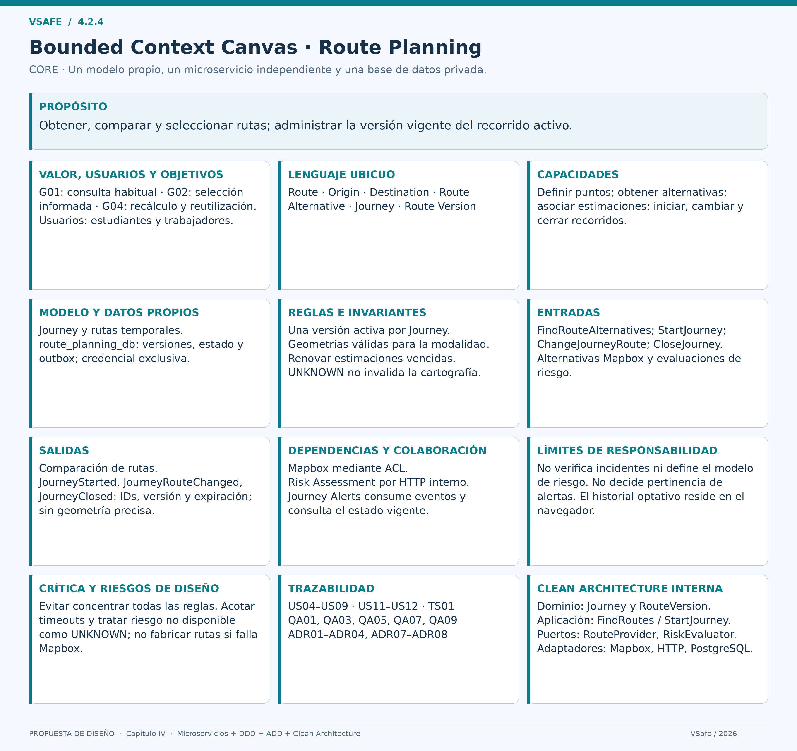
</p>

#### Bounded Context Canvas: Risk Assessment

| Elemento | Definición |
|---|---|
| **Nombre** | Risk Assessment. |
| **Propósito** | Producir evaluaciones comparables y explicar cuándo la información es insuficiente. |
| **Clasificación estratégica** | Core domain. |
| **Valor para el negocio** | Sostiene la diferenciación de VSafe y contribuye a G02 y G04. |
| **Consumidor principal** | Route Planning. |
| **Lenguaje ubicuo** | Risk Estimate, Coverage, Model Version, Assessment Time, Validity Period y Unknown Risk. |
| **Capacidades** | Construir características geoespaciales, ejecutar inferencia, revisar suficiencia y emitir resultados con metadatos. |
| **Datos propios** | Proyección de incidentes para análisis, metadatos del modelo y evaluaciones temporales. |
| **Reglas de negocio** | Ausencia de reportes no implica bajo riesgo; una evaluación debe identificar método, vigencia y cobertura. |
| **Reglas del modelo** | Solo una versión aceptada puede emitir LOW, MEDIUM o HIGH; un fallo o falta de evidencia produce UNKNOWN. |
| **Entradas** | Geometrías de rutas y eventos de publicación, modificación o expiración de incidentes. |
| **Salidas** | Evaluaciones asociadas a cada alternativa. |
| **Dependencias** | Información publicable de Incident Reporting y motor de inferencia. |
| **Límites** | No obtiene rutas del proveedor ni administra sesiones de navegación. |
| **Capas de capacidades** | Preparación de información; evaluación; interpretación y comunicación de incertidumbre. |
| **Crítica del diseño** | Debe distinguir calidad técnica de la inferencia y validez de la información. Un servicio disponible puede devolver una evaluación no utilizable. |

<!-- 4.2.4. Bounded Context Canvas: Risk Assessment -->
<p align="center">
  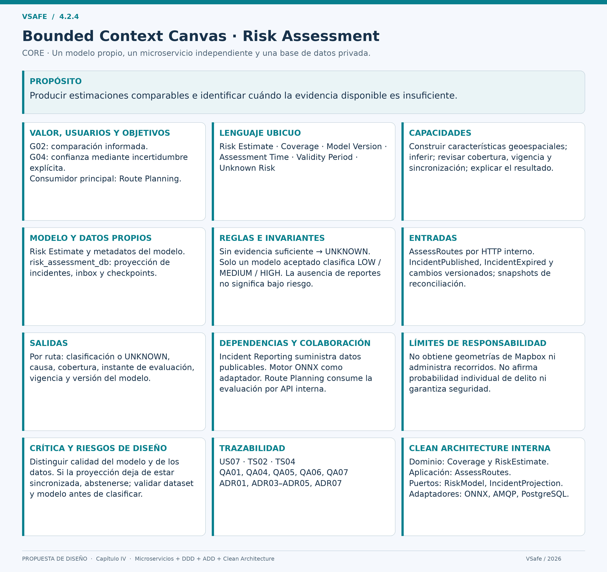
</p>

#### Bounded Context Canvas: Incident Reporting

| Elemento | Definición |
|---|---|
| **Nombre** | Incident Reporting. |
| **Propósito** | Gestionar aportes comunitarios y determinar qué información puede consultarse como incidente publicable. |
| **Clasificación estratégica** | Supporting domain. |
| **Valor para el negocio** | Facilita contribuciones y mejora la información disponible; contribuye a G03. |
| **Usuarios** | Miembros de la comunidad. |
| **Lenguaje ubicuo** | Incident Report, Category, Observed At, Approximate Location, Duplicate Candidate y Published Incident. |
| **Capacidades** | Registrar, clasificar, validar, detectar duplicados, publicar, expirar y consultar estados. |
| **Datos propios** | Reportes, incidentes, categorías, relaciones de duplicidad y trazabilidad de procesamiento. |
| **Reglas de negocio** | El reporte requiere información mínima; la publicación no equivale a confirmación del hecho; los duplicados no se cuentan como incidentes independientes. |
| **Reglas temporales** | La vigencia se calcula desde el momento observado y puede variar por categoría. |
| **Entradas** | Reportes de usuarios y acciones programadas de revisión temporal. |
| **Salidas** | Estados de reportes e información publicable para otros contextos. |
| **Dependencias** | Sesión y autorización técnica del propietario. |
| **Límites** | No selecciona rutas ni decide si un incidente afecta a un recorrido particular. |
| **Capas de capacidades** | Recepción; evaluación; publicación y mantenimiento de vigencia. |
| **Crítica del diseño** | La validación automática debe evitar aparentar una verificación de hechos. Los estados y mensajes deben expresar claramente qué comprobaciones se realizaron. |

<!-- 4.2.4. Bounded Context Canvas: Incident Reporting -->
<p align="center">
  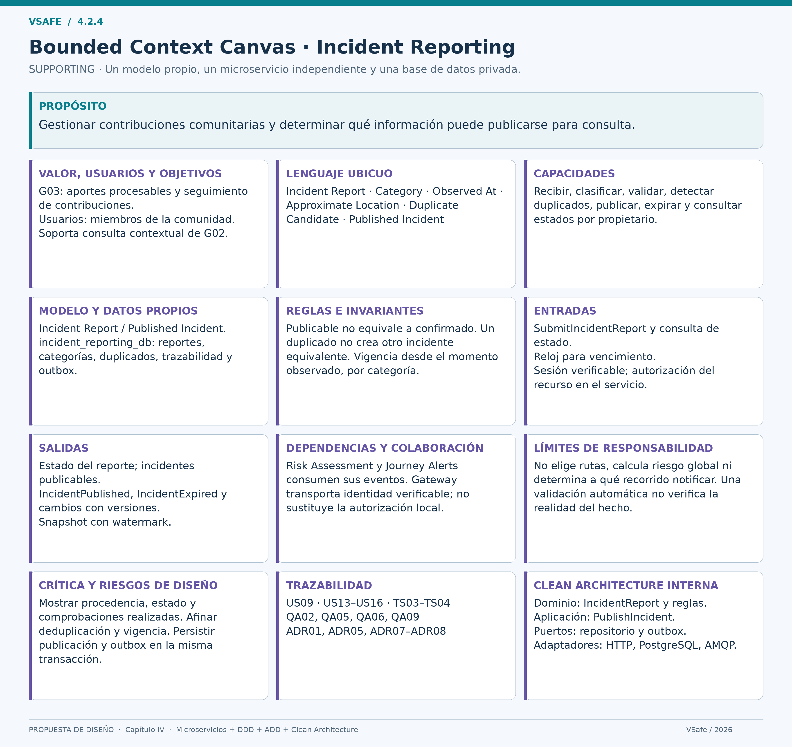
</p>

#### Bounded Context Canvas: Journey Alerts

| Elemento | Definición |
|---|---|
| **Nombre** | Journey Alerts. |
| **Propósito** | Informar incidentes pertinentes para un recorrido activo. |
| **Clasificación estratégica** | Supporting domain. |
| **Valor para el negocio** | Aporta utilidad durante el desplazamiento y contribuye a G04. |
| **Usuarios** | Personas con un recorrido activo. |
| **Lenguaje ubicuo** | Active Journey, Remaining Route, Relevant Incident, Journey Alert y Delivery Status. |
| **Capacidades** | Mantener suscripciones, evaluar proximidad, generar alertas, deduplicar y recuperar entregas. |
| **Datos propios** | Proyección de recorridos activos, incidentes pertinentes, alertas y estados de entrega. |
| **Reglas de negocio** | Solo se generan alertas para recorridos activos; el incidente debe estar vigente y afectar el tramo restante. |
| **Reglas de consistencia** | La versión de ruta se comprueba antes de emitir; una reentrega no crea una nueva alerta lógica. |
| **Entradas** | Eventos de recorridos y de incidentes. |
| **Salidas** | Alertas destinadas a la sesión propietaria. |
| **Dependencias** | Route Planning e Incident Reporting. |
| **Límites** | No modifica automáticamente la ruta ni calcula su riesgo global. |
| **Capas de capacidades** | Suscripción; determinación de pertinencia; entrega y recuperación. |
| **Crítica del diseño** | Debe separar pertinencia y transporte. Una alerta correctamente generada puede no ser visible si el navegador pierde conexión o queda suspendido. |

<!-- 4.2.4. Bounded Context Canvas: Journey Alerts -->
<p align="center">
  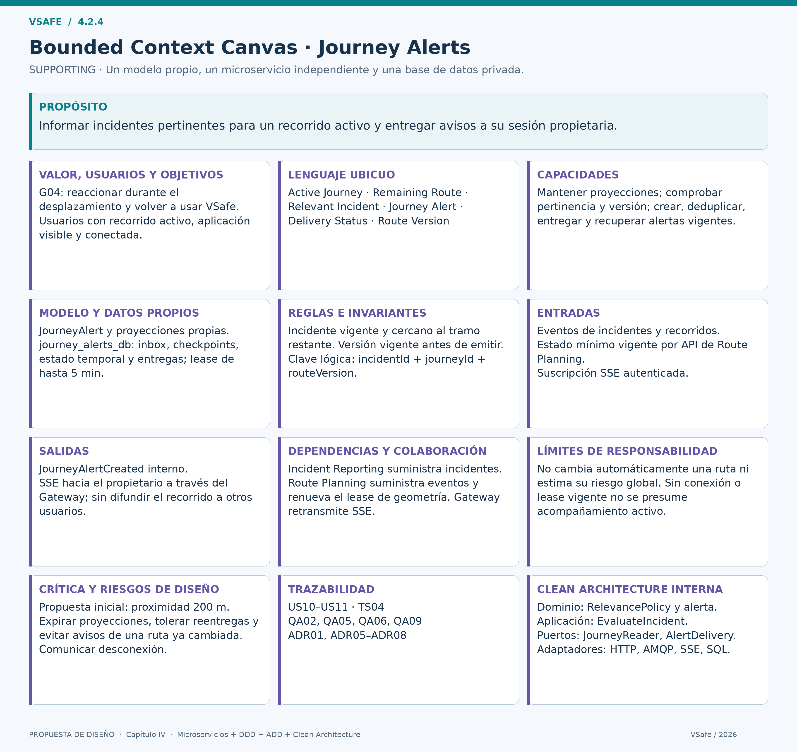
</p>

### 4.2.5. Context Mapping

El Context Map representa las relaciones estructurales entre los contextos y define quién proporciona información, quién la consume y cómo se evita trasladar modelos externos al dominio.

Los patrones seleccionados consideran las relaciones Customer/Supplier, Open Host Service, Published Language y Anti-corruption Layer. [DDD Crew, Context Mapping](https://github.com/ddd-crew/context-mapping).

#### Alternativas evaluadas

| Alternativa | Beneficio | Dificultad | Decisión |
|---|---|---|---|
| Unir rutas y riesgo. | Menos interfaces internas. | Mezcla integración cartográfica con evolución analítica. | Separar Route Planning y Risk Assessment. |
| Unir incidentes y alertas. | Acceso inmediato a los reportes. | Mezcla publicación general con pertinencia individual. | Mantener contextos separados. |
| Compartir todas las entidades. | Reduce mapeos iniciales. | Acopla ciclos de vida y cambios. | Compartir contratos, no un modelo de dominio completo. |
| Un microservicio por bounded context. | Despliegue y propiedad de datos independientes. | Requiere contratos, observabilidad y consistencia eventual. | Adoptar cuatro servicios de negocio, conforme a CON08. |
| Utilizar eventos para todas las consultas. | Uniformidad del transporte. | Complica respuestas que el usuario necesita inmediatamente. | Combinar HTTP entre servicios y eventos asíncronos mediante RabbitMQ. |

#### Mapa de contextos

Las flechas representan suministro de información o servicios desde el proveedor hacia el consumidor.

<!-- 4.2.5. Context Mapping -->
<p align="center">
  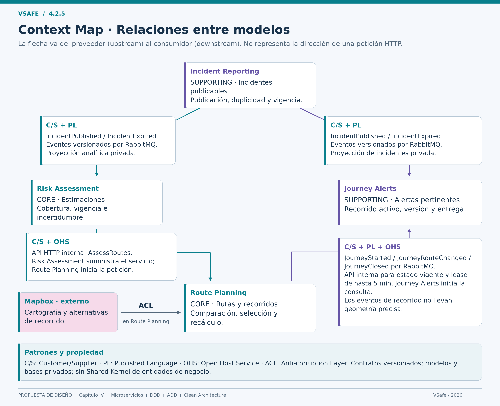
</p>

#### Relaciones seleccionadas

| Proveedor — Upstream | Consumidor — Downstream | Patrón | Aplicación |
|---|---|---|---|
| Proveedor cartográfico. | Route Planning. | Anti-corruption Layer. | El adaptador transforma el modelo externo a tipos propios. |
| Incident Reporting. | Risk Assessment. | Customer/Supplier y Published Language. | El consumidor recibe eventos estables para actualizar su proyección analítica. |
| Incident Reporting. | Journey Alerts. | Customer/Supplier y Published Language. | El consumidor recibe incidentes publicables y sus cambios de vigencia. |
| Risk Assessment. | Route Planning. | Customer/Supplier y Open Host Service. | Un API HTTP interno versionado permite solicitar evaluaciones sin acceder a su base privada. |
| Route Planning. | Journey Alerts. | Customer/Supplier y Published Language. | Los eventos comunican inicio, cambio de versión y cierre de recorridos. |

No se propone un Shared Kernel de entidades de negocio para el MVP. Los identificadores y contratos pueden compartirse mediante esquemas versionados, manteniendo independientes las reglas, bases de datos e imágenes de despliegue de cada microservicio.

Los consumidores aplicarán estas reglas de integración:

1. Ignorar eventos ya procesados.
2. Rechazar versiones incompatibles del contrato.
3. Aplicar solo cambios más recientes que el estado conocido.
4. Mantener referencias por identificador.
5. Evitar consultas directas a las bases privadas de otros microservicios.
6. Eliminar las proyecciones temporales cuando termine su finalidad.

## 4.3. Software Architecture

La arquitectura se representa mediante las vistas System Landscape, System Context, Container y Deployment.

En C4, un container representa una aplicación o un almacén de datos. Por ello, las vistas de containers describen responsabilidades lógicas y tecnologías, mientras que Deployment muestra dónde se ejecutan sus instancias. [Brown, Container diagram](https://c4model.com/diagrams/container); [Brown, Deployment diagram](https://c4model.com/diagrams/deployment).

Los diagramas siguientes representan la implementación del MVP al 12 de noviembre de 2026: Cloudflare Pages para los productos web y el proxy, Railway para el gateway, los cuatro microservicios, PostgreSQL/PostGIS y RabbitMQ, y Ethereum Sepolia para el contrato de integridad. La fuente de las ocho vistas se conserva en [Structurizr DSL](assets/vsafe-c4-actual.dsl), de acuerdo con CON05. Los componentes internos de cada microservicio se detallan en 5.1.5, 5.2.5, 5.3.5 y 5.4.5.

Las dos tecnologías emergentes incorporadas son la inferencia de IA/ML con ONNX Runtime y la auditoría de integridad con blockchain y Solidity. El modelo disponible utiliza datos sintéticos; en modo real el riesgo permanece en `UNKNOWN / MODEL_NOT_VALIDATED` hasta completar su validación. El contrato `IncidentAudit` está desplegado en la red de pruebas Sepolia.

### 4.3.1. Software Architecture System Landscape Diagram

El System Landscape ubica a VSafe dentro de su entorno de uso y desarrollo.

Los estudiantes y trabajadores utilizan el producto. Mapbox Directions API calcula alternativas peatonales, OpenStreetMap aporta las teselas utilizadas por Leaflet y Alchemy proporciona acceso RPC al contrato en Ethereum Sepolia. El equipo mantiene el código, los contratos y los diagramas mediante GitHub.

<!-- 4.3.1. Software Architecture System Landscape Diagram -->
<p align="center">
  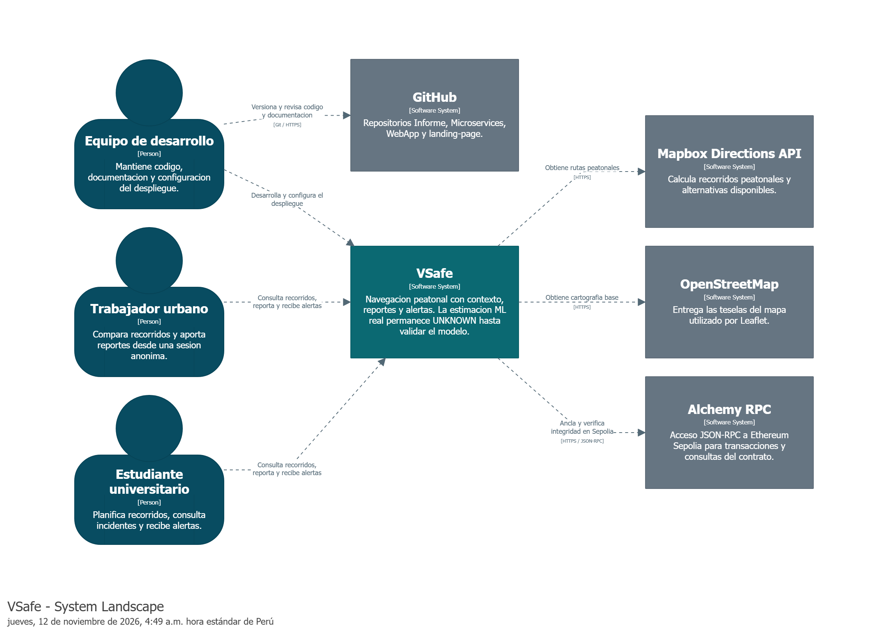
</p>

GitHub forma parte del entorno de construcción y mantenimiento. La navegación de los usuarios no depende de consultar GitHub durante su ejecución.

[Abrir System Landscape en resolución original](assets/VSafe-Landscape.png).

El diseño no presupone que exista una integración disponible con una municipalidad o una fuente oficial de incidentes. La incorporación de esas fuentes requerirá comprobar acceso, cobertura, formato y condiciones de uso.

### 4.3.2. Software Architecture Context Level Diagrams

El Context Diagram representa a VSafe como un sistema único, delimitando sus usuarios y dependencias externas.

<!-- 4.3.2. Software Architecture Context Level Diagram -->
<p align="center">
  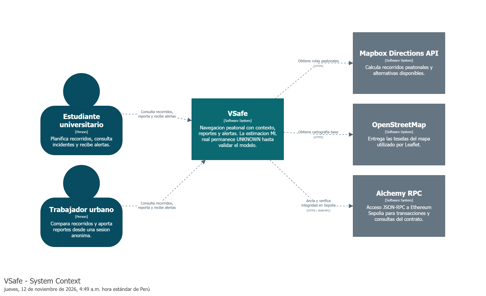
</p>

#### Responsabilidades del sistema

| Elemento | Responsabilidad |
|---|---|
| Estudiante | Definir recorridos, comparar alternativas y aportar información de incidentes. |
| Trabajador | Planificar desplazamientos, consultar contexto y reaccionar ante alertas. |
| VSafe | Coordinar navegación, evaluación con abstención, reportes, alertas y verificación de integridad. |
| Mapbox Directions API | Calcular recorridos peatonales y las alternativas disponibles. |
| OpenStreetMap | Entregar las teselas del mapa utilizado por Leaflet. |
| Alchemy RPC | Proporcionar acceso JSON-RPC a Ethereum Sepolia para transacciones y consultas del contrato. |

La geolocalización procede del dispositivo a través de las capacidades del navegador y requiere autorización. VSafe debe informar al usuario cuando origen y destino se envían al proveedor para calcular las rutas.

[Abrir System Context en resolución original](assets/VSafe-Context.png).

### 4.3.3. Software Architecture Container Level Diagrams

La solución incluye un API Gateway y cuatro microservicios de negocio desplegables de manera independiente. Cada servicio tiene su propia base de datos y administra sus procesos de recepción, consumo de eventos y publicación. RabbitMQ conecta productores y consumidores sin convertir sus bases en un almacenamiento compartido.

<!-- 4.3.3. Software Architecture Container Level Diagram -->
<p align="center">
  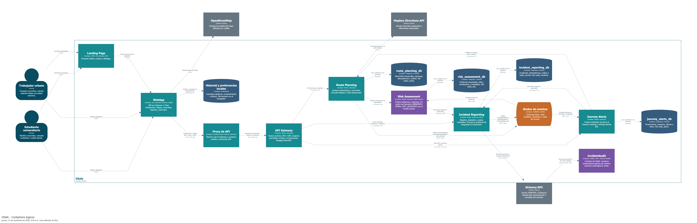
</p>

[Abrir Container Diagram en resolución original](assets/VSafe-Containers.png).

#### Descripción de containers

| Container | Tecnología utilizada | Responsabilidad |
|---|---|---|
| **Landing Page** | HTML5, CSS3, JavaScript y Vite. | Comunicar la propuesta de valor y conducir a la aplicación. |
| **Aplicación web** | Vue, TypeScript, PrimeVue y Leaflet. | Organizar las funcionalidades por features y Clean Architecture; gestionar mapas, comparación, reportes, permisos y alertas. |
| **Proxy de API** | Cloudflare Pages Functions y TypeScript. | Reenviar `/api` al gateway conservando cookies y streaming SSE desde el mismo origen de la WebApp. |
| **API Gateway** | NestJS y TypeScript. | Verificar sesión anónima JWT, CSRF y orígenes; limitar y enrutar solicitudes, retransmitir SSE y publicar OpenAPI. |
| **Route Planning Service** | NestJS y TypeScript. | Obtener alternativas, consultar evaluaciones y administrar recorridos; publicar sus eventos. |
| **Risk Assessment Service** | NestJS, TypeScript y ONNX Runtime. | Mantener la proyección de incidentes y ejecutar inferencia local cuando proceda. El modelo sintético actual exige abstención en modo real. |
| **Incident Reporting Service** | NestJS, TypeScript y ethers. | Registrar, publicar y expirar reportes; mantener su outbox y procesar la auditoría de integridad en blockchain. |
| **Journey Alerts Service** | NestJS y TypeScript. | Consumir eventos, evaluar pertinencia, deduplicar alertas y entregarlas mediante SSE. |
| **Message Broker** | RabbitMQ 4 y AMQP. | Enrutar eventos mediante exchange topic, colas durables por consumidor, reintentos y colas de errores. |
| **Route Planning Database** | PostgreSQL y PostGIS. | Recorridos temporales, versiones y outbox; acceso exclusivo de Route Planning. |
| **Risk Assessment Database** | PostgreSQL y PostGIS. | Proyección analítica, inbox, checkpoints y metadatos de evaluación; acceso exclusivo de Risk Assessment. |
| **Incident Reporting Database** | PostgreSQL y PostGIS. | Reportes, incidentes, idempotencia, outbox y registros de auditoría; acceso exclusivo de Incident Reporting. |
| **Journey Alerts Database** | PostgreSQL y PostGIS. | Proyecciones temporales, inbox, checkpoints, alertas y estado de entrega; acceso exclusivo de Journey Alerts. |
| **Historial y preferencias locales** | localStorage. | Conservar consultas optativas, consentimiento e idioma en el navegador. |
| **IncidentAudit** | Solidity y EVM en Ethereum Sepolia. | Conservar compromisos opacos por versión y restringir la escritura al writer autorizado. Permite verificar integridad; no acredita la veracidad del incidente. |

ONNX Runtime se ejecuta dentro de Risk Assessment; no constituye un servicio externo. El contrato `IncidentAudit` es un artefacto propio desplegado en la EVM y no añade un quinto microservicio de negocio.

#### Distribución de contextos y despliegues

| Bounded Context | Microservicio | Base privada | Unidad de despliegue |
|---|---|---|---|
| Route Planning | Route Planning Service. | `route_planning_db`, rol `vsafe_routes`. | Servicio Railway `route-planning`. |
| Risk Assessment | Risk Assessment Service. | `risk_assessment_db`, rol `vsafe_risk`. | Servicio Railway `risk-assessment`. |
| Incident Reporting | Incident Reporting Service. | `incident_reporting_db`, rol `vsafe_incidents`. | Servicio Railway `incident-reporting`. |
| Journey Alerts | Journey Alerts Service. | `journey_alerts_db`, rol `vsafe_alerts`. | Servicio Railway `journey-alerts`. |

Cada servicio controla sus repositorios y migraciones. Sus relays e inbox pertenecen al mismo propietario; no existe una tabla de integración que permita a todos los servicios leer los datos privados de los demás. PostgreSQL puede compartir servidor físico en el piloto, pero las bases, roles y permisos se mantienen separados.

La aplicación accede a rutas públicas a través del gateway. Risk Assessment expone únicamente contratos internos; no requiere un endpoint público para el usuario. Los servicios permanecen en red privada y autentican las llamadas internas, aun cuando procedan de esa red.

#### Comunicaciones principales

| Origen | Destino | Mecanismo | Finalidad |
|---|---|---|---|
| Aplicación web. | Proxy de API de Cloudflare. | HTTPS, JSON y SSE. | Consultar `/api/v1` desde el mismo origen, con cookie de sesión y CSRF. |
| Proxy de API de Cloudflare. | API Gateway. | HTTPS, cookies y streaming. | Reenviar las operaciones al backend en Railway. |
| API Gateway. | Route Planning, Incident Reporting o Journey Alerts. | HTTP protegido y contexto de identidad verificable. | Enrutar la solicitud al propietario de la capacidad. |
| Route Planning Service. | Risk Assessment Service. | HTTP interno síncrono con timeout. | Solicitar evaluación de alternativas sin consultar su base. |
| Journey Alerts Service. | Route Planning Service. | HTTP interno autenticado. | Obtener y renovar el mínimo estado vigente de un recorrido. |
| Route Planning Service. | Mapbox. | HTTPS. | Obtener alternativas cartográficas. |
| Aplicación web. | OpenStreetMap. | HTTPS. | Obtener las teselas utilizadas por Leaflet. |
| Risk Assessment y Journey Alerts. | Incident Reporting. | HTTP interno autenticado. | Reconciliar sus proyecciones mediante snapshot y watermark. |
| Route Planning e Incident Reporting. | RabbitMQ. | AMQP protegido y publisher confirms. | Publicar eventos desde sus respectivos outboxes. |
| RabbitMQ. | Risk Assessment y Journey Alerts. | Colas por consumidor y acuse manual. | Entregar eventos para actualizar proyecciones privadas. |
| Journey Alerts Service. | Aplicación web, mediante gateway y proxy de Cloudflare. | SSE sobre HTTPS. | Entregar alertas autorizadas y recuperar mensajes vigentes. |
| Cada microservicio. | Su propia base. | Credencial exclusiva y conexión protegida. | Mantener datos, versiones y transacciones locales. |
| Incident Reporting. | Alchemy RPC. | HTTPS y JSON-RPC. | Enviar transacciones firmadas y consultar compromisos de integridad. |
| Alchemy RPC. | IncidentAudit en Sepolia. | Ethereum JSON-RPC y EVM. | Ejecutar transacciones y consultas del contrato en la red de pruebas. |

#### Contratos públicos propuestos

El gateway conserva una dirección pública estable, mientras la operación pertenece a un microservicio. Cada servicio mantiene su especificación OpenAPI y las pruebas de sus consumidores.

| Operación | Endpoint público | Servicio responsable | Resultado esperado |
|---|---|---|---|
| Consultar alternativas. | `POST /api/v1/routes/search` | Route Planning. | Rutas con distancia, duración y evaluación o incertidumbre. |
| Iniciar recorrido. | `POST /api/v1/journeys` | Route Planning. | Identificador y versión inicial. |
| Cambiar ruta. | `PATCH /api/v1/journeys/{id}/route` | Route Planning. | Nueva versión del recorrido. |
| Cerrar recorrido. | `DELETE /api/v1/journeys/{id}` | Route Planning. | Cierre local, evento durable y limpieza temporal. |
| Registrar reporte. | `POST /api/v1/incident-reports` | Incident Reporting. | Identificador y estado pendiente. |
| Consultar reporte propio. | `GET /api/v1/incident-reports/{id}` | Incident Reporting. | Estado autorizado por propietario. |
| Consultar incidentes aplicables. | `GET /api/v1/incidents` | Incident Reporting. | Información publicable filtrada por zona y vigencia. |
| Recibir alertas. | `GET /api/v1/journeys/{id}/alerts/stream` | Journey Alerts. | Flujo SSE autorizado y retransmitido por el gateway. |

#### Contratos internos propuestos

| Endpoint interno | Propietario | Consumidor | Condiciones |
|---|---|---|---|
| `POST /internal/v1/risk-assessments` | Risk Assessment. | Route Planning. | Lista acotada de rutas; respuesta versionada; timeout y resultado UNKNOWN ante insuficiencia. |
| `GET /internal/v1/journeys/{id}/active` | Route Planning. | Journey Alerts. | Identidad técnica autorizada; devuelve versión, geometría mínima y expiración; recorrido cerrado responde sin datos activos. |
| `GET /internal/v1/incidents/snapshot` | Incident Reporting. | Risk Assessment y Journey Alerts. | Snapshot paginado con watermark consistente; permite reconstruir una proyección y reanudar desde una secuencia conocida. |

El snapshot se obtiene sobre una vista consistente del productor. Los cambios posteriores a su watermark se conservan para reanudación; la reconstrucción no se considera completa hasta alcanzar el checkpoint correspondiente. Estos contratos no se exponen al navegador.

Los errores públicos utilizan códigos identificables, como `INVALID_LOCATION`, `OUTSIDE_COVERAGE`, `PROVIDER_UNAVAILABLE` y `JOURNEY_NOT_ACTIVE`. La caída de Risk Assessment puede representarse en una consulta cartográfica exitosa como UNKNOWN con causa `RISK_SERVICE_UNAVAILABLE`. No se confunden la disponibilidad de rutas y la disponibilidad de una estimación informativa.

### 4.3.4. Software Architecture Deployment Diagrams

El entorno implementado publica la landing y la WebApp en Cloudflare Pages y utiliza un proxy de Pages Functions para acceder al backend. Railway ejecuta el gateway, cuatro microservicios independientes, PostgreSQL/PostGIS y RabbitMQ. El contrato `IncidentAudit` se ejecuta en Ethereum Sepolia y se consulta mediante Alchemy. Esta vista sustituye la propuesta anterior de una VM en AWS.

<!-- 4.3.4. Software Architecture Deployment Diagram -->
<p align="center">
  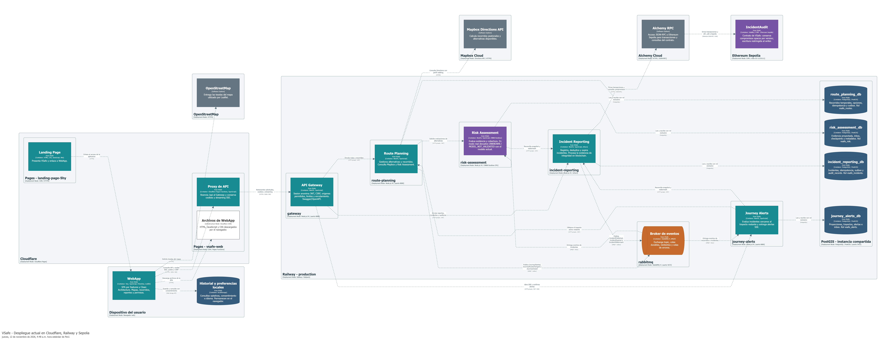
</p>

[Abrir Deployment Diagram en resolución original](assets/VSafe-Deployment.png).

#### Nodos de despliegue

| Nodo | Elementos alojados | Consideraciones |
|---|---|---|
| Dispositivo del usuario | SPA Vue y localStorage en el navegador. | Geolocalización autorizada e historial optativo; descarga los archivos desde Cloudflare. |
| Cloudflare Pages: landing-page-5hy | Archivos estáticos de la landing. | HTTPS y enlace a la WebApp. |
| Cloudflare Pages: vsafe-web | Archivos de la SPA y proxy de Pages Functions. | El proxy conserva cookies y streaming SSE al reenviar `/api` al gateway. |
| Railway: gateway | Aplicación NestJS, Node.js 24 y puerto de aplicación 8080. | Entrada HTTPS pública, sesión, CSRF, límites, OpenAPI y enrutamiento. |
| Railway: route-planning | Proceso NestJS independiente. | Red privada, base `route_planning_db`, Mapbox y Risk Assessment. |
| Railway: risk-assessment | Proceso NestJS con ONNX Runtime CPU. | Red privada, base `risk_assessment_db` y abstención mientras el modelo no esté validado. |
| Railway: incident-reporting | Proceso NestJS con ethers y worker de auditoría. | Base `incident_reporting_db`, eventos y conexión RPC a Sepolia. |
| Railway: journey-alerts | Proceso NestJS con consumidores y SSE. | Base `journey_alerts_db` y consulta del trayecto restante. |
| Railway: RabbitMQ | Broker RabbitMQ 4. | Puerto AMQP privado 5672 y volumen persistente en `/var/lib/rabbitmq`. |
| Railway: PostGIS | Instancia PostgreSQL/PostGIS. | Puerto privado 5432, volumen persistente y cuatro bases con roles exclusivos. |
| Mapbox y OpenStreetMap | Directions API y teselas, respectivamente. | Dependencias externas por HTTPS con responsabilidades distintas. |
| Alchemy Cloud | Acceso RPC a Ethereum Sepolia. | Transporte de transacciones firmadas y consultas del contrato. |
| Ethereum Sepolia | Contrato Solidity `IncidentAudit`. | Red de pruebas con chain ID `11155111`; conserva compromisos opacos por versión. |

#### Configuración operativa del MVP

| Aspecto | Definición |
|---|---|
| Entornos | Desarrollo local y piloto con datos, colas y secretos separados. |
| Construcción | Railpack construye el gateway y cada servicio desde el monorepositorio; Vite genera los productos web. No se requieren Dockerfiles propios. |
| Despliegue | Cada servicio Railway tiene build y start propios; las migraciones se ejecutan en su pre-deploy. Cloudflare publica los productos web por separado. |
| Descubrimiento | DNS privado `*.railway.internal` y variables de entorno para los destinos internos. |
| Persistencia | Database per Service, credenciales exclusivas y migraciones ejecutadas por el propietario. |
| Mensajería | RabbitMQ, colas durables por suscripción, confirmaciones, inbox y reintentos limitados. |
| Seguridad | HTTPS público, autenticación interna, sesiones verificables y broker/bases en red privada. |
| Escalado | El diagrama representa una instancia de cada proceso; cualquier aumento de réplicas requiere comprobar concurrencia e idempotencia. |
| Recuperación | Volúmenes persistentes y reconstrucción de proyecciones. La configuración y restauración de respaldos externos requieren evidencia adicional. |
| Observabilidad | Correlation ID entre gateway, HTTP y eventos; latencia por servicio, backlog de colas, antigüedad de outbox, UNKNOWN y errores. |
| Limitación inicial | No se representa redundancia ni alta disponibilidad. La persistencia del volumen no sustituye una prueba de restauración. |

#### Secuencia de despliegue de una versión compatible

1. Seleccionar el commit del servicio modificado y ejecutar sus pruebas, contratos y construcción.
2. Ejecutar migraciones aditivas de su base con la credencial del propietario.
3. Publicar el servicio en Railway o el producto web en Cloudflare, conservando la compatibilidad con los demás.
4. Comprobar readiness, errores, consumo de eventos y compatibilidad con los servicios existentes.
5. Conservar la referencia del despliegue anterior para rollback; las eliminaciones de campos se posponen hasta retirar consumidores antiguos.

Las actualizaciones incompatibles exigen una transición de versiones del contrato. No se consideran independientes si requieren cambiar simultáneamente todos los servicios para que el producto continúe funcionando.

#### Trazabilidad entre drivers y arquitectura

| Driver o capacidad | Elementos que lo atienden |
|---|---|
| Comparación de recorridos. | Aplicación web, gateway, Route Planning y adaptador cartográfico. |
| Estimación e incertidumbre. | Risk Assessment, base privada, proyección vigente y modelo versionado. |
| Reportes comunitarios. | Incident Reporting, persistencia privada y relay de outbox. |
| Alertas oportunas. | RabbitMQ, Journey Alerts, contratos de recorrido activo y SSE. |
| Integridad ante reintentos. | Transacciones locales, outbox por productor, inbox por consumidor y claves idempotentes. |
| Integridad del registro. | Worker de Incident Reporting, ethers, Alchemy y contrato `IncidentAudit` en Sepolia; no equivale a verificar la ocurrencia del incidente. |
| Protección de ubicación. | Gateway, autorización por recurso en cada servicio, historial local y expiración de proyecciones. |
| Tolerancia a fallos. | Timeouts y límites de concurrencia por llamada, Circuit Breaker y abstención ante información no sincronizada. |
| Recuperabilidad. | Supervisión por proceso, almacenamiento durable y reconciliación entre servicios; restauración de respaldos pendiente de evidencia. |
| Modificabilidad. | APIs y eventos versionados, adaptadores y pruebas de contratos. |
| Despliegue independiente. | Build, start, migraciones y datos privados de cada servicio Railway; QA09 y CON08. |

La arquitectura responde al requisito de microservicios mediante independencia de despliegue, propiedad de datos y comunicación contractual. Sus metas de desempeño y recuperación deberán verificarse con servicios y broker ejecutándose como procesos separados. La validación del dominio y de la información de riesgo continúa siendo necesaria para que la solución resulte útil.

# Capítulo V: Tactical-Level Software Design


El diseño táctico de VSafe materializa los cuatro bounded contexts del capítulo IV en microservicios independientes: Route Planning, Risk Assessment, Incident Reporting y Journey Alerts. Cada servicio mantiene su modelo de dominio, persistencia privada, contratos y despliegue propio. Las tablas de clases y esquemas conservan la propuesta de diseño; las vistas de componentes de 5.1.5, 5.2.5, 5.3.5 y 5.4.5 se actualizan con los nombres y dependencias de la implementación del MVP.

Se utiliza DDD para expresar entidades, objetos de valor, agregados, repositorios y políticas con el lenguaje del negocio. Las reglas se ejecutan en el dominio, mientras la aplicación coordina casos de uso y la infraestructura implementa acceso a datos e integraciones. Esta separación mantiene el modelo independiente del framework y de la persistencia [R1]. ADD orienta las decisiones a los drivers del capítulo IV: oportunidad, respuesta, incertidumbre, privacidad, integridad y evolución independiente [R2].

El API Gateway conserva la verificación de sesión y el enrutamiento. No se convierte en un bounded context de negocio ni accede a las bases privadas. La implementación utiliza PostgreSQL/PostGIS, RabbitMQ, NestJS/TypeScript, Vue/PrimeVue y ONNX Runtime, e incorpora ethers y Solidity para verificar la integridad de registros en Sepolia. ONNX continúa pendiente de validación con datos reales.

**Criterios comunes de diseño**

- Domain Layer contiene las reglas y abstracciones; no importa NestJS, ORM, clientes HTTP ni librerías de mensajería.
- Interface Layer transforma contratos externos a comandos y consultas de Application Layer. La aplicación utiliza interfaces del dominio y puertos propios; Infrastructure Layer implementa esas abstracciones.
- El composition root de cada microservicio registra dependencias. Un DTO público o una entidad ORM no se utiliza directamente como agregado.
- Una transacción pertenece a una base y un servicio. Los identificadores externos no crean claves foráneas entre bases.
- Los contratos HTTP y eventos están versionados. Los productores de eventos usan outbox propia y los consumidores registran inbox y efecto local antes del ACK [R5].
- Las coordenadas personales del recorrido son temporales. Los eventos de recorridos no transportan geometrías ni se conserva una trayectoria continua.

**Alcance y continuidad con el capítulo IV**

Se mantiene una aplicación web adaptable para recorridos peatonales, sesión anónima y alertas mientras la aplicación esté visible y conectada. El historial es optativo en IndexedDB, limitado inicialmente a veinte consultas durante siete días. Las pantallas de este capítulo se presentan en español para la revisión académica; la interfaz contempla en_US por defecto y es_419 según la restricción declarada en el capítulo IV.

Para concretar la evaluación del tramo restante se añade UpdateJourneyProgress: el navegador proyecta la posición autorizada sobre la ruta y comunica únicamente segmentIndex, fractionAlong, observedAt y routeVersion. La última muestra reemplaza a la anterior. Este contrato amplía técnicamente US08/US10 y debe incorporarse al capítulo III junto con el cierre del recorrido y el acuse de alertas; no introduce otro microservicio.


| Decisión táctica | Driver ADD | Aplicación concreta |
| --- | --- | --- |
| Reglas encapsuladas por agregado | QA06 / QA07 | Validación de versiones, estados y transiciones sin entidades compartidas. |
| Puertos y adaptadores | QA03 / QA07 | Mapbox, ONNX, HTTP y PostgreSQL detrás de contratos propios. |
| Consulta de riesgo con abstención | QA04 | UNKNOWN con causa cuando evidencia, cobertura o modelo sean insuficientes. |
| Outbox/inbox e idempotencia | QA06 | Reentregas sin reportes o alertas duplicadas. |
| Lease temporal de recorrido | QA05 | Eliminación espacial incluso cuando el broker no pueda notificar un cierre. |
| Base y migraciones por servicio | QA09 / CON08 | Despliegue compatible sin modificar otros microservicios. |


## 5.1. Bounded Context: Route Planning


Obtener alternativas cartográficas, coordinar su evaluación y administrar el recorrido activo. El usuario decide qué ruta utilizar.


Este contexto se implementa en **Route Planning Service**, utiliza **route_planning_db** y se relaciona con US04–US09, US11, US12, TS01 y TS04. Sus drivers prioritarios son QA01, QA03, QA05, QA07 y QA09.


### 5.1.1. Domain Layer


El siguiente diccionario identifica las clases y sus miembros principales. “−” indica un atributo privado y “+” una operación pública. Los objetos de valor se crean completos y permanecen inmutables. Las interfaces definen contratos, sin estado persistente.


| Clase / categoría | Propósito | Atributos | Métodos |
| --- | --- | --- | --- |
| Journey / Aggregate Root | Controla el ciclo de vida del recorrido y sus cambios de ruta. | - id: UUID; - ownerRef: string; - status: JourneyStatus; - routeVersion: int; - activeRoute: RouteSnapshot; - progress: JourneyProgress; - expiresAt: Instant | + start(owner, route, now): Journey; + changeRoute(route, expectedVersion): void; + updateProgress(progress, expectedVersion): void; + close(reason): void; + isActive(now): boolean |
| RouteSnapshot / Value Object | Conserva la alternativa vigente durante el recorrido; es inmutable. | - routeId: UUID; - geometry: GeoJSONLineString; - distanceM: number; - durationS: number; - risk: RiskSummary | + create(data): RouteSnapshot; + remainingGeometry(progress): GeoJSONLineString |
| GeoPoint / Value Object | Representa una coordenada válida dentro del dominio. | - latitude: number; - longitude: number | + create(lat, lon): GeoPoint; + equals(other): boolean |
| JourneyProgress / Value Object | Describe el último avance válido; no conserva un historial de posiciones. | - segmentIndex: int; - fractionAlong: number; - observedAt: Instant | + create(index, fraction, time): JourneyProgress; + isNewerThan(other): boolean |
| RiskSummary / Value Object | Representa la respuesta del contrato de riesgo sin importar entidades externas. | - level: RiskLevel; - methodVersion: string; - validUntil: Instant; - unknownCause: string? | + fromContract(dto): RiskSummary; + isUsable(now): boolean |
| RouteComparisonService / Domain Service | Ordena y compara alternativas mediante criterios explícitos. | - allowedMode: string | + compare(routes, criterion): RouteSnapshot[]; + validateSelection(route, now): void |
| JourneyRepository / Interface | Abstrae la persistencia del agregado Journey. | Sin estado. | + findOwned(id, owner): Journey?; + save(journey, expectedVersion): void; + deleteExpired(now): int |
| RouteProvider / Interface | Puerto cartográfico que evita dependencias del SDK externo. | Sin estado. | + findAlternatives(origin, destination): RouteSnapshot[] |
| RiskAssessmentPort / Interface | Puerto para obtener evaluaciones por contrato HTTP. | Sin estado. | + assess(routes, time): RiskSummary[] |
| JourneyStatus / Enumeration | Delimita el estado del recorrido. | ACTIVE; CLOSED; EXPIRED | Valores de enumeración. |


**Reglas e invariantes**


1. Un recorrido tiene propietario de sesión, estado y una versión positiva. Solo un propietario autorizado puede modificarlo o cerrarlo.
2. Solo un recorrido ACTIVE puede cambiar de ruta o actualizar su progreso. Un cambio de ruta incrementa routeVersion y reinicia el avance.
3. La geometría, duración y distancia deben ser válidas. El riesgo UNKNOWN permite comparar los demás criterios, pero no afirmar menor riesgo.
4. Una actualización de avance debe coincidir con la versión vigente, estar dentro de los segmentos de la ruta y ser posterior al último observedAt aceptado.
5. El cierre es idempotente. El estado espacial temporal se elimina en un máximo de cinco minutos después del cierre o revocación comunicada a VSafe. expiresAt se fija a cinco minutos y solo se renueva al aceptar un progreso autorizado; la inactividad también provoca expiración.
6. El historial de consultas pertenece al navegador. No se almacena una trayectoria continua ni un historial personal de rutas en el microservicio.


| Origen | Relación | Destino | Multiplicidad / significado |
| --- | --- | --- | --- |
| Journey | composition | RouteSnapshot | 1 → 1; ruta vigente |
| Journey | composition | JourneyProgress | 1 → 1; último avance |
| RouteSnapshot | composition | RiskSummary | 1 → 1; evaluación |
| Journey | association | JourneyStatus | 1 → 1; estado |
| JourneyRepository | dependency | Journey | Dependencia de uso; persiste |
| RouteComparisonService | dependency | RouteSnapshot | Dependencia de uso; compara |
| RouteProvider | dependency | GeoPoint | Dependencia de uso; recibe |
| RiskAssessmentPort | dependency | RiskSummary | Dependencia de uso; devuelve |


### 5.1.2. Interface Layer


Los adaptadores de entrada validan el contrato y la identidad; delegan las decisiones de negocio a los casos de uso. Sus DTO incluyen restricciones de tamaño, formato y valores permitidos.


| Clase | Operaciones | Responsabilidad |
| --- | --- | --- |
| RoutesController | search(request): RoutesResponse | Valida origen y destino y transforma la solicitud en SearchRoutesQuery. No calcula el riesgo. |
| JourneysController | start(), changeRoute(), updateProgress(), close() | Recibe comandos autorizados; exige versión esperada al modificar la ruta. |
| InternalJourneysController | getActive(id): ActiveJourneyContract | Proporciona a Journey Alerts el estado espacial mínimo, progreso, versión y expiración. |
| OwnedJourneyGuard | assertOwned(resource, context): void | Comprueba el propietario a partir de un contexto firmado verificado; nunca de un owner enviado por el cliente. |


### 5.1.3. Application Layer


Los handlers coordinan repositorios, políticas y puertos. Un command modifica estado; una query produce una respuesta. Esta separación de responsabilidades no obliga a utilizar bases separadas para lectura y escritura ni Event Sourcing.


| Clase / miembros principales | Entrada | Proceso |
| --- | --- | --- |
| SearchRoutesHandler; − dependencies: RouteProvider, RiskAssessmentPort y SignedRouteSelectionCodec; + execute(input): Promise<Result> | SearchRoutesQuery | Consulta RouteProvider, solicita evaluaciones a RiskAssessmentPort y produce DTO comparables dentro del presupuesto de QA01. |
| StartJourneyHandler; − dependencies: JourneyRepository, SignedRouteSelectionCodec y UnitOfWork; + execute(input): Promise<Result> | StartJourneyCommand | Valida la alternativa recibida mediante un token de selección firmado y vigente; crea Journey y registra JourneyStarted en la outbox. |
| ChangeJourneyRouteHandler; − dependencies: JourneyRepository, SignedRouteSelectionCodec y UnitOfWork; + execute(input): Promise<Result> | ChangeJourneyRouteCommand | Carga el agregado, comprueba expectedVersion, cambia la ruta y escribe JourneyRouteChanged en la misma transacción. |
| UpdateJourneyProgressHandler; − dependencies: JourneyRepository, UnitOfWork y Clock; + execute(input): Promise<Result> | UpdateJourneyProgressCommand | Reemplaza únicamente el avance actual. No publica coordenadas ni conserva muestras anteriores. |
| CloseJourneyHandler; − dependencies: JourneyRepository, UnitOfWork y Clock; + execute(input): Promise<Result> | CloseJourneyCommand | Cierra el recorrido y publica JourneyClosed sin geometría. Una tarea elimina los datos temporales. |
| GetActiveJourneyHandler; − dependencies: JourneyRepository y ResourceAuthorization; + execute(input): Promise<Result> | GetActiveJourneyQuery | Devuelve el contrato interno mínimo solo a la identidad técnica autorizada. |
| PurgeJourneysJob; − dependencies: JourneyRepository y Clock; + run(now): Promise<int> | Purga temporal | Elimina geometrías y progreso tras la expiración o plazo de cierre. No modifica las reglas del agregado. |


### 5.1.4. Infrastructure Layer


Cada implementación se registra por inyección de dependencias en el servicio propietario. Los detalles externos se traducen a tipos del contexto antes de ingresar al dominio.


| Clase / miembros principales | Abstracción / función | Implementación propuesta |
| --- | --- | --- |
| MapboxRouteProvider; − client: AdapterClient; − config: AdapterConfig; + findAlternatives(origin, destination): RouteSnapshot[] | RouteProvider | Traduce respuestas de Directions a RouteSnapshot mediante ACL, timeout de 2 s y Circuit Breaker. |
| HttpRiskAssessmentAdapter; − client: AdapterClient; − config: AdapterConfig; + assess(routes, time): RiskSummary[] | RiskAssessmentPort | Invoca POST /internal/v1/risk-assessments con identidad técnica y timeout inicial de 1 s; ante fallo devuelve UNKNOWN. |
| PostgresJourneyRepository; − dataSource: PrivateDataSource; + findOwned(id, owner): Journey?; + save(journey, expectedVersion): void; + deleteExpired(now): int | JourneyRepository | Mapea el agregado a journeys y aplica control optimista de versión. |
| SignedRouteSelectionCodec; − client: AdapterClient; − config: AdapterConfig; + sign(route, owner, expiresAt): string; + verify(token, owner): RouteSnapshot | Puerto de selección de Application Layer | Firma una alternativa con propietario, geometría, riesgo y expiración; la verificación impide aceptar geometría manipulada. |
| RoutePlanningUnitOfWork; − dataSource: PrivateDataSource; + run(action): Promise<Result> | Puerto transaccional de Application Layer | Guarda Journey y su evento de integración en una transacción local. |
| RoutePlanningOutboxRelay; − outboxStore: OutboxStore; − publisher: EventPublisher; + publishPending(limit): Promise<int> | Publicación técnica | Publica eventos pendientes con publisher confirms; conserva pendientes ante fallo del broker. |
| JourneyExpiryScheduler; − handler: ApplicationHandler; − clock: Clock; + tick(now): Promise<void> | Programación técnica | Invoca la purga y el cierre por expiración sin acceder a otras bases. |


### 5.1.5. Bounded Context Software Architecture Component Level Diagrams


La vista de componentes descompone el container del microservicio y conserva sus dependencias externas. Un componente expresa un bloque de responsabilidad, no necesariamente una clase individual [R3].


<p align="center">
  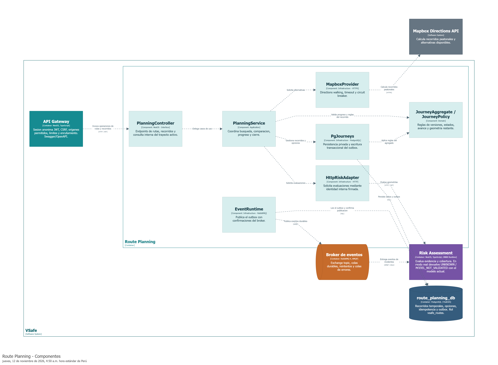
</p>


`PlanningController` delega en `PlanningService`, que coordina `JourneyAggregate` y `JourneyPolicy`, la persistencia `PgJourneys`, `MapboxProvider` y `HttpRiskAdapter`. `PgJourneys` utiliza exclusivamente `route_planning_db` y escribe el outbox en la misma transacción; `EventRuntime` publica sus eventos con confirmaciones de RabbitMQ. La inferencia pertenece a Risk Assessment y se solicita mediante HTTP interno autenticado.

[Abrir componentes de Route Planning en resolución original](assets/route_planning_componentes.png). La fuente se conserva en [Structurizr DSL](assets/vsafe-c4-actual.dsl) [R4].


### 5.1.6. Bounded Context Software Architecture Code Level Diagrams


El nivel de código se especifica mediante las clases del dominio y el modelo relacional. El primero representa comportamiento y relaciones; el segundo define cómo se conserva el estado.


#### 5.1.6.1. Bounded Context Domain Layer Class Diagrams


<p align="center">
  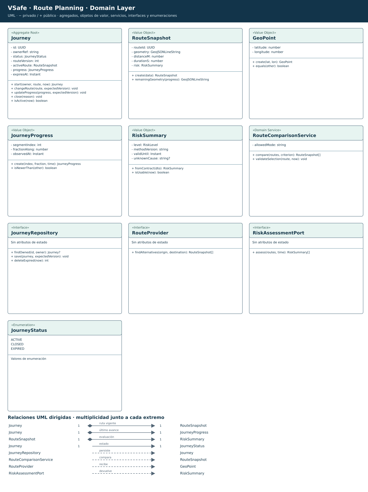
</p>


El panel de relaciones explicita dirección y multiplicidad para evitar cruces visuales. El rombo representa composición; una flecha discontinua indica dependencia. Las fuentes PlantUML conservan los tipos y miembros completos; las fuentes Mermaid permiten revisar la estructura en Markdown.


#### 5.1.6.2. Bounded Context Database Design Diagram


<p align="center">
  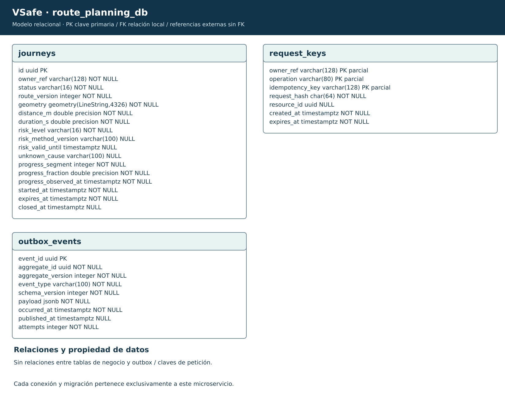
</p>


| Tabla | Columnas y tipos | Constraints / índices |
| --- | --- | --- |
| journeys | id uuid PK; owner_ref varchar(128) NOT NULL; status varchar(16) NOT NULL; route_version integer NOT NULL; geometry geometry(LineString,4326) NOT NULL; distance_m double precision NOT NULL; duration_s double precision NOT NULL; risk_level varchar(16) NOT NULL; risk_method_version varchar(100) NULL; risk_valid_until timestamptz NULL; unknown_cause varchar(100) NULL; progress_segment integer NOT NULL; progress_fraction double precision NOT NULL; progress_observed_at timestamptz NOT NULL; started_at timestamptz NOT NULL; expires_at timestamptz NOT NULL; closed_at timestamptz NULL | CHECK status IN (ACTIVE,CLOSED,EXPIRED), route_version > 0, distance_m > 0, duration_s > 0, progress_segment >= 0 y progress_fraction entre 0 y 1. Índice owner_ref/status; geometry temporal. |
| request_keys | owner_ref varchar(128) PK parcial; operation varchar(80) PK parcial; idempotency_key varchar(128) PK parcial; request_hash char(64) NOT NULL; resource_id uuid NULL; created_at timestamptz NOT NULL; expires_at timestamptz NOT NULL | PK compuesta (owner_ref, operation, idempotency_key). El resultado retenido no contiene geometría; misma clave con cuerpo diferente produce conflicto. |
| outbox_events | event_id uuid PK; aggregate_id uuid NOT NULL; aggregate_version integer NOT NULL; event_type varchar(100) NOT NULL; schema_version integer NOT NULL; payload jsonb NOT NULL; occurred_at timestamptz NOT NULL; published_at timestamptz NULL; attempts integer NOT NULL | Payload de eventos de recorrido sin coordenadas; sin FK al agregado para conservar entrega después de la purga. Índice parcial de pendientes. |


Las claves foráneas indicadas pertenecen a esta base. Los identificadores de otros microservicios se tratan como referencias y se sincronizan mediante contratos. Outbox, inbox y checkpoints son estructuras técnicas de integración; no son agregados de negocio.


## 5.2. Bounded Context: Risk Assessment


Evaluar alternativas con datos de incidentes y un método versionado, distinguiendo clasificación utilizable e incertidumbre.


Este contexto se implementa en **Risk Assessment Service**, utiliza **risk_assessment_db** y se relaciona con US07, TS02 y TS04. Sus drivers prioritarios son QA01, QA04, QA06, QA07 y QA09.


### 5.2.1. Domain Layer


El siguiente diccionario identifica las clases y sus miembros principales. “−” indica un atributo privado y “+” una operación pública. Los objetos de valor se crean completos y permanecen inmutables. Las interfaces definen contratos, sin estado persistente.


| Clase / categoría | Propósito | Atributos | Métodos |
| --- | --- | --- | --- |
| RiskAssessment / Aggregate Root | Agrupa las evaluaciones de una solicitud y garantiza una versión común del método. | - id: UUID; - methodVersion: RiskModelVersion; - evaluatedAt: Instant; - estimates: RouteRiskEstimate[] | + create(version, now): RiskAssessment; + addEstimate(estimate): void; + complete(expectedRoutes): void |
| RouteRiskEstimate / Value Object | Expresa intensidad relativa estimada y cobertura para una alternativa. | - routeRef: string; - level: RiskLevel; - score: number?; - coverage: EvidenceCoverage; - validUntil: Instant; - unknownCause: string? | + classified(data): RouteRiskEstimate; + unknown(cause, coverage): RouteRiskEstimate |
| EvidenceCoverage / Value Object | Describe suficiencia, cobertura y sincronización de la evidencia. | - spatialRatio: number; - sampleCount: int; - lastSyncAt: Instant; - sourceWatermark: string | + isSufficient(policy, now): boolean |
| RiskModelVersion / Value Object | Identifica de forma reproducible el modelo y sus entradas. | - version: string; - checksum: string; - featureSchema: string | + create(data): RiskModelVersion; + matches(schema): boolean |
| IncidentEvidence / Value Object | Representación analítica propia de un incidente publicable. | - incidentId: UUID; - category: string; - location: GeoPoint; - observedAt: Instant; - validUntil: Instant; - sourceVersion: int | + isCurrent(now): boolean |
| RiskEstimationService / Domain Service | Aplica suficiencia, extrae características e interpreta la inferencia. | - policy: CoveragePolicy | + assess(routes, evidence, inference): RiskAssessment; + classify(score, thresholds): RiskLevel |
| CoveragePolicy / Domain Policy | Decide cuándo abstenerse de emitir una categoría de riesgo. | - maxSyncAgeS: int; - minCoverage: number; - minSamples: int | + evaluate(coverage, now): string? |
| IncidentProjectionRepository / Interface | Abstrae las consultas a evidencia espacial propia. | Sin estado. | + findRelevant(geometry, time): IncidentEvidence[]; + upsertIfNewer(evidence): void; + expire(id, version): void |
| RiskInferencePort / Interface | Puerto de ejecución de un modelo compatible. | Sin estado. | + predict(features, modelVersion): number[] |
| RiskLevel / Enumeration | Estados de salida comprensibles. | LOW; MEDIUM; HIGH; UNKNOWN | Valores de enumeración. |


**Reglas e invariantes**


1. La ausencia de reportes no genera LOW. Cobertura, muestras, vigencia y sincronización deben superar los criterios aprobados del modelo.
2. Una proyección sin sincronización comprobada durante más de 60 segundos genera UNKNOWN; el umbral procede del diseño estratégico.
3. Un resultado UNKNOWN tiene score nulo y una causa identificable. Una inferencia fallida nunca se sustituye por un valor arbitrario.
4. Todas las alternativas de una comparación usan la misma versión de método y un instante de referencia común.
5. Los duplicados se descartan por eventId y las versiones anteriores de un incidente no sobrescriben datos más recientes.
6. La puntuación representa intensidad relativa de incidentes reportados. No expresa la probabilidad individual de sufrir un delito.


| Origen | Relación | Destino | Multiplicidad / significado |
| --- | --- | --- | --- |
| RiskAssessment | composition | RouteRiskEstimate | 1 → 1..*; resultados |
| RiskAssessment | composition | RiskModelVersion | 1 → 1; método |
| RouteRiskEstimate | composition | EvidenceCoverage | 1 → 1; cobertura |
| RouteRiskEstimate | association | RiskLevel | 1 → 1; nivel |
| RiskEstimationService | association | CoveragePolicy | 1 → 1; aplica |
| RiskEstimationService | dependency | RiskInferencePort | Dependencia de uso; inferencia |
| IncidentProjectionRepository | dependency | IncidentEvidence | Dependencia de uso; consulta |


### 5.2.2. Interface Layer


Los adaptadores de entrada validan el contrato y la identidad; delegan las decisiones de negocio a los casos de uso. Sus DTO incluyen restricciones de tamaño, formato y valores permitidos.


| Clase | Operaciones | Responsabilidad |
| --- | --- | --- |
| InternalRiskAssessmentsController | assess(request): AssessmentResponse | Acepta una lista acotada de geometrías desde Route Planning; verifica identidad técnica y esquema. |
| IncidentEventsConsumer | consume(envelope): void | Deserializa IncidentPublished/IncidentExpired y delega el procesamiento idempotente. |
| SynchronizationConsumer | consume(checkpoint): void | Registra el watermark confirmado y el momento de sincronización; un heartbeat no prueba procesamiento completo. |


### 5.2.3. Application Layer


Los handlers coordinan repositorios, políticas y puertos. Un command modifica estado; una query produce una respuesta. Esta separación de responsabilidades no obliga a utilizar bases separadas para lectura y escritura ni Event Sourcing.


| Clase / miembros principales | Entrada | Proceso |
| --- | --- | --- |
| AssessRoutesHandler; − dependencies: IncidentProjectionRepository, RiskInferencePort, ModelRegistry y MetadataStore; + execute(input): Promise<Result> | AssessRoutesCommand | Carga el modelo compatible y evidencia propia, invoca RiskEstimationService y almacena únicamente metadatos sin geometrías de rutas. |
| ApplyIncidentEventHandler; − dependencies: IncidentProjectionRepository y RiskInboxUnitOfWork; + handle(event): Promise<void> | IncidentPublished/IncidentExpired | Aplica la actualización y registra inbox en una transacción local; confirma al broker después del commit. |
| ReconcileIncidentProjectionHandler; − dependencies: SnapshotPort, IncidentProjectionRepository y CheckpointStore; + execute(input): Promise<Result> | ReconcileProjectionCommand | Obtiene un snapshot consistente del productor y avanza hasta el watermark; habilita evaluaciones al completar la sincronización. |
| SelectRiskModelHandler; − dependencies: ModelRegistry y RiskModelArtifactLoader; + execute(input): Promise<Result> | SelectModelCommand | Activa una versión evaluada con checksum, esquema y umbrales aprobados; mantiene la anterior para reversión. |


### 5.2.4. Infrastructure Layer


Cada implementación se registra por inyección de dependencias en el servicio propietario. Los detalles externos se traducen a tipos del contexto antes de ingresar al dominio.


| Clase / miembros principales | Abstracción / función | Implementación propuesta |
| --- | --- | --- |
| OnnxRiskInferenceAdapter; − client: AdapterClient; − config: AdapterConfig; + predict(features, modelVersion): number[] | RiskInferencePort | Carga un artefacto ONNX compatible mediante ONNX Runtime para Node.js; verifica checksum y esquema. |
| PostgisIncidentProjectionRepository; − dataSource: PrivateDataSource; + findRelevant(geometry, time): IncidentEvidence[]; + upsertIfNewer(evidence): void; + expire(id, version): void | IncidentProjectionRepository | Consulta evidence_incidents de su base; usa índices espaciales y tiempos de vigencia. |
| RiskAssessmentMetadataRepository; − client: AdapterClient; − config: AdapterConfig; + save(metadata): Promise<void> | Puerto de Application Layer | Almacena modelo, categorías agregadas y causas UNKNOWN sin coordenadas de rutas. |
| RiskInboxUnitOfWork; − dataSource: PrivateDataSource; + run(action): Promise<Result> | Puerto transaccional de Application Layer | Persiste proyección, inbox y checkpoint en la misma transacción. |
| HttpIncidentSnapshotAdapter; − client: AdapterClient; − config: AdapterConfig; + fetchPage(cursor, watermark): Promise<SnapshotPage> | Puerto de reconstrucción de Application Layer | Consulta el snapshot interno de Incident Reporting con paginación y watermark. |
| RiskModelArtifactLoader; − client: AdapterClient; − config: AdapterConfig; + load(version, checksum): Promise<ModelArtifact> | Puerto de carga de Application Layer | Obtiene el modelo de un artefacto versionado de despliegue; no descarga modelos indicados por un cliente. |


### 5.2.5. Bounded Context Software Architecture Component Level Diagrams


La vista de componentes descompone el container del microservicio y conserva sus dependencias externas. Un componente expresa un bloque de responsabilidad, no necesariamente una clase individual [R3].


<p align="center">
  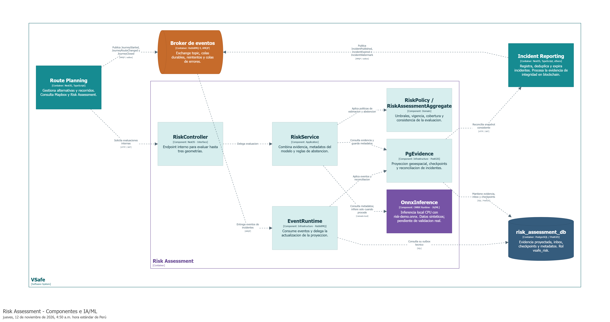
</p>


`RiskController` recibe las evaluaciones internas de Route Planning y las delega a `RiskService`. `RiskPolicy` y `RiskAssessmentAggregate` aplican las reglas de cobertura, vigencia y abstención. `PgEvidence` conserva la proyección en `risk_assessment_db` y la reconcilia con Incident Reporting; `EventRuntime` procesa eventos del broker. `OnnxInference` carga `risk-demo.onnx` dentro del mismo proceso y solo infiere cuando procede. El artefacto actual utiliza datos sintéticos: en modo real se devuelve `UNKNOWN / MODEL_NOT_VALIDATED`.

[Abrir componentes de Risk Assessment en resolución original](assets/risk_assessment_componentes.png). La fuente se conserva en [Structurizr DSL](assets/vsafe-c4-actual.dsl) [R4].


### 5.2.6. Bounded Context Software Architecture Code Level Diagrams


El nivel de código se especifica mediante las clases del dominio y el modelo relacional. El primero representa comportamiento y relaciones; el segundo define cómo se conserva el estado.


#### 5.2.6.1. Bounded Context Domain Layer Class Diagrams


<p align="center">
  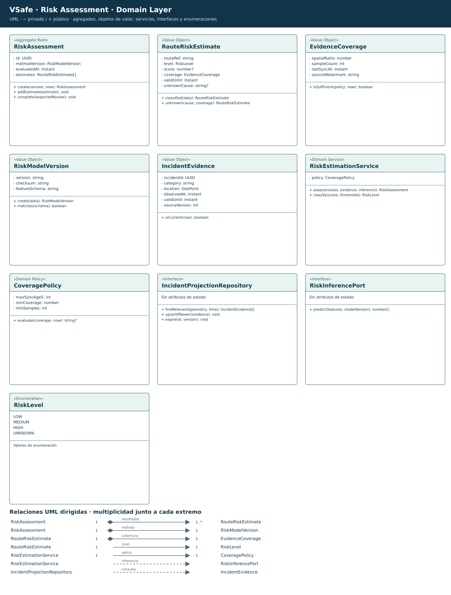
</p>


El panel de relaciones explicita dirección y multiplicidad para evitar cruces visuales. El rombo representa composición; una flecha discontinua indica dependencia. Las fuentes PlantUML conservan los tipos y miembros completos; las fuentes Mermaid permiten revisar la estructura en Markdown.


#### 5.2.6.2. Bounded Context Database Design Diagram


<p align="center">
  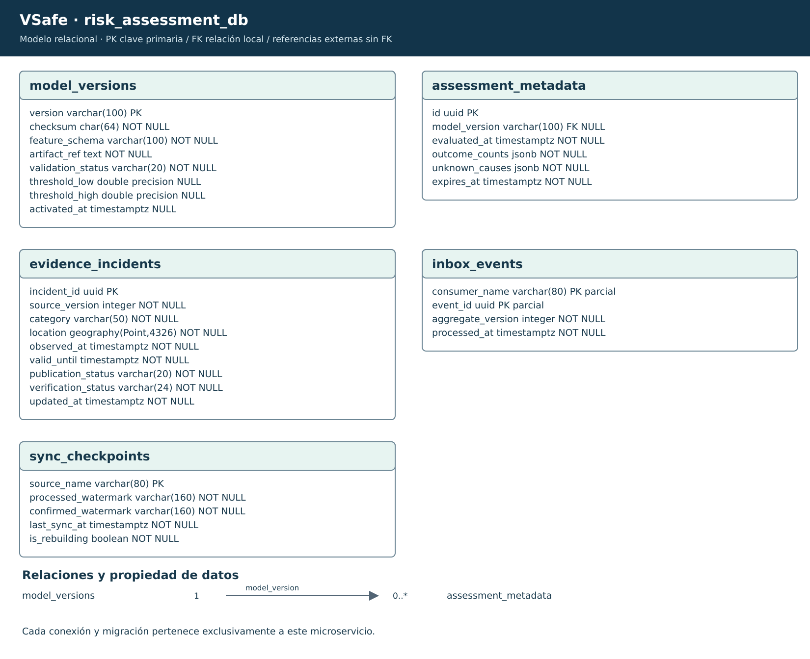
</p>


| Tabla | Columnas y tipos | Constraints / índices |
| --- | --- | --- |
| model_versions | version varchar(100) PK; checksum char(64) NOT NULL; feature_schema varchar(100) NOT NULL; artifact_ref text NOT NULL; validation_status varchar(20) NOT NULL; threshold_low double precision NULL; threshold_high double precision NULL; activated_at timestamptz NULL | Un modelo solo se activa con estado VALIDATED; CHECK threshold_low < threshold_high cuando estén definidos. artifact_ref no acepta entradas del usuario. |
| assessment_metadata | id uuid PK; model_version varchar(100) FK NULL; evaluated_at timestamptz NOT NULL; outcome_counts jsonb NOT NULL; unknown_causes jsonb NOT NULL; expires_at timestamptz NOT NULL | FK local a model_versions. Metadatos agregados sin owner, origen, destino ni geometría; retención operativa propuesta de siete días. |
| evidence_incidents | incident_id uuid PK; source_version integer NOT NULL; category varchar(50) NOT NULL; location geography(Point,4326) NOT NULL; observed_at timestamptz NOT NULL; valid_until timestamptz NOT NULL; publication_status varchar(20) NOT NULL; verification_status varchar(24) NOT NULL; updated_at timestamptz NOT NULL | incident_id es referencia externa sin FK. Índice GiST location y B-tree valid_until; upsert condicionado a source_version mayor. |
| inbox_events | consumer_name varchar(80) PK parcial; event_id uuid PK parcial; aggregate_version integer NOT NULL; processed_at timestamptz NOT NULL | PK (consumer_name,event_id). Se escribe antes del ACK dentro de la transacción del efecto. |
| sync_checkpoints | source_name varchar(80) PK; processed_watermark varchar(160) NOT NULL; confirmed_watermark varchar(160) NOT NULL; last_sync_at timestamptz NOT NULL; is_rebuilding boolean NOT NULL | La proyección se marca utilizable solo cuando el watermark procesado alcanza el confirmado. |


Las claves foráneas indicadas pertenecen a esta base. Los identificadores de otros microservicios se tratan como referencias y se sincronizan mediante contratos. Outbox, inbox y checkpoints son estructuras técnicas de integración; no son agregados de negocio.


**Detalle del método de estimación**

El entrenamiento queda fuera de la solicitud de navegación. El modelo candidato analiza intensidad de incidentes reportados por segmento y franja horaria, utilizando densidad por categoría, recencia, hora y cobertura. Antes de activarlo deben definirse datos de origen, etiquetas, ventanas temporales y umbrales, comparar con una línea base y evaluar errores por zona y horario. Se separan periodos de entrenamiento y prueba y se agrupan duplicados para evitar fuga de información.

La ejecución utiliza un artefacto ONNX compatible, no entrenamiento en producción [R8]. CoveragePolicy combina límites aprobados del modelo con la sincronización de la proyección. Mientras no existan datos y evaluación aceptables, el contrato devuelve UNKNOWN. La metadata identifica método, vigencia y causa; la representación visual no promete una probabilidad de seguridad.


## 5.3. Bounded Context: Incident Reporting


Recibir aportes comunitarios, comprobar su consistencia y administrar información publicable sin confundirla con hechos confirmados.


Este contexto se implementa en **Incident Reporting Service**, utiliza **incident_reporting_db** y se relaciona con US09, US13–US16, TS03 y TS04. Sus drivers prioritarios son QA04, QA05, QA06 y QA09.


### 5.3.1. Domain Layer


El siguiente diccionario identifica las clases y sus miembros principales. “−” indica un atributo privado y “+” una operación pública. Los objetos de valor se crean completos y permanecen inmutables. Las interfaces definen contratos, sin estado persistente.


| Clase / categoría | Propósito | Atributos | Métodos |
| --- | --- | --- | --- |
| IncidentReport / Aggregate Root | Representa la contribución de un usuario y su procesamiento. | - id: UUID; - ownerRef: string; - category: IncidentCategory; - location: ApproximateLocation; - observedAt: Instant; - description: string; - status: ReportStatus; - incidentRef: UUID?; - version: int | + submit(data): IncidentReport; + assess(result): void; + linkTo(incidentId): void; + reject(reason): void |
| PublishedIncident / Aggregate Root | Administra el ciclo de vida de un incidente consultable. | - id: UUID; - categoryCode: string; - location: ApproximateLocation; - validity: ValidityPeriod; - verification: VerificationStatus; - version: int | + publish(data): PublishedIncident; + expire(now): void; + isCurrent(now): boolean |
| IncidentCategory / Value Object | Define la categoría habilitada y su política temporal. | - code: string; - labelKey: string; - validityHours: int | + create(code, hours): IncidentCategory |
| ApproximateLocation / Value Object | Conserva la ubicación del incidente confirmada por el usuario. | - latitude: number; - longitude: number; - precisionM: number | + create(data): ApproximateLocation; + equals(other): boolean |
| ValidityPeriod / Value Object | Representa el intervalo de influencia activa del incidente. | - observedAt: Instant; - validUntil: Instant | + fromCategory(observedAt, hours): ValidityPeriod; + contains(now): boolean |
| ReportAssessmentService / Domain Service | Evalúa consistencia, vigencia y posibles duplicados. | - duplicateRadiusM: number; - duplicateWindowMin: int | + assess(report, candidates, now): AssessmentResult |
| IncidentReportRepository / Interface | Puerto de persistencia de reportes. | Sin estado. | + findOwned(id, owner): IncidentReport?; + save(report, expectedVersion): void |
| PublishedIncidentRepository / Interface | Puerto para incidentes y candidatos espaciales. | Sin estado. | + findCandidates(location, category, time): PublishedIncident[]; + save(incident, expectedVersion): void; + findCurrent(filter): PublishedIncident[] |
| ReportStatus / Enumeration | Estados del aporte comunitario. | PENDING; PUBLISHED; LINKED; REJECTED | Valores de enumeración. |
| VerificationStatus / Enumeration | Distingue procedencia comunitaria y verificación. | UNVERIFIED; CORROBORATED | Valores de enumeración. |


**Reglas e invariantes**


1. El reporte requiere categoría habilitada, ubicación confirmada, momento observado y descripción cuando la categoría sea OTHER.
2. El momento observado no puede estar en el futuro más allá de la tolerancia de reloj configurada. La vigencia se calcula desde observedAt, no desde la recepción.
3. Las comprobaciones de formato y consistencia habilitan la publicación como UNVERIFIED; no verifican la ocurrencia del hecho.
4. Un candidato similar en categoría, distancia y ventana temporal se trata como posible duplicado. La regla debe calibrarse para evitar fusionar incidentes distintos.
5. Un reporte LINKED aporta al incidente existente y no crea un segundo incidente. El conteo de reportes no aumenta automáticamente la intensidad del riesgo.
6. La publicación o expiración y su evento se guardan en la misma transacción local. Los incidentes vencidos no aparecen como activos.


| Origen | Relación | Destino | Multiplicidad / significado |
| --- | --- | --- | --- |
| IncidentReport | composition | IncidentCategory | 1 → 1; categoría |
| IncidentReport | composition | ApproximateLocation | 1 → 1; ubicación |
| IncidentReport | association | ReportStatus | 1 → 1; estado |
| PublishedIncident | composition | ValidityPeriod | 1 → 1; vigencia |
| PublishedIncident | association | VerificationStatus | 1 → 1; verificación |
| IncidentReport | association | PublishedIncident | 0..* → 0..1; referencia por ID |
| IncidentReportRepository | dependency | IncidentReport | Dependencia de uso; persiste |
| PublishedIncidentRepository | dependency | PublishedIncident | Dependencia de uso; persiste |


### 5.3.2. Interface Layer


Los adaptadores de entrada validan el contrato y la identidad; delegan las decisiones de negocio a los casos de uso. Sus DTO incluyen restricciones de tamaño, formato y valores permitidos.


| Clase | Operaciones | Responsabilidad |
| --- | --- | --- |
| IncidentReportsController | submit(), getOwned(), listOwned() | Recibe el reporte con Idempotency-Key y permite consultar estado por propietario. |
| IncidentsController | findCurrent(filters): IncidentResponse[] | Devuelve incidentes publicables filtrados por zona, categoría y vigencia; omite identidad del reportante. |
| InternalIncidentSnapshotController | snapshot(cursor, watermark): SnapshotPage | Entrega una vista consistente y paginada para reconstruir proyecciones privadas. |
| ReportOwnerGuard | assertOwner(report, context): void | Protege el acceso a reportes privados aun cuando el cliente conozca su ID. |


### 5.3.3. Application Layer


Los handlers coordinan repositorios, políticas y puertos. Un command modifica estado; una query produce una respuesta. Esta separación de responsabilidades no obliga a utilizar bases separadas para lectura y escritura ni Event Sourcing.


| Clase / miembros principales | Entrada | Proceso |
| --- | --- | --- |
| SubmitIncidentReportHandler; − dependencies: IncidentReportRepository, CategoryCatalogue, IdempotencyStore y UnitOfWork; + execute(input): Promise<Result> | SubmitIncidentReportCommand | Comprueba idempotencia, construye IncidentReport y guarda aporte pendiente y evento local. |
| AssessIncidentReportHandler; − dependencies: IncidentReportRepository, PublishedIncidentRepository y UnitOfWork; + execute(input): Promise<Result> | AssessIncidentReportCommand | Carga candidatos locales, aplica ReportAssessmentService y publica, vincula o rechaza. Persiste reportes e incidentes dentro de una sola base. |
| GetOwnedReportHandler; − dependencies: IncidentReportRepository y ResourceAuthorization; + execute(input): Promise<Result> | GetOwnedReportQuery | Produce el estado legible y su explicación sin exponer otros propietarios. |
| SearchPublishedIncidentsHandler; − dependencies: PublishedIncidentRepository; + execute(input): Promise<Result> | PublishedIncidentsQuery | Aplica filtros y limita tamaño del área y paginación. |
| ExpireIncidentsHandler; − dependencies: PublishedIncidentRepository, UnitOfWork y Clock; + execute(input): Promise<Result> | ExpireIncidentsCommand | Expira incidentes vigentes según su reloj de negocio y añade IncidentExpired a la outbox. |
| BuildIncidentSnapshotHandler; − dependencies: PublishedIncidentRepository y SnapshotStore; + execute(input): Promise<Result> | SnapshotQuery | Obtiene un watermark consistente con el orden de publicación del productor. |


### 5.3.4. Infrastructure Layer


Cada implementación se registra por inyección de dependencias en el servicio propietario. Los detalles externos se traducen a tipos del contexto antes de ingresar al dominio.


| Clase / miembros principales | Abstracción / función | Implementación propuesta |
| --- | --- | --- |
| PostgresIncidentReportRepository; − dataSource: PrivateDataSource; + findOwned(id, owner): IncidentReport?; + save(report, expectedVersion): void | IncidentReportRepository | Persiste IncidentReport y aplica versión optimista. |
| PostgisPublishedIncidentRepository; − dataSource: PrivateDataSource; + findCandidates(location, category, time): PublishedIncident[]; + save(incident, expectedVersion): void; + findCurrent(filter): PublishedIncident[] | PublishedIncidentRepository | Busca candidatos por categoría, fecha y distancia en geography con índice GiST. |
| IncidentUnitOfWork; − dataSource: PrivateDataSource; + run(action): Promise<Result> | Puerto transaccional de Application Layer | Guarda reporte, incidente y outbox; las transacciones no salen de incident_reporting_db. |
| PostgresIdempotencyStore; − dataSource: PrivateDataSource; + reserve(key, hash): Promise<Result>; + resolve(key): Promise<Result> | Puerto de Application Layer | Retiene la clave por 24 h; cuerpo diferente con igual clave devuelve conflicto. |
| IncidentOutboxRelay; − outboxStore: OutboxStore; − publisher: EventPublisher; + publishPending(limit): Promise<int> | Publicación técnica | Publica IncidentPublished/IncidentExpired mediante RabbitMQ y confirma entrega al broker. |
| IncidentAssessmentScheduler; − handler: ApplicationHandler; − clock: Clock; + tick(now): Promise<void> | Programación técnica | Reintenta reportes pendientes y ejecuta expiraciones; utiliza los casos de uso del servicio. |


### 5.3.5. Bounded Context Software Architecture Component Level Diagrams


La vista de componentes descompone el container del microservicio y conserva sus dependencias externas. Un componente expresa un bloque de responsabilidad, no necesariamente una clase individual [R3].


<p align="center">
  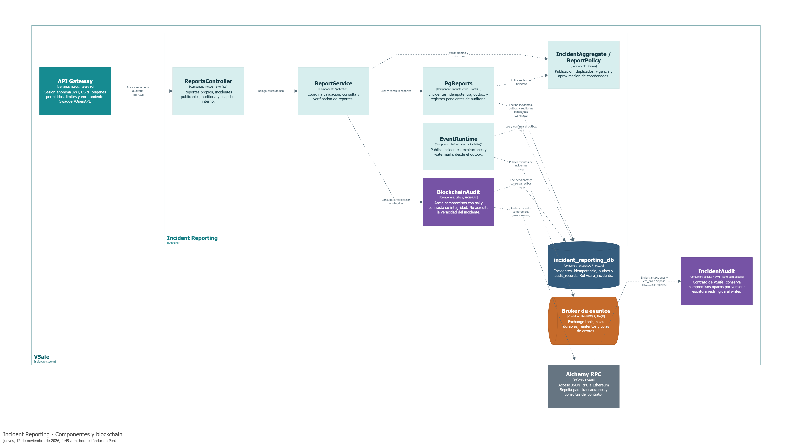
</p>


`ReportsController` delega los casos de uso en `ReportService`; `IncidentAggregate` y `ReportPolicy` controlan publicación, duplicados y vigencia. `PgReports` utiliza exclusivamente `incident_reporting_db` y registra datos, outbox y auditorías pendientes. `EventRuntime` publica incidentes, expiraciones y watermarks. `BlockchainAudit` procesa los compromisos con sal, conserva los recibos y consulta el contrato `IncidentAudit` mediante ethers y Alchemy RPC. El anclaje en Sepolia permite contrastar integridad sin almacenar descripciones ni coordenadas en texto abierto; no demuestra que el incidente haya ocurrido.

[Abrir componentes de Incident Reporting en resolución original](assets/incident_reporting_componentes.png). La fuente se conserva en [Structurizr DSL](assets/vsafe-c4-actual.dsl) [R4].


### 5.3.6. Bounded Context Software Architecture Code Level Diagrams


El nivel de código se especifica mediante las clases del dominio y el modelo relacional. El primero representa comportamiento y relaciones; el segundo define cómo se conserva el estado.


#### 5.3.6.1. Bounded Context Domain Layer Class Diagrams


<p align="center">
  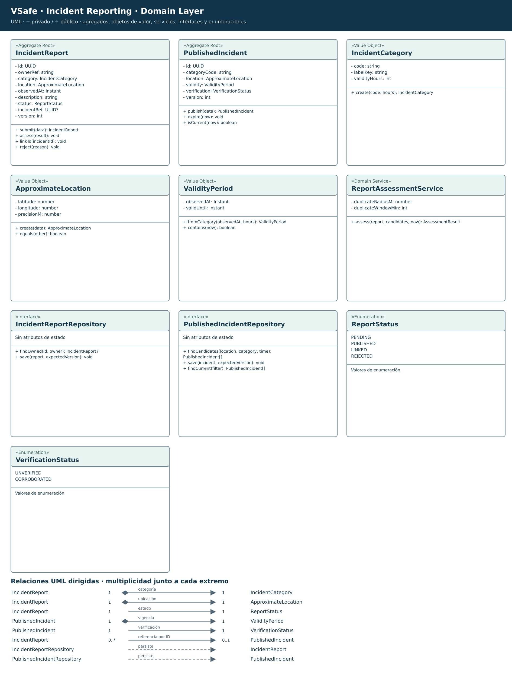
</p>


El panel de relaciones explicita dirección y multiplicidad para evitar cruces visuales. El rombo representa composición; una flecha discontinua indica dependencia. Las fuentes PlantUML conservan los tipos y miembros completos; las fuentes Mermaid permiten revisar la estructura en Markdown.


#### 5.3.6.2. Bounded Context Database Design Diagram


<p align="center">
  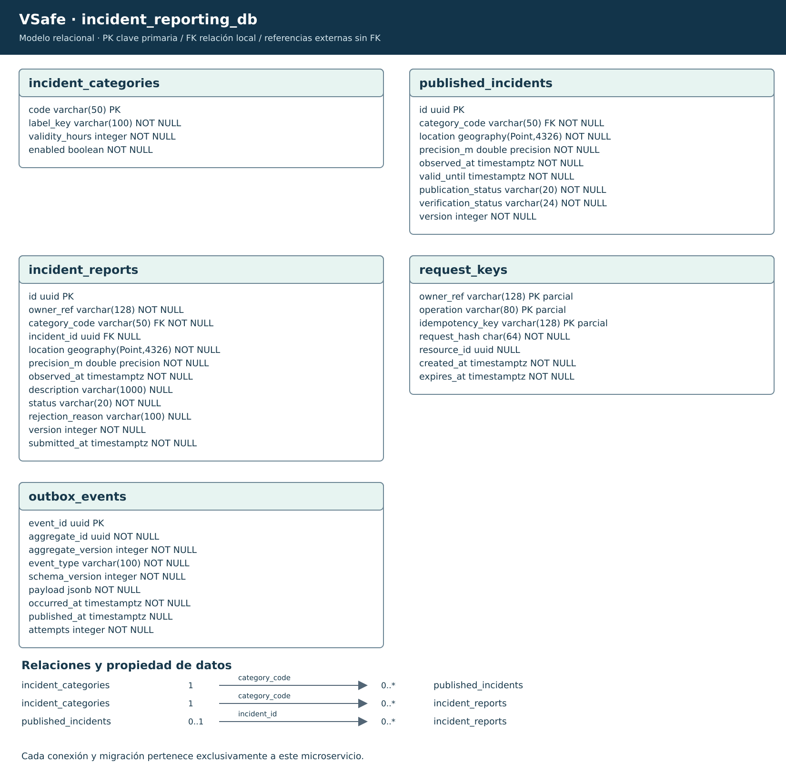
</p>


| Tabla | Columnas y tipos | Constraints / índices |
| --- | --- | --- |
| incident_categories | code varchar(50) PK; label_key varchar(100) NOT NULL; validity_hours integer NOT NULL; enabled boolean NOT NULL | CHECK validity_hours > 0. Categorías iniciales ROBBERY, ASSAULT, SUSPICIOUS_ACTIVITY y OTHER; la configuración no prueba hechos. |
| published_incidents | id uuid PK; category_code varchar(50) FK NOT NULL; location geography(Point,4326) NOT NULL; precision_m double precision NOT NULL; observed_at timestamptz NOT NULL; valid_until timestamptz NOT NULL; publication_status varchar(20) NOT NULL; verification_status varchar(24) NOT NULL; version integer NOT NULL | FK local category_code; CHECK valid_until > observed_at, precision_m > 0 y version > 0. Índices GiST location y categoría/vigencia. |
| incident_reports | id uuid PK; owner_ref varchar(128) NOT NULL; category_code varchar(50) FK NOT NULL; incident_id uuid FK NULL; location geography(Point,4326) NOT NULL; precision_m double precision NOT NULL; observed_at timestamptz NOT NULL; description varchar(1000) NULL; status varchar(20) NOT NULL; rejection_reason varchar(100) NULL; version integer NOT NULL; submitted_at timestamptz NOT NULL | FK locales a incident_categories y published_incidents. CHECK status y coherencia con incident_id. Índice owner_ref/submitted_at; descripción moderada antes de exposición. |
| request_keys | owner_ref varchar(128) PK parcial; operation varchar(80) PK parcial; idempotency_key varchar(128) PK parcial; request_hash char(64) NOT NULL; resource_id uuid NULL; created_at timestamptz NOT NULL; expires_at timestamptz NOT NULL | PK compuesta. El recurso referenciado se resuelve bajo autorización, sin conservar el texto privado de la solicitud. |
| outbox_events | event_id uuid PK; aggregate_id uuid NOT NULL; aggregate_version integer NOT NULL; event_type varchar(100) NOT NULL; schema_version integer NOT NULL; payload jsonb NOT NULL; occurred_at timestamptz NOT NULL; published_at timestamptz NULL; attempts integer NOT NULL | Eventos publicables con ubicación aproximada del incidente; sin propietario ni texto libre del reportante. Índice de pendientes. |


Las claves foráneas indicadas pertenecen a esta base. Los identificadores de otros microservicios se tratan como referencias y se sincronizan mediante contratos. Outbox, inbox y checkpoints son estructuras técnicas de integración; no son agregados de negocio.


**Transiciones del reporte**

PENDING pasa a PUBLISHED si el aporte es procesable y crea información comunitaria consultable; pasa a LINKED si se vincula con un incidente existente; pasa a REJECTED ante inconsistencias no corregibles. La caducidad se expresa en PublishedIncident y en la información del reporte asociado, sin convertir una validación automática en confirmación del hecho. La categoría propuesta de actividad sospechosa exige una descripción factual y moderación para evitar señalamientos personales.


## 5.4. Bounded Context: Journey Alerts


Evaluar incidentes vigentes contra el tramo restante de un recorrido y entregar alertas autorizadas sin cambiar automáticamente la ruta.


Este contexto se implementa en **Journey Alerts Service**, utiliza **journey_alerts_db** y se relaciona con US10, US11 y TS04. Sus drivers prioritarios son QA02, QA05, QA06 y QA09.


### 5.4.1. Domain Layer


El siguiente diccionario identifica las clases y sus miembros principales. “−” indica un atributo privado y “+” una operación pública. Los objetos de valor se crean completos y permanecen inmutables. Las interfaces definen contratos, sin estado persistente.


| Clase / categoría | Propósito | Atributos | Métodos |
| --- | --- | --- | --- |
| JourneyAlert / Aggregate Root | Representa una alerta lógica identificable y su entrega. | - id: UUID; - ownerRef: string; - journeyRef: UUID; - incidentRef: UUID; - routeVersion: int; - status: DeliveryStatus; - expiresAt: Instant | + create(data): JourneyAlert; + markDelivered(at): void; + invalidate(reason): void; + isDeliverable(now, version): boolean |
| ActiveJourneyProjection / Entity | Copia temporal y mínima del recorrido obtenida por contrato autorizado. | - journeyRef: UUID; - ownerRef: string; - routeVersion: int; - remainingGeometry: GeoJSONLineString; - refreshedAt: Instant; - leaseUntil: Instant | + refresh(contract, now): void; + isFresh(now): boolean; + removeGeometry(): void |
| IncidentProjection / Entity | Vista propia de un incidente publicable y su versión. | - incidentRef: UUID; - location: GeoPoint; - category: string; - validUntil: Instant; - sourceVersion: int | + applyIfNewer(contract): void; + isCurrent(now): boolean |
| AlertKey / Value Object | Clave que evita efectos duplicados para una versión de ruta. | - incidentRef: UUID; - journeyRef: UUID; - routeVersion: int | + equals(other): boolean; + toKey(): string |
| AlertRelevancePolicy / Domain Policy | Establece pertinencia espacial, temporal y por versión. | - proximityM: number; - maxProgressAgeS: int | + evaluate(journey, incident, distanceM, now): boolean |
| JourneyAlertRepository / Interface | Puerto para alertas lógicas y reentregas. | Sin estado. | + findByKey(key): JourneyAlert?; + save(alert): void; + findDeliverable(journey, afterId): JourneyAlert[] |
| ActiveJourneyRepository / Interface | Puerto de proyecciones temporales propias. | Sin estado. | + upsert(projection): void; + findActive(id): ActiveJourneyProjection?; + deleteExpired(now): int |
| IncidentProjectionRepository / Interface | Puerto espacial de incidentes de este consumidor. | Sin estado. | + upsertIfNewer(incident): void; + findNear(remainingRoute, radiusM): IncidentProjection[] |
| DeliveryStatus / Enumeration | Distingue creación, visualización e invalidez. | CREATED; DELIVERED; INVALIDATED; EXPIRED | Valores de enumeración. |


**Reglas e invariantes**


1. Solo un recorrido activo, autorizado y con proyección vigente puede recibir alertas. El arrendamiento de su geometría temporal no supera cinco minutos.
2. El incidente debe estar vigente y próximo al tramo restante. Se mantiene el radio inicial de 200 m como parámetro por validar.
3. El avance se renueva desde Route Planning al evaluar pertinencia y al mantener la suscripción. Si no puede comprobarse un progreso vigente, se suspende la evaluación contextual.
4. UNIQUE (incident_ref, journey_ref, route_version) garantiza una alerta lógica por combinación, incluso con reentregas del broker.
5. Antes de emitir o reemitir se comprueban versión, vigencia y propietario. Un cambio de ruta invalida alertas anteriores que ya no sean aplicables.
6. DELIVERED requiere un acuse de visualización del cliente. Escribir un mensaje SSE en una conexión no prueba que haya sido visto.
7. El cierre o revocación impide nuevas entregas y activa la eliminación temporal; el cliente decide si solicita otra ruta.


| Origen | Relación | Destino | Multiplicidad / significado |
| --- | --- | --- | --- |
| JourneyAlert | composition | AlertKey | 1 → 1; identidad lógica |
| JourneyAlert | association | DeliveryStatus | 1 → 1; estado |
| AlertRelevancePolicy | dependency | ActiveJourneyProjection | Dependencia de uso; evalúa |
| AlertRelevancePolicy | dependency | IncidentProjection | Dependencia de uso; evalúa |
| JourneyAlertRepository | dependency | JourneyAlert | Dependencia de uso; persiste |
| ActiveJourneyRepository | dependency | ActiveJourneyProjection | Dependencia de uso; persiste |
| IncidentProjectionRepository | dependency | IncidentProjection | Dependencia de uso; consulta |


### 5.4.2. Interface Layer


Los adaptadores de entrada validan el contrato y la identidad; delegan las decisiones de negocio a los casos de uso. Sus DTO incluyen restricciones de tamaño, formato y valores permitidos.


| Clase | Operaciones | Responsabilidad |
| --- | --- | --- |
| JourneyAlertsController | stream(journeyId, lastEventId): SSE; acknowledge(alertId) | Autoriza la sesión propietaria y abre el flujo; recibe el acuse de visualización. |
| JourneyEventsConsumer | consume(envelope): void | Recibe JourneyStarted, JourneyRouteChanged y JourneyClosed; invalida estado incompatible. |
| IncidentEventsConsumer | consume(envelope): void | Recibe publicaciones y expiraciones y delega evaluación e inbox. |
| AlertSubscriptionGuard | assertOwned(journeyId, context): void | Comprueba propiedad con estado vigente del recorrido; una URL de stream no funciona como credencial. |


### 5.4.3. Application Layer


Los handlers coordinan repositorios, políticas y puertos. Un command modifica estado; una query produce una respuesta. Esta separación de responsabilidades no obliga a utilizar bases separadas para lectura y escritura ni Event Sourcing.


| Clase / miembros principales | Entrada | Proceso |
| --- | --- | --- |
| ApplyJourneyEventHandler; − dependencies: ActiveJourneyPort, ActiveJourneyRepository y AlertsInboxUnitOfWork; + handle(event): Promise<void> | Evento de recorrido | Consulta el estado mínimo en Route Planning, actualiza la proyección y registra inbox; el cierre elimina la copia espacial. |
| ApplyIncidentEventHandler; − dependencies: IncidentProjectionRepository y AlertsInboxUnitOfWork y EvaluateJourneyAlertsHandler; + handle(event): Promise<void> | Evento de incidente | Actualiza la proyección, invoca evaluación sobre recorridos activos y registra el efecto e inbox en una transacción. |
| EvaluateJourneyAlertsHandler; − dependencies: ActiveJourneyPort, ActiveJourneyRepository, IncidentProjectionRepository, JourneyAlertRepository y SpatialQueryPort; + execute(input): Promise<Result> | EvaluateAlertsCommand | Renueva versión y progreso, obtiene distancias por un puerto espacial y aplica AlertRelevancePolicy; crea alertas con clave única. |
| SubscribeJourneyAlertsHandler; − dependencies: ActiveJourneyPort, JourneyAlertRepository y AlertDeliveryPort; + execute(input): Promise<Result> | SubscribeAlertsQuery | Devuelve alertas vigentes, controla reconexión por Last-Event-ID y no entrega mensajes de versiones anteriores. |
| AcknowledgeAlertHandler; − dependencies: JourneyAlertRepository, ResourceAuthorization y UnitOfWork; + execute(input): Promise<Result> | AcknowledgeAlertCommand | Verifica propietario y marca visualización con una operación idempotente. |
| PurgeAlertStateHandler; − dependencies: ActiveJourneyRepository, JourneyAlertRepository y Clock; + execute(input): Promise<Result> | Purga temporal | Borra proyecciones vencidas y estado personal al cerrar; invalida suscripciones locales. |


### 5.4.4. Infrastructure Layer


Cada implementación se registra por inyección de dependencias en el servicio propietario. Los detalles externos se traducen a tipos del contexto antes de ingresar al dominio.


| Clase / miembros principales | Abstracción / función | Implementación propuesta |
| --- | --- | --- |
| HttpActiveJourneyAdapter; − client: AdapterClient; − config: AdapterConfig; + getActive(id): Promise<ActiveJourneyContract> | Puerto de Application Layer | Obtiene geometría mínima, progreso, versión y lease del propietario Route Planning; con fallo no renueva la copia. |
| PostgresJourneyAlertRepository; − dataSource: PrivateDataSource; + findByKey(key): JourneyAlert?; + save(alert): void; + findDeliverable(journey, afterId): JourneyAlert[] | JourneyAlertRepository | Inserta con clave única y resuelve conflictos de reentrega sin crear otra alerta. |
| PostgresActiveJourneyRepository; − dataSource: PrivateDataSource; + upsert(projection): void; + findActive(id): ActiveJourneyProjection?; + deleteExpired(now): int | ActiveJourneyRepository | Persiste únicamente la copia actual, sin muestras históricas de ubicación. |
| PostgisAlertIncidentRepository; − dataSource: PrivateDataSource; + upsertIfNewer(incident): void; + findNear(remainingRoute, radiusM): IncidentProjection[] | IncidentProjectionRepository | Calcula proximidad métrica con geography y ST_DWithin; no usa grados como metros. |
| SseAlertDispatcher; − client: AdapterClient; − config: AdapterConfig; + deliver(alert, connection): void; + close(connection): void | Puerto de entrega de Application Layer | Emite ID, tipo y DTO de alerta a través del gateway; mantiene heartbeats y cierre de conexión. |
| AlertsInboxUnitOfWork; − dataSource: PrivateDataSource; + run(action): Promise<Result> | Puerto transaccional de Application Layer | Guarda proyección, alerta e inbox antes del ACK manual. |
| AlertLeaseScheduler; − handler: ApplicationHandler; − clock: Clock; + tick(now): Promise<void> | Programación técnica | Renueva suscripciones conectadas y elimina leases vencidos antes de admitir nuevas solicitudes. |


### 5.4.5. Bounded Context Software Architecture Component Level Diagrams


La vista de componentes descompone el container del microservicio y conserva sus dependencias externas. Un componente expresa un bloque de responsabilidad, no necesariamente una clase individual [R3].


<p align="center">
  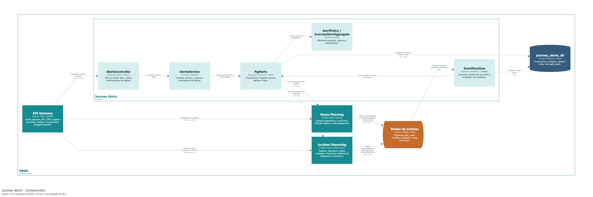
</p>


`AlertsController` abre el stream SSE y recibe confirmaciones de alertas mediante `AlertsService`. `AlertPolicy` y `JourneyAlertAggregate` determinan relevancia, vigencia y deduplicación. `PgAlerts` mantiene las proyecciones en `journey_alerts_db`, consulta el trayecto restante a Route Planning y reconcilia incidentes con Incident Reporting. `EventRuntime` consume eventos de recorridos e incidentes. El SSE llega a la WebApp a través del gateway y del proxy de Cloudflare.

[Abrir componentes de Journey Alerts en resolución original](assets/journey_alerts_componentes.png). La fuente se conserva en [Structurizr DSL](assets/vsafe-c4-actual.dsl) [R4].


### 5.4.6. Bounded Context Software Architecture Code Level Diagrams


El nivel de código se especifica mediante las clases del dominio y el modelo relacional. El primero representa comportamiento y relaciones; el segundo define cómo se conserva el estado.


#### 5.4.6.1. Bounded Context Domain Layer Class Diagrams


<p align="center">
  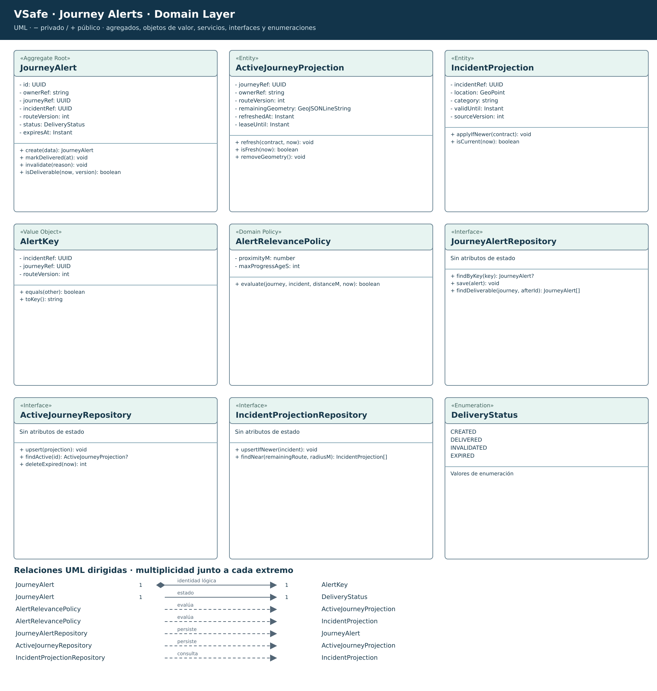
</p>


El panel de relaciones explicita dirección y multiplicidad para evitar cruces visuales. El rombo representa composición; una flecha discontinua indica dependencia. Las fuentes PlantUML conservan los tipos y miembros completos; las fuentes Mermaid permiten revisar la estructura en Markdown.


#### 5.4.6.2. Bounded Context Database Design Diagram


<p align="center">
  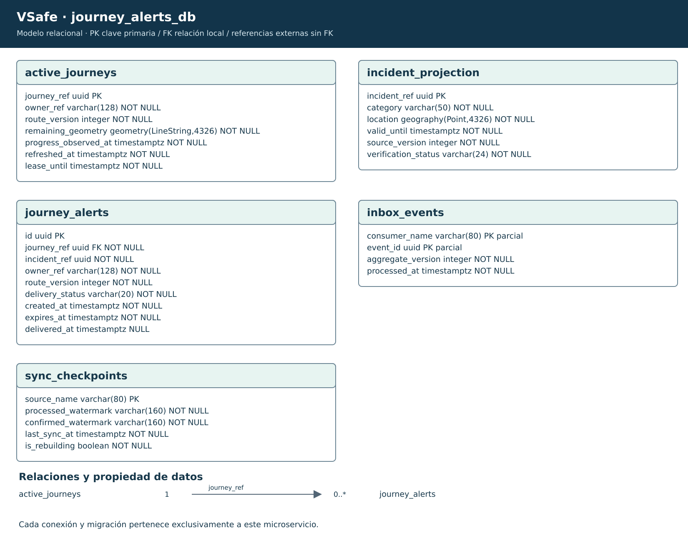
</p>


| Tabla | Columnas y tipos | Constraints / índices |
| --- | --- | --- |
| active_journeys | journey_ref uuid PK; owner_ref varchar(128) NOT NULL; route_version integer NOT NULL; remaining_geometry geometry(LineString,4326) NOT NULL; progress_observed_at timestamptz NOT NULL; refreshed_at timestamptz NOT NULL; lease_until timestamptz NOT NULL | journey_ref es referencia externa sin FK. CHECK route_version > 0 y lease_until <= refreshed_at + 5 minutos. Índice owner_ref y lease_until. |
| incident_projection | incident_ref uuid PK; category varchar(50) NOT NULL; location geography(Point,4326) NOT NULL; valid_until timestamptz NOT NULL; source_version integer NOT NULL; verification_status varchar(24) NOT NULL | Referencia externa sin FK. GiST location y B-tree valid_until; ignora versiones antiguas. |
| journey_alerts | id uuid PK; journey_ref uuid FK NOT NULL; incident_ref uuid NOT NULL; owner_ref varchar(128) NOT NULL; route_version integer NOT NULL; delivery_status varchar(20) NOT NULL; created_at timestamptz NOT NULL; expires_at timestamptz NOT NULL; delivered_at timestamptz NULL | FK local journey_ref a active_journeys ON DELETE CASCADE. incident_ref conserva referencia de negocio sin FK al productor. UNIQUE (incident_ref,journey_ref,route_version); CHECK status. |
| inbox_events | consumer_name varchar(80) PK parcial; event_id uuid PK parcial; aggregate_version integer NOT NULL; processed_at timestamptz NOT NULL | PK compuesta; metadatos sin geometrías ni owner. Idempotencia de consumo por handler. |
| sync_checkpoints | source_name varchar(80) PK; processed_watermark varchar(160) NOT NULL; confirmed_watermark varchar(160) NOT NULL; last_sync_at timestamptz NOT NULL; is_rebuilding boolean NOT NULL | Controla reconstrucción y frescura de la proyección de incidentes. |


Las claves foráneas indicadas pertenecen a esta base. Los identificadores de otros microservicios se tratan como referencias y se sincronizan mediante contratos. Outbox, inbox y checkpoints son estructuras técnicas de integración; no son agregados de negocio.


**Evaluación del tramo restante y entrega**

El navegador obtiene ubicación únicamente con autorización. Route Planning conserva el último progreso y devuelve una geometría restante mediante su contrato interno. Journey Alerts renueva ese estado antes de aplicar la política; si la muestra tiene más de sesenta segundos o no corresponde a la versión actual, suspende las alertas contextuales y la interfaz informa la limitación. Sesenta segundos es un parámetro técnico inicial por validar.

Para proximidad se utiliza geography y distancia métrica. ST_DWithin acepta metros en su variante geography [R7]. SSE entrega eventos servidor-cliente y se integra mediante NestJS [R6]. La reconexión recupera alertas vigentes; un POST de acuse identifica la visualización. Ninguna alerta altera la ruta sin una decisión del usuario.


## 5.5. Contratos, consistencia y trazabilidad entre microservicios


Los contratos siguientes conservan los endpoints públicos del capítulo IV y completan las operaciones necesarias para el ciclo de vida descrito. El API Gateway enruta y retransmite; cada microservicio sigue siendo propietario de sus reglas y de su especificación OpenAPI.


| Operación / contrato | Propietario | Condiciones |
| --- | --- | --- |
| POST /api/v1/routes/search | Route Planning | Origen/destino válidos. Devuelve alternativas, incertidumbre y token de selección con expiración. |
| POST /api/v1/journeys | Route Planning | Token de selección ligado al propietario, Idempotency-Key y versión inicial. |
| PATCH /api/v1/journeys/{id}/route | Route Planning | expectedVersion y token de nueva alternativa; conflicto ante versión antigua. |
| PATCH /api/v1/journeys/{id}/progress | Route Planning | Nuevo detalle técnico: routeVersion, segmentIndex, fractionAlong y observedAt. Sin trayectoria histórica. |
| DELETE /api/v1/journeys/{id} | Route Planning | Cierre idempotente, evento durable y purga temporal. |
| POST /api/v1/incident-reports | Incident Reporting | Idempotency-Key; categoría, ubicación aproximada y momento observado. |
| GET /api/v1/incident-reports | Incident Reporting | Nuevo detalle técnico: listado de reportes de la sesión propietaria para US16. |
| GET /api/v1/incident-reports/{id} | Incident Reporting | Estado autorizado y explicación del procesamiento. |
| GET /api/v1/incidents | Incident Reporting | Filtros espaciales, categoría y vigencia; información publicable sin identidad del reportante. |
| GET /api/v1/journeys/{id}/alerts/stream | Journey Alerts | SSE autorizado con Last-Event-ID; solo alertas vigentes de la versión actual. |
| POST /api/v1/journeys/{id}/alerts/{alertId}/ack | Journey Alerts | Nuevo detalle técnico: acuse idempotente de visualización bajo autorización. |
| POST /internal/v1/risk-assessments | Risk Assessment | HTTP interno, geometrías acotadas, timeout y resultado UNKNOWN cuando corresponda. |
| GET /internal/v1/journeys/{id}/active | Route Planning | Identidad técnica; geometría mínima, último avance, versión, propietario y expiración. |
| GET /internal/v1/incidents/snapshot | Incident Reporting | Snapshot consistente y paginado con watermark para reconciliación. |


**Eventos de integración**

IncidentPublished e IncidentExpired actualizan Risk Assessment y Journey Alerts. JourneyStarted, JourneyRouteChanged y JourneyClosed actualizan Journey Alerts. Los eventos contienen eventId, occurredAt, schemaVersion, aggregateId, aggregateVersion y correlationId. Los de incidentes contienen ubicación aproximada publicable; los de recorridos transportan identificadores, versión y expiración, sin coordenadas personales.

Un evento del dominio representa un hecho dentro del contexto. La aplicación lo transforma a un contrato de integración estable para otros servicios. Los metadatos de transporte y retry no se incorporan como reglas del agregado.

**Consistencia y fallos**

Se mantiene consistencia fuerte en una transacción local y consistencia eventual entre proyecciones. La escritura de outbox evita separar estado y evento; el relay puede republicar y el inbox evita repetir efectos. Los errores no procesables utilizan reintentos limitados y cola de errores. Una versión faltante inicia reconciliación. Cada consumidor conserva su checkpoint y no trata un heartbeat recibido como prueba suficiente de haber aplicado todos los cambios [R5].

Un fallo exclusivo de Risk Assessment permite mostrar cartografía con UNKNOWN. Una caída de Mapbox impide generar nuevas alternativas, pero no bloquea reportes. Si RabbitMQ está caído, los eventos quedan pendientes y no se promete cumplir el tiempo de las alertas. Un lease no renovado elimina la copia espacial temporal.

**Retención propuesta para la implementación**

Los límites del capítulo IV se conservan para recorridos: eliminación en cinco minutos después del cierre y leases de hasta cinco minutos; historial local de veinte consultas durante siete días; idempotencia de veinticuatro horas. Se propone eliminar reportes rechazados después de siete días y retirar owner_ref de aportes publicados o vinculados después de treinta días. Los incidentes históricos desidentificados pueden conservarse para análisis mediante una política documentada. Estas retenciones adicionales deben validarse con el equipo y reflejarse en la información de privacidad. Se purgan primero descripciones con datos personales; el dataset de entrenamiento no incorpora nombres ni propietarios de sesión.

Outbox/inbox retienen metadatos al menos durante la ventana de reentrega configurada. Su limpieza exige checkpoint de reconciliación; no se borran pendientes por superar un plazo. Las tareas operativas contemplan copias y logs sin coordenadas personales del recorrido.


| Caso relevante | Verificación prevista | Driver |
| --- | --- | --- |
| Cambio concurrente de recorrido | Rechazar expectedVersion antigua sin sobrescribir la ruta vigente. | QA06 |
| Evento repetido o fuera de orden | Un solo efecto; reconciliación ante hueco de versión. | QA06 |
| Datos insuficientes o modelo no aprobado | UNKNOWN con causa; nunca LOW por ausencia de reportes. | QA04 |
| Recorrido ajeno o alerta de otra sesión | Acceso denegado sin exponer geometrías ni detalles privados. | QA05 |
| Cierre con broker caído | Sin renovación del lease; purga espacial dentro del límite. | QA05 |
| Incidente fuera del tramo restante | No generar alerta; revisar radio y avance con casos espaciales controlados. | QA02 |
| Despliegue compatible de un servicio | Los demás conservan imágenes y contratos; migración local aditiva. | QA09 |


# Capítulo VI: Solution UX Design


La experiencia de VSafe facilita la comparación de recorridos peatonales y presenta la información de riesgo con su contexto, vigencia e incertidumbre. El diseño traduce las necesidades de estudiantes y trabajadores a una landing page informativa y una aplicación web adaptable a escritorio y dispositivos móviles.

La navegación se organiza por tareas de usuario. La separación interna en microservicios no aparece como menú de producto: consultar una ruta reúne cartografía y riesgo en una sola experiencia, mientras reportar y recibir alertas conservan sus propios estados de procesamiento. Las decisiones de ADD se expresan en tiempos de espera comprensibles, acceso autorizado, información insuficiente y recuperación ante fallos.


## 6.1. Style Guidelines


Las guías definen una identidad y un conjunto de componentes compartidos para la landing page y la aplicación. Los recursos se organizan en un catálogo de tokens, iconos, tipografía, botones, formularios, tarjetas y mensajes. Las decisiones visuales son propuestas para VSafe y deberán contrastarse con pruebas de comprensión y usabilidad.


### 6.1.1. General Style Guidelines


**Branding y principios visuales**

VSafe utiliza el nombre del producto acompañado de un símbolo compacto con la letra V, legible también en encabezados móviles. La identidad combina azul oscuro y verde petróleo para establecer jerarquía y continuidad entre productos. La marca comunica acompañamiento informativo; evita escudos, candados o mensajes que sugieran garantía de seguridad física.

La interfaz prioriza claridad, consistencia, control del usuario y transparencia. Los incidentes se presentan con procedencia y condición de verificación. La etiqueta de riesgo siempre indica que se trata de una estimación. Un estado vacío comunica ausencia de datos aplicables, sin convertirla en afirmación sobre las condiciones reales de una zona.

**Sistema de diseño**

Se toma Material Design como referencia de jerarquía, superficies y componentes, conforme al enunciado del curso. Para Vue se utiliza PrimeVue con tokens personalizados; su modo styled permite configurar el tema [R10]. Se mantiene una escala propia común con el HTML/CSS del Landing Page, sin asumir que PrimeVue tenga que determinar toda la identidad de marca.

**Tipografía**

Se propone Inter para la interfaz, con alternativas system-ui, Segoe UI y sans-serif. Los archivos tipográficos se alojarán en el repositorio con su licencia; los diseños adjuntos utilizan una fuente sans-serif disponible para conservar legibilidad. Se evitan fuentes decorativas y texto esencial integrado exclusivamente en imágenes.


| Uso | Desktop | Mobile | Peso / altura de línea |
| --- | --- | --- | --- |
| Título principal de landing | 48 px | 32 px | 700 / 1,15 |
| Título de sección | 32 px | 24 px | 600 / 1,25 |
| Título de vista | 24 px | 22 px | 600 / 1,3 |
| Texto principal | 16 px | 16 px | 400 / 1,5 |
| Etiquetas y botones | 14–16 px | 14–16 px | 600 / 1,4 |
| Texto complementario | 14 px | 14 px | 400 / 1,5 |


**Paleta de colores propuesta**


| Token | Color | Uso |
| --- | --- | --- |
| brand.primary | #0E7668 | CTA principal y estado seleccionado. |
| brand.heading | #12344A | Encabezados y texto principal. |
| surface.background | #F4F8FA | Fondo general. |
| surface.card | #FFFFFF | Tarjetas y formularios. |
| text.secondary | #536872 | Texto complementario. |
| risk.low | #176B3A | Etiqueta “Menor riesgo estimado”, acompañada de texto. |
| risk.medium | #925900 | Etiqueta “Riesgo estimado intermedio”. |
| risk.high | #B42318 | Etiqueta “Mayor riesgo estimado”. |
| risk.unknown | #536872 | Etiqueta “Información insuficiente”. |
| focus.ring | #1D4ED8 | Indicador de foco sobre fondo claro. |
| border.default | #CCD8DE | Separación decorativa; controles esenciales usan borde con contraste suficiente. |


Los indicadores de riesgo combinan color, etiqueta e icono. La ruta seleccionada se distingue mediante grosor, marcador y estado textual. Se verificará contraste de texto normal al menos 4,5:1 y de texto grande al menos 3:1. Los componentes esenciales y foco tendrán contraste suficiente; los objetivos de interacción adoptan 44 × 44 px como criterio de diseño, superior al mínimo de 24 × 24 CSS px indicado por WCAG 2.2 AA cuando aplica [R9].

**Espaciado, formas e iconografía**

Se usa una escala de 4, 8, 12, 16, 24, 32, 48 y 64 px. Las tarjetas tienen radio de 12 px y los campos 8 px. Los campos móviles mantienen una altura mínima de 48 px. Los iconos comparten trazo y se acompañan de nombre visible o nombre accesible. El espacio entre tarjetas evita confundir el contenido de rutas diferentes.

**Tono de comunicación**

El tono es serio, cercano, respetuoso y sereno. Las instrucciones usan verbos concretos: “Comparar rutas”, “Confirmar ubicación” y “Consultar estado”. Se evita lenguaje alarmista, culpabilizador o que asegure protección. Los errores explican el problema y el siguiente paso disponible.


| Situación | Mensaje propuesto |
| --- | --- |
| Evidencia insuficiente | Información insuficiente para estimar el riesgo de esta ruta. |
| Sin incidentes aplicables | No encontramos reportes vigentes asociados a este recorrido. |
| Reporte recibido | Recibimos tu reporte. Su estado es pendiente. |
| Publicación comunitaria | Reporte comunitario no verificado. |
| Fallo cartográfico | No podemos obtener rutas ahora. Conservamos tus puntos para que puedas reintentar. |
| Permiso de ubicación | Usaremos tu ubicación para esta función. También puedes elegir el origen en el mapa. |
| Alertas pausadas | Las alertas están pausadas. Mantén la aplicación abierta y revisa la conexión y el permiso de ubicación. |


### 6.1.2. Web, Mobile & Devices Style Guidelines


La aplicación corresponde a una experiencia web responsive. El MVP no incorpora una aplicación nativa; por ello se definen desktop browser y mobile browser. Los contratos de los microservicios se mantienen al cambiar de tamaño de pantalla. La landing page conserva la misma identidad, acciones y vocabulario.


| Aspecto | Desktop ≥ 1024 px | Tablet 768–1023 px | Mobile < 768 px |
| --- | --- | --- | --- |
| Landing | Contenedor máximo de 1280 px, 12 columnas; hero con texto y visual. | 8 columnas; se reduce separación y se reorganizan tarjetas. | 4 columnas; contenido apilado y CTA de ancho disponible. |
| Aplicación | Panel de tareas de 360–420 px y mapa flexible. | Panel lateral contraíble y mapa. | Mapa y hoja inferior; tarjetas en una columna. |
| Navegación | Encabezado con Mapa, Reportar, Mis reportes e Historial. | Mismos destinos visibles o en menú compacto. | Barra Mapa/Reportar/Historial; Mis reportes dentro de Reportar y preferencias en el encabezado. |
| Márgenes | 32–64 px según sección. | 24 px. | 16–24 px y safe areas del dispositivo. |
| Interacción | Ratón y teclado; foco visible y navegación secuencial. | Táctil y teclado cuando esté disponible. | Controles de al menos 44 × 44 px; ninguna acción depende de hover. |
| Formularios | Etiquetas persistentes y errores junto al campo. | Se conserva orden y valores. | Teclado adecuado al dato; scroll hasta el error sin borrar el formulario. |


La interfaz se adapta desde 320 px y permite ampliar texto al 200 % sin perder operaciones principales. La representación cartográfica se acompaña de una lista accesible de rutas y de controles para introducir coordenadas o elegir lugares sin depender exclusivamente del arrastre. Los mensajes críticos utilizan regiones anunciables, sin robar el foco continuamente.

Se distinguen loading, success, empty, error y disconnected. Una consulta activa muestra progreso y permite cancelar o corregir; un error no borra los puntos. La aplicación respeta reducción de movimiento y evita destellos. La selección táctil y por teclado produce el mismo resultado.

La Geolocation API requiere permiso y un contexto seguro [R12]. Durante un recorrido, la obtención de ubicación alimenta un progreso mínimo; si no existe permiso, conexión o avance reciente, se muestra la condición de pausa. El criterio inicial de actualización es como máximo una muestra cada diez segundos o cuando el avance supere veinte metros, sujeto a pruebas de batería y precisión; no se guarda una trayectoria. Las alertas no se ofrecen como notificaciones garantizadas en segundo plano.

La preferencia de idioma permite en_US y es_419. Se localizan etiquetas, fechas, mensajes y texto accesible. El idioma predeterminado declarado en el capítulo IV es inglés; en este informe se presenta la variante española para explicar el diseño.


## 6.2. Information Architecture


La organización distingue información pública de la landing page y tareas operativas de la aplicación. Los visitantes encuentran primero la propuesta, después el funcionamiento, los segmentos y la información de confianza. Los usuarios de la aplicación comienzan por el mapa y acceden a reportes, historial y preferencias sin registro obligatorio.


<p align="center">
  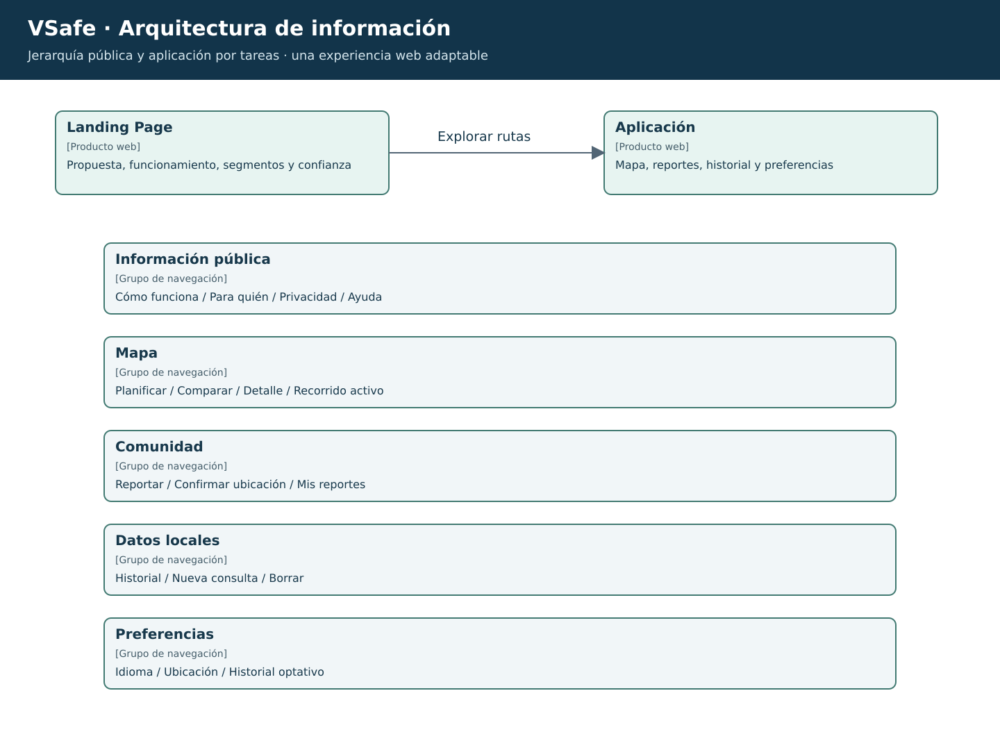
</p>


### 6.2.1. Organization Systems


Se completa la numeración con Organization Systems, solicitado en el enunciado y necesario para explicar la estructura antes de los sistemas de etiquetas. Se combinan jerarquía por contenido, secuencia por tarea y comparación matricial.


| Conjunto de información | Sistema / esquema | Aplicación |
| --- | --- | --- |
| Landing Page | Jerárquico por tópicos y audiencia | Propuesta → funcionamiento → estudiantes/trabajadores → información de confianza → CTA. |
| Planificación | Secuencial | Origen/destino → alternativas → detalle → inicio de recorrido. |
| Comparación de rutas | Matricial por criterios | Cada tarjeta expone duración, distancia, estimación, vigencia y cobertura. |
| Reportes | Secuencial y por estado | Datos → ubicación → resumen → envío; listado por pendiente/publicado/vinculado/rechazado. |
| Incidentes | Geográfico y temporal | Zona visible, categoría y vigencia; no se ordenan como ranking de lugares peligrosos. |
| Historial | Cronológico inverso | Consultas recientes primero, solo en el navegador y con consentimiento. |
| Preferencias | Por tópicos | Idioma, ubicación, historial e información de privacidad. |


### 6.2.2. Labeling Systems


Las etiquetas describen tareas y resultados de forma breve. Se usa “recorrido” para el viaje activo y “ruta” para una alternativa; “reporte” es el aporte y “incidente” la información publicable. El vocabulario conserva la distinción del DDD sin exponer nombres de servicios ni términos de infraestructura al usuario.


| Etiqueta es_419 | Etiqueta en_US | Destino / significado |
| --- | --- | --- |
| Explorar rutas | Explore routes | CTA desde la landing hacia /app/map. |
| Mapa | Map | Vista principal de planificación. |
| Origen | Origin | Punto inicial seleccionado. |
| Destino | Destination | Punto final seleccionado. |
| Usar mi ubicación | Use my location | Solicitar uso autorizado como origen. |
| Comparar rutas | Compare routes | Obtener alternativas con criterios. |
| Ver detalle | View details | Información de una ruta e incidentes. |
| Iniciar recorrido | Start journey | Activar la ruta seleccionada. |
| Finalizar recorrido | End journey | Cerrar el estado temporal y las alertas. |
| Buscar alternativa | Find alternative | Recalcular tras una alerta o cambio. |
| Reportar | Report | Formulario de aporte comunitario. |
| Confirmar ubicación | Confirm location | Aceptar el punto aproximado del incidente. |
| Mis reportes | My reports | Estados de los aportes de la sesión. |
| Historial | History | Consultas locales optativas. |
| Información insuficiente | Insufficient information | Resultado UNKNOWN con causa explicada. |
| Privacidad | Privacy | Uso de ubicación y controles de historial. |


### 6.2.3. Searching Systems


La búsqueda principal se basa en origen y destino seleccionados en el mapa, ubicación autorizada o coordenadas ingresadas mediante controles accesibles. Este alcance corresponde al adaptador cartográfico definido en el capítulo IV. Una caja de direcciones con autocompletado requeriría contratar e integrar geocodificación; por ello no se presenta como capacidad ya incluida.


| Búsqueda | Entradas / filtros | Presentación del resultado |
| --- | --- | --- |
| Alternativas de ruta | Origen y destino; modo peatonal; ordenar por duración o distancia y, cuando sea comparable, intensidad estimada. | Mapa y tarjetas con datos homogéneos. UNKNOWN aparece con explicación; no se ordena como menor riesgo. |
| Incidentes | Área visible o recorrido; categoría y vigencia. | Marcadores y lista con categoría, ubicación aproximada, momento observado y condición de verificación. |
| Mis reportes | Estado y fecha de envío; solo la sesión propietaria. | Lista cronológica y detalle del procesamiento. La paginación evita listados ilimitados. |
| Historial local | Fecha y referencia local de destino. | Últimas consultas del navegador; reutilizar ejecuta nueva búsqueda. |
| Ayuda pública | Preguntas organizadas por tópicos. | Contenido breve sobre riesgo, permisos, reportes y alcance de las alertas. |


Los controles conservan las entradas al cambiar filtros. Se muestran estados de carga, lista vacía y fuente no disponible. Si el punto está fuera de cobertura, se explica la condición y se permite corregirlo. No se confunde cobertura cartográfica con disponibilidad de evidencia de riesgo.


### 6.2.4. SEO Tags and Meta Tags


La landing page comunica la propuesta pública y puede indexarse. Las vistas de la aplicación que contienen recorridos, reportes privados o estados de sesión se definen con noindex. La directiva de indexación no sustituye autorización ni protección de datos. No se incluyen coordenadas o identificadores personales en title, description ni URLs compartibles.


| Página | Title | Description | Robots |
| --- | --- | --- | --- |
| /es-419/ | VSafe / Compara rutas con información de riesgo estimado | Compara recorridos a pie por tiempo, distancia y riesgo estimado. Consulta incidentes y decide con información disponible. | index, follow |
| /en-us/ | VSafe / Compare routes with estimated risk information | Compare walking routes by time, distance and estimated risk. Review reported incidents and choose with available information. | index, follow |
| /es-419/privacidad | Privacidad y ubicación / VSafe | Conoce cómo VSafe utiliza ubicación autorizada, datos temporales y un historial local opcional. | index, follow |
| /en-us/privacy | Privacy and location / VSafe | Learn how VSafe uses authorized location, temporary journey data and optional local history. | index, follow |
| /app/map | Planificar recorrido / VSafe | Planifica y compara alternativas con tu sesión de VSafe. | noindex, nofollow |
| /app/reports | Mis reportes / VSafe | Consulta el estado de los reportes de tu sesión. | noindex, nofollow |
| /app/history | Historial local / VSafe | Revisa consultas guardadas de forma opcional en este navegador. | noindex, nofollow |


Los valores comunes son Author = “Equipo VSafe” y Keywords = “VSafe, rutas peatonales, navegación urbana, riesgo estimado, incidentes, Lima”. Keywords se incluye por el mínimo académico solicitado, pero Google no lo utiliza para indexación o ranking [R11]. Cada variante de idioma adapta title y description y establece lang="es-419" o lang="en-US".

Se configuran viewport, canonical, hreflang recíproco es-419/en-US, og:title, og:description, og:type="website" y una imagen de marca sin datos de ubicación. La URL canónica y og:url se reemplazan por el dominio real al desplegar; no se inventa un dominio público. El sitemap enumera únicamente páginas públicas. No se generan elementos ASO en este alcance porque el MVP no se distribuye en una app store.


### 6.2.5. Navigation Systems


La landing ofrece navegación global hacia Cómo funciona, Para quién, Privacidad y Ayuda. Las secciones pueden alcanzarse por anclas descriptivas. Los CTA de estudiantes y trabajadores redirigen a la misma capacidad de planificación con contexto informativo; no necesitan duplicar aplicaciones ni crear cuentas obligatorias.

La aplicación organiza navegación global en Mapa, Reportar, Mis reportes e Historial. En móvil se conservan tres accesos principales y Mis reportes se ofrece dentro de Reportar. La navegación local permite volver de detalle a alternativas sin perder origen/destino. La navegación contextual conecta una alerta con el recálculo y un reporte enviado con su estado.

El botón Atrás del navegador respeta el estado de la vista y no cierra silenciosamente un recorrido. “Finalizar recorrido” es una acción explícita. Abandonar un formulario con cambios solicita confirmación; los errores de red conservan su contenido en memoria. No se almacenan automáticamente borradores de incidentes en el historial local.

Se proporciona salto al contenido, orden de foco consistente y nombre accesible para la vista actual. El mapa no bloquea la navegación del teclado y los resultados también se pueden revisar como lista. Una alerta anuncia información pertinente, sin imponer un cambio de ruta ni interrumpir continuamente la tarea.


## 6.3. Landing Page UI Design


La landing traduce la propuesta de navegación informada en una secuencia breve: comprender el beneficio, conocer el funcionamiento y acceder a la aplicación. El hero explica los criterios de comparación; las secciones posteriores presentan segmentos, evidencia disponible y privacidad. El CTA principal es “Explorar rutas” y conduce a la planificación peatonal.


### 6.3.1. Landing Page Wireframe


**Desktop Web Browser**


<p align="center">
  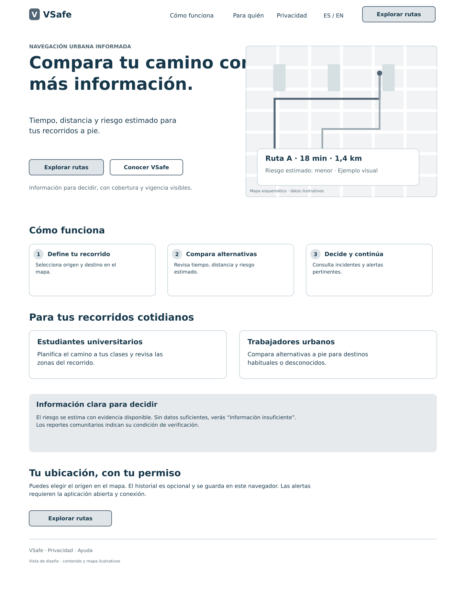
</p>


La vista de escritorio presenta un encabezado persistente de navegación, un hero de dos columnas, tres pasos de funcionamiento, dos bloques por segmento y una sección sobre límites de información. La posición y jerarquía del CTA permiten iniciar la tarea sin revisar todo el contenido. El visual cartográfico es ilustrativo y conserva un equivalente textual.


**Mobile Web Browser**


<p align="center">
  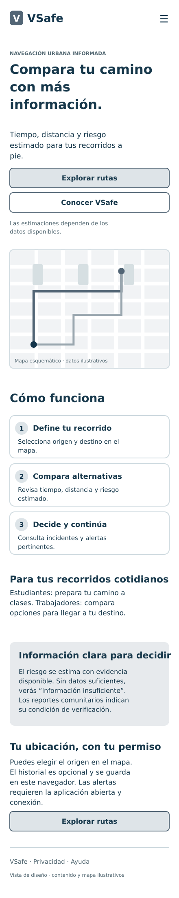
</p>


En móvil se apilan título, explicación, CTA y mapa. Las tarjetas pasan a una columna y el menú conserva los destinos del encabezado. Los botones ocupan el ancho disponible y el contenido puede recorrerse sin desplazamiento horizontal. La información de privacidad permanece próxima a la acción de comenzar.


### 6.3.2. Landing Page Mock-up


**Desktop Web Browser**


<p align="center">
  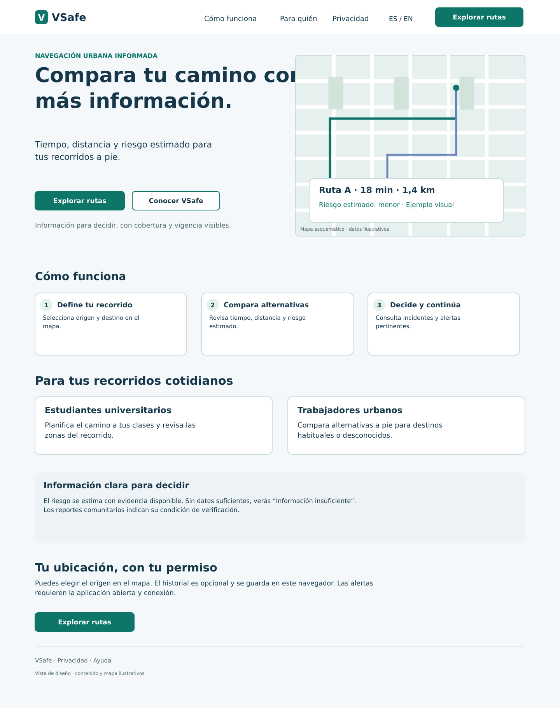
</p>


El mock-up aplica fondo claro, títulos en azul oscuro, CTA en verde petróleo y tarjetas de superficie blanca. El mapa presenta rutas distinguibles y una tarjeta de ejemplo; los datos y el nivel de riesgo se identifican como ilustrativos. El componente de confianza explica información insuficiente y condición comunitaria de los reportes.


**Mobile Web Browser**


<p align="center">
  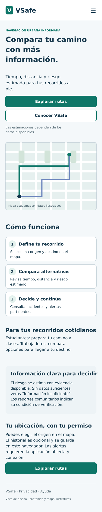
</p>


La adaptación móvil conserva nombre, contraste, jerarquía y vocabulario. La interacción sigue una secuencia vertical y el CTA se mantiene visible entre bloques. Los textos evitan sugerir garantías sobre la integridad física y permiten acceder a la alternativa manual de origen.


## 6.4. Applications UX/UI Design


La aplicación se estructura alrededor de planificación, acompañamiento y colaboración. Las pantallas explican el estado del proceso: obtener rutas, seleccionar, iniciar, recibir información contextual, modificar o finalizar. Los reportes se presentan como aportes procesados por etapas; el usuario puede consultar su resultado.


### 6.4.1. Applications Wireframes


| Wireframe | Vista / estado | Historias y propósito |
| --- | --- | --- |
| WF01 | Planificar ruta | US04, US05 |
| WF02 | Permiso de ubicación | US05, TS04 |
| WF03 | Comparar rutas | US06, US07, US09 |
| WF04 | Detalle de ruta | US08, US09 |
| WF05 | Recorrido activo | US08, US10 |
| WF06 | Alerta del recorrido | US10, US11 |
| WF07 | Nuevas alternativas | US11 |
| WF08 | Reportar incidente | US13, US14 |
| WF09 | Ubicación del incidente | US15 |
| WF10 | Reporte recibido | US13, US16 |
| WF11 | Mis reportes | US16 |
| WF12 | Historial local | US12, TS04 |
| WF13 | Privacidad y preferencias | TS04 |
| WF14 | Servicio no disponible | TS01, QA03 |
| WF15 | Sin alternativas | US06, US11 |
| WF16 | Revisar reporte | US13–US15 |


**Aplicación de escritorio**


<p align="center">
  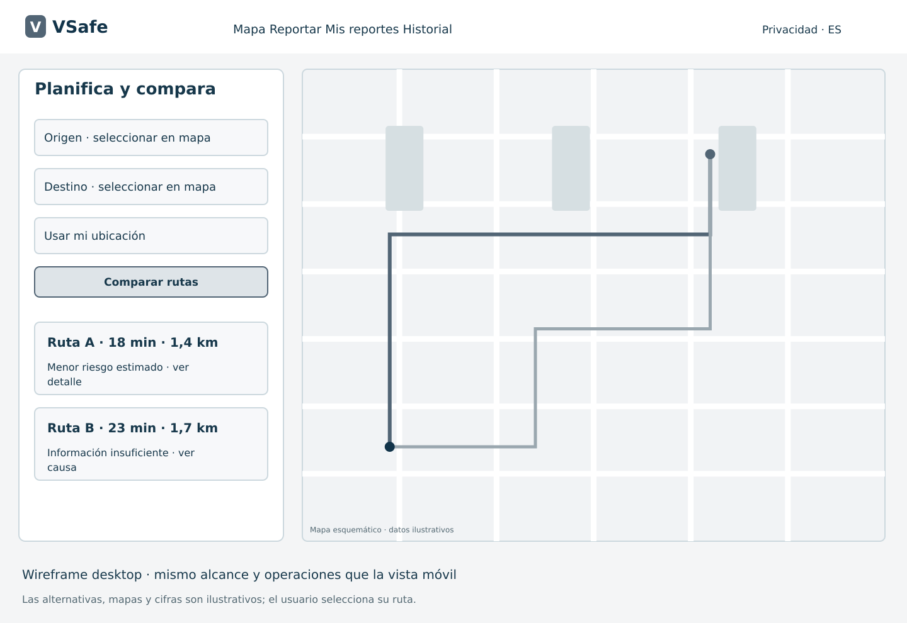
</p>


El panel lateral concentra puntos, filtros y comparación; el mapa presenta geometrías y contexto. La lista sigue siendo operable sin interacción cartográfica. El detalle permite consultar vigencia y causa UNKNOWN antes de iniciar el recorrido.


**Aplicación web móvil**


<p align="center">
  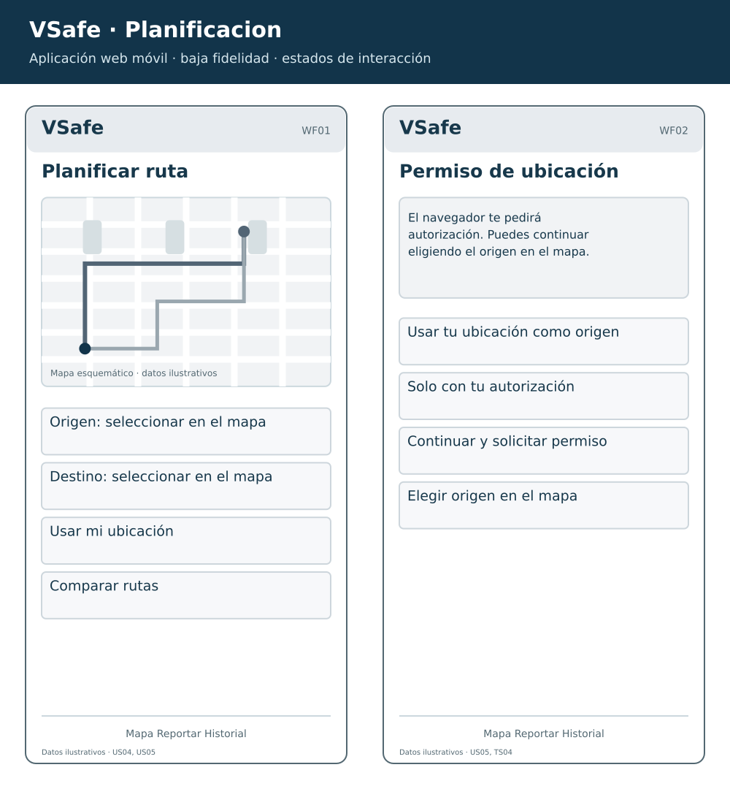
</p>


WF01–WF02 permiten definir puntos y solicitar autorización; la alternativa manual conserva el acceso.


<p align="center">
  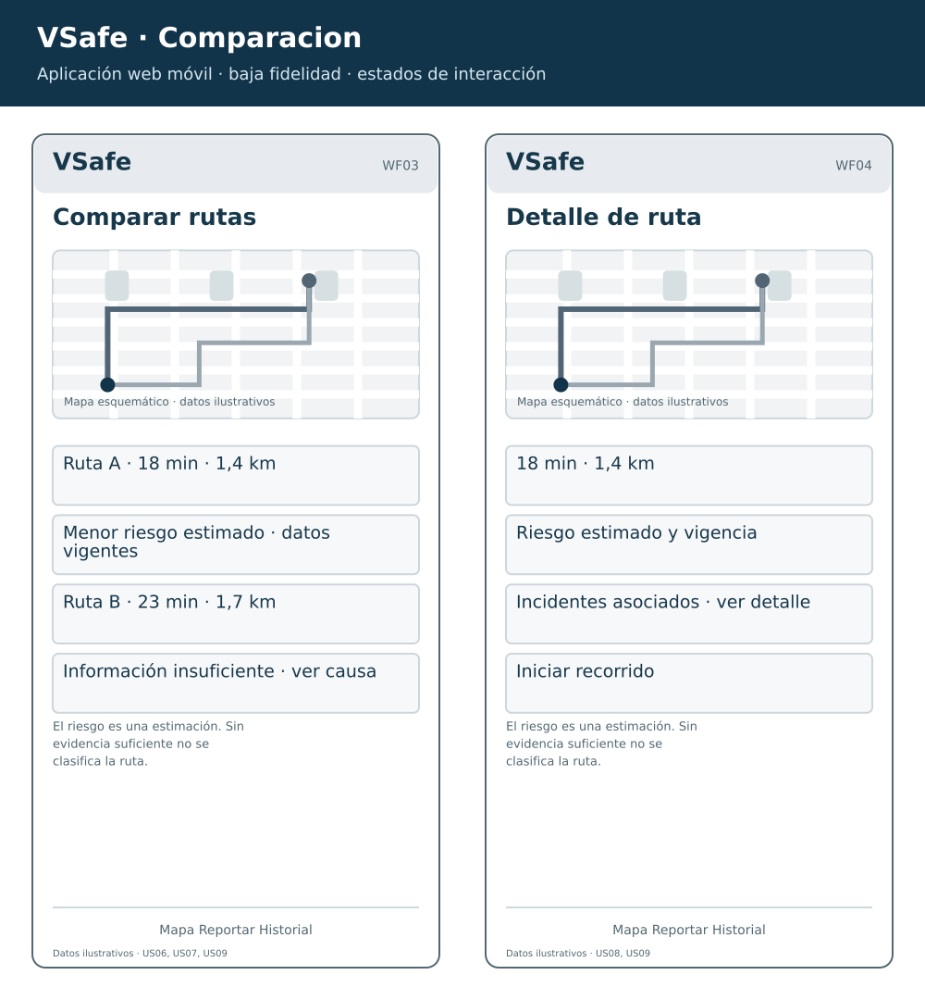
</p>


WF03–WF04 presentan alternativas comparables y el detalle previo a iniciar. La intensidad estimada se muestra con vigencia y explicación.


<p align="center">
  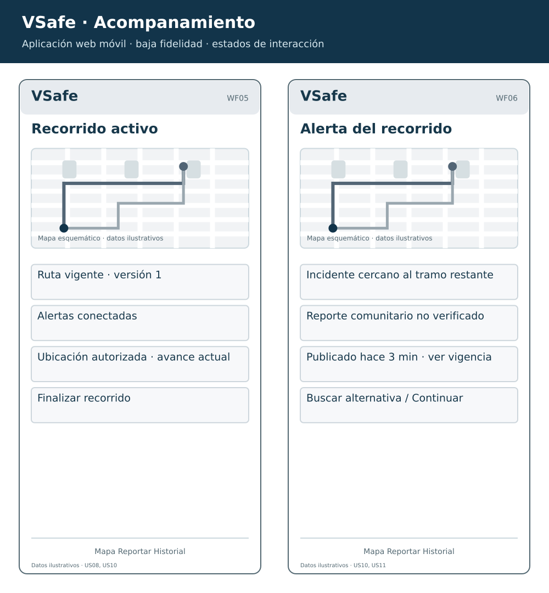
</p>


WF05–WF06 distinguen recorrido activo y aparición de una alerta. El usuario elige continuar o solicitar otra opción.


<p align="center">
  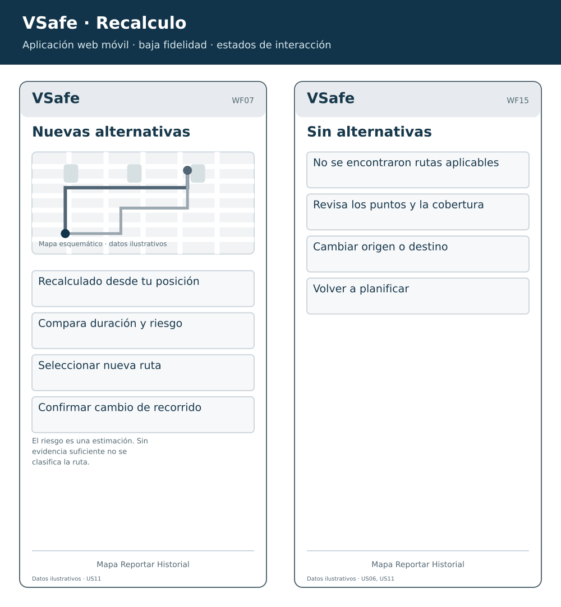
</p>


WF07 representa nuevas alternativas; WF15 informa que no existe otra ruta aplicable. La versión activa cambia solo tras confirmar.


<p align="center">
  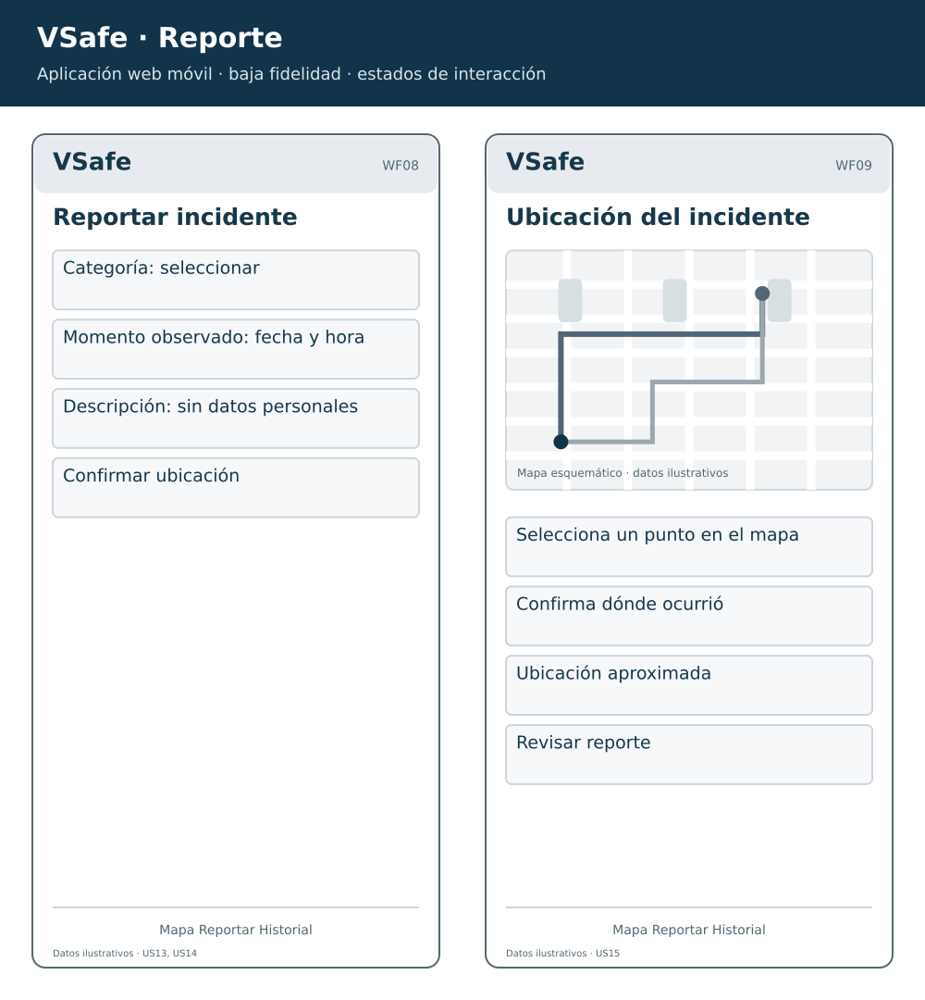
</p>


WF08–WF09 separan categoría/momento del incidente y confirmación espacial. Las correcciones no borran los datos del formulario.


<p align="center">
  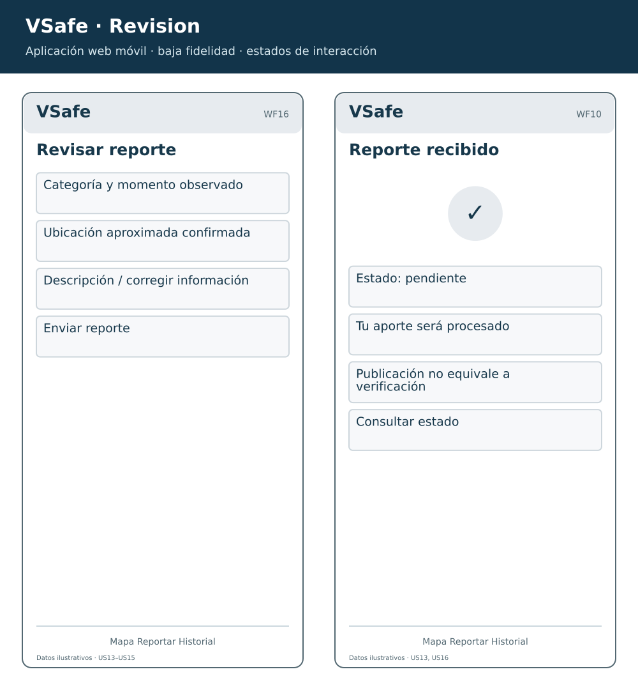
</p>


WF16 muestra el resumen antes del envío; WF10 confirma recepción únicamente después de la respuesta del servidor.


<p align="center">
  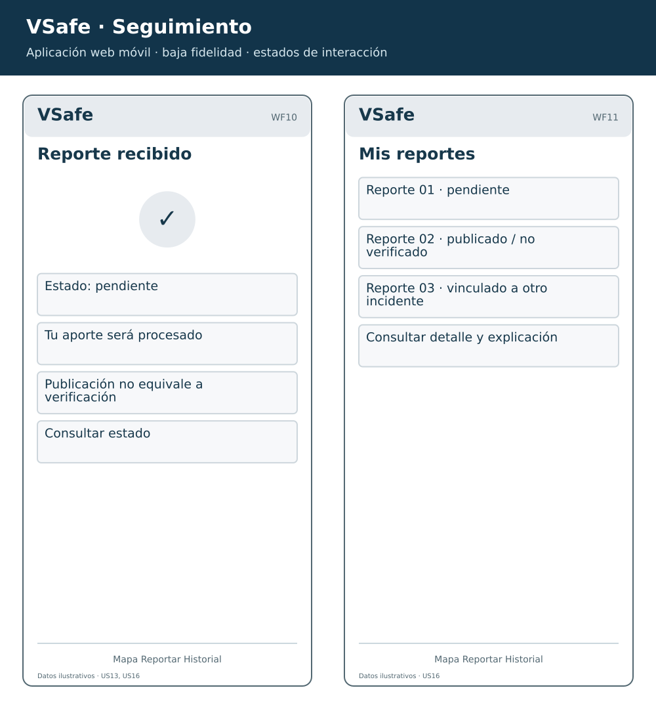
</p>


WF10 confirma recepción pendiente; WF11 presenta estados sin confundir publicación con verificación.


<p align="center">
  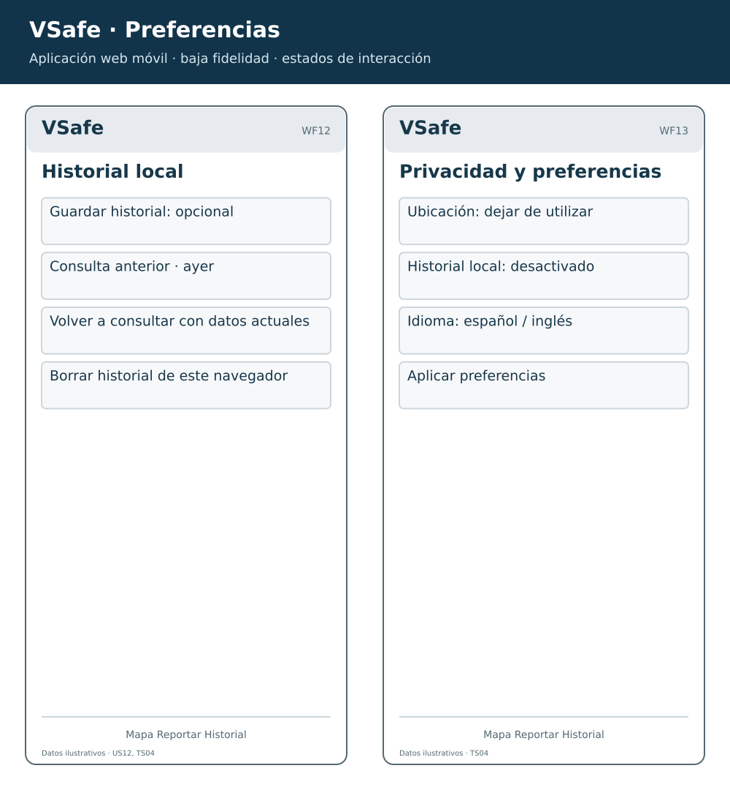
</p>


WF12–WF13 permiten reutilizar con datos actuales, borrar historial y detener uso de ubicación.


<p align="center">
  
</p>


WF14–WF15 informan fallo externo o ausencia de rutas y conservan opciones de recuperación.


Los wireframes se mantienen en baja fidelidad para revisar estructura y estados. Los mock-ups de aplicación y prototipos interactivos corresponden a puntos posteriores del capítulo VI y no forman parte de 6.4.1–6.4.2. Las vistas adjuntas no representan una aplicación ya ejecutada ni resultados de pruebas con usuarios.


### 6.4.2. Applications Wireflow Diagrams


Cada wireflow relaciona pantallas con acciones, nuevos estados y rutas alternativas. Los objetivos se aplican a los dos User Personas porque comparten las capacidades del producto; el estudiante enfatiza la llegada a clases y el trabajador la adaptación a destinos variables. Las preferencias personales no cambian el significado de riesgo ni la autorización de datos.


#### 6.4.2.1. UG01 · Comparar e iniciar un recorrido


**User goal:** Comparar e iniciar un recorrido.


**Persona e historias:** Estudiante o trabajador · US04–US09.


<p align="center">
  
</p>


| Desde | Acción | Hasta |
| --- | --- | --- |
| 1: WF01 | Usar ubicación | 2: WF02 |
| 2: WF02 | Autorizar o elegir mapa | 3: WF03 |
| 3: WF03 | Ver alternativa | 4: WF04 |
| 4: WF04 | Iniciar recorrido | 5: WF05 |
| 2: WF02 | Sin permiso: elegir mapa | 1: WF01 |


Los datos inválidos permanecen en WF01. Sin alternativas se muestra WF15; un fallo cartográfico abre WF14. UNKNOWN permite comparar tiempo y distancia.


#### 6.4.2.2. UG02 · Evaluar una alerta y cambiar la ruta


**User goal:** Evaluar una alerta y cambiar la ruta.


**Persona e historias:** Estudiante o trabajador con recorrido activo · US10–US11.


<p align="center">
  
</p>


| Desde | Acción | Hasta |
| --- | --- | --- |
| 1: WF05 | Incidente pertinente | 2: WF06 |
| 2: WF06 | Buscar alternativa | 3: WF07 |
| 3: WF07 | Confirmar nueva ruta | 5: WF05 |
| 3: WF07 | Sin alternativa | 4: WF15 |
| 2: WF06 | Continuar ruta vigente | 5: WF05 |


El nuevo estado de WF05 usa una versión de ruta incrementada. La reconexión entrega solo alertas vigentes. Sin permiso o avance actualizado se informa que las alertas están pausadas.


#### 6.4.2.3. UG03 · Reportar un incidente observado


**User goal:** Reportar un incidente observado.


**Persona e historias:** Estudiante o trabajador colaborador · US13–US15.


<p align="center">
  
</p>


| Desde | Acción | Hasta |
| --- | --- | --- |
| 1: WF08 | Completar datos | 2: WF09 |
| 2: WF09 | Confirmar ubicación | 3: WF16 |
| 3: WF16 | Enviar reporte | 4: WF10 |
| 4: WF10 | Consultar estado | 5: WF11 |
| 3: WF16 | Corregir información | 1: WF08 |


Un error de validación conserva el formulario. Un fallo de envío conserva el borrador en memoria y reutiliza la clave idempotente al reintentar. WF10 aparece solo tras confirmación del servidor.


#### 6.4.2.4. UG04 · Conocer el resultado de un reporte


**User goal:** Conocer el resultado de un reporte.


**Persona e historias:** Usuario de la sesión propietaria · US16.


<p align="center">
  
</p>


| Desde | Acción | Hasta |
| --- | --- | --- |
| 1: WF11 | Abrir reporte pendiente | 2: WF10 |
| 2: WF10 | Actualizar estado | 3: WF11 |


El segundo WF11 representa el estado actualizado: publicado no verificado, vinculado o rechazado con explicación. Una sesión distinta no puede consultar el reporte.


#### 6.4.2.5. UG05 · Reutilizar o borrar una consulta anterior


**User goal:** Reutilizar o borrar una consulta anterior.


**Persona e historias:** Estudiante o trabajador · US12 y TS04.


<p align="center">
  
</p>


| Desde | Acción | Hasta |
| --- | --- | --- |
| 1: WF12 | Volver a consultar | 2: WF03 |
| 2: WF03 | Revisar datos actuales | 3: WF04 |
| 1: WF12 | Borrar y confirmar | 4: WF12 |


La reutilización genera una nueva consulta; no reactiva una evaluación antigua. El último WF12 representa el estado vacío. Sin consentimiento no se guarda historial.


#### 6.4.2.6. UG06 · Cambiar autorización y preferencias


**User goal:** Cambiar autorización y preferencias.


**Persona e historias:** Cualquier usuario · TS04.


<p align="center">
  
</p>


| Desde | Acción | Hasta |
| --- | --- | --- |
| 1: WF13 | Dejar de usar ubicación | 2: WF05 |
| 2: WF05 | Alertas pausadas / cerrar | 3: WF13 |
| 3: WF13 | Elegir origen en mapa | 4: WF01 |


La preferencia interna detiene el uso de ubicación y cierra el recorrido; la revocación del permiso del navegador se gestiona desde sus ajustes. El historial puede borrarse por separado.


## Relación del diseño UX con ADD y DDD


| Necesidad o driver | Diseño de interacción | Contexto responsable |
| --- | --- | --- |
| Comparar criterios / US07 | Tarjetas homogéneas con tiempo, distancia y estimación. | Route Planning + Risk Assessment. |
| Incertidumbre / QA04 | UNKNOWN con causa, cobertura y vigencia; no se presenta como ruta de menor riesgo. | Risk Assessment. |
| Alertas pertinentes / QA02 | Estado activo, alerta contextual, decisión de recálculo y estado de pausa. | Journey Alerts + Route Planning. |
| Contribución comunitaria / US13–US16 | Formulario por etapas y estados pendiente/publicado/vinculado/rechazado. | Incident Reporting. |
| Privacidad / QA05 | Permiso opcional, alternativa manual, cierre explícito e historial local optativo. | Gateway y autorización en cada servicio; historial en navegador. |
| Fallo externo / QA03 | Reintento con puntos conservados y acceso a reportes independientes. | Route Planning y adaptador cartográfico. |
| Integridad / QA06 | Envío único percibido pese a retry; una alerta lógica con ID estable. | Outbox/inbox de los servicios y claves idempotentes. |


# Capítulo VII: Product Implementation, Validation & Deployment

## 7.1. Software Configuration Management

La gestión de configuración permite relacionar cada entrega con su código fuente, dependencias, contratos, pruebas y parámetros de ejecución. Se versionarán las fuentes y la configuración reproducible; los valores de acceso se administrarán por entorno. Cada producto tendrá una versión identificable y cada microservicio conservará su construcción, sus migraciones y su despliegue independientes.

El equipo distinguirá desarrollo local, validación y piloto. Una entrega deberá poder reconstruirse desde un commit y sus archivos de dependencias, comprobarse antes de publicarse y recuperarse mediante una versión anterior compatible.

### 7.1.1. Software Development Environment Configuration

La tecnología identifica con qué se construye un componente; el entorno define dónde se ejecuta y qué configuración, datos y conexiones utiliza. En VSafe, la misma base tecnológica se mantendrá entre desarrollo, validación y piloto, con valores propios para cada ambiente.

**Base tecnológica de VSafe**

La configuración toma como punto de partida las decisiones de los capítulos IV–VI. Las versiones exactas de las dependencias se fijarán al inicializar los proyectos y se registrarán en sus archivos de configuración y lockfiles.

| Componente | Tecnología definida | Configuración que deberá documentarse |
|---|---|---|
| Landing Page | HTML5, CSS3 y JavaScript | Estructura de páginas, recursos, idiomas y enlace de entrada a la aplicación. |
| Aplicación web | Vue 3, TypeScript, Vite y PrimeVue | Base `/app/`, navegación, tokens de diseño, traducciones y conexión con la API pública. |
| API Gateway | NestJS y TypeScript | Rutas públicas, verificación de sesión, contexto interno autorizado y retransmisión de SSE. |
| Servicios de negocio | NestJS y TypeScript | Proyecto, configuración y construcción propios para Route Planning, Risk Assessment, Incident Reporting y Journey Alerts. |
| Persistencia | PostgreSQL y PostGIS | Una base y un rol por servicio; migraciones, volúmenes y datos de prueba. |
| Mensajería | RabbitMQ | Conexiones, permisos, exchange, colas por suscripción y tratamiento de reentregas. |
| Evaluación de riesgo | ONNX Runtime para Node.js | Modelo, versión y checksum; condiciones para devolver `UNKNOWN`. |
| Cartografía externa | Mapbox | Adaptador de rutas, token del servidor y token público restringido para la visualización del mapa. |

**Herramientas del ciclo de vida**

Las herramientas se organizan según la actividad que apoyan. Sus referencias permiten preparar el equipo de trabajo y acceder a los servicios compartidos.

| Actividad | Producto de software | Propósito en VSafe | Referencia o instalación |
|---|---|---|---|
| Project Management y Requirements Management | Trello | Organizar el Product Backlog, los sprints y las tareas; relacionar tarjetas con los identificadores US y TS y sus criterios de aceptación. | [Trello](https://trello.com/) |
| Colaboración | Microsoft Teams | Realizar planning, coordinación y revisión; conservar los acuerdos y enlaces de cada reunión. | [Microsoft Teams](https://www.microsoft.com/microsoft-teams/group-chat-software) |
| Control de versiones | Git y GitHub | Registrar cambios, revisar Pull Requests y conservar código, pruebas y documentación por producto. | [Instalar Git](https://git-scm.com/downloads) · [GitHub](https://github.com/) |
| Investigación de usuarios | UXPressia | Mantener User Personas, Empathy Maps e Impact Mapping como referencia de requisitos. | [UXPressia](https://uxpressia.com/) |
| Modelado del dominio y datos | Lucidchart | Mantener EventStorming, diagramas UML y modelos de bases de datos. | [Lucidchart](https://www.lucidchart.com/) |
| Product Design | Figma | Consultar y evolucionar wireframes, mock-ups, flujos y componentes visuales. | [Figma](https://www.figma.com/) |
| Arquitectura de software | Structurizr | Mantener las vistas C4 y exportar los diagramas que acompañan al informe. | [Structurizr](https://docs.structurizr.com/) |
| Edición de código y documentación | Visual Studio Code | Editar HTML, CSS, JavaScript, TypeScript, Vue, Gherkin y Markdown con una configuración compartida. | [Descargar VS Code](https://code.visualstudio.com/download) |
| Entorno de ejecución | Node.js 24 LTS y npm | Ejecutar las herramientas de construcción y los servicios; instalar dependencias desde sus lockfiles. | [Descargar Node.js](https://nodejs.org/en/download) · [Ciclo de versiones](https://nodejs.org/en/about/previous-releases) |
| Landing Page Development | HTML5, CSS3 y JavaScript | Implementar el sitio informativo y sus CTA con contenido accesible y localizado. | [Referencia web de MDN](https://developer.mozilla.org/en-US/docs/Web) |
| Web Application Development | Vue 3, TypeScript, Vite y PrimeVue | Implementar la aplicación responsive y sus componentes con los tokens de diseño de VSafe. | [Vue](https://vuejs.org/guide/quick-start.html) · [TypeScript](https://www.typescriptlang.org/download/) · [Vite](https://vite.dev/guide/) · [PrimeVue](https://primevue.org/) |
| Web Services Development | NestJS y TypeScript | Implementar el gateway y los cuatro microservicios con módulos, validación y contratos propios. | [Instalación de NestJS](https://docs.nestjs.com/first-steps) |
| Persistencia geoespacial | PostgreSQL y PostGIS | Administrar las cuatro bases privadas y ejecutar consultas espaciales con permisos separados. | [PostgreSQL](https://www.postgresql.org/download/) · [PostGIS](https://postgis.net/documentation/getting_started/) |
| Mensajería | RabbitMQ | Propagar eventos entre servicios mediante colas, confirmaciones y consumidores idempotentes. | [Instalar RabbitMQ](https://www.rabbitmq.com/docs/download) |
| Inferencia de riesgo | ONNX Runtime para Node.js | Ejecutar un modelo versionado dentro de Risk Assessment cuando exista un artefacto validado. | [ONNX Runtime Node.js](https://onnxruntime.ai/docs/get-started/with-javascript/node.html) |
| Calidad de código | ESLint y Prettier | Comprobar reglas de código y aplicar formato consistente en desarrollo y CI. | [ESLint](https://eslint.org/docs/latest/use/getting-started) · [Prettier](https://prettier.io/docs/install) |
| Software Testing | Vitest, Jest, Cucumber.js y Playwright | Cubrir componentes Vue, unidades e integración de NestJS, escenarios Gherkin y recorridos del navegador. | [Vitest](https://vitest.dev/guide/) · [Jest](https://jestjs.io/docs/getting-started) · [Cucumber.js](https://github.com/cucumber/cucumber-js) · [Playwright](https://playwright.dev/docs/intro) |
| Ejecución reproducible | Docker Engine y Docker Compose | Levantar dependencias locales y ejecutar cada servicio como contenedor independiente. | [Docker Engine](https://docs.docker.com/engine/install/) · [Docker Compose](https://docs.docker.com/compose/install/) |
| Integración y publicación | GitHub Actions y GitHub Container Registry | Ejecutar comprobaciones y publicar imágenes identificadas por versión y commit. | [GitHub Actions](https://docs.github.com/en/actions) · [Publicación de imágenes](https://docs.github.com/en/actions/tutorials/publish-packages/publish-docker-images) |
| Software Deployment | AWS EC2, Amazon S3 y Nginx | Alojar el piloto, servir archivos estáticos, terminar HTTPS y conservar respaldos fuera de la VM. | [Amazon EC2](https://docs.aws.amazon.com/ec2/) · [Amazon S3](https://docs.aws.amazon.com/s3/) · [Nginx](https://nginx.org/en/docs/) |
| Software Documentation | Markdown, OpenAPI y Swagger UI | Mantener el informe, los README de instalación y los contratos de servicios con ejemplos y errores. | [Markdown en GitHub](https://docs.github.com/en/get-started/writing-on-github) · [OpenAPI en NestJS](https://docs.nestjs.com/openapi/introduction) |

**Entornos de ejecución**

| Entorno | Finalidad | Configuración y datos | Comprobación prevista |
|---|---|---|---|
| Desarrollo local | Implementar y probar cambios de un producto o servicio. | Configuración local a partir de `.env.example`, dependencias de Compose y datos de prueba controlados. | El proyecto se instala desde su lockfile, construye y ejecuta sus pruebas pertinentes. |
| Validación | Comprobar el incremento integrado antes de aceptarlo. | Commits identificados, configuración separada del piloto y datos de prueba compartidos por los casos de aceptación. | Las historias incluidas cumplen sus escenarios y el registro identifica versión, comandos y resultados. |
| Piloto | Publicar el incremento aceptado. | Dominio y HTTPS, configuración externa, almacenamiento persistente y respaldos según los componentes incorporados. | Las URL publicadas corresponden al manifiesto de la entrega y superan las comprobaciones del flujo disponible. |

**Preparación del entorno local**

1. Instalar Git, Visual Studio Code, Node.js 24 LTS y Docker con Compose. Verificar sus versiones mediante `git --version`, `node --version`, `npm --version`, `docker --version` y `docker compose version`.
2. Clonar los repositorios indicados en 7.1.2 y trabajar sobre la rama correspondiente. Durante la inicialización se fijará la versión exacta de Node.js en `.nvmrc` y se declarará su compatibilidad en `package.json`.
3. Instalar las dependencias de cada proyecto con `npm ci` una vez generado y versionado su `package-lock.json`. El mismo lockfile se utilizará en CI; las actualizaciones se revisarán mediante Pull Request.
4. Copiar `.env.example` a la configuración local de cada aplicación y completar sus valores. El archivo de ejemplo documentará nombres y propósito de variables; `.env` y las credenciales quedarán fuera del control de versiones.
5. Iniciar PostgreSQL/PostGIS y RabbitMQ con Compose. Crear `route_planning_db`, `risk_assessment_db`, `incident_reporting_db` y `journey_alerts_db`, cada una con su propio rol. Cada microservicio ejecutará únicamente las migraciones de su base.
6. Iniciar los productos incluidos en la iteración y comprobar sus scripts de formato, lint, tipos, pruebas y construcción. Las imágenes de infraestructura y las dependencias se fijarán a versiones concretas, evitando basar una entrega en etiquetas `latest`.

Los entornos de desarrollo, validación y piloto tendrán configuraciones y datos separados. Los ejemplos y las pruebas utilizarán ubicaciones de prueba; los registros técnicos omitirán coordenadas personales precisas. La interfaz y los mensajes contemplarán `en_US` por defecto y `es_419`, manteniendo los criterios de accesibilidad del capítulo VI.

### 7.1.2. Source Code Management

GitHub concentrará el control de versiones de los productos digitales de VSafe. El informe conservará la explicación de las decisiones y cada repositorio de código contendrá las instrucciones necesarias para construir, comprobar y ejecutar su producto.

| Producto o artefacto | Repositorio | Contenido previsto |
|---|---|---|
| Informe del proyecto | [Informe](https://github.com/VSAFE-Arquitecturas-Software-Emergentes/Informe) | Capítulos en Markdown y recursos de documentación. La rama `Chapter-07` contiene este capítulo y sus recursos. |
| Landing Page | [landing-page](https://github.com/VSAFE-Arquitecturas-Software-Emergentes/landing-page) | HTML, CSS y JavaScript; recursos visuales, contenido localizado, pruebas y configuración de publicación. |
| Aplicación web | [WebApp](https://github.com/VSAFE-Arquitecturas-Software-Emergentes/WebApp) | Proyecto Vue/TypeScript/PrimeVue, navegación, componentes, pruebas y construcción de archivos estáticos. |
| API Gateway y servicios REST | [Microservices](https://github.com/VSAFE-Arquitecturas-Software-Emergentes/Microservices) | Proyectos independientes del gateway y de Route Planning, Risk Assessment, Incident Reporting y Journey Alerts; contratos, pruebas, migraciones e imágenes por servicio. |

Para `Microservices` se propone un repositorio con varios proyectos. Compartir repositorio no modifica la propiedad de los datos ni obliga a desplegar todos los procesos juntos. Cada proyecto tendrá su propio `package.json`, lockfile, `Dockerfile`, configuración y pipeline seleccionable. Los cuatro servicios de negocio tendrán además sus migraciones privadas. El gateway mantendrá funciones de acceso y transporte.

```text
Microservices/
  services/
    api-gateway/
    route-planning/
    risk-assessment/
    incident-reporting/
    journey-alerts/
  contracts/
    http/
    events/
  deploy/
  .github/workflows/
```

Dentro de cada servicio, las pruebas acompañarán al código y los escenarios de aceptación se conservarán como texto en `test/features/*.feature`, junto con sus definiciones de pasos en TypeScript. Los contratos compartidos describirán mensajes y operaciones; las entidades y reglas de dominio permanecerán bajo su contexto propietario.

**Flujo de ramas**

Se aplicará GitFlow en los repositorios de producto, tomando como referencia el modelo de [Vincent Driessen](https://nvie.com/posts/a-successful-git-branching-model/). La rama estable se denominará `main`; en el repositorio del informe se conserva el nombre existente `Master`.

| Rama | Origen | Destino de integración | Convención y uso en VSafe |
|---|---|---|---|
| `main` | Inicialización del producto | Se actualiza desde release o hotfix | Versión estable de cada producto. Sus entregas se identifican mediante tags. |
| `develop` | Rama estable | Release | Integra funcionalidades aceptadas para la siguiente entrega. |
| `feature/<story-id>-<description>` | `develop` | `develop` | Una rama por historia o capacidad. Ejemplo: `feature/us03-open-web-app`. |
| `release/<version>` | `develop` | Rama estable y `develop` | Estabilización, pruebas y documentación de una versión. Ejemplo: `release/0.1.0`. |
| `hotfix/<version>` | Rama estable | Rama estable y `develop` | Corrección urgente de una versión publicada. Ejemplo: `hotfix/0.1.1`. Si existe una release abierta, también se incorpora allí. |

Los nombres de funcionalidades se escribirán en inglés y con palabras separadas por guiones. Cada Pull Request relacionará los IDs de historias y tareas, describirá el cambio e incluirá la comprobación realizada. La integración requerirá revisión por otro integrante y las comprobaciones del producto afectado. En `Microservices`, un cambio de servicio deberá comprobar sus contratos con los consumidores involucrados.

Las ramas `Chapter-XX` organizan la edición del informe por capítulo y no representan releases del software. Para consolidar `Chapter-07` en `Master` se incorporará el bloque del capítulo y sus recursos, conservando el contenido y los assets de los capítulos ya integrados.

**Versionado de entregas**

Se adoptará [Semantic Versioning 2.0.0](https://semver.org/) con el esquema `MAJOR.MINOR.PATCH`: cambios incompatibles en la API pública incrementan MAJOR; funcionalidades compatibles, MINOR; y correcciones compatibles, PATCH. Durante el desarrollo inicial se utilizarán versiones `0.y.z`, cuya API aún puede evolucionar. `0.1.0` es una referencia para la primera entrega, sujeta a aceptación.

Cada producto y microservicio mantendrá su versión. Un manifiesto de despliegue relacionará versiones, commits y digests de las imágenes compatibles. Un tag como `route-planning-v0.1.0` identificará el servicio dentro del repositorio compartido; la versión del artefacto seguirá siendo `0.1.0`. La versión de un contrato HTTP o de evento se administrará explícitamente y podrá evolucionar sin compartir entidades de dominio.

**Convención de commits**

Se aplicará [Conventional Commits 1.0.0](https://www.conventionalcommits.org/en/v1.0.0/) con el formato `type(scope): description`. Se utilizarán `feat`, `fix`, `docs`, `test`, `refactor`, `style`, `build`, `ci` y `chore` según el propósito del cambio. Los mensajes se redactarán en inglés; un cambio incompatible se señalará mediante `!` o el pie `BREAKING CHANGE:`.

```text
feat(landing): explain estimated route risk
fix(web): handle unavailable application access
test(gateway): reject an expired session
ci(route-planning): publish the service image
docs(chapter07): define sprint planning and backlog
```

Las historias y tareas se relacionarán en el cuerpo del commit o en el Pull Request. La trazabilidad permitirá pasar de una tarjeta del sprint a los cambios, las pruebas y la versión que la incorpora.

### 7.1.3. Source Code Style Guide & Conventions

La nomenclatura de código, archivos, pruebas y contratos se escribirá en inglés. El vocabulario respetará el lenguaje del dominio: `Route`, `Journey`, `IncidentReport`, `RiskAssessment` y `JourneyAlert` conservarán significados distintos. Los textos visibles se localizarán mediante claves de traducción.

Para TypeScript se toma como referencia la [guía de Google](https://google.github.io/styleguide/tsguide.html). Las convenciones de estructura de [NestJS](https://docs.nestjs.com/) y la [guía de Vue](https://vuejs.org/style-guide/) se adaptan a cada proyecto. ESLint y Prettier harán ejecutables las reglas acordadas.

| Elemento | Convención | Ejemplo |
|---|---|---|
| Clases, interfaces y tipos | `PascalCase`, con nombres del dominio; interfaces sin prefijo `I`. | `Journey`, `RouteProvider`, `RiskAssessmentResult` |
| Funciones, métodos y variables | `camelCase`; métodos expresan una acción. | `searchRoutes`, `confirmLocation`, `selectedRoute` |
| Constantes globales | `UPPER_SNAKE_CASE`; variables locales conservan `camelCase`. | `MAX_HISTORY_ITEMS` |
| Archivos NestJS | `kebab-case` con sufijo de responsabilidad. | `route-search.controller.ts`, `create-journey.dto.ts` |
| Componentes Vue | `PascalCase` y nombres de varias palabras. | `RouteSearchForm.vue`, `IncidentReportCard.vue` |
| Composables | Prefijo `use` y `camelCase`. | `useRouteSearch.ts` |
| Clases CSS y tokens | `kebab-case`; componentes con una convención consistente como BEM. | `.route-card__title`, `--color-brand-primary` |
| Recursos REST | Sustantivos en plural y rutas versionadas. | `/api/v1/incident-reports` |
| Propiedades JSON | `camelCase`; fechas de intercambio en ISO 8601 con zona horaria. | `occurredAt`, `routeVersion`, `correlationId` |
| Eventos de integración | Hechos en pasado; contrato con versión. | `IncidentPublished`, `JourneyClosed`, `schemaVersion` |
| Tablas y columnas | `snake_case`, con claves y restricciones explícitas. | `incident_reports`, `observed_at` |
| Pruebas TypeScript | Sufijo `.spec.ts` y descripción de comportamiento. | `journey.spec.ts` |
| Escenarios de aceptación | Archivos `.feature` en `kebab-case`, etiquetados con su historia. | `access-application.feature`, `@US03` |

Los estados serializados conservarán los valores definidos en los contratos, por ejemplo `LOW`, `MEDIUM`, `HIGH` y `UNKNOWN`. La ausencia de información suficiente se representará mediante `UNKNOWN` y su causa, conforme al diseño de Risk Assessment.

**Reglas de implementación**

- Activar la comprobación estricta de TypeScript y declarar tipos en los límites de los módulos. Las entradas externas se validarán antes de ejecutar los casos de uso.
- Mantener el dominio independiente de NestJS, ORM y transporte. Los controladores transformarán contratos y la aplicación coordinará los casos de uso mediante puertos propios.
- Separar DTO, agregado y modelo de persistencia. Cada servicio accederá a su base y a los demás servicios mediante los contratos autorizados.
- En Vue, utilizar componentes de responsabilidad acotada, props tipadas y eventos explícitos. Los estilos y tokens seguirán la identidad definida en el capítulo VI.
- En HTML, utilizar estructura semántica, etiquetas de campos, nombres accesibles y navegación por teclado. Los mensajes localizados estarán separados de la lógica.
- Documentar decisiones y contratos con comentarios útiles. Los errores usarán códigos estables, como `INVALID_LOCATION`, y mensajes localizables.

Se propone esta configuración común de [Prettier](https://prettier.io/docs/options); ESLint se configurará para evitar reglas de formato incompatibles:

```json
{
  "tabWidth": 2,
  "useTabs": false,
  "singleQuote": true,
  "semi": true,
  "trailingComma": "all",
  "printWidth": 100,
  "endOfLine": "lf"
}
```

Los archivos se guardarán en UTF-8. `.editorconfig` y `.gitattributes` establecerán indentación y finales de línea consistentes. Los Pull Requests comprobarán formato, lint, tipos, pruebas relacionadas y construcción antes de integrarse.

**Comprobación de las convenciones**

Durante la inicialización se definirán los scripts de cada producto. La revisión combinará comprobaciones automatizadas y lectura de los cambios de acuerdo con su alcance.

| Ámbito | Comprobación prevista | Salida para la revisión |
|---|---|---|
| TypeScript y JavaScript | ESLint, Prettier y comprobación de tipos donde corresponda. | Resultado de los scripts del commit presentado. |
| Vue y HTML | Compilación, props y eventos tipados, estructura semántica, foco y etiquetas. | Construcción y recorrido de los componentes afectados en escritorio y móvil. |
| Dominio e infraestructura | Revisión de imports, puertos, adaptadores y acceso a la base propietaria. | Cambios y pruebas relacionados con el contexto del capítulo V. |
| HTTP y eventos | Validación de contratos, respuestas de error, versiones y campos de correlación. | Contrato actualizado y resultados de sus casos aplicables. |
| Gherkin | Relación entre historia, escenarios y definiciones de pasos. | Archivos `.feature`, steps y resultado de ejecución de aceptación. |

**Convenciones Gherkin**

Las especificaciones seguirán la [referencia de Gherkin de Cucumber](https://cucumber.io/docs/gherkin/reference/). Cada escenario describirá un comportamiento observable con contexto, acción y resultado mediante `Given`, `When` y `Then`. Se redactarán en inglés y utilizarán datos controlados; los pasos no dependerán de selectores CSS ni de nombres internos de clases.

```gherkin
@US03
Feature: Access the VSafe web application
  Scenario: Application access is available
    Given a visitor has opened the VSafe landing page
    And the web application entry point is available
    When the visitor chooses to start using VSafe
    Then the visitor reaches the web application entry point

  Scenario: Application access is unavailable
    Given a visitor has opened the VSafe landing page
    And the web application entry point is unavailable
    When the visitor chooses to start using VSafe
    Then the visitor receives a clear unavailability message
```

### 7.1.4. Software Deployment Configuration

El MVP utiliza Cloudflare Pages para la landing y la WebApp, Pages Functions para el proxy de API y Railway para el gateway, los cuatro microservicios, PostgreSQL/PostGIS y RabbitMQ. El contrato `IncidentAudit` está desplegado en Ethereum Sepolia y se conecta mediante Alchemy RPC. La construcción de los servicios utiliza Railpack y comandos del monorepositorio, sin Dockerfiles propios.

Esta configuración sustituye la propuesta inicial de AWS EC2, S3 y Nginx. Las evidencias del despliegue y los comandos por servicio se registran en 7.2.1.7. El modelo ONNX disponible continúa siendo sintético y la estimación de riesgo en modo real permanece en `UNKNOWN / MODEL_NOT_VALIDATED`.

**Deployment Diagram de C4 Model**

La siguiente vista utiliza el mismo modelo de 4.3.4 y distingue instancias, infraestructura y proveedores, de acuerdo con el propósito del [Deployment Diagram de C4](https://c4model.com/diagrams/deployment). Su fuente está disponible en [Structurizr DSL](assets/vsafe-c4-actual.dsl).


*Figura 7.1. Despliegue del MVP: productos web en Cloudflare, gateway y cuatro microservicios en Railway, cuatro bases privadas sobre una instancia PostGIS, RabbitMQ persistente y contrato de integridad en Sepolia. [Abrir la imagen completa](assets/VSafe-Deployment.png).*

| Elemento | Configuración del MVP |
|---|---|
| Navegador | Ejecuta la SPA Vue descargada desde Cloudflare y conserva el historial optativo y las preferencias en localStorage. |
| Landing Page | [landing-page-5hy.pages.dev](https://landing-page-5hy.pages.dev/) presenta el producto y enlaza a la WebApp mediante `VITE_APP_URL`. |
| WebApp | [vsafe-web.pages.dev/explore](https://vsafe-web.pages.dev/explore) permite comparar rutas, consultar reportes y recibir alertas. Vite genera los archivos estáticos. |
| Proxy de API | Pages Functions recibe `/api`, reenvía al gateway de Railway y conserva cookies y streaming SSE. |
| API Gateway | [gateway-production-61ce8b27.up.railway.app/docs](https://gateway-production-61ce8b27.up.railway.app/docs) publica Swagger. Verifica sesión, CSRF y orígenes, emite identidad interna y enruta sin acceder a las bases de negocio. |
| Route Planning | Integra Mapbox y Risk Assessment; utiliza exclusivamente `route_planning_db`. |
| Risk Assessment | Utiliza `risk_assessment_db`, una proyección de incidentes y ONNX Runtime dentro del proceso. Se abstiene en modo real mientras el modelo no esté validado. |
| Incident Reporting | Registra y procesa reportes; conserva outbox y auditorías en `incident_reporting_db` y conecta con el contrato de Sepolia. |
| Journey Alerts | Consume eventos, mantiene proyecciones temporales y entrega SSE; utiliza `journey_alerts_db`. |
| PostgreSQL/PostGIS | Una instancia Railway con cuatro bases lógicas, roles separados y volumen persistente. Las migraciones pertenecen a cada servicio. |
| RabbitMQ | Servicio Railway con AMQP privado, colas durables, confirmaciones, inbox y volumen en `/var/lib/rabbitmq`. |
| Blockchain de integridad | [IncidentAudit en Sepolia](https://sepolia.etherscan.io/address/0xE775Fd6A4Ee1CA64c99b672C8e7aA0bad8272B30), chain ID `11155111`; acceso por Alchemy RPC. |

El navegador utiliza `VITE_API_BASE_URL=/api/v1` desde el mismo origen de la WebApp. Pages Functions reenvía las solicitudes al gateway; este consulta los servicios mediante DNS privado `*.railway.internal` y autenticación interna. Las conexiones SSE atraviesan ambos intermediarios conservando el streaming.

**Parámetros por entorno**

Los nombres siguientes corresponden a la configuración de los repositorios. Solo se documentan su propósito y consumidor; las credenciales se suministran mediante variables protegidas del entorno.

| Parámetro | Consumidor | Propósito |
|---|---|---|
| `NODE_ENV`, `PORT`, `DATA_MODE` | Gateway y servicios según corresponda | Definir ejecución, puerto asignado por Railway y modo de datos; el despliegue utiliza `DATA_MODE=real`. |
| `DATABASE_URL` o la variable `<SERVICIO>_DATABASE_URL` correspondiente | Cada servicio de negocio | Acceder exclusivamente a la base del propietario con su rol. Se admiten los prefijos `ROUTE_PLANNING`, `RISK_ASSESSMENT`, `INCIDENT_REPORTING` y `JOURNEY_ALERTS`. |
| `AMQP_URL` | Productores y consumidores | Conectar al broker con credenciales y permisos del servicio. |
| `ROUTE_PLANNING_URL`, `RISK_ASSESSMENT_URL`, `INCIDENT_REPORTING_URL`, `JOURNEY_ALERTS_URL` | Gateway y consumidores internos según corresponda | Resolver los destinos HTTP mediante DNS privado de Railway. |
| `MAPBOX_ACCESS_TOKEN` | Route Planning | Acceder a la integración cartográfica desde el servidor. |
| `FRONTEND_ORIGINS` | Gateway | Permitir los orígenes autorizados de la WebApp. |
| `SESSION_SECRET`, `INTERNAL_SECRET` | Gateway y verificadores autorizados | Proteger la sesión y la identidad interna firmada. |
| `MODEL_PATH`, `MODEL_METADATA_PATH` | Risk Assessment | Cargar el artefacto ONNX y sus metadatos; no equivalen a una validación con datos reales. |
| `BLOCKCHAIN_RPC_URL`, `BLOCKCHAIN_CONTRACT_ADDRESS`, `BLOCKCHAIN_PRIVATE_KEY` | Incident Reporting | Conectar con Sepolia y firmar las operaciones de auditoría desde el servidor. |
| `VITE_API_BASE_URL` | WebApp | Utilizar `/api/v1` a través del proxy del mismo origen. |
| `API_ORIGIN` | Proxy de Pages Functions | Definir el origen HTTPS del API Gateway en Railway. |
| `VITE_APP_URL` | Landing Page | Definir la URL de acceso a la WebApp. |

Las conexiones de ejecución a PostgreSQL y RabbitMQ utilizan la red privada. Los valores `VITE_*` forman parte de los archivos enviados al navegador; las claves privadas y los secretos del backend permanecen en la configuración del servidor.

**Proceso desde el repositorio hasta la publicación**

Cada producto tiene una construcción y publicación propias. Los comandos concretos de build, pre-deploy y start del gateway y de los cuatro servicios se conservan en la tabla de 7.2.1.7.

| Producto / repositorio | Artefacto publicado | Configuración de publicación | Comprobación de salida |
|---|---|---|---|
| Landing / `landing-page` | HTML, CSS, JavaScript y recursos estáticos. | Proyecto Cloudflare Pages y `VITE_APP_URL`. | Página accesible y CTA hacia la WebApp. |
| Aplicación / `WebApp` | Archivos Vite y Pages Functions. | Proyecto Cloudflare Pages, `VITE_API_BASE_URL` y `API_ORIGIN`. | Entrada directa a `/explore`, recursos y comunicación con la API. |
| Gateway / `Microservices` | Aplicación NestJS construida por Railpack. | Servicio Railway, dominio público, destinos internos, sesión y SSE. | `/health/ready`, `/docs` y controles de acceso. |
| Servicios de negocio / `Microservices` | Cuatro procesos Node.js independientes. | Servicio Railway por contexto, migraciones y base exclusiva. | Readiness, contratos y funcionamiento integrado. |
| Contrato / `Microservices` | Bytecode de `IncidentAudit`. | Despliegue en Sepolia, RPC y writer autorizado. | Recibos confirmados y comparación de compromisos. |

La secuencia de publicación utilizada comprende:

1. Publicar los repositorios `landing-page`, `WebApp` y `Microservices` y vincularlos con sus proveedores de despliegue.
2. Preparar PostGIS en Railway, crear las cuatro bases y roles y habilitar la extensión PostGIS. Configurar RabbitMQ con volumen persistente.
3. Crear el gateway y los cuatro servicios Railway desde el monorepositorio, cada uno con sus comandos, variables y health check.
4. Ejecutar las migraciones de cada servicio en pre-deploy y comprobar su arranque y conectividad privada.
5. Publicar la landing y la WebApp en Cloudflare Pages, configurar sus URLs y el proxy de API y permitir el origen de la aplicación en el gateway.
6. Configurar Mapbox y `DATA_MODE=real`; compilar y desplegar `IncidentAudit` en Sepolia y conectar Incident Reporting con su RPC y contrato.
7. Comprobar las URLs públicas, Swagger, rutas peatonales, flujo del recorrido, streaming y verificación de integridad, conforme a las evidencias de 7.2.1.6 y 7.2.1.7.

**Actualización y recuperación**

Una actualización compatible puede publicarse por servicio sin sustituir los demás. La recuperación de una versión anterior requiere conservar su referencia de despliegue y comprobar la compatibilidad de configuración, contratos y esquema. Los volúmenes persistentes de PostGIS y RabbitMQ conservan el estado de sus servicios; no prueban por sí mismos la recuperación de datos.

La configuración de respaldos externos y las pruebas de restauración permanecen pendientes de evidencia. No se presenta Amazon S3 ni una política de copias como infraestructura ya implementada. La recuperación deberá incluir la reconciliación de proyecciones y la reanudación de eventos por propietario.

El diagrama representa una instancia por proceso y una instancia PostGIS compartida por cuatro bases privadas. No presupone alta disponibilidad. El contrato pertenece a una red de pruebas y el modelo ONNX continúa pendiente de validación real.

## 7.2. Solution Implementation

La implementación se organizará en sprints que relacionan el objetivo de producto con historias del Product Backlog y tareas verificables. El avance se evaluará mediante los criterios de aceptación, la revisión del código, las pruebas y la publicación del incremento correspondiente.

Para la primera iteración se priorizan US01, US02 y US03, relacionadas con el descubrimiento de VSafe. Esta selección conserva la prioridad de la landing desde el primer sprint y permite entregar una presentación de la propuesta de valor conectada con el punto de entrada de la aplicación.

### 7.2.1. Sprint 1

El Sprint 1 propone entregar una landing responsive y bilingüe que explique cómo VSafe compara tiempo, distancia y riesgo estimado, presente sus capacidades y permita acceder a la estructura inicial de la aplicación. La implementación tomará como referencia los diseños del capítulo VI y mantendrá sus criterios de comunicación y accesibilidad.

El incremento comprende la landing, la navegación a `/app/map` y la infraestructura de construcción y publicación necesaria para ambos productos. Las historias de búsqueda, evaluación de riesgo, reportes y alertas mantienen su lugar en el Product Backlog para las siguientes iteraciones.

#### 7.2.1.1. Sprint Planning 1

La planificación inicial propone tres historias con **8 Story Points** y una duración de **dos semanas**, sujeta a la disponibilidad del equipo. La fecha, hora y asistencia se registrarán en el acta del planning; la capacidad y las asignaciones siguientes constituyen una propuesta para esa reunión.

**Sprint Planning Background**

| Campo | Detalle |
|---|---|
| Sprint # | Sprint 1 |
| Date | 2026-11-9 |
| Time | 09:00PM, zona horaria America/Lima. |
| Duración del planning | 30 minutos propuestos; inicio y fin por registrar al confirmar la reunión. |
| Location | Reunión virtual por Microsoft Teams|
| Prepared By | Renzo Sebastián Uribe Livia, propuesto como responsable del registro. |
| Attendees (to planning meeting) | Participantes propuestos: Oscar Leonardo Espinoza Quijandria, Renzo Sebastián Uribe Livia, Stephano Mayrzon Landauri Preciado y Gianfranco Jared Durand Vega. La asistencia se confirmará en el acta. |
| Inicio y cierre del sprint | Se propone una iteración de dos semanas. |
| Insumos del planning | Product Backlog del capítulo III, arquitectura de los capítulos IV y V, diseños del capítulo VI y repositorios de los productos digitales. |
| Sprint n − 1 Review Summary | No aplica: primera iteración de implementación. Se utilizan como insumos el Product Backlog y los diseños de los capítulos anteriores. |
| Sprint n − 1 Retrospective Summary | No aplica: primera iteración. Se propone iniciar con tareas acotadas, revisión por pares y bloqueos registrados en el tablero. |

**Sprint Goal & User Stories**

| Campo | Detalle |
|---|---|
| Sprint 1 Goal | Publicar una landing que permita comprender la propuesta y capacidades de VSafe y acceder al punto de entrada de la aplicación. El objetivo se cumple cuando las tres historias satisfacen sus seis escenarios de aceptación y los flujos se comprueban en `en_US` y `es_419`. |
| Sprint 1 Velocity | Pronóstico inicial de 8 Story Points. La velocidad observada se calculará después de la revisión contando únicamente historias aceptadas. |
| Sum of Story Points | **8 Story Points: US01 (3) + US02 (3) + US03 (2).** |
| Duración propuesta | Dos semanas; fechas de inicio y fin pendientes del planning. |
| Capacidad propuesta | 80 horas: cuatro integrantes con 20 horas disponibles cada uno durante la iteración. |
| Estimación del trabajo | 69 horas distribuidas en 18 tareas, 4 horas de coordinación del equipo y 7 horas de reserva: **80 horas en total**. Las horas de tareas y los Story Points son estimaciones distintas. |

| User Story ID | Historia | Resultado esperado | Story Points |
|---|---|---|---:|
| US01 | Comprender la propuesta de valor | Explicar el problema y la comparación por tiempo, distancia y riesgo estimado, junto con los beneficios de incidentes, alertas y colaboración. | 3 |
| US02 | Conocer las capacidades principales | Presentar búsqueda, alternativas, incidentes y alertas con explicaciones coherentes con la navegación urbana informada. | 3 |
| US03 | Acceder a la aplicación | Conectar la landing con la entrada de la aplicación y comunicar una indisponibilidad de acceso cuando corresponda. | 2 |
| **Total** | | | **8** |

**Distribución propuesta de responsabilidades**

Las asignaciones relacionan cada integrante con resultados concretos. La revisión de otro integrante se registrará en el Pull Request o en la comprobación de aceptación correspondiente.

| Integrante | Trabajo que realizará | Tareas |
|---|---|---|
| Renzo Sebastián Uribe Livia | Preparará la propuesta de valor y los contenidos por segmento; inicializará los repositorios, comprobará el acceso y consolidará la trazabilidad. | WI01, WI05, WI11, WI12, WI18 |
| Gianfranco Jared Durand Vega | Implementará el hero, los estilos responsive y los CTA; configurará los pipelines de ambos productos. | WI02, WI06, WI09, WI15 |
| Oscar Leonardo Espinoza Quijandria | Implementará las secciones de capacidades y la entrada Vue; resolverá la indisponibilidad y publicará el incremento. | WI04, WI08, WI10, WI16 |
| Stephano Mayrzon Landauri Preciado | Incorporará las traducciones, configurará calidad de código y revisará contenidos, accesibilidad y aceptación. | WI03, WI07, WI13, WI14, WI17 |

**Secuencia de trabajo y dependencias**

El calendario se expresa por etapas para completarlo con las fechas aprobadas en el planning. Las tareas independientes podrán avanzar a la vez; las dependencias concretas de cada tarea se detallan en 7.2.1.2.

| Periodo propuesto | Trabajo previsto | Salida esperada |
|---|---|---|
| Primera semana, inicio | WI01, WI12 y WI08: contenido base, repositorios y entrada de la aplicación. | Entorno inicial y estructura disponibles para los primeros cambios. |
| Primera semana, desarrollo | WI02–WI05 y WI13: landing, traducciones, segmentos y comprobaciones de código. | Componentes que puedan revisarse e integrarse. |
| Primera semana, cierre / segunda semana, inicio | WI06, WI07, WI09 y WI10: adaptación, revisión de contenido, CTA y acceso no disponible. | Recorrido completo desde la landing hasta la entrada de la aplicación. |
| Segunda semana, comprobación | WI11, WI14 y WI15: escenarios automatizados, accesibilidad y pipelines. | Resultados de pruebas y artefactos identificados por commit. |
| Segunda semana, cierre | WI16, WI17 y cierre de WI18: publicación, aceptación y trazabilidad. | URL del incremento, comprobación de los seis escenarios y registro para la revisión. |

La coordinación propone 30 minutos de planning, 20 minutos de review y 10 minutos de retrospectiva por integrante: una hora por persona y cuatro horas de equipo. Las siete horas de reserva permiten atender ajustes durante la iteración. El registro de avance y las revisiones técnicas forman parte de las tareas asignadas.

**Criterios de aceptación conservados para el sprint**

Los escenarios retoman los criterios de US01–US03 del capítulo III. Se presentan en texto para conservar su trazabilidad con las futuras pruebas de aceptación.

| Historia / escenario | Given | When | Then |
|---|---|---|---|
| US01 / 1 | El visitante accede a la landing. | Consulta la presentación del producto. | Comprende que VSafe compara rutas por tiempo, distancia y riesgo estimado. |
| US01 / 2 | El visitante revisa la propuesta. | Consulta los beneficios. | Identifica la visualización de incidentes, las alertas y los reportes comunitarios. |
| US02 / 1 | El visitante explora el contenido informativo. | Revisa las capacidades. | Encuentra la búsqueda de rutas, la comparación de alternativas, los incidentes y las alertas. |
| US02 / 2 | El visitante necesita más contexto. | Consulta una capacidad. | Recibe una explicación coherente con el propósito de seguridad urbana de VSafe. |
| US03 / 1 | El visitante decide utilizar VSafe y el acceso está disponible. | Solicita comenzar. | Accede al punto de entrada de la aplicación. |
| US03 / 2 | El acceso a la aplicación no está disponible. | El visitante intenta continuar. | Recibe información clara sobre la indisponibilidad. |

**Definition of Ready**

Antes de iniciar una tarea se identificarán el repositorio de destino, el responsable, el resultado verificable y los insumos necesarios. Las tareas dependientes utilizarán la salida revisada de sus predecesoras. Los accesos al ambiente y las configuraciones que falten se registrarán como bloqueos en la tarjeta correspondiente.

**Definition of Done del incremento**

Una historia se considerará terminada cuando sus criterios de aceptación se hayan comprobado, el código tenga revisión por pares y las comprobaciones del producto pasen. El incremento se verificará en ambos idiomas, con teclado y en los tamaños de pantalla definidos en el capítulo VI. El CTA deberá llegar a `/app/map`, y el caso de indisponibilidad deberá conservar un mensaje comprensible y una opción de reintento.

La revisión registrará las URL publicadas, los commits, las comprobaciones y la aceptación de las historias. Cada registro enlazará **historia → tarea → repositorio y rama → commit → prueba → resultado o URL**. La aceptación de una historia se evaluará sobre el conjunto de sus escenarios; el estado de cada tarea conservará su propia evidencia de cierre. La presentación de capacidades en la landing mantendrá correspondencia con el estado del producto y distinguirá los ejemplos ilustrativos.

#### 7.2.1.2. Sprint Backlog 1

El backlog descompone el objetivo del Sprint 1 en tareas de contenido, implementación, pruebas y publicación. Las tareas transversales preparan el entorno y la entrega de las tres historias; su esfuerzo se incluye en la capacidad de la iteración. Los responsables y las horas son asignaciones propuestas y el estado inicial de todas las tareas es `To-do`.

**Tablero del Sprint 1**

Se utilizará Trello con las columnas `To-do`, `In-Process`, `To-Review` y `Done`. Cada tarjeta indicará el ID de historia o su condición transversal, el ID de tarea, responsable, estimación, criterios y enlaces al Pull Request y a sus comprobaciones. Una tarjeta pasará a `To-Review` cuando esté lista para revisión y a `Done` cuando se cumplan los criterios definidos.

**Sprint # — Sprint 1**

Para facilitar la lectura de las asignaciones: Renzo = Renzo Sebastián Uribe Livia; Gianfranco = Gianfranco Jared Durand Vega; Oscar = Oscar Leonardo Espinoza Quijandria; Stephano = Stephano Mayrzon Landauri Preciado.

| User Story ID | User Story Title | Task ID | Task Title | Description | Estimation (Hours) | Assigned To | Status |
|---|---|---|---|---|---:|---|---|
| US01 | Comprender la propuesta de valor | WI01 | Define value proposition content | Redactar el problema, el beneficio y los límites de la estimación; revisar su coherencia con el perfil del producto. | 3 | Renzo | To-do |
| US01 | Comprender la propuesta de valor | WI02 | Build the landing hero | Implementar encabezado, presentación y estructura semántica del hero con la identidad de VSafe. | 4 | Gianfranco | To-do |
| US01 | Comprender la propuesta de valor | WI03 | Localize the value proposition | Incorporar la presentación en inglés y español, incluyendo nombres accesibles y textos alternativos. | 3 | Stephano | To-do |
| US02 | Conocer las capacidades principales | WI04 | Build capability sections | Implementar las explicaciones de rutas, incidentes, alertas y aportes comunitarios con ejemplos identificados como ilustrativos. | 4 | Oscar | To-do |
| US02 | Conocer las capacidades principales | WI05 | Describe audience journeys | Redactar los bloques de estudiantes y trabajadores y relacionarlos con los beneficios y CTA. | 3 | Renzo | To-do |
| US02 | Conocer las capacidades principales | WI06 | Apply responsive styles | Implementar tipografía, tokens, tarjetas, navegación y adaptación a escritorio y móvil según el capítulo VI. | 5 | Gianfranco | To-do |
| US02 | Conocer las capacidades principales | WI07 | Review capability consistency | Revisar contenidos en ambos idiomas, vigencia de las explicaciones y correspondencia entre landing, diseños e incremento. | 3 | Stephano | To-do |
| US03 | Acceder a la aplicación | WI08 | Create the application entry point | Inicializar Vue, TypeScript, PrimeVue y el router; disponer la estructura inicial de `/app/map`. | 5 | Oscar | To-do |
| US03 | Acceder a la aplicación | WI09 | Connect landing calls to action | Conectar los CTA principal y por segmento con la entrada de la aplicación y comprobar navegación por teclado. | 3 | Gianfranco | To-do |
| US03 | Acceder a la aplicación | WI10 | Handle unavailable application access | Implementar y comprobar la detección de acceso no disponible, el mensaje accesible y el reintento en un escenario controlado. | 4 | Oscar | To-do |
| US03 | Acceder a la aplicación | WI11 | Test application access scenarios | Automatizar acceso satisfactorio e indisponibilidad; comprobar enlaces, conservación del idioma y recarga de `/app/map`. | 4 | Renzo | To-do |
| — | Tarea transversal | WI12 | Initialize repositories and configuration | Preparar ramas, archivos de instalación, lockfiles, ejemplos de variables y exclusiones de configuración local. | 3 | Renzo | To-do |
| — | Tarea transversal | WI13 | Configure code quality checks | Configurar formato, lint, comprobación de tipos y las bases de pruebas necesarias en landing y WebApp. | 4 | Stephano | To-do |
| — | Tarea transversal | WI14 | Verify accessibility and localization | Revisar foco, etiquetas, contraste, tamaños de pantalla, inglés predeterminado y variante española en los flujos incluidos. | 4 | Stephano | To-do |
| — | Tarea transversal | WI15 | Configure product pipelines | Preparar las comprobaciones y artefactos de construcción de landing y WebApp mediante trabajos independientes. | 5 | Gianfranco | To-do |
| — | Tarea transversal | WI16 | Publish the first increment | Configurar el entorno de validación, HTTPS y Nginx; publicar ambos productos y comprobar sus rutas de acceso. | 5 | Oscar | To-do |
| — | Tarea transversal | WI17 | Review acceptance scenarios | Verificar los seis escenarios con otro integrante y registrar resultados, incidencias y correcciones necesarias. | 4 | Stephano | To-do |
| — | Tarea transversal | WI18 | Record sprint traceability | Mantener tarjetas, enlaces a cambios, resultados de comprobación y registro de publicación para la revisión del sprint. | 3 | Renzo | To-do |
| | | | **Total** | **18 tareas** | **69** | | |

**Dependencias y aceptación de las tareas**

Las siguientes salidas permitirán revisar cada tarea antes de cambiarla a `Done`. Los resultados se registrarán al ejecutarlas; los criterios describen lo que se deberá comprobar.

| Task ID | Dependencias para el cierre | Salida verificable |
|---|---|---|
| WI01 | Insumos de los capítulos I, III y VI. | Contenido revisado que explica tiempo, distancia y riesgo estimado y mantiene los límites de la propuesta de VSafe. |
| WI02 | WI01, WI12. | Hero y encabezado implementados; jerarquía semántica y acceso por teclado comprobados. |
| WI03 | WI01, WI02. | Presentación y nombres accesibles disponibles en inglés y español; selección de idioma comprobada. |
| WI04 | WI01, WI12. | Secciones de rutas, incidentes, alertas y comunidad implementadas, con ejemplos identificados y textos de ambos idiomas. |
| WI05 | WI01. | Bloques de estudiantes y trabajadores revisados y relacionados con sus beneficios y el acceso a VSafe. |
| WI06 | WI02, WI04, WI05. | Landing operable en los tamaños del capítulo VI, con tokens consistentes y contenido principal sin desbordamiento horizontal. |
| WI07 | WI03, WI04, WI05, WI06. | Revisión de contenidos y capacidades de ambos idiomas registrada; observaciones resueltas en la versión presentada. |
| WI08 | WI12. | Proyecto Vue/TypeScript/PrimeVue que construye y permite abrir y recargar directamente `/app/map`. |
| WI09 | WI06, WI08. | CTA principal y por segmento alcanzan la entrada de la aplicación y conservan la preferencia de idioma. |
| WI10 | WI08, WI09. | Caso controlado de entrada no disponible que presenta mensaje accesible y permite reintentar. |
| WI11 | WI09, WI10, WI13. | Pruebas del acceso disponible e indisponible ejecutadas, con comando, commit y resultado registrados. |
| WI12 | URL y acceso a los repositorios de producto. | Estructura inicial, ramas, instrucciones, lockfiles y ejemplos de configuración disponibles para los proyectos del incremento. |
| WI13 | WI08, WI12. | Scripts de formato, lint, tipos y pruebas aplicables definidos; su ejecución inicial queda documentada. |
| WI14 | WI03, WI06, WI07, WI09, WI10. | Recorrido con teclado, foco, etiquetas, contraste, adaptación e idioma comprobado; problemas que impidan las operaciones corregidos y observaciones restantes registradas. |
| WI15 | WI08, WI12, WI13. | Cada producto genera su artefacto mediante un trabajo independiente; el registro identifica commit y resultado de las comprobaciones. |
| WI16 | WI11, WI14, WI15. | Landing y entrada web publicadas por HTTPS; URL, versión y recarga de rutas comprobadas en el ambiente de validación. |
| WI17 | WI16. | Los seis escenarios del sprint se revisan con otro integrante sobre el incremento publicado y se registra su resultado. |
| WI18 | Registro durante el sprint; cierre después de WI17. | Tablero e informe relacionan tareas, cambios, comprobaciones y publicación; la review conserva el estado de aceptación de cada historia. |

**Resumen de capacidad propuesta**

| Integrante | Horas de tareas | Coordinación | Reserva | Capacidad total |
|---|---:|---:|---:|---:|
| Renzo Sebastián Uribe Livia | 16 | 1 | 3 | 20 |
| Gianfranco Jared Durand Vega | 17 | 1 | 2 | 20 |
| Oscar Leonardo Espinoza Quijandria | 18 | 1 | 1 | 20 |
| Stephano Mayrzon Landauri Preciado | 18 | 1 | 1 | 20 |
| **Total** | **69** | **4** | **7** | **80** |

La inicialización de repositorios y herramientas habilita los primeros cambios. Los contenidos y componentes de la landing pueden avanzar en paralelo con la entrada de la aplicación; la conexión de los CTA depende de que esa entrada esté disponible. Las comprobaciones integradas preceden a la publicación y a la aceptación del incremento. Los bloqueos y ajustes de alcance se registrarán en el tablero durante el sprint.


### 7.2.1.3. Development Evidence for Sprint Review

A continuación, se presenta una recopilación visual del historial
de commits de los repositorios Informe, Microservices, WebApp y
landing-page del proyecto VSafe, como evidencia del trabajo
registrado durante el sprint.

<p align="center">
  
</p>

<p align="center">
  <em>Figura. Recopilación del historial de commits de VSafe.</em>
</p>

#### 7.2.1.4. Testing Suite Evidence for Sprint Review

El Sprint 1 comprende las historias US01 (comprender la propuesta de valor), US02 (conocer las capacidades principales) y US03 (acceder a la aplicación). La evidencia de las pruebas se presenta por nivel: pruebas unitarias, de integración y de aceptación. Se incluye la cobertura adicional implementada en el MVP para rutas, recorridos, incidentes, alertas y estimación de riesgo.

##### Unit Tests

Se identificaron tres casos automatizados en WebApp y quince en Microservices. Los archivos incluyen comprobaciones de lógica de dominio y de dependencias entre capas. La tabla indica el componente y el comportamiento comprobado por cada caso o grupo de casos.

| Repositorio | Clase, función o componente | Comportamiento comprobado | Casos |
| --- | --- | --- | ---: |
| WebApp | `currentHistory` | Descarta entradas caducadas y limita el historial a 20 elementos. | 1 |
| WebApp | `projectPosition` | Determina el segmento, la fracción recorrida y la distancia desde una posición GPS. | 1 |
| WebApp | Capas de dominio y aplicación | Comprueba que las capas revisadas carezcan de importaciones directas de Vue y adaptadores de infraestructura. | 1 |
| Microservices | `JourneyAggregate` | Verifica el ciclo de vida, las versiones y el cierre del recorrido. | 1 |
| Microservices | `JourneyPolicy` | Valida cambios de ruta según estado y versión, rechaza muestras antiguas y segmentos inválidos, y calcula la geometría restante. | 3 |
| Microservices | `IncidentAggregate` | Impide publicar duplicados y verifica que la expiración incremente la versión una vez. | 1 |
| Microservices | `RiskAssessmentAggregate` | Rechaza versiones de modelo mezcladas, comparaciones incompletas y puntuaciones asignadas a `UNKNOWN`. | 1 |
| Microservices | `RiskService` | Rechaza un modelo sintético fuera del modo demo explícito. | 1 |
| Microservices | `RiskPolicy` | Devuelve incertidumbre ante muestras insuficientes, proyecciones desactualizadas, modelos sin validar o cobertura insuficiente. | 2 |
| Microservices | `AlertPolicy` | Evalúa la proximidad, la vigencia del progreso y el periodo activo para emitir alertas. | 1 |
| Microservices | `ReportPolicy` | Valida la antigüedad y vigencia de observaciones y aproxima las coordenadas del reporte. | 2 |
| Microservices | `targetFor` | Impide enrutar endpoints internos desde el gateway y asigna los endpoints públicos a sus servicios. | 1 |
| Microservices | `canonical` y `commitment` | Conservan el compromiso ante cambios en el orden de claves y detectan modificaciones del contenido. | 1 |
| Microservices | Capas de dominio y aplicación | Comprueba las restricciones de dependencias de los cuatro servicios revisados. | 1 |

##### Integration Tests

El archivo `scripts/integration.mjs` contiene 14 comprobaciones de integración para el MVP. Utiliza el API Gateway en modo demo y requiere servicios locales, PostgreSQL/PostGIS, RabbitMQ y la red local de Hardhat. Las historias de la tabla pertenecen al Product Backlog y amplían el alcance funcional del Sprint 1.

| Servicio o flujo | Comprobaciones diseñadas | Historias relacionadas |
| --- | --- | --- |
| API Gateway | Rechazo de solicitudes sin protección CSRF y de acceso a recorridos desde otra sesión. | US08, TS04 |
| Route Planning y Risk Assessment | Búsqueda de rutas, abstención ante evidencia insuficiente, proyección de eventos de RabbitMQ hacia ONNX y reconciliación ante una secuencia incompleta. | US06, US07, TS01, TS02 |
| Route Planning | Inicio idempotente del recorrido, rechazo de solicitudes con contenido incompatible bajo la misma clave, rechazo de actualizaciones obsoletas, cierre y propagación del evento. | US08 |
| Incident Reporting y blockchain | Idempotencia, detección de duplicados espaciales, autorización de la auditoría, verificación del compromiso en Solidity y detección de un registro alterado. | US13, US16, TS03 |
| Journey Alerts | Entrega de una alerta por SSE a través del gateway y confirmación de recepción. | US10 |
| Persistencia | Rechazo de una conexión a la base de otro servicio con un rol ajeno. | Control técnico transversal |

Microservices incluye además `scripts/load.mjs` para pruebas de carga. Su ejecución quedó pendiente.

##### Acceptance Tests

Se identificaron cinco escenarios de navegador implementados con Playwright, uno en landing-page y cuatro en WebApp.

| Repositorio | Escenario automatizado | Relación con historias o tareas |
| --- | --- | --- |
| landing-page | Abre la landing, comprueba el encabezado, verifica el destino del CTA, cambia entre inglés y español y revisa el ancho móvil. | Cobertura parcial de US01 y US03. La adaptación móvil se relaciona con WI06 de US02. |
| WebApp | Introduce coordenadas manuales y verifica que la ruta solicitada use la coordenada ingresada. | US04 y entrada manual relacionada con US05. |
| WebApp | Activa el historial, compara rutas, inicia y finaliza un recorrido y vuelve a consultar la ruta desde el historial. | US06, US08 y US12. |
| WebApp | Revisa un reporte, comprueba que el formulario conserve los datos al cancelar, envía el reporte y consulta la evidencia de integridad. | US13 y US16. |
| WebApp | Comprueba que las vistas principales no tengan desplazamiento horizontal en móvil y que la comparación muestre alternativas. | US06 y comprobación transversal de interfaz móvil. |

##### Resultados de ejecución

Se ejecutaron las tres pruebas de dominio de WebApp con Node.js 24.8.0 y un cargador auxiliar de importaciones TypeScript. El resultado fue **3 aprobadas y 0 fallidas**. Los scripts oficiales de npm se detuvieron antes de ejecutar las suites debido a dependencias faltantes. La instalación se bloqueó por un error de resolución DNS del registro npm y por paquetes ausentes de la caché local. Las pruebas de navegador, integración y carga quedaron pendientes.

<p align="center">
  
</p>

<p align="center">
  <em>Figura. Ejecución de las pruebas de dominio de VSafe WebApp con Node.js 24.8.0.</em>
</p>

#### 7.2.1.5. Execution Evidence for Sprint Review

Durante el Sprint 1 se implementó la landing page de VSafe para presentar su propuesta de valor y explicar cómo la aplicación permite definir un recorrido, comparar rutas y recibir alertas. En la ejecución local se verificaron el cambio de idioma de inglés a español y la navegación desde el menú principal hasta la sección «Cómo funciona».

<p align="center">
  
</p>
<p align="center"><em>Figura. Pantalla de inicio de la landing page de VSafe.</em></p>

<p align="center">
  
</p>
<p align="center"><em>Figura. Sección «Cómo funciona», que presenta las capacidades principales de VSafe.</em></p>

[Video de visualización y navegación de la landing page](assets/Chapter-07/VSafe_Sprint1_Landing.mp4)

#### 7.2.1.6. Services Documentation Evidence for Sprint Review

Durante esta revisión se publicó la documentación OpenAPI 3.0 del API Gateway de VSafe y se comprobó su acceso mediante Swagger UI. El catálogo contiene **16 operaciones públicas: 14 de aplicación y dos de salud**. Incluye sesiones anónimas, consultas de rutas, gestión de recorridos, reportes de incidentes, verificación de integridad y alertas SSE. El Sprint 1 planificado prioriza US01–US03; las operaciones de rutas, reportes y alertas constituyen implementación adicional del Product Backlog y su disponibilidad técnica no equivale a la aceptación de todas esas historias.

La documentación desplegada está disponible en [Swagger UI](https://gateway-production-61ce8b27.up.railway.app/docs) y su contrato en [OpenAPI JSON](https://gateway-production-61ce8b27.up.railway.app/openapi.json). Se conserva una [instantánea del contrato consultado](assets/Chapter-07/OpenAPI_Gateway_Sprint1.json), obtenida el **12 de noviembre de 2026**. El código pertenece al repositorio [Microservices](https://github.com/VSAFE-Arquitecturas-Software-Emergentes/Microservices).

**Convenciones de llamada y control de acceso**

- La base pública es `https://gateway-production-61ce8b27.up.railway.app`. La WebApp accede mediante `https://vsafe-web.pages.dev/api/v1`, cuyo proxy mantiene las peticiones en el mismo origen del navegador.
- Se inicia la sesión con `GET /api/v1/sessions`. El servidor entrega la cookie `vsafe_session` con `HttpOnly`, `Secure` y `SameSite=Lax`, además de `csrfToken` en el JSON. Las operaciones de aplicación posteriores requieren esa cookie; los `POST`, `PATCH` y `DELETE` también requieren el encabezado `x-csrf-token` obtenido de la sesión.
- Los cuerpos de las operaciones REST utilizan `Content-Type: application/json`. `Idempotency-Key` identifica de manera estable la creación de un recorrido o reporte y admite entre 8 y 100 caracteres.
- `{id}`, `{alertId}` y `alternativeId` representan UUID. Los identificadores utilizados por cada persona deben obtenerse dentro de su propia sesión. Las fechas se expresan en ISO 8601 UTC y las coordenadas en grados decimales.
- Los ejemplos siguientes muestran campos relevantes del contrato, omitiendo geometrías extensas y valores temporales de autenticación. No constituyen respuestas completas ni implican que se hayan ejecutado todos los escenarios de éxito.

**Relación de endpoints públicos**

| Acción implementada / trazabilidad | Verbo HTTP y sintaxis | Parámetros y cuerpo | Ejemplo de response y explicación | OpenAPI |
|---|---|---|---|---|
| Inicializar o recuperar sesión; soporte de US03 y TS04. | `GET /api/v1/sessions` | Sin parámetros. Reutiliza la cookie si sigue vigente. | `200`: `{ "ownerRef": "uuid", "csrfToken": "valor-temporal", "demo": false }`. Identifica la sesión y entrega la protección CSRF. | [Ver][o-session] |
| Buscar y comparar recorridos; US04, US06, US07, TS01 y TS02. | `POST /api/v1/routes/search` | JSON con `origin` y `destination`, cada uno con `lat` y `lng`. El producto restringe la cobertura a Lima. | `201`: `{ "routes": [{ "id": "uuid", "distance": 1472.179, "duration": 998.462 }], "generatedAt": "fecha-UTC", "demo": false, "notice": null }`, donde `routes` contiene las alternativas encontradas. Si solo hay una, `notice` es `SINGLE_ALTERNATIVE`. El ejemplo observado se desarrolla más abajo. | [Ver][o-routes] |
| Iniciar un recorrido; US08. | `POST /api/v1/journeys` | Encabezado `Idempotency-Key`; JSON `{ "alternativeId": "uuid-obtenido-en-la-busqueda" }`. | `201`: `{ "id": "uuid", "version": 1, "status": "ACTIVE", "route": {}, "progress": null, "expiresAt": "fecha-UTC" }`. Crea el recorrido a partir de una opción vigente. | [Ver][o-start] |
| Consultar un recorrido de la sesión; US08. | `GET /api/v1/journeys/{id}` | UUID `id` en la ruta. | `200`: recorrido con `id`, `version`, `status`, `route`, `progress` y `expiresAt`. `404 JOURNEY_NOT_FOUND` si no pertenece a la sesión o no existe. | [Ver][o-journey] |
| Cambiar la alternativa del recorrido; US11. | `PATCH /api/v1/journeys/{id}/route` | UUID `id`; JSON `{ "expectedVersion": 1, "alternativeId": "uuid" }`. | `200`: `{ "id": "uuid", "version": 2, "status": "ACTIVE", "route": {}, "progress": null }`. Incrementa la versión y reinicia el progreso. Una versión obsoleta produce `409`. | [Ver][o-route] |
| Actualizar el avance para evaluar el trayecto restante; soporte de US10 y US11. | `PATCH /api/v1/journeys/{id}/progress` | JSON `{ "routeVersion": 2, "segmentIndex": 0, "fractionAlong": 0, "observedAt": "fecha-UTC-actual" }`. Índice no negativo y fracción entre 0 y 1. | `200`: `{ "updated": true }`. Confirma la muestra de progreso; una actualización incompatible puede producir `409 PROGRESS_CONFLICT`. | [Ver][o-progress] |
| Finalizar el recorrido y retirar su estado transitorio; US08 y TS04. | `DELETE /api/v1/journeys/{id}` | UUID `id` en la ruta. | `200`: `{ "closed": true }`. Cierra el recorrido, retira su geometría y publica el evento de cierre. | [Ver][o-close] |
| Registrar un incidente; US13, US14, US15 y TS03. | `POST /api/v1/incident-reports` | Encabezado `Idempotency-Key`; JSON con `category`, `location`, `observedAt` y `description` de hasta 500 caracteres. Categorías: `THEFT`, `ASSAULT`, `HARASSMENT`, `OBSTRUCTION`. | `201`: `{ "id": "uuid", "status": "PUBLISHED", "verification": "COMMUNITY_UNVERIFIED", "auditStatus": "PENDING" }`. Un duplicado espacial puede quedar en `DUPLICATE`. El registro comunitario no acredita veracidad. | [Ver][o-report] |
| Listar reportes propios; US16. | `GET /api/v1/incident-reports` | Sin parámetros adicionales; utiliza la sesión. | `200`: `[]` si todavía no existen reportes propios; en otro caso, una lista con categoría, ubicación aproximada, vigencia, estado y descripción. | [Ver][o-reports] |
| Consultar el estado de un reporte propio; US16. | `GET /api/v1/incident-reports/{id}` | UUID `id` del reporte. | `200`: `{ "id": "uuid", "status": "PUBLISHED", "version": 1, "verification": "COMMUNITY_UNVERIFIED" }`. `404 REPORT_NOT_FOUND` para un ID inexistente o ajeno. | [Ver][o-reportStatus] |
| Comprobar integridad de versiones; US16 y TS03. | `GET /api/v1/incident-reports/{id}/audit` | UUID `id` del reporte propio. | `200`: `{ "incidentId": "uuid", "versions": [{ "version": 1, "status": "VERIFIED", "transactionHash": "0x..." }], "scope": "RECORD_INTEGRITY_ONLY" }`. También puede informar `PENDING`, `UNAVAILABLE`, `MISMATCH` o `NETWORK_RESET`. La confirmación es asíncrona. | [Ver][o-audit] |
| Consultar incidentes públicos vigentes; US09 y TS01. | `GET /api/v1/incidents?bbox={oeste},{sur},{este},{norte}` | `bbox` opcional: cuatro números separados por comas. Ejemplo: `bbox=-77.05,-12.15,-77.01,-12.10`. | `200`: `[]` cuando no hay incidentes aplicables; en otro caso, una lista con `id`, `category`, `location`, `observedAt`, `validUntil`, `version`, `status` y `demo`. Ausencia de reportes no significa ausencia de riesgo. | [Ver][o-incidents] |
| Recibir alertas durante un recorrido; US10. | `GET /api/v1/journeys/{id}/alerts/stream` | UUID `id`; encabezado opcional `Last-Event-ID` numérico para reanudar. Requiere recorrido activo y contexto de sesión. | `200`, `text/event-stream`. El inicio observado fue `: connected` seguido de una línea vacía. Cuando existe una alerta pertinente, el evento `alert` contiene `id`, `eventId`, `journeyId`, `incidentId`, `routeVersion`, `category` y vigencia. No es un JSON único. | [Ver][o-stream] |
| Confirmar recepción de una alerta; US10. | `POST /api/v1/journeys/{id}/alerts/{alertId}/ack` | UUID del recorrido y de la alerta; sin cuerpo obligatorio. | `201` sin cuerpo JSON al confirmar. `404 ALERT_NOT_FOUND` si la alerta no existe o no corresponde a la sesión. | [Ver][o-ack] |
| Comprobar que el proceso responde; operación técnica. | `GET /health/live` | Sin sesión ni parámetros. | `200`: `{ "service": "gateway", "status": "ok" }`. Comprueba liveness del proceso consultado. | [Ver][o-live] |
| Comprobar readiness; operación técnica. | `GET /health/ready` | Sin sesión ni parámetros. | `200`: `{ "service": "gateway", "status": "ready" }`. En los microservicios con persistencia ejecuta además `SELECT 1`; el Gateway no tiene base propia. Por sí solo no certifica todos los servicios, el broker o la IA. | [Ver][o-ready] |

**Contratos internos y documentación por servicio**

Los cuatro servicios de negocio generan sus propios `/docs` y `/openapi.json`, pero permanecen en la red privada de Railway. El catálogo público anterior corresponde al Gateway, que retransmite las operaciones de aplicación. Los endpoints internos siguientes no se exponen mediante él y exigen identidad técnica firmada, con audiencia y emisor autorizados.

| Servicio / acción interna | Verbo y sintaxis | Parámetros / response resumido | Consulta local de su OpenAPI |
|---|---|---|---|
| Risk Assessment: evaluar hasta tres geometrías. | `POST /internal/v1/risk-assessments` | JSON `routes`, lista de `{ id, geometry: { type: "LineString", coordinates: [[lng,lat],[lng,lat]] } }`. `201`: objeto indexado por ID con `level`, `score`, `cause`, cobertura y versión del método. Solo lo solicita Route Planning. | [Swagger local, puerto 3102](http://localhost:3102/docs) |
| Incident Reporting: reconciliar proyecciones. | `GET /internal/v1/incidents/snapshot` | Sin cuerpo. `200`: `{ "incidents": [], "watermark": 0 }`. El watermark permite reconstruir el punto de sincronización; lo consumen Risk Assessment y Journey Alerts. | [Swagger local, puerto 3103](http://localhost:3103/docs) |
| Route Planning: consultar geometría restante de un recorrido. | `GET /internal/v1/journeys/{id}/active` | UUID `id`. `200`: `id`, `ownerRef`, `version`, `geometry`, `progressObservedAt` y `leaseUntil`; `410 JOURNEY_NOT_ACTIVE` cuando no procede. Solo lo solicita Journey Alerts. | [Swagger local, puerto 3101](http://localhost:3101/docs) |

Journey Alerts tiene su [Swagger local en el puerto 3104](http://localhost:3104/docs). Estas direcciones locales requieren levantar el entorno de desarrollo; no son URLs públicas del despliegue. Cada proceso comparte las rutas técnicas `/health/live` y `/health/ready`, identificándose por su propio nombre de servicio.

**Ejemplo de solicitud y respuesta observada**

La solicitud siguiente se ejecutó desde el origen autorizado de WebApp, con cookie y protección CSRF:

```http
POST /api/v1/routes/search
Content-Type: application/json
x-csrf-token: <obtenido-de-la-sesion>
```

```json
{
  "origin": { "lat": -12.1213, "lng": -77.0300 },
  "destination": { "lat": -12.1318, "lng": -77.0309 }
}
```

La respuesta fue `201`. Este extracto conserva los campos de distancia, duración y abstención observados; omite el UUID, las coordenadas de la geometría y las fechas temporales:

```json
{
  "routes": [
    {
      "distance": 1472.179,
      "duration": 998.462,
      "risk": {
        "level": "UNKNOWN",
        "score": null,
        "cause": "MODEL_NOT_VALIDATED",
        "coverage": 0,
        "sampleCount": 0,
        "methodVersion": "synthetic-logistic-v1",
        "demo": true
      },
      "demo": false
    }
  ],
  "demo": false,
  "notice": "SINGLE_ALTERNATIVE"
}
```

`distance` está en metros y `duration` en segundos. La ruta procede de Mapbox (`demo: false`), mientras que `risk.demo: true` informa que el artefacto disponible fue entrenado con datos sintéticos. Al ejecutarse en modo real, el servicio se abstiene de asignar una puntuación. La consulta no demuestra que la ruta sea segura.

Para un reporte, el cuerpo esperado tiene esta estructura; la fecha debe sustituirse por la observación real en UTC y no deben publicarse incidentes ficticios para probar producción:

```json
{
  "category": "OBSTRUCTION",
  "location": { "lat": -12.125, "lng": -77.033 },
  "observedAt": "<fecha-ISO-8601-UTC-de-la-observacion>",
  "description": "<descripcion-del-hecho-observado>"
}
```

**Capturas y resultados de interacción**

<p align="center"></p>
<p align="center"><em>Figura 7.2.1.6-A. Swagger UI publicado en Railway y operaciones agrupadas del Gateway.</em></p>

<p align="center"></p>
<p align="center"><em>Figura 7.2.1.6-B. Try it out y Execute permiten comprobar GET /health/ready; se obtuvo HTTP 200 y status ready.</em></p>

<p align="center"></p>
<p align="center"><em>Figura 7.2.1.6-C. Tras inicializar la sesión, GET /api/v1/incidents respondió 200 con una lista vacía. Se conserva la diferencia entre no tener reportes y garantizar seguridad.</em></p>

<p align="center"></p>
<p align="center"><em>Figura 7.2.1.6-D. Interacción real con coordenadas de muestra desde Swagger: el Gateway rechazó el origen del propio panel con 403 ORIGIN_NOT_ALLOWED.</em></p>

La última captura registra una limitación pendiente del cliente de documentación: `FRONTEND_ORIGINS` autoriza la WebApp, pero no el origen de Swagger alojado en el Gateway. Además, Swagger no prepara automáticamente `x-csrf-token`. Por ello no se presenta ese intento como un POST exitoso. La misma operación sí respondió `201` desde el origen autorizado de WebApp. El OpenAPI enumera las operaciones, pero todavía faltan declaraciones completas de algunos parámetros de ruta/query, encabezados, esquemas de respuesta y errores; las tablas anteriores complementan el contrato implementado y no sustituyen esas mejoras pendientes del backend.

El [registro de comprobaciones](assets/Chapter-07/Sprint1_Verification.json) contiene 16 observaciones con los resultados esperados: salud, sesión, consulta, inicio, lectura, cambio de ruta, progreso, cierre, listados, apertura SSE y rechazos controlados. Para consultar un reporte y su auditoría se usaron IDs inexistentes (`404`); para crear un reporte se usó un cuerpo inválido (`400`); para confirmar una alerta inexistente se obtuvo `404`. Esas pruebas negativas no acreditan sus flujos de éxito. El recorrido de muestra quedó cerrado y no se crearon incidentes públicos durante esta revisión. La entrega de una alerta demo y la verificación de dos versiones en Sepolia se habían comprobado durante la preparación del despliegue; son evidencias distintas de este registro.

**Commits relacionados con la documentación de servicios**

| Repositorio / commit | Relación comprobable con la documentación |
|---|---|
| [Microservices — fe60f4708777221354bc54123fdec0ce3b022251](https://github.com/VSAFE-Arquitecturas-Software-Emergentes/Microservices/commit/fe60f4708777221354bc54123fdec0ce3b022251) | Incluye `packages/platform/src/http.ts`, que genera Swagger/OpenAPI mediante NestJS, y `services/gateway/src/interfaces/controller.ts`, con las operaciones y los cuerpos documentados. Es el commit de implementación disponible, no un commit exclusivo de documentación. |
| [Informe — 40fba04a05d7ee499dc5c6ab7b96ba5d700e266b](https://github.com/VSAFE-Arquitecturas-Software-Emergentes/Informe/commit/40fba04a05d7ee499dc5c6ab7b96ba5d700e266b) | Integra las evidencias previas del capítulo VII en Master y constituye la base de esta revisión documental. |

[o-session]: https://gateway-production-61ce8b27.up.railway.app/docs#/Gateway/GatewayController_session
[o-routes]: https://gateway-production-61ce8b27.up.railway.app/docs#/Gateway/GatewayController_routes
[o-start]: https://gateway-production-61ce8b27.up.railway.app/docs#/Gateway/GatewayController_start
[o-journey]: https://gateway-production-61ce8b27.up.railway.app/docs#/Gateway/GatewayController_journey
[o-route]: https://gateway-production-61ce8b27.up.railway.app/docs#/Gateway/GatewayController_route
[o-progress]: https://gateway-production-61ce8b27.up.railway.app/docs#/Gateway/GatewayController_progress
[o-close]: https://gateway-production-61ce8b27.up.railway.app/docs#/Gateway/GatewayController_close
[o-report]: https://gateway-production-61ce8b27.up.railway.app/docs#/Gateway/GatewayController_report
[o-reports]: https://gateway-production-61ce8b27.up.railway.app/docs#/Gateway/GatewayController_reports
[o-reportStatus]: https://gateway-production-61ce8b27.up.railway.app/docs#/Gateway/GatewayController_reportStatus
[o-audit]: https://gateway-production-61ce8b27.up.railway.app/docs#/Gateway/GatewayController_audit
[o-incidents]: https://gateway-production-61ce8b27.up.railway.app/docs#/Gateway/GatewayController_incidents
[o-stream]: https://gateway-production-61ce8b27.up.railway.app/docs#/Gateway/GatewayController_stream
[o-ack]: https://gateway-production-61ce8b27.up.railway.app/docs#/Gateway/GatewayController_ack
[o-live]: https://gateway-production-61ce8b27.up.railway.app/docs#/Health/Health_live
[o-ready]: https://gateway-production-61ce8b27.up.railway.app/docs#/Health/Health_ready

#### 7.2.1.7. Software Deployment Evidence for Sprint Review

Durante este incremento se publicaron la landing, WebApp, el API Gateway y los cuatro microservicios. Se configuraron PostgreSQL/PostGIS, RabbitMQ, rutas reales de Mapbox y el contrato de integridad en Ethereum Sepolia. La infraestructura efectivamente utilizada fue **Cloudflare Pages y Railway**; su configuración y diagrama actualizado se presentan en 7.1.4. El modelo ONNX disponible continúa siendo sintético y se mantiene la abstención en modo real.

**Productos y recursos publicados**

| Producto / recurso | Plataforma y configuración efectiva | Acceso o evidencia |
|---|---|---|
| Landing Page | Cloudflare Pages; repositorio `landing-page`, rama `main`, raíz `/`, Node 24, build `VITE_APP_URL=https://vsafe-web.pages.dev npm run build`, salida `dist`. | [Landing publicada](https://landing-page-5hy.pages.dev/) |
| WebApp | Cloudflare Pages; repositorio `WebApp`, rama `main`, raíz `/`, Node 24, build `npm run build`, salida `dist`. | [Aplicación publicada](https://vsafe-web.pages.dev/explore) |
| API Gateway | Railway; Node 24, puerto 8080, dominio HTTPS público y healthcheck `/health/ready`. | [OpenAPI desplegado](https://gateway-production-61ce8b27.up.railway.app/docs) |
| Route Planning, Risk Assessment, Incident Reporting y Journey Alerts | Cuatro procesos Railway conectados al repositorio `Microservices`, con build, migración, arranque y base propios. | Red privada `*.railway.internal`; la imagen 7.2.1.7-A registra su estado Online durante la configuración. |
| PostgreSQL/PostGIS | Una instancia con volumen persistente y **cuatro bases lógicas**, cada una con un propietario exclusivo. | `route_planning_db`, `risk_assessment_db`, `incident_reporting_db` y `journey_alerts_db`. |
| RabbitMQ | Imagen administrada `rabbitmq:4-management`, usuario/vhost del proyecto, nombre estable del nodo y volumen en `/var/lib/rabbitmq`. | AMQP privado, puerto 5672; publicación/consumo con outbox e inbox. |
| Mapbox | Directions API con perfil peatonal `walking`; token configurado en Route Planning. | Se comprobó una consulta real con geometría y una alternativa disponible. |
| Blockchain de integridad | RPC de Alchemy y contrato `IncidentAudit` en Sepolia, chain ID `11155111`. | [Contrato 0xE775Fd6A4Ee1CA64c99b672C8e7aA0bad8272B30](https://sepolia.etherscan.io/address/0xE775Fd6A4Ee1CA64c99b672C8e7aA0bad8272B30) |

**Proceso de configuración y publicación**

1. **Accesos y repositorios.** Se configuró el acceso a GitHub desde Railway y Cloudflare y se vincularon los tres repositorios de producto. Se configuraron las cuentas de Mapbox y Alchemy, además de una wallet destinada a la red de pruebas. La separación de repositorios permite construir la landing, WebApp y servicios de forma independiente.
2. **Persistencia por servicio.** Se creó una instancia PostGIS con almacenamiento persistente. Dentro de ella se crearon las cuatro bases y los roles `vsafe_routes`, `vsafe_risk`, `vsafe_incidents` y `vsafe_alerts`. Se revocó el acceso público a cada base y se habilitó PostGIS dentro de cada una. Se comprobó que cada rol accediera a su base y no a las otras tres. El acceso TCP externo se utilizó para administración y comprobaciones; las aplicaciones usan la red privada.
3. **Mensajería.** Se publicó RabbitMQ con credenciales propias, el vhost `vsafe`, `RABBITMQ_NODENAME` estable y el volumen persistente. Los cuatro servicios recibieron `AMQP_URL`; se verificaron publicación y recepción de eventos mediante los registros de outbox e inbox. Gateway no necesita conexión al broker.
4. **Construcción de servicios.** Cada servicio Railway usa la raíz `/` del repositorio para resolver los npm workspaces. Se compilan primero `@vsafe/contracts` y `@vsafe/platform`, y después el servicio seleccionado. La migración se ejecuta como pre-deploy del propietario; Gateway no ejecuta migraciones.
5. **Configuración de acceso.** Se asignaron `NODE_ENV=production`, `PORT=8080`, el mismo `INTERNAL_SECRET` a los cinco procesos y un `SESSION_SECRET` diferente al Gateway. Cada servicio de negocio recibió su propia `DATABASE_URL`. Solo Gateway recibió un dominio público; las URLs entre procesos utilizan dominios privados. Los valores secretos permanecen en la configuración local y del proveedor y no forman parte de estas evidencias.
6. **Publicación de WebApp.** Se configuraron `NODE_VERSION=24`, `VITE_API_BASE_URL=/api/v1` y el secreto `API_ORIGIN` con el origen HTTPS del Gateway. La función `functions/api/[[path]].ts` retransmite las peticiones y conserva cookies y streaming. Se añadió `https://vsafe-web.pages.dev` a `FRONTEND_ORIGINS` y se verificó una escritura protegida por CSRF desde ese origen.
7. **Publicación de la landing.** Se configuró `VITE_APP_URL` con la URL de WebApp. El primer bundle seguía apuntando a localhost; se fijó el valor en el comando de compilación y se volvió a desplegar. Se comprobó el botón de acceso en el navegador hasta llegar a `/explore`.
8. **Activación de integraciones.** Se configuró `MAPBOX_ACCESS_TOKEN` en Route Planning y `DATA_MODE=real` en los cinco servicios. Se obtuvo Sepolia ETH de prueba, se compiló el contrato y se ejecutó su despliegue con el RPC de Sepolia. En Incident Reporting se configuraron `BLOCKCHAIN_RPC_URL`, `BLOCKCHAIN_CONTRACT_ADDRESS` y `BLOCKCHAIN_PRIVATE_KEY`. Las dos evidencias pendientes se anclaron; se contrastaron recibos confirmados y compromisos calculados con los valores de la cadena.
9. **Comprobación del incremento.** Se verificaron HTTP 200 de las páginas y salud, sesión, rutas de Mapbox, operaciones de recorrido, errores controlados y apertura del canal SSE a través de Cloudflare. El detalle de esta comprobación está en `Sprint1_Verification.json`. Estos resultados no sustituyen pruebas de carga, restauración de respaldos ni validación de la IA con datos reales.

| Servicio | Custom Build Command | Pre-deploy Command | Start Command |
|---|---|---|---|
| Gateway | `npm run build -w @vsafe/contracts && npm run build -w @vsafe/platform && npm run build -w @vsafe/gateway` | No aplica. | `npm run start -w @vsafe/gateway` |
| Route Planning | `npm run build -w @vsafe/contracts && npm run build -w @vsafe/platform && npm run build -w @vsafe/route-planning` | `node scripts/migrate.mjs route-planning` | `npm run start -w @vsafe/route-planning` |
| Risk Assessment | `npm run build -w @vsafe/contracts && npm run build -w @vsafe/platform && npm run build -w @vsafe/risk-assessment` | `node scripts/migrate.mjs risk-assessment` | `npm run start -w @vsafe/risk-assessment` |
| Incident Reporting | `npm run build -w @vsafe/contracts && npm run build -w @vsafe/platform && npm run build -w @vsafe/incident-reporting` | `node scripts/migrate.mjs incident-reporting` | `npm run start -w @vsafe/incident-reporting` |
| Journey Alerts | `npm run build -w @vsafe/contracts && npm run build -w @vsafe/platform && npm run build -w @vsafe/journey-alerts` | `node scripts/migrate.mjs journey-alerts` | `npm run start -w @vsafe/journey-alerts` |

La construcción directa con npm resuelve el error de ubicación de `npm-cli.js` encontrado al usar inicialmente `scripts/build-service.mjs` en Railpack. La configuración se aplicó en el panel de Railway: no se afirma que los archivos `railway.json` del repositorio reflejen ese ajuste. No se incorporaron Dockerfiles para las aplicaciones; Railway administra internamente el entorno de ejecución y las imágenes de PostgreSQL/PostGIS y RabbitMQ. La automatización alcanzada corresponde a la integración con Git y a los pasos de construcción, pre-deploy y arranque del proveedor; no se presenta un workflow de GitHub Actions como evidencia de esta entrega.

**Capturas del proceso y del resultado**

<p align="center"></p>
<p align="center"><em>Figura 7.2.1.7-A. Captura proporcionada durante la configuración: los cuatro microservicios, PostGIS y RabbitMQ aparecen Online. Gateway se incorporó después y su respuesta pública se muestra en la figura 7.2.1.6-B.</em></p>

<p align="center"></p>
<p align="center"><em>Figura 7.2.1.7-B. La consulta devuelve el nombre de cada base y su versión de PostGIS; instalar la extensión en la base inicial no la habilitaba automáticamente en las otras cuatro.</em></p>

<p align="center"></p>
<p align="center"><em>Figura 7.2.1.7-C. Volumen del broker montado en /var/lib/rabbitmq para conservar su estado entre reinicios.</em></p>

<p align="center"></p>
<p align="center"><em>Figura 7.2.1.7-D. Variables públicas de compilación de la landing. La captura registra los valores configurados; su incorporación al bundle se resolvió fijando VITE_APP_URL en el comando de build y redesplegando.</em></p>

<p align="center"></p>
<p align="center"><em>Figura 7.2.1.7-E. Landing publicada en landing-page-5hy.pages.dev. El botón Explorar rutas condujo a la WebApp desplegada.</em></p>

<p align="center"></p>
<p align="center"><em>Figura 7.2.1.7-F. WebApp accesible en vsafe-web.pages.dev: la consulta entre los lugares predefinidos devolvió una ruta peatonal real de aproximadamente 1,2 km y 13 minutos. La interfaz comunica información insuficiente para el riesgo; no presenta el modelo sintético como validado.</em></p>

<p align="center"></p>
<p align="center"><em>Figura 7.2.1.7-G. Despliegue del contrato 0xE775Fd6A4Ee1CA64c99b672C8e7aA0bad8272B30. El texto heredado del script dice local; la red se verificó por RPC como Sepolia, chain ID 11155111, con código de contrato y writer correspondiente a la wallet de prueba.</em></p>

Como evidencia externa del anclaje se conservan las transacciones [af0f0ac…59244](https://sepolia.etherscan.io/tx/0xaf0f0acabe00f9ab1b3a58099283508ae06a6d1904ad3b7f8046675933759244) y [318b296…170e4](https://sepolia.etherscan.io/tx/0x318b296e3b57cd267bae80742ce81d6967732b7946b24e814e8028348a2170e4), correspondientes a dos versiones del registro de prueba. La comprobación de esos compromisos acredita integridad del registro, no la ocurrencia del incidente. La blockchain no almacena las descripciones ni las coordenadas en texto abierto.

**Trazabilidad de los productos publicados**

| Producto | Commit de código utilizado como base |
|---|---|
| Web Services | [Microservices — fe60f47](https://github.com/VSAFE-Arquitecturas-Software-Emergentes/Microservices/commit/fe60f4708777221354bc54123fdec0ce3b022251) |
| Aplicación web | [WebApp — 2c59590](https://github.com/VSAFE-Arquitecturas-Software-Emergentes/WebApp/commit/2c595904d02409a455ffff22fe91572b0ec35b3f) |
| Landing Page | [landing-page — e0a8176](https://github.com/VSAFE-Arquitecturas-Software-Emergentes/landing-page/commit/e0a81763bb3a12c8d2251d4f97925d1f2f189752) |

Los secretos, dominios y comandos del panel son configuración de los proveedores; no generan por sí solos commits adicionales. Al cierre de esta evidencia quedan pendientes el entrenamiento y evaluación con datos reales, completar la experiencia Try it out para las escrituras y comprobar restauración y carga del despliegue.

#### 7.2.1.8. Team Collaboration Insights during Sprint

El trabajo se distribuyó documentalmente mediante las responsabilidades propuestas en el Sprint Planning y los repositorios separados de landing, WebApp, Web Services e informe. Para esta revisión se contrastó esa planificación con las autorías y los commits disponibles en GitHub. Las capturas y los conteos siguientes describen la evidencia registrada; no atribuyen implementación, revisiones por pares o aceptación de historias que no estén respaldadas por el historial consultado.

**Corte y método de revisión**

El corte utiliza los commits alcanzables desde `main` de cada producto y `Master` de Informe, entre el **9 de noviembre de 2026 a las 00:00, America/Lima**, y el **12 de noviembre de 2026 a las 09:07 UTC (04:07, America/Lima)**. Los conteos Git incluyen merges. Las capturas de GitHub Insights muestran su ventana de tres meses y excluyen merges, por lo que no deben compararse como si tuvieran exactamente el mismo filtro. Se conserva el [detalle reproducible del corte](assets/Chapter-07/Sprint1_Collaboration.json).

| Repositorio | Commits en el corte | Autoría registrada | Evidencia relacionada |
|---|---:|---|---|
| [Microservices](https://github.com/VSAFE-Arquitecturas-Software-Emergentes/Microservices) | 1 | `Oscar`: 1; GitHub lo asocia a `Carbocnito5443`. | `fe60f47`: implementación de los servicios, contratos, migraciones, OpenAPI y pruebas. [Historial](https://github.com/VSAFE-Arquitecturas-Software-Emergentes/Microservices/commits/main/) · [Contributors](https://github.com/VSAFE-Arquitecturas-Software-Emergentes/Microservices/graphs/contributors) |
| [WebApp](https://github.com/VSAFE-Arquitecturas-Software-Emergentes/WebApp) | 1 | `Oscar`: 1; GitHub lo asocia a `Carbocnito5443`. | `2c59590`: aplicación Vue/TypeScript/PrimeVue, features y pruebas. [Historial](https://github.com/VSAFE-Arquitecturas-Software-Emergentes/WebApp/commits/main/) · [Contributors](https://github.com/VSAFE-Arquitecturas-Software-Emergentes/WebApp/graphs/contributors) |
| [landing-page](https://github.com/VSAFE-Arquitecturas-Software-Emergentes/landing-page) | 1 | `Oscar`: 1; GitHub lo asocia a `Carbocnito5443`. | `e0a8176`: landing, estilos, traducciones, CTA y pruebas. [Historial](https://github.com/VSAFE-Arquitecturas-Software-Emergentes/landing-page/commits/main/) · [Contributors](https://github.com/VSAFE-Arquitecturas-Software-Emergentes/landing-page/graphs/contributors) |
| [Informe](https://github.com/VSAFE-Arquitecturas-Software-Emergentes/Informe) | 14 | `Mayrzon02`: 7; `JKOlimpo`: 4; `Carbocnito5443`: 2; `Oscar`: 1. | Planificación, evidencias, Student Outcome e integración en Master. [Historial](https://github.com/VSAFE-Arquitecturas-Software-Emergentes/Informe/commits/Master/) |

`Oscar` y `Carbocnito5443` no se contabilizan como dos integrantes distintos: son representaciones de autoría asociadas por GitHub. Tampoco se equipara automáticamente el número de nombres Git del informe con el número de integrantes. La cantidad de commits describe actividad registrada, no horas trabajadas ni calidad de la contribución.

**Capturas de colaboración y commits**

<p align="center"></p>
<p align="center"><em>Figura 7.2.1.8-A. Contributors de Microservices: la implementación consultada está concentrada en una autoría.</em></p>

<p align="center"></p>
<p align="center"><em>Figura 7.2.1.8-B. Contributors de WebApp: un commit de implementación visible en la rama principal.</em></p>

<p align="center"></p>
<p align="center"><em>Figura 7.2.1.8-C. Contributors de landing-page: un commit de implementación visible en la rama principal.</em></p>

<p align="center"></p>
<p align="center"><em>Figura 7.2.1.8-D. El informe contiene aportes documentales de distintas cuentas y el merge de Chapter-07. Esa actividad documental no acredita por sí sola participación en el código de los otros tres productos.</em></p>

| Identidad Git / commit del informe | Actividad comprobable |
|---|---|
| `JKOlimpo` — [733db92](https://github.com/VSAFE-Arquitecturas-Software-Emergentes/Informe/commit/733db92d45a196ba16ca9c8b67efede6e8ba332d) | Incorporación de la configuración y planificación del Sprint 1. |
| `Mayrzon02` — [3f67521](https://github.com/VSAFE-Arquitecturas-Software-Emergentes/Informe/commit/3f67521805493fdd79fa1bf1d24474c138ec8e21), [c431deb](https://github.com/VSAFE-Arquitecturas-Software-Emergentes/Informe/commit/c431debefe978b9dbd39c36472dfa3dad2a3807e) y [d24f692](https://github.com/VSAFE-Arquitecturas-Software-Emergentes/Informe/commit/d24f6929d8b0ee2a632c99e9523e8d4c322d3366) | Documentación de evidencias de desarrollo, pruebas y ejecución de la landing. |
| `Carbocnito5443` — [450d6ef](https://github.com/VSAFE-Arquitecturas-Software-Emergentes/Informe/commit/450d6ef38877dd8b98f6e948fab89d346dd86869) y [9d9c931](https://github.com/VSAFE-Arquitecturas-Software-Emergentes/Informe/commit/9d9c93101e49f190c1967bf037817dfe12ba7498) | Ajustes de las secciones de evidencias previos a la integración. |
| `Oscar` — [40fba04](https://github.com/VSAFE-Arquitecturas-Software-Emergentes/Informe/commit/40fba04a05d7ee499dc5c6ab7b96ba5d700e266b) | Integración de Chapter-07 en Master conservando capítulos anteriores, conclusiones y referencias. |


# Conclusiones

1. El desarrollo de VSafe permitió estructurar una propuesta de navegación urbana que incorpora tiempo, distancia e información de riesgo estimado para apoyar la elección de recorridos. El análisis inicial de estudiantes universitarios y trabajadores urbanos aportó necesidades relacionadas con la comparación de alternativas, la consulta de incidentes y la confianza en la información. La investigación específica del alcance peatonal deberá ampliarse durante las siguientes etapas.

2. La aplicación de Domain-Driven Design permitió delimitar cuatro bounded contexts: Route Planning, Risk Assessment, Incident Reporting y Journey Alerts. Esta separación organiza las responsabilidades del negocio y mantiene modelos de dominio propios. Para el MVP, se propone implementar cada contexto mediante un microservicio con persistencia privada y despliegue independiente.

3. Attribute-Driven Design permitió relacionar las decisiones arquitectónicas con escenarios de desempeño, oportunidad de alertas, privacidad, integridad, tolerancia a fallos y evolución independiente. Las métricas definidas constituyen objetivos de verificación para la implementación y el piloto.

4. El diseño táctico concretó los contextos mediante entidades, objetos de valor, agregados, repositorios y políticas de dominio. La documentación de las capas Domain, Interface, Application e Infrastructure, junto con los diagramas de componentes, clases y bases de datos, proporciona una base común para implementar los servicios y revisar sus responsabilidades.

5. La integración propuesta combina consultas HTTP y eventos asíncronos con contratos versionados. Los mecanismos de outbox, inbox e idempotencia permiten diseñar la recuperación ante reintentos y fallos, conservando transacciones locales y consistencia eventual entre los microservicios.

6. El diseño UX/UI estableció una identidad visual, sistemas de organización y navegación, wireframes y mockups de la landing page, además de wireframes y wireflows de la aplicación. Los flujos contemplan planificación, comparación, alertas, reportes, historial y privacidad, e incorporan estados de incertidumbre y errores para orientar las decisiones del usuario.

7. El avance alcanzado corresponde al análisis y diseño de la solución. Las siguientes etapas deberán implementar los microservicios y las interfaces, validar la cobertura y calidad del modelo de riesgo, comprobar las metas de calidad y realizar pruebas de usabilidad. Estas verificaciones permitirán evaluar la utilidad de la propuesta y ajustar las decisiones documentadas.

# Referencias Bibliográficas

## Antecedentes de la solución

- Galbrun, E., Pelechrinis, K., & Terzi, E. (2016). *Urban navigation beyond shortest route: The case of safe paths*. Information Systems. https://doi.org/10.1016/j.is.2015.10.005

- Mata, F., Torres-Ruiz, M., Guzmán, G., Quintero, R., Zagal-Flores, R., Moreno-Ibarra, M., & Loza, E. (2016). *A mobile information system based on crowd-sensed and official crime data for finding safe routes: A case study of Mexico City*. Mobile Information Systems, 2016, artículo 8068209. https://doi.org/10.1155/2016/8068209

- Sohrabi, S., Weng, Y., Das, S., & Paal, S. G. (2022). *Safe route-finding: A review of literature and future directions*. Accident Analysis & Prevention. https://doi.org/10.1016/j.aap.2022.106816

## Diseño arquitectónico, táctico y UX/UI

Los identificadores R1–R12 corresponden a las citas utilizadas en los capítulos V y VI.

- **[R1]** Microsoft. (s. f.). *Design a DDD-oriented microservice*. Microsoft Learn. https://learn.microsoft.com/en-us/dotnet/architecture/microservices/microservice-ddd-cqrs-patterns/ddd-oriented-microservice

- **[R2]** Wojcik, R., Bachmann, F., Bass, L., Clements, P., Merson, P., Nord, R., & Wood, W. (2006). *Attribute-Driven Design (ADD), Version 2.0* (CMU/SEI-2006-TR-023). Software Engineering Institute. https://doi.org/10.1184/R1/6572066.v1

- **[R3]** C4 Model. (s. f.). *Component diagram*. https://c4model.com/diagrams/component

- **[R4]** Structurizr. (s. f.). *Language reference*. https://docs.structurizr.com/dsl/language

- **[R5]** RabbitMQ. (s. f.). *Consumer acknowledgements and publisher confirms*. https://www.rabbitmq.com/docs/confirms

- **[R6]** NestJS. (s. f.). *Server-Sent Events*. https://docs.nestjs.com/techniques/server-sent-events

- **[R7]** PostGIS. (s. f.). *ST_DWithin*. https://postgis.net/docs/ST_DWithin.html

- **[R8]** ONNX Runtime. (s. f.). *Get started with ONNX Runtime Node.js binding*. https://onnxruntime.ai/docs/get-started/with-javascript/node.html

- **[R9]** World Wide Web Consortium. (s. f.). *How to meet WCAG: Quick reference*. https://www.w3.org/WAI/WCAG22/quickref/

- **[R10]** PrimeVue. (s. f.). *Styled mode*. https://primevue.dev/theming/styled/

- **[R11]** Google. (s. f.). *Meta tags and attributes that Google supports*. Google Search Central. https://developers.google.com/search/docs/crawling-indexing/special-tags

- **[R12]** MDN Web Docs. (s. f.). *Geolocation API*. https://developer.mozilla.org/en-US/docs/Web/API/Geolocation_API

- Software Engineering Institute. (2003). *Quality Attribute Workshops (QAWs), Third Edition*. https://www.sei.cmu.edu/library/quality-attribute-workshops-qaws-third-edition/

- Microsoft. (s. f.). *Data considerations for microservices*. Microsoft Learn. https://learn.microsoft.com/en-us/azure/architecture/microservices/design/data-considerations

- Mapbox. (s. f.). *Directions API*. https://docs.mapbox.com/api/navigation/directions/

- Amazon Web Services. (s. f.). *Transactional outbox pattern*. AWS Prescriptive Guidance. https://docs.aws.amazon.com/prescriptive-guidance/latest/cloud-design-patterns/transactional-outbox.html

- RabbitMQ. (s. f.). *Reliability guide*. https://www.rabbitmq.com/docs/reliability

- Brandolini, A. (s. f.). *EventStorming*. https://www.eventstorming.com/

- DDD Crew. (s. f.). *The Bounded Context Canvas*. https://github.com/ddd-crew/bounded-context-canvas

- DDD Crew. (s. f.). *Context mapping*. https://github.com/ddd-crew/context-mapping

- Domain Storytelling. (s. f.). *Quick-start guide*. https://domainstorytelling.org/quick-start-guide

- C4 Model. (s. f.). *Container diagram*. https://c4model.com/diagrams/container

- C4 Model. (s. f.). *Deployment diagram*. https://c4model.com/diagrams/deployment

