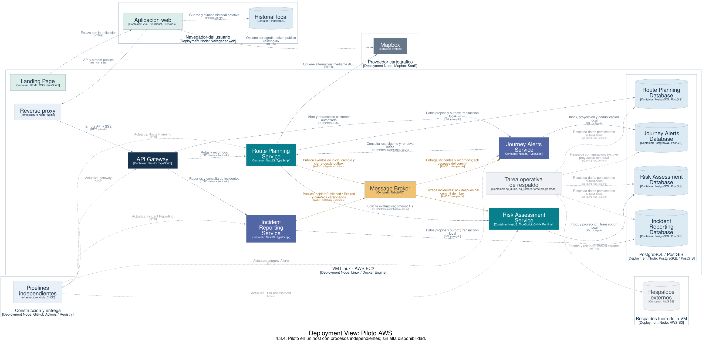

# Capítulo VII: Product Implementation, Validation & Deployment

## 7.1. Software Configuration Management

La gestión de configuración permite relacionar cada entrega con su código fuente, dependencias, contratos, pruebas y parámetros de ejecución. Se versionarán las fuentes y la configuración reproducible; los valores de acceso se administrarán por entorno. Cada producto tendrá una versión identificable y cada microservicio conservará su construcción, sus migraciones y su despliegue independientes.

El equipo distinguirá desarrollo local, validación y piloto. Una entrega deberá poder reconstruirse desde un commit y sus archivos de dependencias, comprobarse antes de publicarse y recuperarse mediante una versión anterior compatible.

### 7.1.1. Software Development Environment Configuration

La tecnología identifica con qué se construye un componente; el entorno define dónde se ejecuta y qué configuración, datos y conexiones utiliza. En VSafe, la misma base tecnológica se mantendrá entre desarrollo, validación y piloto, con valores propios para cada ambiente.

**Base tecnológica de VSafe**

La configuración toma como punto de partida las decisiones de los capítulos IV–VI. Las versiones exactas de las dependencias se fijarán al inicializar los proyectos y se registrarán en sus archivos de configuración y lockfiles.

| Componente | Tecnología definida | Configuración que deberá documentarse |
|---|---|---|
| Landing Page | HTML5, CSS3 y JavaScript | Estructura de páginas, recursos, idiomas y enlace de entrada a la aplicación. |
| Aplicación web | Vue 3, TypeScript, Vite y PrimeVue | Base `/app/`, navegación, tokens de diseño, traducciones y conexión con la API pública. |
| API Gateway | NestJS y TypeScript | Rutas públicas, verificación de sesión, contexto interno autorizado y retransmisión de SSE. |
| Servicios de negocio | NestJS y TypeScript | Proyecto, configuración y construcción propios para Route Planning, Risk Assessment, Incident Reporting y Journey Alerts. |
| Persistencia | PostgreSQL y PostGIS | Una base y un rol por servicio; migraciones, volúmenes y datos de prueba. |
| Mensajería | RabbitMQ | Conexiones, permisos, exchange, colas por suscripción y tratamiento de reentregas. |
| Evaluación de riesgo | ONNX Runtime para Node.js | Modelo, versión y checksum; condiciones para devolver `UNKNOWN`. |
| Cartografía externa | Mapbox | Adaptador de rutas, token del servidor y token público restringido para la visualización del mapa. |

**Herramientas del ciclo de vida**

Las herramientas se organizan según la actividad que apoyan. Sus referencias permiten preparar el equipo de trabajo y acceder a los servicios compartidos.

| Actividad | Producto de software | Propósito en VSafe | Referencia o instalación |
|---|---|---|---|
| Project Management y Requirements Management | Trello | Organizar el Product Backlog, los sprints y las tareas; relacionar tarjetas con los identificadores US y TS y sus criterios de aceptación. | [Trello](https://trello.com/) |
| Colaboración | Microsoft Teams | Realizar planning, coordinación y revisión; conservar los acuerdos y enlaces de cada reunión. | [Microsoft Teams](https://www.microsoft.com/microsoft-teams/group-chat-software) |
| Control de versiones | Git y GitHub | Registrar cambios, revisar Pull Requests y conservar código, pruebas y documentación por producto. | [Instalar Git](https://git-scm.com/downloads) · [GitHub](https://github.com/) |
| Investigación de usuarios | UXPressia | Mantener User Personas, Empathy Maps e Impact Mapping como referencia de requisitos. | [UXPressia](https://uxpressia.com/) |
| Modelado del dominio y datos | Lucidchart | Mantener EventStorming, diagramas UML y modelos de bases de datos. | [Lucidchart](https://www.lucidchart.com/) |
| Product Design | Figma | Consultar y evolucionar wireframes, mock-ups, flujos y componentes visuales. | [Figma](https://www.figma.com/) |
| Arquitectura de software | Structurizr | Mantener las vistas C4 y exportar los diagramas que acompañan al informe. | [Structurizr](https://docs.structurizr.com/) |
| Edición de código y documentación | Visual Studio Code | Editar HTML, CSS, JavaScript, TypeScript, Vue, Gherkin y Markdown con una configuración compartida. | [Descargar VS Code](https://code.visualstudio.com/download) |
| Entorno de ejecución | Node.js 24 LTS y npm | Ejecutar las herramientas de construcción y los servicios; instalar dependencias desde sus lockfiles. | [Descargar Node.js](https://nodejs.org/en/download) · [Ciclo de versiones](https://nodejs.org/en/about/previous-releases) |
| Landing Page Development | HTML5, CSS3 y JavaScript | Implementar el sitio informativo y sus CTA con contenido accesible y localizado. | [Referencia web de MDN](https://developer.mozilla.org/en-US/docs/Web) |
| Web Application Development | Vue 3, TypeScript, Vite y PrimeVue | Implementar la aplicación responsive y sus componentes con los tokens de diseño de VSafe. | [Vue](https://vuejs.org/guide/quick-start.html) · [TypeScript](https://www.typescriptlang.org/download/) · [Vite](https://vite.dev/guide/) · [PrimeVue](https://primevue.org/) |
| Web Services Development | NestJS y TypeScript | Implementar el gateway y los cuatro microservicios con módulos, validación y contratos propios. | [Instalación de NestJS](https://docs.nestjs.com/first-steps) |
| Persistencia geoespacial | PostgreSQL y PostGIS | Administrar las cuatro bases privadas y ejecutar consultas espaciales con permisos separados. | [PostgreSQL](https://www.postgresql.org/download/) · [PostGIS](https://postgis.net/documentation/getting_started/) |
| Mensajería | RabbitMQ | Propagar eventos entre servicios mediante colas, confirmaciones y consumidores idempotentes. | [Instalar RabbitMQ](https://www.rabbitmq.com/docs/download) |
| Inferencia de riesgo | ONNX Runtime para Node.js | Ejecutar un modelo versionado dentro de Risk Assessment cuando exista un artefacto validado. | [ONNX Runtime Node.js](https://onnxruntime.ai/docs/get-started/with-javascript/node.html) |
| Calidad de código | ESLint y Prettier | Comprobar reglas de código y aplicar formato consistente en desarrollo y CI. | [ESLint](https://eslint.org/docs/latest/use/getting-started) · [Prettier](https://prettier.io/docs/install) |
| Software Testing | Vitest, Jest, Cucumber.js y Playwright | Cubrir componentes Vue, unidades e integración de NestJS, escenarios Gherkin y recorridos del navegador. | [Vitest](https://vitest.dev/guide/) · [Jest](https://jestjs.io/docs/getting-started) · [Cucumber.js](https://github.com/cucumber/cucumber-js) · [Playwright](https://playwright.dev/docs/intro) |
| Ejecución reproducible | Docker Engine y Docker Compose | Levantar dependencias locales y ejecutar cada servicio como contenedor independiente. | [Docker Engine](https://docs.docker.com/engine/install/) · [Docker Compose](https://docs.docker.com/compose/install/) |
| Integración y publicación | GitHub Actions y GitHub Container Registry | Ejecutar comprobaciones y publicar imágenes identificadas por versión y commit. | [GitHub Actions](https://docs.github.com/en/actions) · [Publicación de imágenes](https://docs.github.com/en/actions/tutorials/publish-packages/publish-docker-images) |
| Software Deployment | AWS EC2, Amazon S3 y Nginx | Alojar el piloto, servir archivos estáticos, terminar HTTPS y conservar respaldos fuera de la VM. | [Amazon EC2](https://docs.aws.amazon.com/ec2/) · [Amazon S3](https://docs.aws.amazon.com/s3/) · [Nginx](https://nginx.org/en/docs/) |
| Software Documentation | Markdown, OpenAPI y Swagger UI | Mantener el informe, los README de instalación y los contratos de servicios con ejemplos y errores. | [Markdown en GitHub](https://docs.github.com/en/get-started/writing-on-github) · [OpenAPI en NestJS](https://docs.nestjs.com/openapi/introduction) |

**Entornos de ejecución**

| Entorno | Finalidad | Configuración y datos | Comprobación prevista |
|---|---|---|---|
| Desarrollo local | Implementar y probar cambios de un producto o servicio. | Configuración local a partir de `.env.example`, dependencias de Compose y datos de prueba controlados. | El proyecto se instala desde su lockfile, construye y ejecuta sus pruebas pertinentes. |
| Validación | Comprobar el incremento integrado antes de aceptarlo. | Commits identificados, configuración separada del piloto y datos de prueba compartidos por los casos de aceptación. | Las historias incluidas cumplen sus escenarios y el registro identifica versión, comandos y resultados. |
| Piloto | Publicar el incremento aceptado. | Dominio y HTTPS, configuración externa, almacenamiento persistente y respaldos según los componentes incorporados. | Las URL publicadas corresponden al manifiesto de la entrega y superan las comprobaciones del flujo disponible. |

**Preparación del entorno local**

1. Instalar Git, Visual Studio Code, Node.js 24 LTS y Docker con Compose. Verificar sus versiones mediante `git --version`, `node --version`, `npm --version`, `docker --version` y `docker compose version`.
2. Clonar los repositorios indicados en 7.1.2 y trabajar sobre la rama correspondiente. Durante la inicialización se fijará la versión exacta de Node.js en `.nvmrc` y se declarará su compatibilidad en `package.json`.
3. Instalar las dependencias de cada proyecto con `npm ci` una vez generado y versionado su `package-lock.json`. El mismo lockfile se utilizará en CI; las actualizaciones se revisarán mediante Pull Request.
4. Copiar `.env.example` a la configuración local de cada aplicación y completar sus valores. El archivo de ejemplo documentará nombres y propósito de variables; `.env` y las credenciales quedarán fuera del control de versiones.
5. Iniciar PostgreSQL/PostGIS y RabbitMQ con Compose. Crear `route_planning_db`, `risk_assessment_db`, `incident_reporting_db` y `journey_alerts_db`, cada una con su propio rol. Cada microservicio ejecutará únicamente las migraciones de su base.
6. Iniciar los productos incluidos en la iteración y comprobar sus scripts de formato, lint, tipos, pruebas y construcción. Las imágenes de infraestructura y las dependencias se fijarán a versiones concretas, evitando basar una entrega en etiquetas `latest`.

Los entornos de desarrollo, validación y piloto tendrán configuraciones y datos separados. Los ejemplos y las pruebas utilizarán ubicaciones de prueba; los registros técnicos omitirán coordenadas personales precisas. La interfaz y los mensajes contemplarán `en_US` por defecto y `es_419`, manteniendo los criterios de accesibilidad del capítulo VI.

### 7.1.2. Source Code Management

GitHub concentrará el control de versiones de los productos digitales de VSafe. El informe conservará la explicación de las decisiones y cada repositorio de código contendrá las instrucciones necesarias para construir, comprobar y ejecutar su producto.

| Producto o artefacto | Repositorio | Contenido previsto |
|---|---|---|
| Informe del proyecto | [Informe](https://github.com/VSAFE-Arquitecturas-Software-Emergentes/Informe) | Capítulos en Markdown y recursos de documentación. La rama `Chapter-07` contiene este capítulo y sus recursos. |
| Landing Page | [landing-page](https://github.com/VSAFE-Arquitecturas-Software-Emergentes/landing-page) | HTML, CSS y JavaScript; recursos visuales, contenido localizado, pruebas y configuración de publicación. |
| Aplicación web | [WebApp](https://github.com/VSAFE-Arquitecturas-Software-Emergentes/WebApp) | Proyecto Vue/TypeScript/PrimeVue, navegación, componentes, pruebas y construcción de archivos estáticos. |
| API Gateway y servicios REST | [Microservices](https://github.com/VSAFE-Arquitecturas-Software-Emergentes/Microservices) | Proyectos independientes del gateway y de Route Planning, Risk Assessment, Incident Reporting y Journey Alerts; contratos, pruebas, migraciones e imágenes por servicio. |

Para `Microservices` se propone un repositorio con varios proyectos. Compartir repositorio no modifica la propiedad de los datos ni obliga a desplegar todos los procesos juntos. Cada proyecto tendrá su propio `package.json`, lockfile, `Dockerfile`, configuración y pipeline seleccionable. Los cuatro servicios de negocio tendrán además sus migraciones privadas. El gateway mantendrá funciones de acceso y transporte.

```text
Microservices/
  services/
    api-gateway/
    route-planning/
    risk-assessment/
    incident-reporting/
    journey-alerts/
  contracts/
    http/
    events/
  deploy/
  .github/workflows/
```

Dentro de cada servicio, las pruebas acompañarán al código y los escenarios de aceptación se conservarán como texto en `test/features/*.feature`, junto con sus definiciones de pasos en TypeScript. Los contratos compartidos describirán mensajes y operaciones; las entidades y reglas de dominio permanecerán bajo su contexto propietario.

**Flujo de ramas**

Se aplicará GitFlow en los repositorios de producto, tomando como referencia el modelo de [Vincent Driessen](https://nvie.com/posts/a-successful-git-branching-model/). La rama estable se denominará `main`; en el repositorio del informe se conserva el nombre existente `Master`.

| Rama | Origen | Destino de integración | Convención y uso en VSafe |
|---|---|---|---|
| `main` | Inicialización del producto | Se actualiza desde release o hotfix | Versión estable de cada producto. Sus entregas se identifican mediante tags. |
| `develop` | Rama estable | Release | Integra funcionalidades aceptadas para la siguiente entrega. |
| `feature/<story-id>-<description>` | `develop` | `develop` | Una rama por historia o capacidad. Ejemplo: `feature/us03-open-web-app`. |
| `release/<version>` | `develop` | Rama estable y `develop` | Estabilización, pruebas y documentación de una versión. Ejemplo: `release/0.1.0`. |
| `hotfix/<version>` | Rama estable | Rama estable y `develop` | Corrección urgente de una versión publicada. Ejemplo: `hotfix/0.1.1`. Si existe una release abierta, también se incorpora allí. |

Los nombres de funcionalidades se escribirán en inglés y con palabras separadas por guiones. Cada Pull Request relacionará los IDs de historias y tareas, describirá el cambio e incluirá la comprobación realizada. La integración requerirá revisión por otro integrante y las comprobaciones del producto afectado. En `Microservices`, un cambio de servicio deberá comprobar sus contratos con los consumidores involucrados.

Las ramas `Chapter-XX` organizan la edición del informe por capítulo y no representan releases del software. Para consolidar `Chapter-07` en `Master` se incorporará el bloque del capítulo y sus recursos, conservando el contenido y los assets de los capítulos ya integrados.

**Versionado de entregas**

Se adoptará [Semantic Versioning 2.0.0](https://semver.org/) con el esquema `MAJOR.MINOR.PATCH`: cambios incompatibles en la API pública incrementan MAJOR; funcionalidades compatibles, MINOR; y correcciones compatibles, PATCH. Durante el desarrollo inicial se utilizarán versiones `0.y.z`, cuya API aún puede evolucionar. `0.1.0` es una referencia para la primera entrega, sujeta a aceptación.

Cada producto y microservicio mantendrá su versión. Un manifiesto de despliegue relacionará versiones, commits y digests de las imágenes compatibles. Un tag como `route-planning-v0.1.0` identificará el servicio dentro del repositorio compartido; la versión del artefacto seguirá siendo `0.1.0`. La versión de un contrato HTTP o de evento se administrará explícitamente y podrá evolucionar sin compartir entidades de dominio.

**Convención de commits**

Se aplicará [Conventional Commits 1.0.0](https://www.conventionalcommits.org/en/v1.0.0/) con el formato `type(scope): description`. Se utilizarán `feat`, `fix`, `docs`, `test`, `refactor`, `style`, `build`, `ci` y `chore` según el propósito del cambio. Los mensajes se redactarán en inglés; un cambio incompatible se señalará mediante `!` o el pie `BREAKING CHANGE:`.

```text
feat(landing): explain estimated route risk
fix(web): handle unavailable application access
test(gateway): reject an expired session
ci(route-planning): publish the service image
docs(chapter07): define sprint planning and backlog
```

Las historias y tareas se relacionarán en el cuerpo del commit o en el Pull Request. La trazabilidad permitirá pasar de una tarjeta del sprint a los cambios, las pruebas y la versión que la incorpora.

### 7.1.3. Source Code Style Guide & Conventions

La nomenclatura de código, archivos, pruebas y contratos se escribirá en inglés. El vocabulario respetará el lenguaje del dominio: `Route`, `Journey`, `IncidentReport`, `RiskAssessment` y `JourneyAlert` conservarán significados distintos. Los textos visibles se localizarán mediante claves de traducción.

Para TypeScript se toma como referencia la [guía de Google](https://google.github.io/styleguide/tsguide.html). Las convenciones de estructura de [NestJS](https://docs.nestjs.com/) y la [guía de Vue](https://vuejs.org/style-guide/) se adaptan a cada proyecto. ESLint y Prettier harán ejecutables las reglas acordadas.

| Elemento | Convención | Ejemplo |
|---|---|---|
| Clases, interfaces y tipos | `PascalCase`, con nombres del dominio; interfaces sin prefijo `I`. | `Journey`, `RouteProvider`, `RiskAssessmentResult` |
| Funciones, métodos y variables | `camelCase`; métodos expresan una acción. | `searchRoutes`, `confirmLocation`, `selectedRoute` |
| Constantes globales | `UPPER_SNAKE_CASE`; variables locales conservan `camelCase`. | `MAX_HISTORY_ITEMS` |
| Archivos NestJS | `kebab-case` con sufijo de responsabilidad. | `route-search.controller.ts`, `create-journey.dto.ts` |
| Componentes Vue | `PascalCase` y nombres de varias palabras. | `RouteSearchForm.vue`, `IncidentReportCard.vue` |
| Composables | Prefijo `use` y `camelCase`. | `useRouteSearch.ts` |
| Clases CSS y tokens | `kebab-case`; componentes con una convención consistente como BEM. | `.route-card__title`, `--color-brand-primary` |
| Recursos REST | Sustantivos en plural y rutas versionadas. | `/api/v1/incident-reports` |
| Propiedades JSON | `camelCase`; fechas de intercambio en ISO 8601 con zona horaria. | `occurredAt`, `routeVersion`, `correlationId` |
| Eventos de integración | Hechos en pasado; contrato con versión. | `IncidentPublished`, `JourneyClosed`, `schemaVersion` |
| Tablas y columnas | `snake_case`, con claves y restricciones explícitas. | `incident_reports`, `observed_at` |
| Pruebas TypeScript | Sufijo `.spec.ts` y descripción de comportamiento. | `journey.spec.ts` |
| Escenarios de aceptación | Archivos `.feature` en `kebab-case`, etiquetados con su historia. | `access-application.feature`, `@US03` |

Los estados serializados conservarán los valores definidos en los contratos, por ejemplo `LOW`, `MEDIUM`, `HIGH` y `UNKNOWN`. La ausencia de información suficiente se representará mediante `UNKNOWN` y su causa, conforme al diseño de Risk Assessment.

**Reglas de implementación**

- Activar la comprobación estricta de TypeScript y declarar tipos en los límites de los módulos. Las entradas externas se validarán antes de ejecutar los casos de uso.
- Mantener el dominio independiente de NestJS, ORM y transporte. Los controladores transformarán contratos y la aplicación coordinará los casos de uso mediante puertos propios.
- Separar DTO, agregado y modelo de persistencia. Cada servicio accederá a su base y a los demás servicios mediante los contratos autorizados.
- En Vue, utilizar componentes de responsabilidad acotada, props tipadas y eventos explícitos. Los estilos y tokens seguirán la identidad definida en el capítulo VI.
- En HTML, utilizar estructura semántica, etiquetas de campos, nombres accesibles y navegación por teclado. Los mensajes localizados estarán separados de la lógica.
- Documentar decisiones y contratos con comentarios útiles. Los errores usarán códigos estables, como `INVALID_LOCATION`, y mensajes localizables.

Se propone esta configuración común de [Prettier](https://prettier.io/docs/options); ESLint se configurará para evitar reglas de formato incompatibles:

```json
{
  "tabWidth": 2,
  "useTabs": false,
  "singleQuote": true,
  "semi": true,
  "trailingComma": "all",
  "printWidth": 100,
  "endOfLine": "lf"
}
```

Los archivos se guardarán en UTF-8. `.editorconfig` y `.gitattributes` establecerán indentación y finales de línea consistentes. Los Pull Requests comprobarán formato, lint, tipos, pruebas relacionadas y construcción antes de integrarse.

**Comprobación de las convenciones**

Durante la inicialización se definirán los scripts de cada producto. La revisión combinará comprobaciones automatizadas y lectura de los cambios de acuerdo con su alcance.

| Ámbito | Comprobación prevista | Salida para la revisión |
|---|---|---|
| TypeScript y JavaScript | ESLint, Prettier y comprobación de tipos donde corresponda. | Resultado de los scripts del commit presentado. |
| Vue y HTML | Compilación, props y eventos tipados, estructura semántica, foco y etiquetas. | Construcción y recorrido de los componentes afectados en escritorio y móvil. |
| Dominio e infraestructura | Revisión de imports, puertos, adaptadores y acceso a la base propietaria. | Cambios y pruebas relacionados con el contexto del capítulo V. |
| HTTP y eventos | Validación de contratos, respuestas de error, versiones y campos de correlación. | Contrato actualizado y resultados de sus casos aplicables. |
| Gherkin | Relación entre historia, escenarios y definiciones de pasos. | Archivos `.feature`, steps y resultado de ejecución de aceptación. |

**Convenciones Gherkin**

Las especificaciones seguirán la [referencia de Gherkin de Cucumber](https://cucumber.io/docs/gherkin/reference/). Cada escenario describirá un comportamiento observable con contexto, acción y resultado mediante `Given`, `When` y `Then`. Se redactarán en inglés y utilizarán datos controlados; los pasos no dependerán de selectores CSS ni de nombres internos de clases.

```gherkin
@US03
Feature: Access the VSafe web application
  Scenario: Application access is available
    Given a visitor has opened the VSafe landing page
    And the web application entry point is available
    When the visitor chooses to start using VSafe
    Then the visitor reaches the web application entry point

  Scenario: Application access is unavailable
    Given a visitor has opened the VSafe landing page
    And the web application entry point is unavailable
    When the visitor chooses to start using VSafe
    Then the visitor receives a clear unavailability message
```

### 7.1.4. Software Deployment Configuration

El piloto mantendrá la configuración planteada en la arquitectura: una VM Linux en AWS EC2 ejecutará contenedores independientes y un reverse proxy Nginx expondrá la entrada HTTPS. La landing y la aplicación se publicarán como archivos estáticos; el gateway y cada microservicio tendrán una imagen propia. El servidor PostgreSQL/PostGIS y RabbitMQ utilizarán almacenamiento persistente.

La configuración descrita corresponde al despliegue objetivo. La publicación inicial del Sprint 1 comprende la landing y la estructura de acceso de la aplicación; los servicios de negocio se incorporarán conforme a las historias de sus siguientes iteraciones. El dominio y las URL del piloto se registrarán al habilitar el entorno.

**Deployment Diagram de C4 Model**

La siguiente vista conserva el despliegue del modelo arquitectónico de VSafe. Muestra instancias y nodos del piloto, de acuerdo con el propósito del [Deployment Diagram de C4](https://c4model.com/diagrams/deployment). Las modificaciones del modelo se mantendrán en Structurizr.



*Figura 7.1. Despliegue objetivo del piloto de VSafe: procesos independientes en una VM, persistencia privada por servicio y respaldos externos. [Abrir la imagen completa](assets/Chapter-07/deployment-pilot-aws.png).*

| Elemento | Configuración prevista |
|---|---|
| Navegador | Ejecuta la aplicación Vue y conserva el historial optativo en IndexedDB, bajo los límites de retención definidos. |
| Reverse proxy | Sirve la landing y los archivos de la aplicación; publica HTTPS y enruta `/api/v1/` al gateway. |
| Aplicación web | Se construye con una base compatible con `/app/`; Vue Router resuelve `/app/map` y la recarga de rutas mediante el fallback de la aplicación. |
| API Gateway | Verifica la sesión, emite contexto interno autorizado y enruta HTTP/SSE sin acceder a las bases de negocio. |
| Route Planning | Integra Mapbox y Risk Assessment; utiliza exclusivamente `route_planning_db`. |
| Risk Assessment | Evalúa rutas con su proyección y un modelo ONNX validado; utiliza `risk_assessment_db` y devuelve `UNKNOWN` cuando corresponde. |
| Incident Reporting | Registra y procesa reportes; conserva outbox y relay propios en `incident_reporting_db`. |
| Journey Alerts | Consume eventos, mantiene proyecciones temporales y entrega SSE; utiliza `journey_alerts_db`. |
| PostgreSQL/PostGIS | Cuatro bases lógicas y roles separados sobre almacenamiento persistente. Las migraciones pertenecen a cada servicio. |
| RabbitMQ | Colas durables por suscripción, mensajes persistentes, confirmaciones y permisos por servicio en la red interna. |
| Respaldos | Copias por base fuera de la VM en Amazon S3, con acceso restringido y retención inicial de siete copias diarias. |

El navegador consumirá la API desde el mismo origen público. Nginx atenderá `/app/` como aplicación y `/api/v1/` como API, evitando que una operación de API devuelva el HTML del frontend. Para SSE, tanto el proxy como el gateway permitirán conexiones persistentes y heartbeats y deshabilitarán el buffering del flujo.

**Parámetros por entorno**

Los nombres siguientes constituyen la convención propuesta de configuración. Cada proyecto documentará los valores obligatorios y validará su presencia al iniciar.

| Parámetro | Consumidor | Propósito |
|---|---|---|
| `NODE_ENV`, `PORT`, `PUBLIC_ORIGIN` | Gateway y servicios según corresponda | Definir modo de ejecución, puerto y origen público permitido. |
| `DATABASE_URL` | Cada servicio de negocio | Acceder exclusivamente a la base del propietario con su rol correspondiente. |
| `AMQP_URL` | Productores y consumidores | Conectar al broker con credenciales y permisos del servicio. |
| `RISK_SERVICE_URL`, `ROUTE_PLANNING_SERVICE_URL` | Consumidores internos autorizados | Resolver servicios mediante DNS de la red de contenedores. |
| `MAPBOX_ACCESS_TOKEN` | Route Planning | Acceder a la integración cartográfica desde el servidor. |
| `VITE_MAPBOX_PUBLIC_TOKEN` | Aplicación web | Obtener cartografía con un token público restringido por origen y permisos. Los valores `VITE_*` quedan incluidos en el código del navegador. |
| `SESSION_SECRET`, `INTERNAL_AUTH_KEY` | Gateway y verificadores autorizados | Proteger la sesión y el contexto interno de acceso. |
| `MODEL_PATH`, `MODEL_VERSION`, `MODEL_SHA256` | Risk Assessment | Identificar y verificar el artefacto de inferencia aprobado. |

Las credenciales se suministrarán mediante la configuración protegida del entorno. PostgreSQL y RabbitMQ serán accesibles desde la red interna; la entrada pública de la aplicación se realizará por HTTPS. Los entornos de validación y piloto conservarán secretos, bases y colas separados.

**Proceso desde el repositorio hasta la publicación**

Cada producto tendrá una salida de construcción y una comprobación de publicación propias. La incorporación de los servicios de negocio se planificará junto con las historias que los requieren.

| Producto / repositorio | Artefacto que se publicará | Configuración de publicación | Comprobación de salida |
|---|---|---|---|
| Landing / `landing-page` | HTML, CSS, JavaScript y recursos estáticos. | Raíz pública de Nginx, rutas de idiomas y CTA hacia `/app/map`. | Contenido y recursos accesibles en ambos idiomas; CTA operable con teclado. |
| Aplicación / `WebApp` | Archivos estáticos generados por Vite. | Base `/app/`, fallback del router y origen de API del ambiente. | Entrada directa y recarga de `/app/map`, recursos resueltos y mensajes de acceso correspondientes. |
| Gateway / `Microservices` | Imagen independiente de `api-gateway`. | Rutas públicas y destinos internos, sesión y retransmisión de SSE. | Health checks, enrutamiento y controles de acceso de las operaciones incluidas. |
| Servicios de negocio / `Microservices` | Una imagen por Route Planning, Risk Assessment, Incident Reporting y Journey Alerts. | Base privada, migraciones y conexiones de cada propietario; modelo o broker cuando corresponda. | Readiness, contrato y recorrido funcional del servicio incorporado, manteniendo compatibles los demás. |

La secuencia de publicación será la siguiente:

1. Seleccionar el commit o tag de la entrega de cada producto y registrar la combinación en un manifiesto. Recuperar el código de `landing-page`, `WebApp` y los proyectos de `Microservices` incluidos en esa entrega.
2. Instalar las dependencias con la versión de Node fijada y los lockfiles versionados. Ejecutar formato, lint, comprobación de tipos, pruebas y construcción según el producto. Los servicios ejecutarán además sus escenarios de contrato e integración con dependencias controladas.
3. Preparar los archivos estáticos de la landing. Construir la aplicación Vue con base `/app/` y comprobar que su navegación y sus recursos utilizan esa ubicación. Incorporar ambas salidas a sus artefactos o imágenes de publicación.
4. Construir por separado las imágenes del gateway y de cada servicio incluido. Publicarlas en GitHub Container Registry y registrar sus versiones, commits y digests. GitHub Actions ejecutará trabajos seleccionables por producto o servicio.
5. Preparar la VM y sus redes, volúmenes, configuración y certificado HTTPS. Registrar el dominio del piloto y configurar Nginx para servir la landing, la aplicación y las rutas de API correspondientes.
6. Crear las bases y los roles privados de los servicios que se incorporan. Aplicar las migraciones de cada propietario y configurar el broker, sus usuarios, colas y almacenamiento. Verificar las dependencias antes de admitir tráfico.
7. Aplicar el manifiesto de la entrega. Para un cambio compatible, actualizar únicamente el producto o servicio afectado y conservar los digests de los demás. Las migraciones seguirán una evolución aditiva y el retiro de campos se pospondrá hasta retirar a sus consumidores antiguos.
8. Comprobar liveness y readiness de los procesos publicados y ejecutar una verificación del flujo incluido en la entrega. Para el Sprint 1 se comprobarán la landing, ambos idiomas, los CTA y `/app/map`; las consultas, reportes y SSE se comprobarán al incorporarse esos servicios.
9. Registrar las URL, el manifiesto, el resultado de las comprobaciones y la evidencia de publicación. Habilitar seguimiento de errores, latencia por servicio, antigüedad de outbox y colas pendientes según los procesos activos.

**Actualización y recuperación**

Cada publicación conservará el artefacto anterior para recuperar la versión del producto afectado. El rollback de una imagen requiere que su configuración, sus contratos y el esquema persistente sigan siendo compatibles; la recuperación de datos se realizará mediante un procedimiento específico y comprobado.

Se programarán respaldos diarios por base y pruebas de restauración. Los respaldos respetarán la eliminación de datos personales y excluirán el estado transitorio de recorridos cuando corresponda. La recuperación completa incluirá reconciliación de proyecciones y reanudación de eventos según los contratos de cada propietario.

El piloto comparte host, broker y servidor de persistencia. Su disponibilidad y sus objetivos de recuperación deberán medirse mediante pruebas; la independencia de los despliegues permite evolucionar después la distribución de la infraestructura.

## 7.2. Solution Implementation

La implementación se organizará en sprints que relacionan el objetivo de producto con historias del Product Backlog y tareas verificables. El avance se evaluará mediante los criterios de aceptación, la revisión del código, las pruebas y la publicación del incremento correspondiente.

Para la primera iteración se priorizan US01, US02 y US03, relacionadas con el descubrimiento de VSafe. Esta selección conserva la prioridad de la landing desde el primer sprint y permite entregar una presentación de la propuesta de valor conectada con el punto de entrada de la aplicación.

### 7.2.1. Sprint 1

El Sprint 1 propone entregar una landing responsive y bilingüe que explique cómo VSafe compara tiempo, distancia y riesgo estimado, presente sus capacidades y permita acceder a la estructura inicial de la aplicación. La implementación tomará como referencia los diseños del capítulo VI y mantendrá sus criterios de comunicación y accesibilidad.

El incremento comprende la landing, la navegación a `/app/map` y la infraestructura de construcción y publicación necesaria para ambos productos. Las historias de búsqueda, evaluación de riesgo, reportes y alertas mantienen su lugar en el Product Backlog para las siguientes iteraciones.

#### 7.2.1.1. Sprint Planning 1

La planificación inicial propone tres historias con **8 Story Points** y una duración de **dos semanas**, sujeta a la disponibilidad del equipo. La fecha, hora y asistencia se registrarán en el acta del planning; la capacidad y las asignaciones siguientes constituyen una propuesta para esa reunión.

**Sprint Planning Background**

| Campo | Detalle |
|---|---|
| Sprint # | Sprint 1 |
| Date | 2026-11-9 |
| Time | 09:00PM, zona horaria America/Lima. |
| Duración del planning | 30 minutos propuestos; inicio y fin por registrar al confirmar la reunión. |
| Location | Reunión virtual por Microsoft Teams|
| Prepared By | Renzo Sebastián Uribe Livia, propuesto como responsable del registro. |
| Attendees (to planning meeting) | Participantes propuestos: Oscar Leonardo Espinoza Quijandria, Renzo Sebastián Uribe Livia, Stephano Mayrzon Landauri Preciado y Gianfranco Jared Durand Vega. La asistencia se confirmará en el acta. |
| Inicio y cierre del sprint | Se propone una iteración de dos semanas. |
| Insumos del planning | Product Backlog del capítulo III, arquitectura de los capítulos IV y V, diseños del capítulo VI y repositorios de los productos digitales. |
| Sprint n − 1 Review Summary | No aplica: primera iteración de implementación. Se utilizan como insumos el Product Backlog y los diseños de los capítulos anteriores. |
| Sprint n − 1 Retrospective Summary | No aplica: primera iteración. Se propone iniciar con tareas acotadas, revisión por pares y bloqueos registrados en el tablero. |

**Sprint Goal & User Stories**

| Campo | Detalle |
|---|---|
| Sprint 1 Goal | Publicar una landing que permita comprender la propuesta y capacidades de VSafe y acceder al punto de entrada de la aplicación. El objetivo se cumple cuando las tres historias satisfacen sus seis escenarios de aceptación y los flujos se comprueban en `en_US` y `es_419`. |
| Sprint 1 Velocity | Pronóstico inicial de 8 Story Points. La velocidad observada se calculará después de la revisión contando únicamente historias aceptadas. |
| Sum of Story Points | **8 Story Points: US01 (3) + US02 (3) + US03 (2).** |
| Duración propuesta | Dos semanas; fechas de inicio y fin pendientes del planning. |
| Capacidad propuesta | 80 horas: cuatro integrantes con 20 horas disponibles cada uno durante la iteración. |
| Estimación del trabajo | 69 horas distribuidas en 18 tareas, 4 horas de coordinación del equipo y 7 horas de reserva: **80 horas en total**. Las horas de tareas y los Story Points son estimaciones distintas. |

| User Story ID | Historia | Resultado esperado | Story Points |
|---|---|---|---:|
| US01 | Comprender la propuesta de valor | Explicar el problema y la comparación por tiempo, distancia y riesgo estimado, junto con los beneficios de incidentes, alertas y colaboración. | 3 |
| US02 | Conocer las capacidades principales | Presentar búsqueda, alternativas, incidentes y alertas con explicaciones coherentes con la navegación urbana informada. | 3 |
| US03 | Acceder a la aplicación | Conectar la landing con la entrada de la aplicación y comunicar una indisponibilidad de acceso cuando corresponda. | 2 |
| **Total** | | | **8** |

**Distribución propuesta de responsabilidades**

Las asignaciones relacionan cada integrante con resultados concretos. La revisión de otro integrante se registrará en el Pull Request o en la comprobación de aceptación correspondiente.

| Integrante | Trabajo que realizará | Tareas |
|---|---|---|
| Renzo Sebastián Uribe Livia | Preparará la propuesta de valor y los contenidos por segmento; inicializará los repositorios, comprobará el acceso y consolidará la trazabilidad. | WI01, WI05, WI11, WI12, WI18 |
| Gianfranco Jared Durand Vega | Implementará el hero, los estilos responsive y los CTA; configurará los pipelines de ambos productos. | WI02, WI06, WI09, WI15 |
| Oscar Leonardo Espinoza Quijandria | Implementará las secciones de capacidades y la entrada Vue; resolverá la indisponibilidad y publicará el incremento. | WI04, WI08, WI10, WI16 |
| Stephano Mayrzon Landauri Preciado | Incorporará las traducciones, configurará calidad de código y revisará contenidos, accesibilidad y aceptación. | WI03, WI07, WI13, WI14, WI17 |

**Secuencia de trabajo y dependencias**

El calendario se expresa por etapas para completarlo con las fechas aprobadas en el planning. Las tareas independientes podrán avanzar a la vez; las dependencias concretas de cada tarea se detallan en 7.2.1.2.

| Periodo propuesto | Trabajo previsto | Salida esperada |
|---|---|---|
| Primera semana, inicio | WI01, WI12 y WI08: contenido base, repositorios y entrada de la aplicación. | Entorno inicial y estructura disponibles para los primeros cambios. |
| Primera semana, desarrollo | WI02–WI05 y WI13: landing, traducciones, segmentos y comprobaciones de código. | Componentes que puedan revisarse e integrarse. |
| Primera semana, cierre / segunda semana, inicio | WI06, WI07, WI09 y WI10: adaptación, revisión de contenido, CTA y acceso no disponible. | Recorrido completo desde la landing hasta la entrada de la aplicación. |
| Segunda semana, comprobación | WI11, WI14 y WI15: escenarios automatizados, accesibilidad y pipelines. | Resultados de pruebas y artefactos identificados por commit. |
| Segunda semana, cierre | WI16, WI17 y cierre de WI18: publicación, aceptación y trazabilidad. | URL del incremento, comprobación de los seis escenarios y registro para la revisión. |

La coordinación propone 30 minutos de planning, 20 minutos de review y 10 minutos de retrospectiva por integrante: una hora por persona y cuatro horas de equipo. Las siete horas de reserva permiten atender ajustes durante la iteración. El registro de avance y las revisiones técnicas forman parte de las tareas asignadas.

**Criterios de aceptación conservados para el sprint**

Los escenarios retoman los criterios de US01–US03 del capítulo III. Se presentan en texto para conservar su trazabilidad con las futuras pruebas de aceptación.

| Historia / escenario | Given | When | Then |
|---|---|---|---|
| US01 / 1 | El visitante accede a la landing. | Consulta la presentación del producto. | Comprende que VSafe compara rutas por tiempo, distancia y riesgo estimado. |
| US01 / 2 | El visitante revisa la propuesta. | Consulta los beneficios. | Identifica la visualización de incidentes, las alertas y los reportes comunitarios. |
| US02 / 1 | El visitante explora el contenido informativo. | Revisa las capacidades. | Encuentra la búsqueda de rutas, la comparación de alternativas, los incidentes y las alertas. |
| US02 / 2 | El visitante necesita más contexto. | Consulta una capacidad. | Recibe una explicación coherente con el propósito de seguridad urbana de VSafe. |
| US03 / 1 | El visitante decide utilizar VSafe y el acceso está disponible. | Solicita comenzar. | Accede al punto de entrada de la aplicación. |
| US03 / 2 | El acceso a la aplicación no está disponible. | El visitante intenta continuar. | Recibe información clara sobre la indisponibilidad. |

**Definition of Ready**

Antes de iniciar una tarea se identificarán el repositorio de destino, el responsable, el resultado verificable y los insumos necesarios. Las tareas dependientes utilizarán la salida revisada de sus predecesoras. Los accesos al ambiente y las configuraciones que falten se registrarán como bloqueos en la tarjeta correspondiente.

**Definition of Done del incremento**

Una historia se considerará terminada cuando sus criterios de aceptación se hayan comprobado, el código tenga revisión por pares y las comprobaciones del producto pasen. El incremento se verificará en ambos idiomas, con teclado y en los tamaños de pantalla definidos en el capítulo VI. El CTA deberá llegar a `/app/map`, y el caso de indisponibilidad deberá conservar un mensaje comprensible y una opción de reintento.

La revisión registrará las URL publicadas, los commits, las comprobaciones y la aceptación de las historias. Cada registro enlazará **historia → tarea → repositorio y rama → commit → prueba → resultado o URL**. La aceptación de una historia se evaluará sobre el conjunto de sus escenarios; el estado de cada tarea conservará su propia evidencia de cierre. La presentación de capacidades en la landing mantendrá correspondencia con el estado del producto y distinguirá los ejemplos ilustrativos.

#### 7.2.1.2. Sprint Backlog 1

El backlog descompone el objetivo del Sprint 1 en tareas de contenido, implementación, pruebas y publicación. Las tareas transversales preparan el entorno y la entrega de las tres historias; su esfuerzo se incluye en la capacidad de la iteración. Los responsables y las horas son asignaciones propuestas y el estado inicial de todas las tareas es `To-do`.

**Tablero del Sprint 1**

Se utilizará Trello con las columnas `To-do`, `In-Process`, `To-Review` y `Done`. Cada tarjeta indicará el ID de historia o su condición transversal, el ID de tarea, responsable, estimación, criterios y enlaces al Pull Request y a sus comprobaciones. Una tarjeta pasará a `To-Review` cuando esté lista para revisión y a `Done` cuando se cumplan los criterios definidos.

**Sprint # — Sprint 1**

Para facilitar la lectura de las asignaciones: Renzo = Renzo Sebastián Uribe Livia; Gianfranco = Gianfranco Jared Durand Vega; Oscar = Oscar Leonardo Espinoza Quijandria; Stephano = Stephano Mayrzon Landauri Preciado.

| User Story ID | User Story Title | Task ID | Task Title | Description | Estimation (Hours) | Assigned To | Status |
|---|---|---|---|---|---:|---|---|
| US01 | Comprender la propuesta de valor | WI01 | Define value proposition content | Redactar el problema, el beneficio y los límites de la estimación; revisar su coherencia con el perfil del producto. | 3 | Renzo | To-do |
| US01 | Comprender la propuesta de valor | WI02 | Build the landing hero | Implementar encabezado, presentación y estructura semántica del hero con la identidad de VSafe. | 4 | Gianfranco | To-do |
| US01 | Comprender la propuesta de valor | WI03 | Localize the value proposition | Incorporar la presentación en inglés y español, incluyendo nombres accesibles y textos alternativos. | 3 | Stephano | To-do |
| US02 | Conocer las capacidades principales | WI04 | Build capability sections | Implementar las explicaciones de rutas, incidentes, alertas y aportes comunitarios con ejemplos identificados como ilustrativos. | 4 | Oscar | To-do |
| US02 | Conocer las capacidades principales | WI05 | Describe audience journeys | Redactar los bloques de estudiantes y trabajadores y relacionarlos con los beneficios y CTA. | 3 | Renzo | To-do |
| US02 | Conocer las capacidades principales | WI06 | Apply responsive styles | Implementar tipografía, tokens, tarjetas, navegación y adaptación a escritorio y móvil según el capítulo VI. | 5 | Gianfranco | To-do |
| US02 | Conocer las capacidades principales | WI07 | Review capability consistency | Revisar contenidos en ambos idiomas, vigencia de las explicaciones y correspondencia entre landing, diseños e incremento. | 3 | Stephano | To-do |
| US03 | Acceder a la aplicación | WI08 | Create the application entry point | Inicializar Vue, TypeScript, PrimeVue y el router; disponer la estructura inicial de `/app/map`. | 5 | Oscar | To-do |
| US03 | Acceder a la aplicación | WI09 | Connect landing calls to action | Conectar los CTA principal y por segmento con la entrada de la aplicación y comprobar navegación por teclado. | 3 | Gianfranco | To-do |
| US03 | Acceder a la aplicación | WI10 | Handle unavailable application access | Implementar y comprobar la detección de acceso no disponible, el mensaje accesible y el reintento en un escenario controlado. | 4 | Oscar | To-do |
| US03 | Acceder a la aplicación | WI11 | Test application access scenarios | Automatizar acceso satisfactorio e indisponibilidad; comprobar enlaces, conservación del idioma y recarga de `/app/map`. | 4 | Renzo | To-do |
| — | Tarea transversal | WI12 | Initialize repositories and configuration | Preparar ramas, archivos de instalación, lockfiles, ejemplos de variables y exclusiones de configuración local. | 3 | Renzo | To-do |
| — | Tarea transversal | WI13 | Configure code quality checks | Configurar formato, lint, comprobación de tipos y las bases de pruebas necesarias en landing y WebApp. | 4 | Stephano | To-do |
| — | Tarea transversal | WI14 | Verify accessibility and localization | Revisar foco, etiquetas, contraste, tamaños de pantalla, inglés predeterminado y variante española en los flujos incluidos. | 4 | Stephano | To-do |
| — | Tarea transversal | WI15 | Configure product pipelines | Preparar las comprobaciones y artefactos de construcción de landing y WebApp mediante trabajos independientes. | 5 | Gianfranco | To-do |
| — | Tarea transversal | WI16 | Publish the first increment | Configurar el entorno de validación, HTTPS y Nginx; publicar ambos productos y comprobar sus rutas de acceso. | 5 | Oscar | To-do |
| — | Tarea transversal | WI17 | Review acceptance scenarios | Verificar los seis escenarios con otro integrante y registrar resultados, incidencias y correcciones necesarias. | 4 | Stephano | To-do |
| — | Tarea transversal | WI18 | Record sprint traceability | Mantener tarjetas, enlaces a cambios, resultados de comprobación y registro de publicación para la revisión del sprint. | 3 | Renzo | To-do |
| | | | **Total** | **18 tareas** | **69** | | |

**Dependencias y aceptación de las tareas**

Las siguientes salidas permitirán revisar cada tarea antes de cambiarla a `Done`. Los resultados se registrarán al ejecutarlas; los criterios describen lo que se deberá comprobar.

| Task ID | Dependencias para el cierre | Salida verificable |
|---|---|---|
| WI01 | Insumos de los capítulos I, III y VI. | Contenido revisado que explica tiempo, distancia y riesgo estimado y mantiene los límites de la propuesta de VSafe. |
| WI02 | WI01, WI12. | Hero y encabezado implementados; jerarquía semántica y acceso por teclado comprobados. |
| WI03 | WI01, WI02. | Presentación y nombres accesibles disponibles en inglés y español; selección de idioma comprobada. |
| WI04 | WI01, WI12. | Secciones de rutas, incidentes, alertas y comunidad implementadas, con ejemplos identificados y textos de ambos idiomas. |
| WI05 | WI01. | Bloques de estudiantes y trabajadores revisados y relacionados con sus beneficios y el acceso a VSafe. |
| WI06 | WI02, WI04, WI05. | Landing operable en los tamaños del capítulo VI, con tokens consistentes y contenido principal sin desbordamiento horizontal. |
| WI07 | WI03, WI04, WI05, WI06. | Revisión de contenidos y capacidades de ambos idiomas registrada; observaciones resueltas en la versión presentada. |
| WI08 | WI12. | Proyecto Vue/TypeScript/PrimeVue que construye y permite abrir y recargar directamente `/app/map`. |
| WI09 | WI06, WI08. | CTA principal y por segmento alcanzan la entrada de la aplicación y conservan la preferencia de idioma. |
| WI10 | WI08, WI09. | Caso controlado de entrada no disponible que presenta mensaje accesible y permite reintentar. |
| WI11 | WI09, WI10, WI13. | Pruebas del acceso disponible e indisponible ejecutadas, con comando, commit y resultado registrados. |
| WI12 | URL y acceso a los repositorios de producto. | Estructura inicial, ramas, instrucciones, lockfiles y ejemplos de configuración disponibles para los proyectos del incremento. |
| WI13 | WI08, WI12. | Scripts de formato, lint, tipos y pruebas aplicables definidos; su ejecución inicial queda documentada. |
| WI14 | WI03, WI06, WI07, WI09, WI10. | Recorrido con teclado, foco, etiquetas, contraste, adaptación e idioma comprobado; problemas que impidan las operaciones corregidos y observaciones restantes registradas. |
| WI15 | WI08, WI12, WI13. | Cada producto genera su artefacto mediante un trabajo independiente; el registro identifica commit y resultado de las comprobaciones. |
| WI16 | WI11, WI14, WI15. | Landing y entrada web publicadas por HTTPS; URL, versión y recarga de rutas comprobadas en el ambiente de validación. |
| WI17 | WI16. | Los seis escenarios del sprint se revisan con otro integrante sobre el incremento publicado y se registra su resultado. |
| WI18 | Registro durante el sprint; cierre después de WI17. | Tablero e informe relacionan tareas, cambios, comprobaciones y publicación; la review conserva el estado de aceptación de cada historia. |

**Resumen de capacidad propuesta**

| Integrante | Horas de tareas | Coordinación | Reserva | Capacidad total |
|---|---:|---:|---:|---:|
| Renzo Sebastián Uribe Livia | 16 | 1 | 3 | 20 |
| Gianfranco Jared Durand Vega | 17 | 1 | 2 | 20 |
| Oscar Leonardo Espinoza Quijandria | 18 | 1 | 1 | 20 |
| Stephano Mayrzon Landauri Preciado | 18 | 1 | 1 | 20 |
| **Total** | **69** | **4** | **7** | **80** |

La inicialización de repositorios y herramientas habilita los primeros cambios. Los contenidos y componentes de la landing pueden avanzar en paralelo con la entrada de la aplicación; la conexión de los CTA depende de que esa entrada esté disponible. Las comprobaciones integradas preceden a la publicación y a la aceptación del incremento. Los bloqueos y ajustes de alcance se registrarán en el tablero durante el sprint.

### 7.2.1.3. Development Evidence for Sprint Review

A continuación, se presenta una recopilación visual del historial
de commits de los repositorios Informe, Microservices, WebApp y
landing-page del proyecto VSafe, como evidencia del trabajo
registrado durante el sprint.

<p align="center">
  
</p>

<p align="center">
  <em>Figura. Recopilación del historial de commits de VSafe.</em>
</p>

#### 7.2.1.4. Testing Suite Evidence for Sprint Review

El Sprint 1 comprende las historias US01 (comprender la propuesta de valor), US02 (conocer las capacidades principales) y US03 (acceder a la aplicación). La evidencia de las pruebas se presenta por nivel: pruebas unitarias, de integración y de aceptación. Se incluye la cobertura adicional implementada en el MVP para rutas, recorridos, incidentes, alertas y estimación de riesgo.

##### Unit Tests

Se identificaron tres casos automatizados en WebApp y quince en Microservices. Los archivos incluyen comprobaciones de lógica de dominio y de dependencias entre capas. La tabla indica el componente y el comportamiento comprobado por cada caso o grupo de casos.

| Repositorio | Clase, función o componente | Comportamiento comprobado | Casos |
| --- | --- | --- | ---: |
| WebApp | `currentHistory` | Descarta entradas caducadas y limita el historial a 20 elementos. | 1 |
| WebApp | `projectPosition` | Determina el segmento, la fracción recorrida y la distancia desde una posición GPS. | 1 |
| WebApp | Capas de dominio y aplicación | Comprueba que las capas revisadas carezcan de importaciones directas de Vue y adaptadores de infraestructura. | 1 |
| Microservices | `JourneyAggregate` | Verifica el ciclo de vida, las versiones y el cierre del recorrido. | 1 |
| Microservices | `JourneyPolicy` | Valida cambios de ruta según estado y versión, rechaza muestras antiguas y segmentos inválidos, y calcula la geometría restante. | 3 |
| Microservices | `IncidentAggregate` | Impide publicar duplicados y verifica que la expiración incremente la versión una vez. | 1 |
| Microservices | `RiskAssessmentAggregate` | Rechaza versiones de modelo mezcladas, comparaciones incompletas y puntuaciones asignadas a `UNKNOWN`. | 1 |
| Microservices | `RiskService` | Rechaza un modelo sintético fuera del modo demo explícito. | 1 |
| Microservices | `RiskPolicy` | Devuelve incertidumbre ante muestras insuficientes, proyecciones desactualizadas, modelos sin validar o cobertura insuficiente. | 2 |
| Microservices | `AlertPolicy` | Evalúa la proximidad, la vigencia del progreso y el periodo activo para emitir alertas. | 1 |
| Microservices | `ReportPolicy` | Valida la antigüedad y vigencia de observaciones y aproxima las coordenadas del reporte. | 2 |
| Microservices | `targetFor` | Impide enrutar endpoints internos desde el gateway y asigna los endpoints públicos a sus servicios. | 1 |
| Microservices | `canonical` y `commitment` | Conservan el compromiso ante cambios en el orden de claves y detectan modificaciones del contenido. | 1 |
| Microservices | Capas de dominio y aplicación | Comprueba las restricciones de dependencias de los cuatro servicios revisados. | 1 |

##### Integration Tests

El archivo `scripts/integration.mjs` contiene 14 comprobaciones de integración para el MVP. Utiliza el API Gateway en modo demo y requiere servicios locales, PostgreSQL/PostGIS, RabbitMQ y la red local de Hardhat. Las historias de la tabla pertenecen al Product Backlog y amplían el alcance funcional del Sprint 1.

| Servicio o flujo | Comprobaciones diseñadas | Historias relacionadas |
| --- | --- | --- |
| API Gateway | Rechazo de solicitudes sin protección CSRF y de acceso a recorridos desde otra sesión. | US08, TS04 |
| Route Planning y Risk Assessment | Búsqueda de rutas, abstención ante evidencia insuficiente, proyección de eventos de RabbitMQ hacia ONNX y reconciliación ante una secuencia incompleta. | US06, US07, TS01, TS02 |
| Route Planning | Inicio idempotente del recorrido, rechazo de solicitudes con contenido incompatible bajo la misma clave, rechazo de actualizaciones obsoletas, cierre y propagación del evento. | US08 |
| Incident Reporting y blockchain | Idempotencia, detección de duplicados espaciales, autorización de la auditoría, verificación del compromiso en Solidity y detección de un registro alterado. | US13, US16, TS03 |
| Journey Alerts | Entrega de una alerta por SSE a través del gateway y confirmación de recepción. | US10 |
| Persistencia | Rechazo de una conexión a la base de otro servicio con un rol ajeno. | Control técnico transversal |

Microservices incluye además `scripts/load.mjs` para pruebas de carga. Su ejecución quedó pendiente.

##### Acceptance Tests

Se identificaron cinco escenarios de navegador implementados con Playwright, uno en landing-page y cuatro en WebApp.

| Repositorio | Escenario automatizado | Relación con historias o tareas |
| --- | --- | --- |
| landing-page | Abre la landing, comprueba el encabezado, verifica el destino del CTA, cambia entre inglés y español y revisa el ancho móvil. | Cobertura parcial de US01 y US03. La adaptación móvil se relaciona con WI06 de US02. |
| WebApp | Introduce coordenadas manuales y verifica que la ruta solicitada use la coordenada ingresada. | US04 y entrada manual relacionada con US05. |
| WebApp | Activa el historial, compara rutas, inicia y finaliza un recorrido y vuelve a consultar la ruta desde el historial. | US06, US08 y US12. |
| WebApp | Revisa un reporte, comprueba que el formulario conserve los datos al cancelar, envía el reporte y consulta la evidencia de integridad. | US13 y US16. |
| WebApp | Comprueba que las vistas principales no tengan desplazamiento horizontal en móvil y que la comparación muestre alternativas. | US06 y comprobación transversal de interfaz móvil. |

##### Resultados de ejecución

Se ejecutaron las tres pruebas de dominio de WebApp con Node.js 24.8.0 y un cargador auxiliar de importaciones TypeScript. El resultado fue **3 aprobadas y 0 fallidas**. Los scripts oficiales de npm se detuvieron antes de ejecutar las suites debido a dependencias faltantes. La instalación se bloqueó por un error de resolución DNS del registro npm y por paquetes ausentes de la caché local. Las pruebas de navegador, integración y carga quedaron pendientes.

<p align="center">
  
</p>

<p align="center">
  <em>Figura. Ejecución de las pruebas de dominio de VSafe WebApp con Node.js 24.8.0.</em>
</p>

#### 7.2.1.5. Execution Evidence for Sprint Review

Durante el Sprint 1 se implementó la landing page de VSafe para presentar su propuesta de valor y explicar cómo la aplicación permite definir un recorrido, comparar rutas y recibir alertas. En la ejecución local se verificaron el cambio de idioma de inglés a español y la navegación desde el menú principal hasta la sección «Cómo funciona».

<p align="center">
  
</p>
<p align="center"><em>Figura. Pantalla de inicio de la landing page de VSafe.</em></p>

<p align="center">
  
</p>
<p align="center"><em>Figura. Sección «Cómo funciona», que presenta las capacidades principales de VSafe.</em></p>

[Video de visualización y navegación de la landing page](assets/Chapter-07/VSafe_Sprint1_Landing.mp4)
